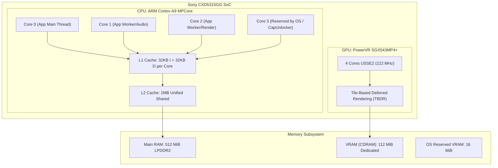
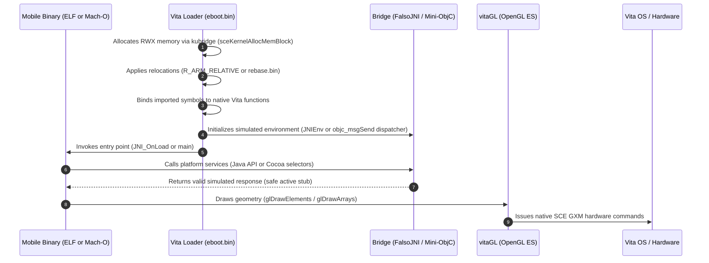

<div class="chapter-hero">
  <span class="chapter-badge">Chapter 00 • Core Foundations</span>
  <h1 style="margin: 0.4rem 0 0.6rem 0; font-size: 2rem;">Hardware Architecture & SoLoader Theory</h1>
  <p style="margin: 0; opacity: 0.9; font-size: 1.05rem;">
    Comprehensive breakdown of PlayStation Vita's silicon limits (Cortex-A9, SGX543MP4+, CDRAM) and the mathematical rationale behind zero-overhead native ARMv7 execution.
  </p>
  <div class="chapter-meta">
    <span class="chapter-meta-pill">⚡ Level: Fundamental</span>
    <span class="chapter-meta-pill">🧠 Focus: ARMv7-A, SGX543 TBDR, CDRAM vs RAM</span>
    <span class="chapter-meta-pill">🎮 Verified: Hero of Sparta, Zenonia 3, Badland 2</span>
  </div>
</div>

---

## 🔬 PS Vita Hardware Architecture



### 1. The CPU (ARM Cortex-A9 MPCore)
The PlayStation Vita features an **ARM Cortex-A9** 32-bit quad-core processor (ARMv7-A architecture).
- **Default Factory Clock:** 333 MHz (underclocked by Sony to preserve battery and thermals).
- **Maximum Stable Native Clock:** 444 MHz CPU / 222 MHz GPU / 166 MHz Bus (unlocked via VitaSDK power management APIs).
- **Caches:** 32 KiB L1 instruction + 32 KiB L1 data cache per core; 2 MiB unified shared L2 cache.
- **Floating Point Unit:** Hardware VFPv3-D32 and 128-bit SIMD NEON engine.
- **The 4th Core:** Reserved by default for VitaOS background services. Using GrapheneCt's [CapUnlocker](https://github.com/GrapheneCt/CapUnlocker) kernel plugin, homebrew applications can claim this core by setting affinity mask `0x80000` via `sceKernelChangeThreadCpuAffinityMask()`.

=== "C (Power & Clock Overclocking)"
    ```c
    #include <vitasdk.h>

    void init_vita_hardware_performance(void) {
        // Boost CPU, GPU, and Bus to maximum factory capability
        scePowerSetArmClockFrequency(444);
        scePowerSetBusClockFrequency(222);
        scePowerSetGpuClockFrequency(222);
        scePowerSetGpuXbarClockFrequency(166);

        // Optional: Disable screen dimming during gameplay
        sceKernelPowerTick(SCE_KERNEL_POWER_TICK_DEFAULT);
    }
    ```

=== "C (CapUnlocker 4th Core Affinity)"
    ```c
    #include <vitasdk.h>

    // Core affinity bitmasks
    #define VITA_CORE_0 0x10000
    #define VITA_CORE_1 0x20000
    #define VITA_CORE_2 0x40000
    #define VITA_CORE_3 0x80000 // Requires CapUnlocker plugin installed

    void assign_audio_thread_to_core3(SceUID thread_id) {
        // Free up Core 0 and Core 1 for the game's main engine and rendering loop
        sceKernelChangeThreadCpuAffinityMask(thread_id, VITA_CORE_3);
    }
    ```

---

### 2. The GPU (PowerVR SGX543MP4+)
A 4-core PowerVR Series5XT graphics chip clocked up to 222 MHz, utilizing a **Tile-Based Deferred Rendering (TBDR)** pipeline.
- The GPU breaks the screen into 16x16 pixel tiles, performing Hidden Surface Removal (HSR / Early-Z) *before* fragment shading occurs, conserving massive amounts of memory bandwidth.
- Alpha-testing (`discard` in shaders) can cause the GPU to fall back to a slower multi-pass path; optimizing textures and shaders in vitaGL yields major framerate gains.

### 3. Main Memory vs Video Memory (CDRAM)
Physically, the Vita has two distinct memory buses and partitions:

| Memory Partition | Physical Size | Usable by Homebrew | Role and Characteristics |
|---|---|---|---|
| **Main RAM** | 512 MiB | ~300 MiB to 420 MiB | System RAM accessible by CPU. Houses code, heap, the loaded `.so` binary, decompressed assets, and the FalsoJNI runtime. |
| **CDRAM (VRAM)** | 128 MiB | **112 MiB** | Ultra-fast VRAM directly tied to the GPU bus. Used for framebuffers, active textures, vertex and index buffers. |
| **System VRAM** | 16 MiB | 0 MiB | Reserved by VitaOS for LiveArea UI and system overlays. |

=== "C (Memory Budget Telemetry)"
    ```c
    #include <vitasdk.h>
    #include <stdio.h>

    void print_memory_telemetry(void) {
        SceKernelFreeMemorySize info;
        info.size = sizeof(SceKernelFreeMemorySize);
        sceKernelGetFreeMemorySize(&info);

        printf("[MEMORY] Free User RAM: %u MB\n", info.size_user / (1024 * 1024));
        printf("[MEMORY] Free CDRAM: %u MB\n", info.size_cdram / (1024 * 1024));
    }
    ```

---

## 💡 What is the SoLoader Technique?

Most emulators interpret alien CPU instructions or translate them dynamically via a JIT (Just-In-Time) compiler. **The SoLoader technique is neither an emulator nor a recompiler.**

### Why does Android ARMv7 execute NATIVELY on PS Vita?
Both the PlayStation Vita and 2010–2016 era Android smartphones share the **exact same Instruction Set Architecture: ARMv7-A (32-bit)** with Thumb-2 instructions and VFP/NEON.

When a game is built for Android using the Android NDK in C++, the compiler outputs an ELF shared library: `libgame.so`. That binary contains **raw, bare-metal ARM machine instructions**.

| Platform | CPU ISA | Binary Format | Calling Convention | OS / Runtime Layer |
|---|---|---|---|---|
| **Android 32-bit** | ARMv7-A (Cortex-A8/A9/A15) | ELF32 (`.so`) | AAPCS standard | Bionic Libc + Java VM (JNI) |
| **Apple iOS 32-bit** | ARMv7-A (Cortex-A8/A9) | Mach-O 32-bit (`MH_EXECUTE`) | Darwin ARM ABI (r9 scratch, stack 4B) | Darwin Libc + Objective-C Runtime |
| **PlayStation Vita** | ARMv7-A (Cortex-A9 MPCore) | ELF32 / Sony SELF (`eboot.bin`) | AAPCS (SoftFP / HardFP) | VitaOS Microkernel + Newlib Libc |

Because the PlayStation Vita CPU inherently understands the ARM opcodes in both Android and iOS binaries, **the Vita executes the game's code directly on bare-metal silicon with ZERO CPU emulation overhead.**



### The Dual Guest Ecosystems: Android & iOS
If instructions are natively compatible, why can't we run the binary directly?
Because the compiled code expects its original operating system environment:
1. **The Android Environment (ELF):** Expects Android's standard C library (**Bionic libc**), **EGL** surface graphics, audio via **OpenSL ES** or **AudioTrack**, and the **Dalvik/ART** virtual machine for **JNI** calls. Handled by the ELF loader and **FalsoJNI**.
2. **The iOS Environment (Mach-O):** Expects **Darwin libc**, graphics via **EAGLContext / CAEAGLLayer**, audio via **CoreAudio / AudioQueue**, and system service invocation through the **`objc_msgSend`** dynamic messaging dispatcher. Handled by the Mach-O loader and the pure C **Mini-Runtime Objective-C**.

The **Vita Loader** (compiled into your `eboot.bin`) fulfills this role:
- Maps code and data segments into Vita memory.
- Adjusts all absolute memory pointers (`.rel.dyn` in ELF or `rebase.bin` in Mach-O).
- Intercepts imported functions (`malloc`, `memcpy`, `glDrawArrays`) and routes them to VitaSDK and vitaGL.
- Supplies the simulated platform layer, answering queries for storage paths, controllers, and audio without needing full OS emulation.
