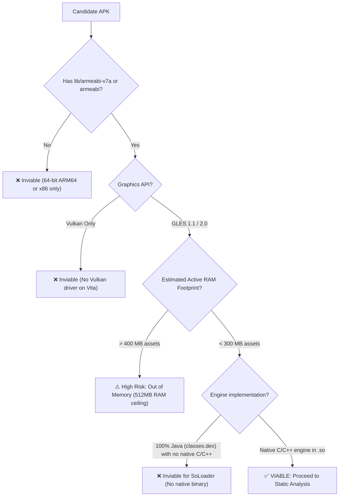

<div class="lang-switch-bar">
  <span>🌐 Language / Idioma:</span>
  <a href="../02-apk-triage-and-selection/" class="lang-switch-link active">🇬🇧 English</a>
  <a href="../es/02-triaje-y-seleccion-apk/" class="lang-switch-link">🇪🇸 Español</a>
  <a href="../pt/02-triagem-e-selecao-apk/" class="lang-switch-link">🇧🇷 Português</a>
</div>

<div class="chapter-hero">
  <span class="chapter-badge">Chapter 02 • Viability & Triage</span>
  <h1 style="margin: 0.4rem 0 0.6rem 0; font-size: 2rem;">APK Triage & Viability Analysis</h1>
  <p style="margin: 0; opacity: 0.9; font-size: 1.05rem;">
    Systematic checklist and automated diagnostics to evaluate an Android APK's architecture (ARMv7 vs ARM64), graphics pipeline (GLES 1.1 vs 2.0 vs Vulkan), memory footprint, and native code ratio before writing a single line of loader code.
  </p>
  <div class="chapter-meta">
    <span class="chapter-meta-pill">⚡ Level: Intermediate</span>
    <span class="chapter-meta-pill">🔍 Focus: ABI Triage, GLES Detection, Memory Feasibility</span>
    <span class="chapter-meta-pill">🎮 Case Studies: Hero of Sparta, Zenonia 3, Badland 2</span>
  </div>
</div>

---

## 📦 APK Anatomy & Structure

An `.apk` file is a standard **ZIP archive** containing bytecode, assets, and native shared libraries:

```
game.apk (ZIP)
├── AndroidManifest.xml        # Binary manifest (Java package, GLES version, permissions)
├── classes.dex                # Dalvik executable bytecode for Java classes
├── assets/                    # Game assets (models, textures, audio tracks, levels)
├── res/                       # Android UI layouts and application icons
├── lib/                       # COMPILED NATIVE SHARED LIBRARIES (.so)
│   ├── armeabi/               # ARMv5/v6 binaries (32-bit, soft-float) [COMPATIBLE]
│   ├── armeabi-v7a/           # ARMv7-A binaries (32-bit, Thumb-2, VFPv3/NEON) [OPTIMAL]
│   ├── arm64-v8a/             # ARMv8 binaries (64-bit) [INCOMPATIBLE ON VITA]
│   └── x86/                   # Intel x86 binaries [INCOMPATIBLE]
└── META-INF/                  # APK cryptographic signatures
```

---

## 🔍 Criterion 1: Architecture Compatibility (ABI)

Inspect the `lib/` directory inside the APK:

```bash
unzip -l game.apk "lib/*"
```

| ABI Folder | Verdict | Technical Reality on PS Vita |
|---|---|---|
| **`lib/armeabi-v7a/`** | **OPTIMAL (Ideal)** | 32-bit ARMv7 code with Thumb-2 and NEON SIMD vectorization. Exactly matches the Vita's Cortex-A9 CPU. |
| **`lib/armeabi/`** | **COMPATIBLE** | 32-bit ARMv5TE/v6 code with soft-float arithmetic. Runs natively on Vita because ARMv7 is a strict superset of ARMv6. |
| **`lib/arm64-v8a/`** | **INCOMPATIBLE** | 64-bit AArch64 instructions. The PS Vita is strictly a 32-bit machine. If the APK only contains 64-bit binaries, search for an earlier release of the game (pre-August 2019, when Google mandated 64-bit binaries). |
| **`lib/x86/` / `lib/x86_64/`** | **INCOMPATIBLE** | Intel/AMD x86 instruction sets. |

---

## 🎨 Criterion 2: Graphics API (OpenGL ES)

The PS Vita hardware GPU supports **OpenGL ES 1.1** and **OpenGL ES 2.0** via [vitaGL](https://github.com/Rinnegatamante/vitaGL).

### Detecting the OpenGL ES Version:

=== "Inspection Commands"
    ```bash
    # Extract .so from APK
    unzip -j game.apk "lib/armeabi-v7a/*.so" -d ./so_dump/

    # Check for GLES 1.1 fixed-function symbols
    arm-vita-eabi-nm -D so_dump/libgame.so | grep -E "glVertexPointer|glColorPointer|glMatrixMode"

    # Check for GLES 2.0 programmable shader symbols
    arm-vita-eabi-nm -D so_dump/libgame.so | grep -E "glCreateShader|glCompileShader|glUniformMatrix4fv"

    # Check for Vulkan (Fatal blocker)
    arm-vita-eabi-nm -D so_dump/libgame.so | grep -E "vkCreateInstance|vkCreateDevice"
    ```

=== "Interpretation"
    - **GLES 1.1 Found:** Handled with extreme performance by vitaGL's fixed-function pipeline (e.g. *Hero of Sparta*, *Zenonia 1/2/3*).
    - **GLES 2.0 Found:** Uses vitaGL's programmable shader pipeline with runtime shader compilation (e.g. *Badland 2*, *Dead Space*).
    - **Vulkan Found:** PS Vita has **no** Vulkan hardware driver. Port is impossible unless an OpenGL ES fallback path exists.

---

## 🔗 Criterion 3: NDK Dependencies & Dynamic Linking

Check the external shared libraries imported by `libgame.so`:

```bash
arm-vita-eabi-readelf -d so_dump/libgame.so | grep NEEDED
```

| Dependency | Status | Handling on PS Vita |
|---|---|---|
| `libc.so`, `libm.so`, `libdl.so` | **Supported** | Routed directly to VitaSDK Newlib functions. |
| `libGLESv1_CM.so` / `libGLESv2.so` | **Supported** | Routed to `vitaGL`. |
| `liblog.so` | **Supported** | Routed to Vita logging (`sceClibPrintf` / file log). |
| `libz.so` | **Supported** | Linked against `zlib` from VitaSDK. |
| `libOpenSLES.so` | **Supported** | Reimplemented using `sceAudio` or `OpenAL-Soft`. |
| `libunity.so` / `libmono.so` | **Complex** | Older Unity titles with Mono are possible; modern IL2CPP ARMv7 games often exceed the Vita's 512MB RAM budget. |

---

## ⚡ Automated APK Triage Script

Save this script as `triage_apk.sh` to quickly analyze any candidate game:

=== "Bash (triage_apk.sh)"
    ```bash
    #!/usr/bin/env bash
    set -euo pipefail

    APK="$1"
    echo "=== PS VITA APK TRIAGE: $APK ==="

    # 1. ABI Check
    echo "[1/4] Checking ABI architectures..."
    ABIS=$(unzip -l "$APK" "lib/*" 2>/dev/null | grep -oE "lib/(armeabi-v7a|armeabi|arm64-v8a|x86)" | sort -u || true)
    echo "$ABIS"

    if echo "$ABIS" | grep -q "armeabi-v7a"; then
        echo "✅ Found armeabi-v7a: Optimal 32-bit ARMv7 binary."
    elif echo "$ABIS" | grep -q "armeabi"; then
        echo "⚠️ Found armeabi: Compatible 32-bit ARMv5/v6 binary."
    else
        echo "❌ FAILED: No 32-bit ARM binaries found. Port is inviable."
        exit 1
    fi

    # 2. Extract SO to temp directory
    TMPDIR=$(mktemp -d)
    trap "rm -rf $TMPDIR" EXIT
    unzip -q "$APK" "lib/armeabi*/*.so" -d "$TMPDIR"

    # 3. Check Graphics Symbols
    echo "[2/4] Analyzing Graphics APIs in native libraries..."
    SO_FILE=$(find "$TMPDIR" -name "*.so" | head -n 1)
    echo "Inspecting: $(basename "$SO_FILE")"

    if nm -D "$SO_FILE" 2>/dev/null | grep -qE "glCreateShader|glCompileShader"; then
        echo "🎨 Graphics: OpenGL ES 2.0 (Programmable Pipeline)"
    elif nm -D "$SO_FILE" 2>/dev/null | grep -qE "glVertexPointer|glMatrixMode"; then
        echo "🎨 Graphics: OpenGL ES 1.1 (Fixed-Function Pipeline)"
    else
        echo "❓ Graphics: Custom or Software Renderer"
    fi

    # 4. Check Vulkan blocker
    if nm -D "$SO_FILE" 2>/dev/null | grep -qE "vkCreateInstance"; then
        echo "❌ BLOCKED: Vulkan symbols detected with no apparent GLES fallback."
    else
        echo "✅ Vulkan Clean: No Vulkan driver dependencies."
    fi

    echo "=== TRIAGE COMPLETE ==="
    ```

---

## 🚦 Viability Decision Matrix


