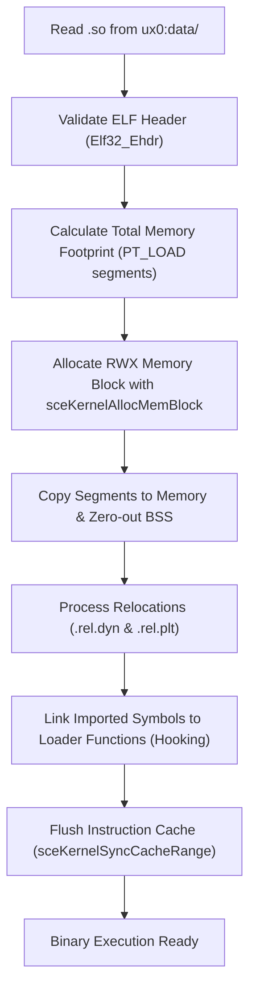

<div class="chapter-hero">
  <span class="chapter-badge">Chapter 04 • Core Runtime</span>
  <h1 style="margin: 0.4rem 0 0.6rem 0; font-size: 2rem;">SoLoader Core & Relocations</h1>
  <p style="margin: 0; opacity: 0.9; font-size: 1.05rem;">
    Low-level mechanics of loading Android ELF32 binaries into executable memory on PlayStation Vita, parsing program headers, processing ARM relocation records, and runtime symbol hooking.
  </p>
  <div class="chapter-meta">
    <span class="chapter-meta-pill">⚡ Level: Advanced</span>
    <span class="chapter-meta-pill">🧠 Focus: ELF32, ARMv7 Relocations, Memory Pages</span>
    <span class="chapter-meta-pill">🎮 Verified: Hero of Sparta, Zenonia 3, Badland 2</span>
  </div>
</div>

---

## 🏗️ In-Memory ELF Loading Mechanics

Android NDK `.so` files are standard 32-bit **ELF (Executable and Linkable Format)** binaries for the ARM architecture. In Vita homebrew, the loader acts as a userspace dynamic linker.



### 1. Validating the ELF Header (`Elf32_Ehdr`)
The loader validates the magic identification bytes and machine architecture:
- **Magic:** `0x7F 'E' 'L' 'F'`
- **Class:** `ELFCLASS32` (1)
- **Endianness:** `ELFDATA2LSB` (1)
- **Machine:** `EM_ARM` (40)

### 2. Allocating RWX Memory
The loader scans the Program Headers (`Elf32_Phdr`), locates `PT_LOAD` segments, computes the aligned memory range, and allocates a single executable block:

=== "C (Memory Allocation)"
    ```c
    // Calculate total size across all PT_LOAD segments
    uintptr_t min_vaddr = 0xFFFFFFFF;
    uintptr_t max_vaddr = 0;

    for (int i = 0; i < ehdr->e_phnum; i++) {
        if (phdr[i].p_type == PT_LOAD) {
            if (phdr[i].p_vaddr < min_vaddr) min_vaddr = phdr[i].p_vaddr;
            if (phdr[i].p_vaddr + phdr[i].p_memsz > max_vaddr)
                max_vaddr = phdr[i].p_vaddr + phdr[i].p_memsz;
        }
    }

    size_t total_memsz = (max_vaddr - min_vaddr + 0xFFF) & ~0xFFF;

    // Allocate RWX memory block via kubridge
    SceUID memid = sceKernelAllocMemBlock(
        "game_elf_block",
        SCE_KERNEL_MEMBLOCK_TYPE_USER_RWX, // RWX permissions
        total_memsz,
        NULL
    );

    void *base_addr;
    sceKernelGetMemBlockBase(memid, &base_addr);
    ```

=== "CMake Configuration"
    ```cmake
    # kubridge stub link requirement in CMakeLists.txt
    target_link_libraries(${PROJECT_NAME}
        kubridge_stub
        SceKernel_stub
        SceAppMgr_stub
    )
    ```

> [!NOTE]
> The ability to allocate `USER_RWX` memory blocks requires the **kubridge** kernel plugin. Without it, VitaOS enforces strict W^X memory protection and denies execution.

---

## 🔄 The ARM Relocation Engine

Because shared libraries are compiled as Position-Independent Code (**PIC/PIE**), internal addresses are offsets that must be adjusted by adding the base load address (`base_addr`).

The loader reads the `.rel.dyn` and `.rel.plt` relocation tables:

```c
typedef struct {
    Elf32_Addr r_offset; // Memory address to patch
    Elf32_Word r_info;   // Relocation type and symbol index
} Elf32_Rel;

#define ELF32_R_SYM(val)  ((val) >> 8)
#define ELF32_R_TYPE(val) ((val) & 0xff)
```

### Critical ARM Relocation Types:

| Relocation Code | Symbolic Name | Loader Action |
|---|---|---|
| **23** | `R_ARM_RELATIVE` | `*(uint32_t*)(base + r_offset) += (uint32_t)base;` <br>Rebases an internal absolute pointer relative to the new base address. |
| **21** | `R_ARM_GLOB_DAT` | Resolves the external symbol name in `.dynstr`, finds its address (in VitaSDK or the loader), and writes it to `*(uint32_t*)(base + r_offset)`. |
| **22** | `R_ARM_JUMP_SLOT` | Targets the PLT (Procedure Linkage Table). Writes the function target address. |
| **2** | `R_ARM_ABS32` | Adds the symbol's runtime value to the existing data at the target offset. |

### Practical Relocation Processing Loop

=== "dynlib.c Relocation Implementation"
    ```c
    void so_relocate(so_module *mod) {
        for (int i = 0; i < mod->num_rel; i++) {
            Elf32_Rel *rel = &mod->rel[i];
            uint32_t type = ELF32_R_TYPE(rel->r_info);
            uint32_t sym_idx = ELF32_R_SYM(rel->r_info);
            uint32_t *target = (uint32_t *)(mod->base + rel->r_offset);

            switch (type) {
                case R_ARM_RELATIVE:
                    // Base rebasing for internal function/data pointers
                    *target += (uint32_t)mod->base;
                    break;

                case R_ARM_GLOB_DAT:
                case R_ARM_JUMP_SLOT: {
                    const char *name = mod->dynstr + mod->dynsym[sym_idx].st_name;
                    uintptr_t addr = so_resolve_symbol(name);
                    if (addr) {
                        *target = addr;
                    } else {
                        sceClibPrintf("[RELOC WARN] Unresolved symbol: %s\n", name);
                    }
                    break;
                }

                case R_ARM_ABS32: {
                    const char *name = mod->dynstr + mod->dynsym[sym_idx].st_name;
                    uintptr_t addr = so_resolve_symbol(name);
                    *target += addr;
                    break;
                }

                default:
                    sceClibPrintf("[RELOC ERROR] Unknown relocation type: %d\n", type);
                    break;
            }
        }
    }
    ```

---

## 🪝 Practical Symbol Hooking and Routing

When the game calls standard functions like `malloc`, `fopen`, or `glTexImage2D`, the loader intercepts them via a symbol table:

=== "dynlib_symbols (Symbol Routing Table)"
    ```c
    typedef struct {
        const char *symbol;
        uintptr_t func;
    } DynLibSymbol;

    static const DynLibSymbol dynlib_symbols[] = {
        // Standard libc
        { "malloc", (uintptr_t)&malloc },
        { "free", (uintptr_t)&free },
        { "memcpy", (uintptr_t)&memcpy },
        { "memset", (uintptr_t)&memset },
        
        // Redirected POSIX I/O
        { "fopen", (uintptr_t)&vita_fopen },
        { "fclose", (uintptr_t)&fclose },
        { "fread", (uintptr_t)&fread },
        
        // Hardware graphics (vitaGL)
        { "glViewport", (uintptr_t)&glViewport },
        { "glClear", (uintptr_t)&glClear },
        { "glDrawElements", (uintptr_t)&glDrawElements },
        { "glBindTexture", (uintptr_t)&glBindTexture },
        
        // Android logging redirected to Vita debug console / log file
        { "__android_log_print", (uintptr_t)&vita_log_print },
        { NULL, 0 }
    };

    uintptr_t so_resolve_symbol(const char *name) {
        for (int i = 0; dynlib_symbols[i].symbol != NULL; i++) {
            if (strcmp(dynlib_symbols[i].symbol, name) == 0) {
                return dynlib_symbols[i].func;
            }
        }
        return 0; // Not resolved
    }
    ```

---

## 🩹 In-Memory Binary Patching (Bypassing Anti-Tamper & DRM)

Many Android titles (especially Gameloft or Gamevil titles) execute integrity checks on startup. We neutralize them by writing `BX LR` directly into memory before executing the game loop.

=== "Immediate Return Patch (patch.c)"
    ```c
    // Thumb mode: movs r0, #0 (0x2000) + bx lr (0x4770) -> returns 0 (SUCCESS)
    void patch_thumb_return_zero(uintptr_t addr) {
        *(uint16_t *)(addr) = 0x2000;
        *(uint16_t *)(addr + 2) = 0x4770;
        sceKernelSyncCacheRange((void *)addr, 4);
    }

    // Thumb mode: movs r0, #1 (0x2001) + bx lr (0x4770) -> returns 1 (TRUE/VALID)
    void patch_thumb_return_one(uintptr_t addr) {
        *(uint16_t *)(addr) = 0x2001;
        *(uint16_t *)(addr + 2) = 0x4770;
        sceKernelSyncCacheRange((void *)addr, 4);
    }

    // ARM 32-bit mode: mov r0, #0 (0xe3a00000) + bx lr (0xe12fff1e)
    void patch_arm_return_zero(uintptr_t addr) {
        *(uint32_t *)(addr) = 0xe3a00000;
        *(uint32_t *)(addr + 4) = 0xe12fff1e;
        sceKernelSyncCacheRange((void *)addr, 8);
    }
    ```

=== "Real Example: Gameloft License Check Bypass"
    ```c
    // Hero of Sparta / Dungeon Hunter 2:
    // Offset 0x48a12 validates Google Play license signature
    void patch_game_drm(uintptr_t so_base) {
        sceClibPrintf("[PATCH] Neutralizing Google Play License Verification...\n");
        patch_thumb_return_one(so_base + 0x48a12);
        
        // Offset 0x51c20 calls native analytics/telemetry
        sceClibPrintf("[PATCH] Neutralizing Crashlytics telemetry...\n");
        patch_thumb_return_zero(so_base + 0x51c20);
    }
    ```

> [!CRITICAL]
> **Instruction Cache Flushing**: When opcodes are overwritten in memory, they reside in the CPU Data Cache (**D-Cache**). Without calling `sceKernelSyncCacheRange()`, the CPU Instruction Cache (**I-Cache**) will continue to execute the original unpatched instructions, resulting in crashes.
