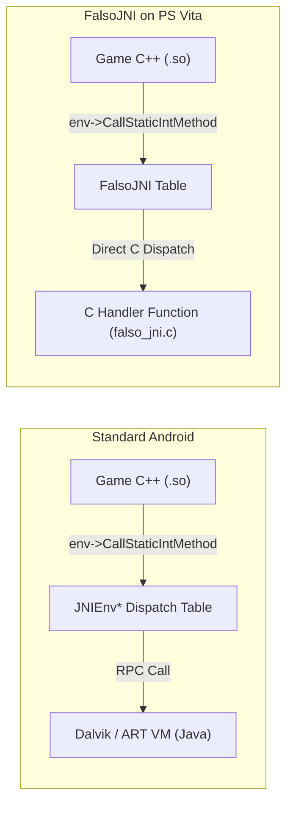

<div class="chapter-hero">
  <span class="chapter-badge">Chapter 05 • JNI Runtime</span>
  <h1 style="margin: 0.4rem 0 0.6rem 0; font-size: 2rem;">FalsoJNI & Java Bridge</h1>
  <p style="margin: 0; opacity: 0.9; font-size: 1.05rem;">
    Simulating the Android Java Native Interface without a Dalvik/ART virtual machine. Method ID resolution, type descriptor decoding, active callback triggers, and string lifetime management.
  </p>
  <div class="chapter-meta">
    <span class="chapter-meta-pill">⚡ Level: Intermediate to Advanced</span>
    <span class="chapter-meta-pill">🧠 Focus: JNIEnv, JavaVM, JVM Callbacks</span>
    <span class="chapter-meta-pill">🎮 Verified: Hero of Sparta, Inotia 3, Brothers in Arms 2</span>
  </div>
</div>

---

## 🏛️ JNI Function Dispatch

When the game calls JNI, it invokes function pointers inside `JNIEnv*`:



### The Simulated Interface Table
`FalsoJNI` populates a static `JNINativeInterface` struct matching the JNI standard:

=== "FalsoJNI Interface Setup"
    ```c
    static const struct JNINativeInterface fake_jni_native_interface = {
        .GetVersion = &fake_GetVersion,
        .FindClass = &fake_FindClass,
        .GetMethodID = &fake_GetMethodID,
        .GetStaticMethodID = &fake_GetStaticMethodID,
        .CallVoidMethod = &fake_CallVoidMethod,
        .CallStaticVoidMethod = &fake_CallStaticVoidMethod,
        .CallStaticIntMethod = &fake_CallStaticIntMethod,
        .CallStaticBooleanMethod = &fake_CallStaticBooleanMethod,
        .CallStaticObjectMethod = &fake_CallStaticObjectMethod,
        .NewStringUTF = &fake_NewStringUTF,
        .GetStringUTFChars = &fake_GetStringUTFChars,
        .ReleaseStringUTFChars = &fake_ReleaseStringUTFChars,
    };

    const struct JNINativeInterface *fake_env = &fake_jni_native_interface;
    JNIEnv *env = (JNIEnv *)&fake_env;
    ```

=== "Method Lookup Table"
    ```c
    typedef struct {
        const char *name;
        const char *sig;
        uintptr_t func;
    } JNIMethodEntry;

    static const JNIMethodEntry jni_methods[] = {
        { "getDeviceModel", "()Ljava/lang/String;", (uintptr_t)&fake_getDeviceModel },
        { "isNetworkAvailable", "()Z", (uintptr_t)&fake_isNetworkAvailable },
        { "playMusic", "(Ljava/lang/String;Z)I", (uintptr_t)&fake_playMusic },
        { NULL, NULL, 0 }
    };
    ```

---

## 🔡 JNI Method Signatures

When a game calls `GetMethodID(env, clazz, "methodName", "(signature)returnType")`, the signature string encodes argument and return types:

| Character | Java Type | C / C++ Type |
|---|---|---|
| `Z` | `boolean` | `jboolean` (uint8_t: 0 or 1) |
| `B` | `byte` | `jbyte` (int8_t) |
| `C` | `char` | `jchar` (uint16_t UTF-16) |
| `S` | `short` | `jshort` (int16_t) |
| `I` | `int` | `jint` (int32_t) |
| `J` | `long` | `jlong` (int64_t) |
| `F` | `float` | `jfloat` (float) |
| `D` | `double` | `jdouble` (double) |
| `V` | `void` | `void` |
| `Ljava/lang/String;` | `String` (Object) | `jstring` (object pointer) |
| `[I` | Array of ints (`int[]`) | `jintArray` |
| `[B` | Array of bytes (`byte[]`) | `jbyteArray` |

---

## 🪤 The Stubbing Trap: Dangerous No-Ops vs Active Stubs

One of the most insidious bugs in mobile porting is implementing **empty no-op stubs returning 0 or NULL**.

### The Video / Ad Black Screen Hang
Suppose the Android game executes this Java logic on startup:

=== "Original Java in APK"
    ```java
    public static void playIntroVideo() {
        VideoPlayer.play("intro.mp4", new OnVideoCompletionListener() {
            public void onCompletion() {
                nativeOnVideoCompleted(); // Informs the C++ native engine
            }
        });
    }
    ```

=== "❌ Dangerous No-Op Stub"
    ```c
    // ❌ WRONG: Hangs the game engine permanently in WAITING_FOR_VIDEO state!
    void fake_playIntroVideo(void) {
        sceClibPrintf("[FalsoJNI] playIntroVideo called (doing nothing)\n");
        return;
    }
    ```

=== "✔️ Active Safe Stub (Production)"
    ```c
    // Function pointer to the game's native callback
    void (*nativeOnVideoCompleted_func)(JNIEnv *env, jobject obj) = NULL;

    // ✔️ CORRECT: Triggers the completion callback immediately!
    void fake_playIntroVideo(void) {
        sceClibPrintf("[FalsoJNI] playIntroVideo called -> Firing completion callback!\n");
        
        if (nativeOnVideoCompleted_func) {
            nativeOnVideoCompleted_func(env, NULL);
        }
    }
    ```

---

## 🔤 String Handling and Heap Management

When the game calls `GetStringUTFChars`, manage memory lifecycle carefully to prevent heap leaks:

=== "Safe UTF-8 String Lifecycle"
    ```c
    // Simulated String struct
    typedef struct {
        char *str;
    } FakeJString;

    jstring fake_NewStringUTF(JNIEnv *env, const char *bytes) {
        if (!bytes) return NULL;
        FakeJString *s = malloc(sizeof(FakeJString));
        s->str = strdup(bytes);
        return (jstring)s;
    }

    const char *fake_GetStringUTFChars(JNIEnv *env, jstring str, jboolean *isCopy) {
        if (!str) return NULL;
        if (isCopy) *isCopy = JNI_TRUE;
        FakeJString *s = (FakeJString *)str;
        return strdup(s->str);
    }

    void fake_ReleaseStringUTFChars(JNIEnv *env, jstring str, const char *chars) {
        if (chars) {
            free((void *)chars); // Mandatory cleanup against memory leaks
        }
    }
    ```

> [!TIP]
> **Locale & Device Model**: Games often query `Locale.getDefault().getLanguage()` or `android.os.Build.MODEL`. Returning `"en"` (or the PS Vita system language queried via `sceAppUtilSystemParamGetInt`) and `"PlayStation Vita"` ensures the game initializes valid language tables and displays clean console branding.
