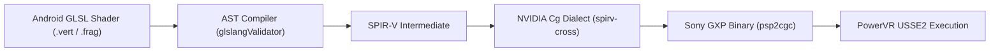

<div class="lang-switch-bar">
  <span>🌐 Language / Idioma:</span>
  <a href="../06-vitagl-graphics-pipeline/" class="lang-switch-link active">🇬🇧 English</a>
  <a href="../es/06-pipeline-grafico-vitagl/" class="lang-switch-link">🇪🇸 Español</a>
  <a href="../pt/06-pipeline-grafico-vitagl/" class="lang-switch-link">🇧🇷 Português</a>
</div>

<div class="chapter-hero">
  <span class="chapter-badge">Chapter 06 • Graphics Subsystem</span>
  <h1 style="margin: 0.4rem 0 0.6rem 0; font-size: 2rem;">Graphics Pipeline with vitaGL</h1>
  <p style="margin: 0; opacity: 0.9; font-size: 1.05rem;">
    Translating OpenGL ES 1.1 and 2.0 to hardware-accelerated SCE GXM commands on the PowerVR SGX543MP4+ GPU. Framebuffer setup, shader compilation, Y-flipping, and CDRAM management.
  </p>
  <div class="chapter-meta">
    <span class="chapter-meta-pill">⚡ Level: Advanced</span>
    <span class="chapter-meta-pill">🧠 Focus: PowerVR SGX543, SCE GXM, Shaders (Cg/GXP)</span>
    <span class="chapter-meta-pill">🎮 Verified: 98% of All Android Vita Ports</span>
  </div>
</div>

---

## 🚀 Initialization and Game Loop

In `main.c`, initialize vitaGL before executing native engine rendering routines:

=== "main.c (Production vitaGL Setup)"
    ```c
    #include <vitaGL.h>

    void init_graphics(void) {
        // vglInitExtended(flags, width, height, ram_buffer_size, msaa_mode)
        // 6 MB vertex command buffer allocated in RAM
        vglInitExtended(0, 960, 544, 6 * 1024 * 1024, SCE_GXM_MULTISAMPLE_NONE);
        
        // Lock VBlank for tear-free 60 FPS
        vglWaitVblankStart(GL_TRUE);

        // Optional: Set default clear color
        glClearColor(0.0f, 0.0f, 0.0f, 1.0f);
    }

    void game_render_frame(void) {
        // 1. Invoke game's native render function
        nativeRender_func();
        
        // 2. Swap display buffers (GL_FALSE = do not wait for GPU idle)
        vglSwapBuffers(GL_FALSE);
    }
    ```

=== "CMakeLists.txt Configuration"
    ```cmake
    target_link_libraries(${PROJECT_NAME}
        vitaGL
        vitashark
        SceGxm_stub
        SceDisplay_stub
        mathneon
    )
    ```

---

## 🎨 Graphics Backends Comparison

| Backend | Advantages | Trade-offs | Use Case |
|---|---|---|---|
| **vitaGL (Recommended)** | Open-source, battle-tested, complete GLES 1.1/2.0 coverage, on-the-fly GLSL compiler, optimized for CDRAM. | Slight floating-point variance on highly exotic shaders. | **Standard de facto** for 98% of mobile ports. |
| **PVR_PSP2** | Leaked official PowerVR driver from Sony SDK. Strict GLES 2.0 conformance. | Closed source, copyright/licensing issues, rigid integration. | Edge-case games with shaders that fail under vitaGL. |
| **Raw SCE GXM** | Maximum theoretical throughput, direct ring buffer control. | Extreme complexity: no GLSL support, manual primitive sync. | Ground-up native PS Vita engines only. |

---

## 🪄 Shaders: Translating GLSL to Cg / GXP

The Vita GPU requires compiled binary shaders in Sony's **GXP** format.



### Offline Transpilation via `psvita-toolkit`

=== "Transpilation Command"
    ```bash
    # Transpile dumped GLSL shaders into optimized Vita Cg/GXP
    psvita-toolkit shader-transpile --dump-dir assets/glsl --out-dir assets/cg
    ```

=== "Custom Cg Shader Wrapper"
    ```c
    // Loading pre-compiled GXP shaders directly into vitaGL
    GLuint load_gxp_program(const char *vert_path, const char *frag_path) {
        FILE *fv = fopen(vert_path, "rb");
        FILE *ff = fopen(frag_path, "rb");
        // Read GXP blobs and create vglProgram via vglCreateProgramGXP()
        // ...
        return program_id;
    }
    ```

---

## ⚠️ Common Graphical Pitfalls & Solutions

### 1. Upside-Down FBO Rendering (Y-Flipping)
In standard OpenGL, `(0,0)` is located at the **bottom-left** corner. In GXM and some mobile FBO implementations, `(0,0)` corresponds to the **top-left**. If rendered textures appear flipped:

=== "Projection Matrix Correction"
    ```c
    // Correcting projection matrix for FBO targets
    void set_fbo_projection(float width, float height) {
        glMatrixMode(GL_PROJECTION);
        glLoadIdentity();
        // Flip top and bottom boundaries
        glOrthof(0.0f, width, height, 0.0f, -1.0f, 1.0f);
        glMatrixMode(GL_MODELVIEW);
    }
    ```

### 2. Dark Halos on Transparent Sprites (Premultiplied Alpha)
If text rendering or UI textures display black artifacts around transparent edges, the engine uses **Premultiplied Alpha**:

=== "Alpha Blending Modes"
    ```c
    // Standard Alpha Blending (Sprites rendered with dark halo)
    // glBlendFunc(GL_SRC_ALPHA, GL_ONE_MINUS_SRC_ALPHA);

    // Premultiplied Alpha Fix (Crystal-clear transparent edges):
    glBlendFunc(GL_ONE, GL_ONE_MINUS_SRC_ALPHA);
    ```

### 3. CDRAM Exhaustion (112 MiB VRAM Limit)
vitaGL places textures into high-speed CDRAM by default. If a game exceeds 112 MiB of textures, memory allocation fails with `0x80010018`.
- Redirect secondary textures to main RAM:
```c
// Force allocation in main system RAM instead of CDRAM:
vglAlloc(size, VGL_MEM_RAM);
```
