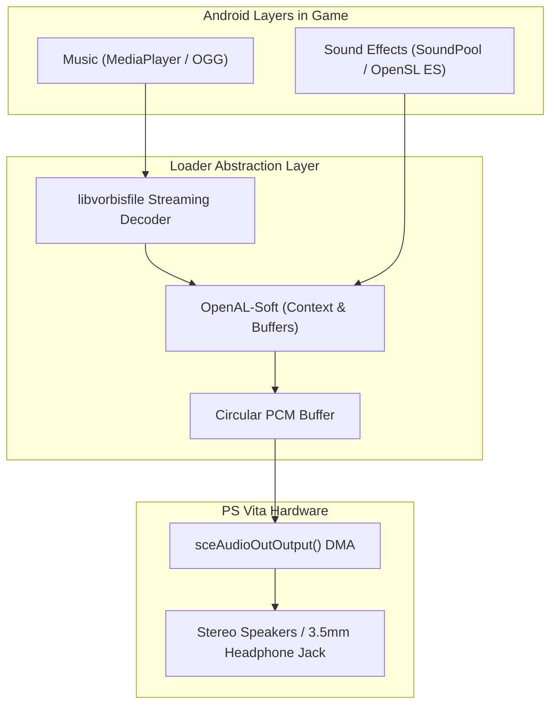

<div class="chapter-hero">
  <span class="chapter-badge">Chapter 07 • Audio Subsystem</span>
  <h1 style="margin: 0.4rem 0 0.6rem 0; font-size: 2rem;">Audio Subsystem Architecture</h1>
  <p style="margin: 0; opacity: 0.9; font-size: 1.05rem;">
    Bridging Android audio backends (OpenSL ES, SoundPool, MediaPlayer) to PS Vita hardware using sceAudioOut, OpenAL-Soft multi-channel spatialization, and threaded OGG Vorbis streaming.
  </p>
  <div class="chapter-meta">
    <span class="chapter-meta-pill">⚡ Level: Intermediate</span>
    <span class="chapter-meta-pill">🔊 Backends: sceAudioOut, OpenAL-Soft, libvorbisfile</span>
    <span class="chapter-meta-pill">🎮 Verified: Hero of Sparta, Zenonia 3, Badland 2</span>
  </div>
</div>

---

## 🔊 Audio Pipeline Architecture

Android games generally manage audio across three distinct APIs:
1. **OpenSL ES:** Native C API used for low-latency sound effects and procedural audio.
2. **SoundPool (Java):** Android SDK class for short, pre-decoded sound effects stored in memory.
3. **MediaPlayer (Java):** Android SDK streaming class for long background music tracks (OGG, MP3).

On PlayStation Vita, all audio converges into hardware DMA buffers via **`sceAudioOut`** or high-level wrappers like **OpenAL-Soft**:



---

## 🎛️ Low-Level PCM Output via `sceAudioOut`

VitaOS manages audio ports with hardware synchronization via `sceAudioOut`:

=== "Direct sceAudioOut (C)"
    ```c
    #include <psp2/audioout.h>
    #include <stdint.h>

    static int s_audio_port = -1;

    void init_audio_hardware(void) {
        // Open stereo BGM port at 44100 Hz with 1024 sample buffer (grain)
        s_audio_port = sceAudioOutOpenPort(
            SCE_AUDIO_OUT_PORT_TYPE_BGM,
            1024,
            44100,
            SCE_AUDIO_OUT_MODE_STEREO
        );

        // Set left and right channels to 100% volume (32768 = 0 dB)
        int vol[2] = { 32768, 32768 };
        sceAudioOutSetVolume(s_audio_port, SCE_AUDIO_VOLUME_FLAG_L_CH | SCE_AUDIO_VOLUME_FLAG_R_CH, vol);
    }

    void output_pcm_block(const int16_t *stereo_samples) {
        // Blocks the calling thread until 1024 samples are consumed by hardware DMA
        sceAudioOutOutput(s_audio_port, stereo_samples);
    }

    void shutdown_audio_hardware(void) {
        if (s_audio_port >= 0) {
            sceAudioOutReleasePort(s_audio_port);
            s_audio_port = -1;
        }
    }
    ```

---

## 📻 Background Music Streaming (OGG Vorbis)

Most mobile titles compress background music into OGG Vorbis files. Decoding on a dedicated worker thread avoids frame drops in the main render thread:

=== "Threaded OGG Decoder (C)"
    ```c
    #include <vitasdk.h>
    #include <vorbis/vorbisfile.h>
    #include <stdio.h>

    typedef struct {
        OggVorbis_File vf;
        FILE *file;
        int is_playing;
        int loop;
    } BGMStream;

    static BGMStream g_bgm = {0};
    static SceUID g_audio_thread_uid = -1;

    void bgm_play(const char *path, int loop) {
        if (g_bgm.file) {
            ov_clear(&g_bgm.vf);
            g_bgm.file = NULL;
        }

        g_bgm.file = fopen(path, "rb");
        if (!g_bgm.file) return;

        if (ov_open_callbacks(g_bgm.file, &g_bgm.vf, NULL, 0, OV_CALLBACKS_DEFAULT) < 0) {
            fclose(g_bgm.file);
            g_bgm.file = NULL;
            return;
        }

        g_bgm.loop = loop;
        g_bgm.is_playing = 1;
    }

    static int audio_worker_thread(SceSize args, void *argp) {
        int16_t pcm_buffer[2048]; // 1024 stereo samples
        int current_section = 0;

        while (1) {
            if (g_bgm.is_playing && g_bgm.file) {
                long bytes = ov_read(&g_bgm.vf, (char *)pcm_buffer, sizeof(pcm_buffer), 0, 2, 1, &current_section);
                if (bytes > 0) {
                    output_pcm_block(pcm_buffer);
                } else if (bytes == 0) {
                    if (g_bgm.loop) {
                        ov_time_seek(&g_bgm.vf, 0);
                    } else {
                        g_bgm.is_playing = 0;
                    }
                }
            } else {
                sceKernelDelayThread(15000); // Sleep 15ms when idle
            }
        }
        return 0;
    }
    ```

---

## 🧩 FalsoJNI SoundPool Emulation

When an Android game triggers sound effects via Java's `SoundPool.play(...)`:

=== "SoundPool Bridge (falso_jni.c)"
    ```c
    #include <jni.h>
    #include <stdio.h>

    // Forward declaration to OpenAL or custom sound engine
    extern int audio_sfx_play(int sound_id, float volume, int loop);

    jint fake_SoundPool_play(JNIEnv *env, jobject obj, jint soundID, jfloat leftVolume,
                            jfloat rightVolume, jint priority, jint loop, jfloat rate) {
        float avg_vol = (leftVolume + rightVolume) * 0.5f;
        int stream_id = audio_sfx_play(soundID, avg_vol, loop);

        // ALWAYS return a non-zero positive stream ID!
        // Returning 0 causes Android engines to believe the audio device crashed,
        // triggering expensive reload cycles every frame.
        return (stream_id > 0) ? stream_id : soundID;
    }

    jint fake_SoundPool_load(JNIEnv *env, jobject obj, jstring path, jint priority) {
        const char *native_path = (*env)->GetStringUTFChars(env, path, NULL);
        printf("[SOUNDPOOL] Loading sample: %s\n", native_path);

        // Generate synthetic sound ID
        static int next_sound_id = 1;
        int sound_id = next_sound_id++;

        (*env)->ReleaseStringUTFChars(env, path, native_path);
        return sound_id;
    }
    ```

> [!TIP]
> If `SoundPool.play` returns `0`, the Android engine assumes audio hardware failure and may attempt to reload the sound file every frame, causing massive stutter. Always return a valid positive ID.
