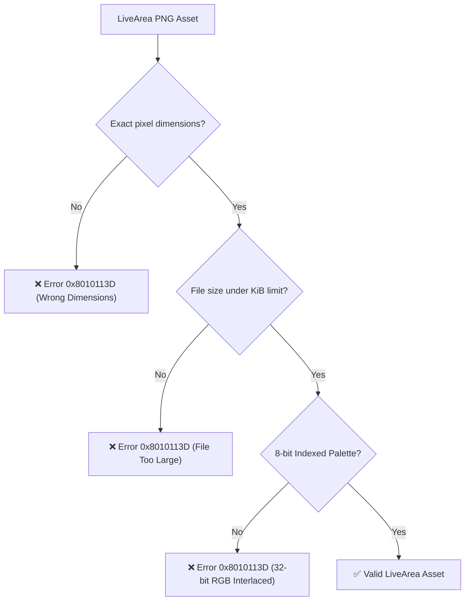

<div class="chapter-hero">
  <span class="chapter-badge">Chapter 10 • Packaging & LiveArea</span>
  <h1 style="margin: 0.4rem 0 0.6rem 0; font-size: 2rem;">LiveArea & VPK Packaging</h1>
  <p style="margin: 0; opacity: 0.9; font-size: 1.05rem;">
    Building Sony-compliant VPK distribution packages, constructing interactive LiveArea gates (template.xml, icon0.png, bg0.png), avoiding 0x8010113D installation errors, and purging macOS AppleDouble metadata.
  </p>
  <div class="chapter-meta">
    <span class="chapter-meta-pill">⚡ Level: Intermediate</span>
    <span class="chapter-meta-pill">📦 Format: Sony SELF, param.sfo, VPK (ZIP)</span>
    <span class="chapter-meta-pill">🎨 Assets: 8-bit Indexed PNG, SceShell Limits</span>
  </div>
</div>

---

## 🖼️ LiveArea Asset Specifications

Sony's system shell (**SceShell**) strictly enforces image resolutions, formats, and file size limits:

| Asset | Resolution (Pixels) | Maximum Allowed Size | Role on Console |
|---|---|---|---|
| **`icon0.png`** | **128 x 128** | 128 KiB | Circular home screen application bubble. |
| **`startup.png`** | **280 x 158** | 64 KiB | Interactive startup gate button. |
| **`bg0.png`** | **840 x 500** | 128 KiB | LiveArea gate background image. |
| **`pic0.png`** | **960 x 544** | 256 KiB | Optional full-screen background banner. |

---

## 🚫 The Infamous `0x8010113D` Installation Error

Error `0x8010113D` in VitaShell or the Sony package installer occurs when LiveArea images violate Sony's internal specifications:



### Golden Rules for LiveArea Images:
1. **8-bit Indexed Palette (256 colors):** Always quantize PNGs using `pngquant` or ImageMagick.
2. **No Interlacing:** The hardware decoder does not support interlaced/progressive PNG formats.

=== "ImageMagick & pngquant Processing"
    ```bash
    # Process icon0.png (128x128, 8-bit indexed, < 128KB)
    convert input_icon.png -resize 128x128! -strip icon0.png
    pngquant --force --ext .png 256 icon0.png

    # Process startup.png (280x158, 8-bit indexed, < 64KB)
    convert input_startup.png -resize 280x158! -strip startup.png
    pngquant --force --ext .png 256 startup.png

    # Process bg0.png (840x500, 8-bit indexed, < 128KB)
    convert input_bg.png -resize 840x500! -strip bg0.png
    pngquant --force --ext .png 256 bg0.png
    ```

=== "template.xml (LiveArea Layout)"
    ```xml
    <?xml version="1.0" encoding="utf-8"?>
    <livearea style="a1" format-ver="01.00">
      <livearea-background>
        <image>bg0.png</image>
      </livearea-background>
      <gate>
        <startup>startup.png</startup>
      </gate>
    </livearea>
    ```

---

## 🍏 The macOS AppleDouble `._*` Trap

When packaging on macOS, the OS generates hidden AppleDouble metadata files (`._icon0.png`, `._param.sfo`, `._eboot.bin`) on FAT32/exFAT external drives.

> [!CAUTION]
> If `._*` files are packaged inside the `.vpk`, VitaShell installation fails or displays corrupted app bubbles. Always purge them before building.

=== "Automated Cleanup (CLI)"
    ```bash
    # Recursively purge all AppleDouble metadata files
    find . -name "._*" -type f -delete

    # Remove macOS .DS_Store artifacts
    find . -name ".DS_Store" -type f -delete
    ```

---

## 📜 Generating `param.sfo` & Title IDs

Configure your Title ID and display name with `vita-mksfoex`:

```bash
vita-mksfoex -s TITLE_ID="PSVHOS001" "Hero of Sparta" param.sfo
```

### Title ID Format:
- Exactly **9 uppercase alphanumeric characters**.
- Standard homebrew format: `PSV` followed by 3–4 letters and digits (e.g. `PSVHOS001`, `ZENONIA03`, `BADLAND02`).

---

## 📦 Automated Packaging via CMake

Add the official packaging targets to your `CMakeLists.txt`:

=== "CMake Integration"
    ```cmake
    vita_create_self(eboot.bin ${PROJECT_NAME} UNSAFE)

    vita_create_vpk(${PROJECT_NAME}.vpk ${TITLE_ID} eboot.bin
        VERSION "01.00"
        NAME "${GAME_NAME}"
        FILE livearea/icon0.png sce_sys/icon0.png
        FILE livearea/startup.png sce_sys/livearea/contents/startup.png
        FILE livearea/bg0.png sce_sys/livearea/contents/bg0.png
        FILE livearea/template.xml sce_sys/livearea/contents/template.xml
    )
    ```
