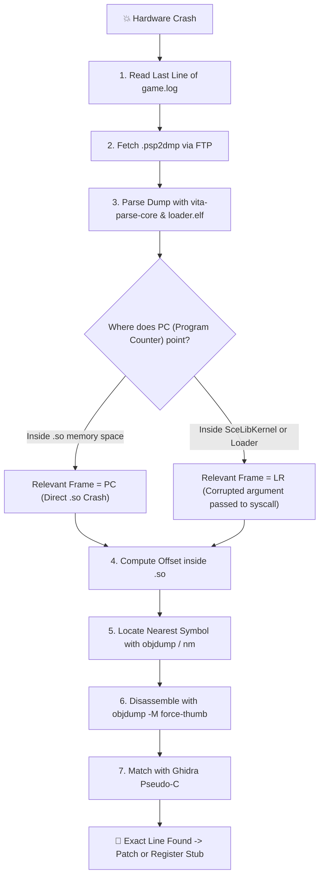

<div class="lang-switch-bar">
  <span>🌐 Language / Idioma:</span>
  <a href="../11-crash-triage-and-debugging/" class="lang-switch-link active">🇬🇧 English</a>
  <a href="../es/11-triage-de-crashes-y-debugging/" class="lang-switch-link">🇪🇸 Español</a>
  <a href="../pt/11-triagem-de-crashes-e-depuracao/" class="lang-switch-link">🇧🇷 Português</a>
</div>

<div class="chapter-hero">
  <span class="chapter-badge">Chapter 11 • Hardware Diagnostics</span>
  <h1 style="margin: 0.4rem 0 0.6rem 0; font-size: 2rem;">Crash Triage & Hardware Debugging</h1>
  <p style="margin: 0; opacity: 0.9; font-size: 1.05rem;">
    The Triangulation Methodology: parsing physical PlayStation Vita <code>.psp2dmp</code> kernel core dumps, distinguishing PC vs LR frames, matching disassembly against Ghidra pseudo-C, and fixing ARMv7 hardware alignment traps.
  </p>
  <div class="chapter-meta">
    <span class="chapter-meta-pill">⚡ Level: Expert</span>
    <span class="chapter-meta-pill">🧠 Focus: vita-parse-core, PC/LR Analysis, Data Aborts, ARMv7 ldrd</span>
    <span class="chapter-meta-pill">🎮 Verified: Zenonia 2/3, Dungeon Hunter 2, Inotia 3</span>
  </div>
</div>

---

## 🎯 The Triangulation Workflow



---

## 📋 Step 1: Flushed Logs

Always call `fflush(log_file)` after every log write so that buffered text is committed to flash storage before a panic:

=== "Production Logger (log.c)"
    ```c
    static FILE *log_file = NULL;

    void vita_log(const char *fmt, ...) {
        if (!log_file) {
            log_file = fopen("ux0:data/game/logs/game_001.log", "a");
        }
        va_list args;
        va_start(args, fmt);
        vfprintf(log_file, fmt, args);
        fflush(log_file); // CRITICAL: forces write to disk before abort
        va_end(args);
    }
    ```

---

## 🔬 Step 2: Parsing `.psp2dmp` Core Dumps

Upon encountering a Data Abort, VitaOS generates a crash dump in `ux0:data/` or `ur0:temp/core/` named `psp2core-XXXXXXXXXX-eboot.bin.psp2dmp`.

Parse it with `vita-parse-core` against your debug `loader.elf` (the unstripped ELF with symbols):

=== "Command Line"
    ```bash
    python3 vita-parse-core/main.py crash.psp2dmp build/loader.elf
    ```

=== "vita-parse-core Output"
    ```text
    Exception Type: Data abort (read access to 0x00000004)
    Registers:
      r0: 0x00000000   r1: 0x98124000   r2: 0x00000001   r3: 0x81005a20
      r4: 0x810ff320   r5: 0x00000000   r6: 0x98200000   r7: 0x810ff3f8
      r8: 0x00000000   r9: 0x81000000  r10: 0x00000000  r11: 0x810ff410
      ip: 0x00000000   SP: 0x810ff400   LR: 0x98045a05   PC: 0x98045a1c
      CPSR: 0x20000030 (Thumb Mode, User)
    ```

---

## ⚖️ Step 3: Deciding Between PC and LR

- **If `PC` lies within `.so` memory (`0x98000000`+):**
  The crash instruction was executed inside the game's native library. Investigate that offset.
- **If `PC` lies within `SceLibKernel` or the loader (`eboot.bin`):**
  **`LR` (Link Register) is the caller!** The game code invoked a system function (e.g. `memcpy` or `fopen`) with an invalid parameter (`NULL` pointer or corrupt size). Inspect the call-site in `LR`.

---

## 🔎 Step 4: Resolving the Offset & Matching Disassembly

Calculate: `offset = PC - so_base_address` (e.g. `0x98045a1c - 0x98000000 = 0x45a1c`).

=== "Symbol Resolution"
    ```bash
    # Extract sorted dynamic symbol table
    objdump -T libgame.so | grep -v UND | awk '{print $1, $NF}' | sort > syms.txt
    
    # Locate symbol right before offset 0x45a1c:
    # 000459f8 g DF .text 00000080 GameRenderer_updateUI
    ```

=== "Disassembly with -M force-thumb"
    ```assembly
       45a18:   6808        ldr     r0, [r1, #0]    ; Read player object pointer
       45a1a:   2800        cmp     r0, #0          ; Check if player != NULL
       45a1c:   6840        ldr     r0, [r0, #4]    ; ❌ Crash: player was valid, but health_bar at +0x4 was NULL!
    ```

=== "Ghidra Pseudo-C Match"
    ```c
    // Matching decompiled code in out_ghidra.c:
    if (player != (PlayerObject *)0x0) {
        player->health_bar->current_hp = 100; // health_bar is NULL!
    }
    ```

---

## ⚠️ ARMv7 Memory Alignment Traps

On x86 PCs, unaligned memory accesses are transparently handled by CPU microcode.
**On the ARM Cortex-A9 CPU of the PS Vita, `LDRD` (Load Register Dual, 64-bit), `STRD`, and NEON vector instructions (`VLD1`) trigger an instant hardware Data Abort if the address is not aligned to 8 or 16 bytes.**

=== "Atypical Hardware Crash Example"
    ```text
    Instruction: ldrd r2, r3, [r0]
    Register r0: 0x81240004  <-- Address is NOT divisible by 8! (Ends in 4)
    Exception: Data abort (Unaligned memory trap)
    ```

=== "Fix: Enforcing Memory Alignment"
    ```c
    // Replace standard malloc with 8-byte aligned allocation:
    void *aligned_buf = memalign(8, struct_size);
    ```

> [!TIP]
> Always check the last hexadecimal digit of the address in `r0` or the base pointer when `ldrd` crashes. If it ends in `4`, `c`, or odd digits, enforce struct packing or aligned allocation.
