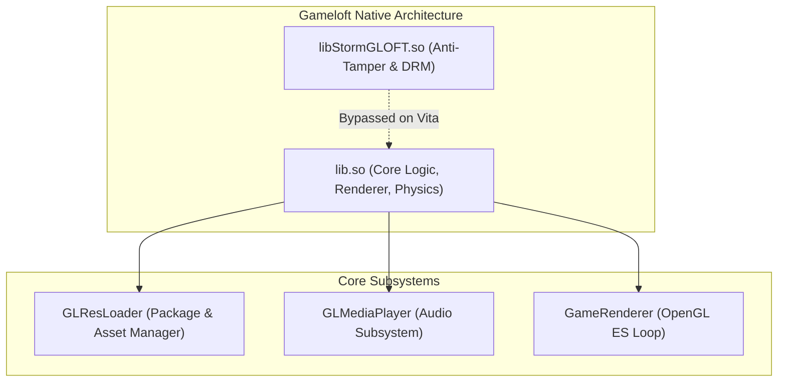
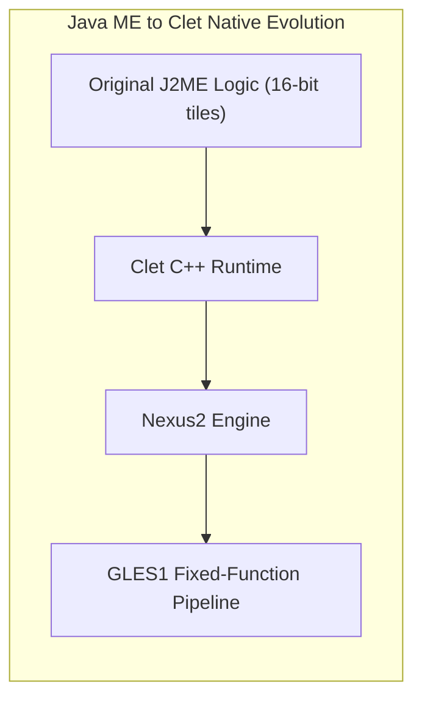

<div class="lang-switch-bar">
  <span>🌐 Language / Idioma:</span>
  <a href="../12-engine-archaeology/" class="lang-switch-link active">🇬🇧 English</a>
  <a href="../es/12-arqueologia-de-motores/" class="lang-switch-link">🇪🇸 Español</a>
  <a href="../pt/12-arqueologia-de-motores/" class="lang-switch-link">🇧🇷 Português</a>
</div>

<div class="chapter-hero">
  <span class="chapter-badge">Chapter 12 • Engine Archaeology</span>
  <h1 style="margin: 0.4rem 0 0.6rem 0; font-size: 2rem;">Real Engine Archaeology & Case Studies</h1>
  <p style="margin: 0; opacity: 0.9; font-size: 1.05rem;">
    Architectural patterns, historical reverse engineering breakthroughs, symbol tables, and battle-tested solutions across 30+ production mobile engines (Gameloft, Gamevil, Com2uS, Cocos2d-x).
  </p>
  <div class="chapter-meta">
    <span class="chapter-meta-pill">⚡ Level: Advanced</span>
    <span class="chapter-meta-pill">🏛️ Engines: Gameloft, Gamevil Nexus2, Com2uS, Cocos2d-x</span>
    <span class="chapter-meta-pill">🎮 Verified: Hero of Sparta, Zenonia 2/3, Inotia 3, Badland 2</span>
  </div>
</div>

---

## ⚔️ Family 1: Classic Gameloft Engines (2010–2013)

**Representative titles:** *Hero of Sparta*, *Dungeon Hunter 1 & 2*, *N.O.V.A. 1 & 2*, *Shadow Guardian*, *Eternal Legacy*, *Six-Guns*, *Gangstar Rio*, *Brothers in Arms 2*, *Asphalt 5 & 6*.



### Critical Quirks:
1. **The `libStormGLOFT.so` Companion:** Gameloft APKs bundle `libStormGLOFT.so` alongside the main library. It contains obsolete anti-tamper routines that perform licensing checks. **Never load this library; only load the main game `.so`.**
2. **`GLResLoader` Asset Resolution:** Gameloft requires calling `GLResLoader_nativeInit` before any rendering occurs to index files in resolution directories (`1024x768`, `960x540`, `800x480`).

=== "Gameloft Loader Init (Hero of Sparta)"
    ```c
    typedef void (*GLResLoader_init_t)(const char *path);
    typedef void (*GameRenderer_init_t)(int width, int height, int orientation);
    typedef void (*GameRenderer_render_t)(void);

    void init_gameloft_engine(so_module *mod) {
        GLResLoader_init_t res_init = (GLResLoader_init_t)so_resolve(mod, "Java_com_gameloft_android_GLResLoader_nativeInit");
        GameRenderer_init_t rnd_init = (GameRenderer_init_t)so_resolve(mod, "Java_com_gameloft_android_GameRenderer_nativeInit");

        if (res_init) {
            // Point asset loader to Vita data directory
            res_init("ux0:data/heroofsparta/assets");
        }

        // Initialize 960x544 display (Landscape = 1)
        if (rnd_init) {
            rnd_init(960, 544, 1);
        }
    }
    ```

---

## 🛡️ Family 2: Gamevil Nexus2 / Clet Engine

**Representative titles:** *Zenonia 1, 2, 3, 4*, *Destinia*, *ILLUSIA 1 & 2*, *Advena*, *Baseball Superstars*.



### Critical Quirks:
1. **Heritage:** Originally engineered for Korean feature phones in Java ME (MIDP 2.0), Gamevil converted their core RPG virtual machine into C++ runtimes (**Clet / Nexus2**).
2. **Shared Symbol Topology:** Zenonia 2 and Zenonia 3 share nearly identical entry points: `Java_com_gamevil_nexus2_Natives_nativeInit` and `Java_com_gamevil_nexus2_Natives_nativeEvent`.

=== "Gamevil Event Dispatcher (Zenonia 2 & 3)"
    ```c
    typedef void (*nativeInit_t)(int width, int height);
    typedef void (*nativeEvent_t)(int type, int keycode, int param);

    // Event constants in Gamevil Nexus2
    #define NEXUS_EVENT_KEY_DOWN 1
    #define NEXUS_EVENT_KEY_UP   2
    #define NEXUS_KEY_OK         10
    #define NEXUS_KEY_ATTACK     11

    void dispatch_gamevil_pad_input(nativeEvent_t send_event, SceCtrlData *pad, SceCtrlData *old_pad) {
        if ((pad->buttons & SCE_CTRL_CROSS) && !(old_pad->buttons & SCE_CTRL_CROSS)) {
            send_event(NEXUS_EVENT_KEY_DOWN, NEXUS_KEY_ATTACK, 0);
        } else if (!(pad->buttons & SCE_CTRL_CROSS) && (old_pad->buttons & SCE_CTRL_CROSS)) {
            send_event(NEXUS_EVENT_KEY_UP, NEXUS_KEY_ATTACK, 0);
        }
    }
    ```

---

## 🏹 Family 3: Com2uS Engines

**Representative titles:** *Inotia 2: A Wanderer of Luone*, *Inotia 3: Children of Carnia*, *Inmortal Dusk*.

### Critical Quirks:
- **Mono 22050 Hz Audio:** Sound buffers are 22050 Hz 16-bit mono PCM. Feeding mono PCM directly into a stereo `sceAudioOut` port causes high-pitched playback at 2x speed. Upsample or duplicate samples to interleaved L/R before hardware output.

=== "Mono to Stereo Upsampler (Com2uS)"
    ```c
    void convert_mono22050_to_stereo44100(const int16_t *mono_in, int num_samples, int16_t *stereo_out) {
        for (int i = 0; i < num_samples; i++) {
            int16_t sample = mono_in[i];
            // Duplicate sample across both channels and repeat for 44.1kHz rate
            stereo_out[(i * 4) + 0] = sample; // Left 1
            stereo_out[(i * 4) + 1] = sample; // Right 1
            stereo_out[(i * 4) + 2] = sample; // Left 2
            stereo_out[(i * 4) + 3] = sample; // Right 2
        }
    }
    ```

---

## 🌳 Family 4: Cocos2d-x Engines

**Representative titles:** *Badland 2*, *Rayman Jungle Run*, *The Impossible Game*.

### Critical Quirks:
- Standardized lifecycle method: `Java_org_cocos2dx_lib_Cocos2dxRenderer_nativeInit(width, height)`.
- Asset access relies on `CCFileUtils` mounting the original APK file as a ZIP archive in memory, reading compressed PNGs and audio on demand.

=== "Cocos2d-x Initialization (Badland 2)"
    ```c
    typedef void (*cocos_init_t)(int w, int h);
    typedef void (*cocos_render_t)(void);

    void boot_cocos2dx_port(so_module *mod) {
        cocos_init_t init_func = (cocos_init_t)so_resolve(mod, "Java_org_cocos2dx_lib_Cocos2dxRenderer_nativeInit");
        cocos_render_t render_func = (cocos_render_t)so_resolve(mod, "Java_org_cocos2dx_lib_Cocos2dxRenderer_nativeRender");

        // Pass native PS Vita screen resolution
        init_func(960, 544);

        while (1) {
            render_func();
            vglSwapBuffers(GL_FALSE);
        }
    }
    ```
