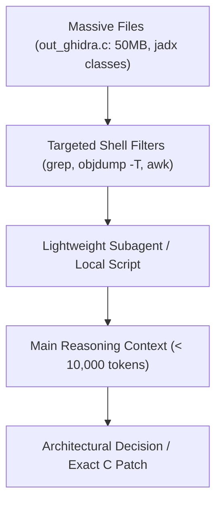

<div class="lang-switch-bar">
  <span>🌐 Language / Idioma:</span>
  <a href="../13-ai-assisted-porting/" class="lang-switch-link active">🇬🇧 English</a>
  <a href="../es/13-guia-porting-con-ia/" class="lang-switch-link">🇪🇸 Español</a>
  <a href="../pt/13-guia-porting-con-ia/" class="lang-switch-link">🇧🇷 Português</a>
</div>

<div class="chapter-hero">
  <span class="chapter-badge">Chapter 13 • AI Pair Programming</span>
  <h1 style="margin: 0.4rem 0 0.6rem 0; font-size: 2rem;">AI-Assisted Porting & Token Economy</h1>
  <p style="margin: 0; opacity: 0.9; font-size: 1.05rem;">
    Best practices for human + AI pair programming in SoLoader development, optimizing context token usage by over 90%, preventing reverse engineering hallucinations, and using surgical prompt templates.
  </p>
  <div class="chapter-meta">
    <span class="chapter-meta-pill">⚡ Level: Methodology</span>
    <span class="chapter-meta-pill">🤖 Tools: Claude, GPT, Antigravity, Subagents</span>
    <span class="chapter-meta-pill">🎯 Focus: Zero Hallucination, Token Optimization</span>
  </div>
</div>

---

## ⚡ Context and Token Economy

Ghidra pseudo-C outputs (`out_ghidra.c`), raw disassemblies (`objdump`), and decompiled Java source trees frequently exceed **500,000 tokens**. Dumping them directly into an LLM window degrades reasoning performance, generates hallucinations, and wastes resources.



### Golden Rules:
1. **Never dump full `out_ghidra.c` files into chat:**
   Use surgical CLI extraction: `grep -n -C 20 "function_name" out_ghidra.c` to extract only the 40 lines under active review.
2. **Delegate mechanical boilerplate to fast models:**
   Use lightweight subagents (Flash-Lite / Flash / Haiku) for generating symbol relocation tables and repetitive stubs, reserving top-tier models for deep `.psp2dmp` crash triage and register state analysis.

=== "Surgical Context Extractor (Bash)"
    ```bash
    #!/usr/bin/env bash
    # Extract only the targeted function from a 50MB Ghidra pseudo-C dump
    FUNCTION_NAME="$1"
    GHIDRA_FILE="${2:-out_ghidra.c}"

    LINE_NUM=$(grep -n -m 1 " $FUNCTION_NAME(" "$GHIDRA_FILE" | cut -d: -f1)

    if [ -z "$LINE_NUM" ]; then
        echo "Function $FUNCTION_NAME not found!"
        exit 1
    fi

    # Extract 10 lines before and 60 lines after
    START=$((LINE_NUM - 10))
    [ $START -lt 1 ] && START=1
    END=$((LINE_NUM + 60))

    echo "=== FUNCTION: $FUNCTION_NAME (Lines $START to $END) ==="
    sed -n "${START},${END}p" "$GHIDRA_FILE"
    ```

---

## 🛡️ Preventing Reverse Engineering Hallucinations

AI models will invent plausible JNI method names or return types if context is underspecified. Prevent this with strict grounding:

### 1. Always provide verbatim signatures from Java or `objdump`
❌ **Vague Prompt:**  
*"Write a stub for the sound function in Hero of Sparta."*

✔️ **Grounded Prompt:**  
*"jadx decompilation reveals this exact Java declaration:*  
`public static native int nativePlayMusic(String path, boolean loop);`  
*Write the C FalsoJNI function with signature `(Ljava/lang/String;Z)I`, convert jstring to UTF-8, route it to our audio backend, and return streamID > 0 to indicate success."*

---

## 📋 Production Stubbing Prompt Template

Copy and paste this template when generating batch FalsoJNI stubs:

=== "Prompt Template"
    ```markdown
    You are an expert PS Vita port engineer using FalsoJNI.
    The game logged the following missing Android methods:

    1. com.gameloft.android.GLUtils.getDeviceModel() -> Ljava/lang/String;
    2. com.gameloft.android.GLMediaPlayer.isMusicActive() -> Z
    3. com.gameloft.android.GLResLoader.openAsset(String path) -> [B

    Requirements:
    1. Write the corresponding C function with matching FalsoJNI signatures.
    2. For strings, return fake_NewStringUTF with a safe value ("PlayStation Vita").
    3. For booleans, return JNI_TRUE or JNI_FALSE according to expected game behavior.
    4. Output the jni_methods registration table entries.
    ```

=== "Expected High-Fidelity Output"
    ```c
    // 1. Device model query
    jstring fake_GLUtils_getDeviceModel(JNIEnv *env, jobject obj) {
        return fake_NewStringUTF(env, "PlayStation Vita");
    }

    // 2. Music active check
    jboolean fake_GLMediaPlayer_isMusicActive(JNIEnv *env, jobject obj) {
        return JNI_TRUE;
    }

    // Table registration
    { "getDeviceModel", "()Ljava/lang/String;", (void *)&fake_GLUtils_getDeviceModel },
    { "isMusicActive", "()Z", (void *)&fake_GLMediaPlayer_isMusicActive },
    ```
