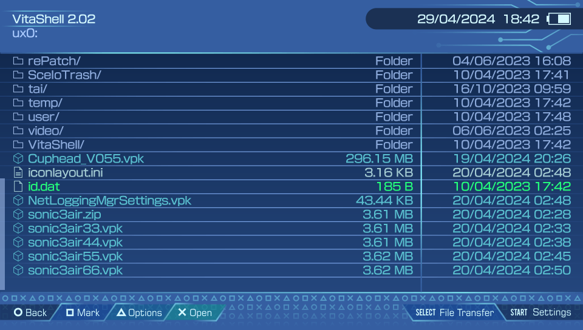

<div class="lang-switch-bar">
  <span>🌐 Language / Idioma:</span>
  <a href="../14-base-guide-gl33ntwine/" class="lang-switch-link active">🇬🇧 English</a>
  <a href="../es/14-guia-base-gl33ntwine/" class="lang-switch-link">🇪🇸 Español</a>
  <a href="../pt/14-guia-base-gl33ntwine/" class="lang-switch-link">🇧🇷 Português</a>
</div>

<div class="chapter-hero">
  <span class="chapter-badge">Chapter 14 • Heritage Guide</span>
  <h1 style="margin: 0.4rem 0 0.6rem 0; font-size: 2rem;">Getting Started with PSVita Homebrew Development</h1>
  <p style="margin: 0; opacity: 0.9; font-size: 1.05rem;">
    The foundational guide by gl33ntwine (Vitaliy Atamanenko), preserved and integrated into this wiki under CC BY 4.0. Covering hardware internals, VitaSDK setup, CMake, and the Vita homebrew ecosystem.
  </p>
  <div class="chapter-meta">
    <span class="chapter-meta-pill">✍️ Author: gl33ntwine</span>
    <span class="chapter-meta-pill">📜 License: CC BY 4.0</span>
    <span class="chapter-meta-pill">🏛️ Preserved from Wayback Machine</span>
  </div>
</div>

---


Hi there! If you landed here, I probably don’t need to tell you about how amazing the PlayStation Vita is and how sad it is that Sony failed its marketing and threw it away so quickly. Nevertheless, I feel obliged to say that the Vita is also very curious from a developer’s perspective.

You must understand that a portable console released in 2012 can’t possibly have the capabilities of a PlayStation 4, and in most cases—not even of a PlayStation 3. But the limits of this tiny old handheld hardware are still more of a challenge than an annoyance in 2022. I do believe that if you take time to master your gamedev techniques with PSV, making smooth and optimized software for any desktop, mobile, or console platform will be much less of a problem for you.

And most importantly, the Vita homebrew scene is still cherished by maintainers and developers, brimming with new libraries, languages, engines, and whatnot. Of course, that also implies a not-that-small crowd of faithful players who will enjoy and value your works.

Convinced now? :) Let’s get into it.

## Introduction

This guide is planned to consist of several parts, starting with general information and Vita SDK in the first part and getting to other programming languages, engines, plugins, and Android ports in the following parts.

Keep in mind that Vita SDK is a C/C++ toolchain. So, to develop things using Vita SDK directly, you need to have some knowledge of either of these languages and a good understanding of computer science in general. Don’t leave just yet if you don’t know both C and C++, though! This article will also contain a lot of information that can prove helpful, no matter the language or engine you end up using. Feel free to use the navigation on the right to jump to the sections you’re interested in the most.

> [!TIP]
> Running any homebrew applications on the Vita requires custom firmware. If you don’t know what it is or are ready to close the article now, don’t worry. It’s a straightforward and safe process and even a completely reversible one. You can always “un-hack” your device back like it never happened. More info: [https://vita.hacks.guide/](https://vita.hacks.guide/)

## Vita’s Hardware Overview

### Inputs and outputs


As you can see on the diagram above, controls-wise, the Vita is pretty much a DualShock 4 gamepad with a 5-inch touchscreen in the front and its touchpad moved to the back. Some important differences to note are that analog sticks can’t be clicked, and you don’t have the second pair of triggers (L2/R2 on DS4), just L/R.

The good news here is that everything you see on the diagram can be accessed from Vita SDK. Except for maybe the accessory port. Not sure why it even exists :)

### CPU

PlayStation Vita sports an [ARM Cortex-A9](https://en.wikipedia.org/wiki/ARM_Cortex-A9). Thankfully, Sony chose the convenient, optimized, and well-known **ARM architecture** for the Vita instead of the rather exotic MIPS they had used for the PSP. By the way, this exact CPU was used by Apple for the iPhone 4S and other devices on the Apple A5 SoC.

Vita’s variant of Cortex-A9 has four 500 MHz cores, each with an L1 Instruction Cache of 32 KiB and a Data Cache of 32 KiB. Additionally, all four share a common L2 cache of 2 MiB.

Before you look at your i9-99999k 1337 GHz processor and decide it’s a lost cause, let me remind you that the PlayStation 2 CPU was clocked at 294 MHz and still did a lot of impressive stuff. Also, hey, look at [Killzone Mercenary gameplay](https://youtu.be/KlLQlTFIQ6U?t=698)! Basically, ~~fame~~ clock speed is not everything. Optimization is key!

If you want to dive deeper into the specifics of the Vita’s CPU, I recommend to read:

- [“Main Processor” on the HENkaku Wiki](https://wiki.henkaku.xyz/vita/Main_Processor).
- [“CPU” on the PlayStation Developer Wiki](https://playstationdev.wiki/psvitadevwiki/index.php/CPU).

Here, let’s just focus on two of its caveats important to you as a developer.

#### Overclocking

To be precise, the CPU clock is not 500 MHz; it’s **111 MHz to 500 MHz**. This clock speed can be changed on the user’s side using a plugin such as [PSVShell](https://github.com/Electry/PSVshell):


The standard CPU clock speed is 330 MHz, but the developer can force a higher value in code [like this](https://github.com/v-atamanenko/osu-octave/blob/6ee14f52f91ca4d49e9b7ffab72e963dd0685f8f/source/main.cpp#L17-L20).

Such “overclocking” is safe and won’t cause overheating or unexpected behavior: we’re not actually overclocking but reversing the *underclocking* introduced by Sony to extend battery life.

#### Fourth core

By default, the fourth core is reserved for system processes and can’t be used by “game applications” (that is, any homebrew applications in our context).

In most cases, your game or application’s performance depends on the single-core clock speed. But if you happen to have a multithreading-intensive task and feel the lack of that fourth core, there is [a plugin named CapUnlocker](https://github.com/GrapheneCt/CapUnlocker) by GrapheneCt.

To make use of the fourth core having CapUnlocker set up, specify 0x80000 for the CPU affinity mask when creating a new thread. You can also use that value with `sceKernelChangeThreadCpuAffinityMask()` to change the affinity mask of an already existing thread.

Don’t worry if you don’t understand what the last paragraph tells you to do just yet. Just keep in mind that such an option exists.

### GPU

While the CPU can be considered rather average, the Vita’s GPU is pretty impressive. It’s a [PowerVR Series5XT chip](https://en.wikipedia.org/wiki/PowerVR#Series5XT_(SGX)), SGX543MP4+, to be specific. In terms of GFLOPS, it’s 11x more powerful than the PSP, 6x more powerful than Nintendo 3DS, and only 5.5x less powerful than Nintendo Switch!

The GPU has 4 cores, each clocked at up to 222 MHz. Overclocking is done the same way as for CPU, either on a user’s or developer’s side.

If you want to know more in-depth stuff about the GPU, I recommend to read:

- [“SGX543” on the HENkaku Wiki](https://wiki.henkaku.xyz/vita/SGX543).
- [“Graphics” on the PlayStation Developer Wiki](https://playstationdev.wiki/psvitadevwiki/index.php/Graphics).

### Memory

I hope you survived the previous two sections with ease because this one may be tough, but it is still very important.

Physically, there are two kinds of RAM: main memory (512 MiB) and video memory (128 MiB). Let’s start with video memory, which is mainly used—as the name implies—by the GPU.

#### Video memory / VRAM (128 MiB)

Both types of memory are partitioned on the Vita. With VRAM, it’s quite simple:

1) **CDRAM**: 112 MiB partition.
 `CDRAM` is the video memory you can use in your applications. Unless you’re going really low-level, pretty much any graphics library will deal with VRAM for you, e.g., store active textures and geometry and manage it. In most cases, you only have to be mindful of its volume (again, 112MB) to not put 8192x8192 textures in your game. Other than that, just trust your graphics library/API.

2) **Reserved**: 16 MiB partition.
 Yes, Sony stole 12.5% of our video memory for system needs. Sigh. Nothing we can do about it.

#### Main memory / RAM (512 MiB)

Main memory is much more heavily partitioned:

1) **USER_RW** (aka **MAIN**): 365 MiB partition.
 This is your best friend. Pretty much everything (except graphics and some system stuff) will use `USER_RW` memory for storage. An important note here is that by default, `USER_RW` is 256 MiB to leave room for **multitasking**. With applications that do not use up the whole maximum of 365 MiB, you can run system apps like Web Browser or Music Player in parallel. Later in this article, I will discuss how to adjust the USER_RW budget in [the param.sfo section](#paramsfo).

2) **PHYCONT**: 26 MiB partition.
 `PHYCONT` is a *physically contiguous memory*<sup>[what is it?](https://www.techopedia.com/definition/3769/contiguous-memory-allocation)</sup>. On the Vita, it is normally used for things like system video codecs that require this type of memory. But in case you’re out of `USER_RW` and desperately need to squeeze out some more MiBs, you can use `PHYCONT`, but keep in mind that it must be 1MiB-aligned. An example of such usage is [VitaGL](https://github.com/Rinnegatamante/vitaGL/blob/4163e5e8e8dcd383615c7dc267eec2d1bbf404fb/source/utils/mem_utils.c#L259-L271), a PSVita Native Graphics API (GXM) ↔ OpenGL compatibility layer.

3) **CDLG**: 9 MiB partition.
 `CDLG` is a partition normally used by the system for *common dialogs*, such as on-screen keyboard input dialogs. If you still need to squeeze out more RAM even after using `PHYCONT` and are sure that you won’t use common dialogs, 8.77 MiB of `CDLG` is there to help (8.77 due to 1024 alignment). An example of `CDLG` usage can be found in VitaGL, too.

4) **Reserved**: 112 MiB partition.
 The final 112 MiB of RAM is reserved by the operating system for different purposes, such as storing shared modules, kernel, shell, etc. No luck trying to use this.

#### Memory caching and performance

TL;DR:

- There are **UNCACHED** and **CACHED** versions of `USER_RW` and `PHYCONT`. “CACHED” means using the CPU’s L1/L2 cache. `CDRAM` is, of course, always UNCACHED. For best performance on CPU, `USER_RW | CACHED` is the best way to go, and for GPU, start with `CDRAM` until filled out and then use `UNCACHED` variants of other types of RAM. Another reminder here: this info is useful when going really low-level or squeezing out every last bit of performance/RAM. Generally, all this stuff is handled for you.

Not TL;DR:

- [Elaborate memcpy speed test with different implementations and types of memory.](https://forum.devchroma.nl/index.php/topic,315.0.html)
- [More about Memory Budget on the HENkaku wiki](https://wiki.henkaku.xyz/vita/Memory_budget)

### Storage and file system

Superficially, it might seem that there’s next to nothing to say about the Vita’s storage. It’s understandable: for a power user, a quick look at the file manager would suffice to understand that everything works in a very similar to Windows way; you get a few “disks”/partitions for different system purposes and a typical file/directory tree inside them:




But as always, there are some things you need to understand about it.

#### Storage performance

The Vita’s storage is arguably its least performant part. Developers often had to invent ways to deal with abysmal loading times while porting or creating something, all while experiencing no CPU or GPU performance issues.

The [Baba Is You port](https://github.com/v-atamanenko/baba-is-you-vita) is a prime example. While average Android users didn’t notice anything strange, the initial version of the port took **40 minutes** to load into the main menu. Another 20 was needed to load the map, and another 20 was needed to finally load into the level. You can tell I’m telling the truth by the eye twitch I got that day.

The exact reason for that was that while loading assets, the engine tried to open tens of thousands of non-existing files, and while it looks like it’s free on Android, it very much wasn’t on the Vita. Just by adding a static list of really existing files and searching it before actually trying to access the file system, we brought down these loading times to **mere seconds**.

Unfortunately, it doesn’t even matter what kind of storage medium you use: whether it’s the internal memory, memory card, SD2Vita (by the way, do get one if you haven’t yet!), external HDD/SSD/pen drive, or even Wi-Fi or Ethernet. It’s going to be slow. Do keep that in mind and try to optimize your IO access as much as possible. Especially if you’re dealing with directories with many files; in that case, either pack them in an archive or at least split the files across several directories.

IO access speed can be improved by using a Fios2 caching layer and some more performant IO calls, but that’s a topic for a separate article.

#### Locations

The partition you will work with 99% of the time is **ux0**. This is where the OS stores the installed games data, and this is where we put our homebrew applications as well. Most often, it would be mapped to SD2Vita (a normal MicroSD inserted into the game card slot via an adapter), but sometimes it can be the Memory Card or internal storage, so do be mindful not to waste too much disk space for users.

In the later sections of this article, we will touch on `ux0:/app` and `ux0:/data`, the two most important directories to you as a developer.

If you want to learn more about how the file system works and what you can find there, check out these links:

- [“File Management” on the HENkaku Wiki](https://wiki.henkaku.xyz/vita/File_Management).
- [“Partitions” on the PlayStation Developer Wiki](https://www.psdevwiki.com/vita/Partitions).
- [“Files on the PS Vita” on the PlayStation Developer Wiki](https://www.psdevwiki.com/vita/Files_on_the_PS_Vita).

## What is VitaSDK

[Vita SDK](https://vitasdk.org/) is an open-source toolchain for PlayStation Vita development. Don’t be surprised just yet: of course, Sony didn’t open-source anything. The community has progressively built this SDK by analyzing and reverse-engineering Vita’s firmware.

The term “Toolchain” in the above paragraph refers to a set of development tools, such as a compiler, linker, libraries, etc., that enable you to build your code so that you can run it on the Vita and use its platform-specific features, like touchscreen or gyroscope.

Vita SDK is built on top of well-known open-source software like [GCC](https://gcc.gnu.org/), so if you’ve made something for Linux-like platforms before, you’ll quickly get the hang of it.

In the last few years, Vita SDK’s POSIX compliance <sup>[what is it?](https://superuser.com/questions/322601/what-does-it-mean-to-have-a-posix-compliant-operating-system)</sup> reached the point that unless you’re using Vita-specific hardware features like proximity sensors, your code can be fully cross-platform. For example, in [my osu! client](https://web.archive.org/web/20241206184722/https://gl33ntwine.com/p/osu-octave/), the only target platform checks in the code are for back touchpad input and overclocking, like [here](https://github.com/v-atamanenko/osu-octave/blob/6ee14f52f91ca4d49e9b7ffab72e963dd0685f8f/source/main.cpp#L16). Thus, it can be compiled for desktop platforms as-is.

Another way to give you a general idea of how similar our current toolchain is to a normal Linux toolchain is to say that it is not uncommon for the process of porting SDL-powered<sup>[what is it?](https://www.libsdl.org/)</sup> C/C++ games to the Vita to consist of just minor edits to the Makefile/CMakeLists<sup>[what is it?](https://stackoverflow.com/questions/25789644/what-is-the-difference-between-using-a-makefile-and-cmake-to-compile-the-code)</sup> and adjusting the inputs code and screen resolution.

### VitaSDK and Sony SDK — any difference?

Don’t confuse Vita SDK (or “VitaSDK”, “vitasdk”) with the official Sony PSVita SDK, often referred to as “sce sdk”, “official sdk” or “sony sdk”.

The official SDK is licensed, copyrighted software provided by Sony to its registered developers. It is likely illegal to download or use it if you weren’t granted permission directly by Sony. Theoretically, you could even be sued for that, even though the community has never heard of such cases.

Unless you’re up for obscure things nobody in the scene did before, it’s highly unlikely that you will ever need to replace Vita SDK with SCE SDK. Personally, I can’t remember any homebrew that *required* it to be developed from the top of my head. Well, except for Unity (the game engine) projects, but we’ll get to that in the future parts of the guide.

### Okay, what about dolcesdk and vdsuite?

I hope your head hasn’t blown yet from the number of SDKs we have :) Those are the last two you should know about.

**dolcesdk** was a fork of VitaSDK with additions from the leaked official SDK code. It is now deprecated, so if you encounter something using it, you can most likely easily port it to either Vita SDK or vdsuite.

**vdsuite** is what **dolcesdk** was deprecated in favor of. vdsuite brings additions and improvements to the official SDK; it’s regularly updated and maintained by the community. As you might have guessed, it is in a rather gray legal area, so use it at your own risk.

You would probably need vdsuite if you wanted to work on anything using ScePaf, which is a Sony library that allows—among other things—to use the native Vita UI widgets (see [NetStream](https://github.com/GrapheneCt/NetStream), [BetterHomebrewBrowser](https://github.com/Ibrahim778/BetterHomebrewBrowser), [PSVshellPlus](https://github.com/GrapheneCt/PSVshellPlus)).

In a normal case, Vita SDK is the way to go unless you know that you need some features specific to vdsuite.

## Setting up Vita SDK

Vita SDK can be easily set up on Linux, macOS, and Windows desktops. ARM64 Raspberry Pi and Apple M1 builds are coming soon™; if you’re using one of these platforms now and don’t know how building toolchains works, you better use another device or wait some time. By the way, some mad lads were even able to run it on a Nokia N900 with postmarketOS :)

The installation process is quite easy. Follow the instructions on [the Vita SDK home page](https://vitasdk.org/) and come back here if you’re done or have some issues with environment variables (solving which happens to be the next section).

### Environment variables

On the page linked above, you can see that one of the required steps is to set the `$VITASDK` environment variable and add `$VITASDK/bin` to `$PATH` like this:

```bash
export VITASDK=/usr/local/vitasdk
export PATH=$VITASDK/bin:$PATH # add vitasdk tool to $PATH
```

What sometimes causes confusion is that *the place to set these* is not universal. To learn where to put your environment variables, do the following in your terminal:

```bash
cd ~ # this will take you to your home directory
ls -d .* # this will show all hidden ("dot") files
```

For example, on my macOS Monterey, I don’t have either `.bash_profile` or `.bashrc` mentioned by Vita SDK. Here is the output of the above commands:

```bash
v@mbp ~ % ls -d .*
.CFUserTextEncoding  .DS_Store     .Trash
.bitnami             .bundle       .gitconfig
.gem                 .ghidra       .ssh
.viminfo             .zsh_history  .zshrc
```

But I do have `.zshrc`! [Zsh](https://www.zsh.org/) is another shell, a replacement for [Bash](https://www.gnu.org/software/bash/) that became the default in macOS a few versions ago. Thus, `.zshrc` is the place where I should put these lines.

If you have nothing similar to `.bash_profile`, `.bashrc`, or `.zshrc`, try creating a new file named `.bashrc` and using it instead.

After you’ve done this, restart your Terminal and check if it worked with the following command:

```bash
echo $VITASDK # should print whatever you set as the vitasdk path in the variable
```

If the output of this command is empty no matter what you try, and even googling didn’t help, there is still a last resort, but you’ll have to do this every time you start the terminal:

```bash
source ~/.bashrc # or whatever the file you put variables into is named
```

This will forcefully load the environment variables, and you’re all set to continue the installation.

### Hello world

Yes, finally, we are ready to do something palpable :) Let’s grab `vitasdk/samples` from GitHub and build a hello-world application:

```bash
cd /your/preferred/working/directory/
git clone https://github.com/vitasdk/samples
cd samples/hello_world
cmake .
make
```

If you didn’t mess up the installation, this should produce a `hello_world.vpk` file ready to be run on your Vita. To run it, do the following:

- Send the generated `hello_world.vpk` to your Vita:
  - Start an FTP server on your Vita (for example, with [VitaShell](https://github.com/TheOfficialFloW/VitaShell#vitashell) - by pressing the SELECT button).
  - Upload the `.vpk` to the Vita using your FTP client (for example, FileZilla or just plain curl)
- Install the `.vpk` on your Vita using a VPK installer (for example, with VitaShell - by pressing the X button on the .vpk)

Finally, on your home screen, a new “Hello World” bubble will appear that you can run and behold something like this:


## Setting up the dev and debug environment

Now, when you learned the basics of Vita’s hardware and SDKs, set up your own copy of Vita SDK, and even built your first application with it, you’re pretty much all set to start developing or porting whatever you want on your own.

But, to make this process a little more mindful than just “editing hello world in Notepad until it becomes a game”, let’s go over several key aspects of it.

### Development

Since Vita SDK is a normal C/C++ toolchain, you can write code using whatever you like. Visual Studio Code, Sublime Text, and Notepad++ are some of the most popular choices.

Personally, I prefer JetBrains CLion because of its powerful IDE capabilities like refactoring helpers, fully integrated debugger, clangd, IntelliSense, etc., but it’s paid.

Vita SDK offers a great variety of already ported open source libraries, as well as a pretty good level of POSIX compliance, thus allowing the majority of cross-platform code to run as-is. We will go over some of those libraries and graphics APIs in one of the later sections of this article.

For future reference, in Vita SDK, C Standard Library (libc) is implemented through a [newlib port](https://github.com/vitasdk/newlib/), and C++ Standard Library (libstdc++) is provided by GCC.

### Building

Again, since Vita SDK is a normal C/C++ toolchain, you probably can use whatever generator / build system you like that can work with `gcc`/`g++` compilers (even something like Ninja or Meson).

There are two most common choices that will let you find more answers on the internet when needed, as well as save your contributors some time:

- [GNU Make](https://www.gnu.org/software/make/)
The Standard for many decades, perfect for simple (as in “small” and “easy on dependencies”) projects. [Example of a Makefile for a Vita project.](https://github.com/vitasdk/samples/blob/master/hello_world/Makefile)
- [CMake](https://cmake.org/)
More modern alternative to Make, perfect for more complex or crossplatform projects. [Example of a CMakeLists.txt for a Vita project.](https://github.com/vitasdk/samples/blob/master/hello_world/CMakeLists.txt)

For this and later articles, I will use only **CMake**. For me it has more intuintive syntax and lots of helpful macros that easen dependency management and project setup for the Vita specifically.

Example CMakeLists.txt linked above is a good place to start figuring out how to set up build systems for Vita projects. Another good idea is to look at the source code of some ports and compare them against the original build systems:

- A [CMakeLists.txt](https://github.com/v-atamanenko/blues-vita/blob/ed08706d776018fd8ea8aa43333873081b2ddc1d/CMakeLists.txt) manually made from [Makefile](https://github.com/cyxx/blues/blob/140d278724ae2d26f8328cb822f36cff4ef73c8e/Makefile) for an SDL2 game port (Blues Brothers).
- A [Desktop vs Vita diff](https://github.com/arx/ArxLibertatis/compare/master...v-atamanenko:ArxLibertatis:master#diff-1e7de1ae2d059d21e1dd75d5812d5a34b0222cef273b7c3a2af62eb747f9d20a) of a rather complex CMakeLists.txt for an older 3D game port (Arx Libertatis).

#### Executable format

Something worth noting is that unlike, say, Linux binaries, PSVita executables are not just simple ELFs<sup>[what is it?](https://en.wikipedia.org/wiki/Executable_and_Linkable_Format)</sup>.

When you compile a program with VitaSDK, it goes through several stages:

1. The compiler and linker create a standard ELF. By default, this one would appear as a file with no extension in your build directory.
2. The ELF is converted into a VELF using `vita-elf-create` from the toolchain. It is Sony’s own version of the ELF format that has some extra information about modules (basically, libraries) used in the application. This would be the file with the `.velf` extension in your build directory.
3. The VELF is converted into an (F)SELF using `vita-make-fself` from the toolchain. SELF is the final stage of an executable as it would be stored in the Vita’s filesystem; basically, it is an encrypted version of VELF. FSELF stands for “Fake SELF”. FSELF differs from a normal official SELF by having no proprietary signature that we can not reproduce with VitaSDK. Hence why homebrew applications only run on hacked consoles: they bypass the signature check.

You will see in the following sections why this information is helpful to know.

#### Quick deploy

Reinstalling the VPK using VitaShell every time you make a new build is inconvenient, to say the least. There are two things you can do to make this process much quicker and simpler, and you’ll only need to install your VPK once.

First off, instead of reinstalling the VPK, you can just replace the installed SELF with a new one. It is located in `ux0:app/{TITLEID}/eboot.bin`, where `TITLEID` is your app’s unique identifier that you specify in Makefile/CMakeLists ([example](https://github.com/vitasdk/samples/blob/97381cf9240e944ab1529587963a5f99b9e03f26/hello_world/CMakeLists.txt#L26-L28)), and `eboot.bin` is the standard name of the application’s main executable on the PSVita.

As you might have noticed, the example Makefile/CMakeLists in VitaSDK have `${PROJECT_NAME}.self` [specified as the SELF’s filename](https://github.com/vitasdk/samples/blob/97381cf9240e944ab1529587963a5f99b9e03f26/hello_world/CMakeLists.txt#L65-L68). I recommend changing that to `eboot.bin` for convenience.

Second, there is a great plugin called [vitacompanion](https://github.com/devnoname120/vitacompanion). It keeps a background FTP server running on your Vita at all times and also listens for some commands that we can make use of. (Please do take the time to read the entire project’s readme.)

> [!TIP]
> If you never installed plugins before, check [Samilop’s guide](https://cimmerian.gitbook.io/vita-troubleshooting-guide/plugins-related-problem/error-when-using-autoplugin) or [taiHEN (the framework that powers the plugin system) homepage](https://tai.henkaku.xyz/) for more information.

With vitacompanion installed, you can build and run your homebrew using a single command. I define the following custom target in all of my homebrews’ CMakeLists:

```cmake
set(PSVITAIP "192.168.0.198" CACHE STRING "PSVita IP (for FTP access)")

add_custom_target(send
                  COMMAND echo destroy | nc ${PSVITAIP} 1338
                  COMMAND curl -T eboot.bin ftp://${PSVITAIP}:1337/ux0:/app/${VITA_TITLEID}/
                  COMMAND echo launch ${VITA_TITLEID} | nc ${PSVITAIP} 1338
                  DEPENDS ${VITA_VPKNAME}.vpk-vpk
                  )
```

This custom target waits for the build to be completed, sends a `destroy` command to vitacompanion to close running apps, uploads the newly built SELF, and launches the application. All in one command from your terminal:

```bash
cmake --build build --target send # as opposed to normal cmake --build build
```

### Debugging

Now for the most interesting part… While Sony-licensed developers could enjoy a pretty versatile selection of debugging tools, with VitaSDK we are limited to using a few basic things instead.

#### Logging

The first one would be **logging**, the great and terrible. As much as it is a meme, having an extensive logging for your Vita game or application is a must.

You can always opt for logging to a file, but it is much more productive to see your logs (stdout) in real time on your PC. There are two useful plugins to achieve that:

1. [Cat-A-Log](https://github.com/isage/catlog)
 Basically a continuation of [PrincessLog](https://forum.devchroma.nl/index.php?topic=80.0) that has native Settings app integration and an annoying configuration bug fixed. Allows you to see logging output using `netcat`. The setup instructions are available by the link above.
2. [PSMLogUSB](https://forum.devchroma.nl/index.php?topic=136.0)
 Coincidentally, also a continuation of PrincessLog, but in this case adapted to redirect stdout to a USB serial device. If, for some reason, you like wires or can’t put your Vita on the same local network as your PC, use this.

Technically, there is a third way: doing a [UART hardware mod](https://forum.devchroma.nl/index.php/topic,79.msg135.html), but in most cases, that is a bit of an overkill in my opinion.

#### Parsing crash dumps

When something bad happens in places where you can’t add some logging in, your only hope is crashdumps.

Whenever an unrecoverable error forces the application to shut down, the PS Vita OS creates a dump of CPU registers state, stack, and some more useful information. Those dumps are saved in `ux0:/data/` in files named like `psp2core-[some-digits]-[executable_name].psp2dmp`.

By supplying one of those dumps and an ELF to [vita-parse-core](https://github.com/xyzz/vita-parse-core), you can see all that dumped information and, in most cases, a disassembly around the place where the application crashed. The linked repository also has a sample output that can give you a general idea of what you will be dealing with.

> [!WARNING]
> Notice how I specifically mentioned **ELF** in the paragraph above. Do not try to provide a VELF or a SELF to vita-parse-core; this will not work. Don’t forget about [the executable formats](#executable-format) we discussed above.

Manually downloading crash dumps and running the script every time gets annoying rather quickly, so I’d recommend setting up another shortcut here, just like we did with uploading a newly built SELF.

To do that, first, create a Bash script with the following contents somewhere in your project directory. This script fetches the newest file with `.psp2dmp` extension from your Vita and saves it as `coredump`.

```bash
#!/bin/bash

curl "ftp://$1:1337/ux0:/data/"$(curl "ftp://$1:1337/ux0:/data/" 2>/dev/null | grep psp2core | tail -1 | awk '{print $(NF)}') --output coredump
```

And in your CMakeLists, define another custom target as follows (don’t forget to adjust the paths):

```cmake
set(PSVITAIP "192.168.0.198" CACHE STRING "PSVita IP (for FTP access)")
set(PARSECOREPATH "/your/path/to/vita-parse-core/main.py" CACHE STRING "vita-parse-core main.py")

add_custom_target(dump
                  COMMAND ${CMAKE_SOURCE_DIR}/bash-script-you-just-created.sh ${PSVITAIP}
                  COMMAND python3 ${PARSECOREPATH} coredump ${CMAKE_PROJECT_NAME}
                  )
```

Now, with that set up, whenever your application crashes, you can just do `cmake --build build --target dump` to immediately get a parsed crash dump in your terminal.

#### gdb (kvdb)

Thanks to Davee, we also have a gdb-compatible debugger - [kvdb](https://github.com/DaveeFTW/kvdb). In theory, it should provide you with all those neat features good debuggers have, like backtrace, breakpoints, variable monitoring, etc.

But unfortunately, kvdb never moved past an alpha stage, so it’s rather buggy, unreliable, and hard to set up. Maybe in the future I will do a separate article about how to set it up and use it, but for now I’d advise you to avoid it unless you’re absolutely out of options.

#### Sony SDK tools

Even if limited, there is still some use one could make of the official SDK tools even with VitaSDK-built applications. An example would be GPU capturing, which can be irreplaceable when debugging graphical bugs. Do keep in mind, though, that the legality of using these tools is very questionable.

Still, this is its own topic and at a more advanced level. Hopefully, in the future I will also write a separate article about that.

## Engines, libraries, graphic APIs

Tired yet? :) Don’t worry, we’re close to the end, but there still are important things to cover. Specifically, in this section, let’s go over the wide variety of pre-made things like libraries and engines that you can use to power your homebrew.

### GPU Drivers

Starting at the lowest and the most important level, when it comes to graphics on the Vita, you have two choices for a graphical driver, **GXM** (a.k.a. SceGxm) and **PVR_PSP2**. Note: you can probably skip this section if you’re planning to use a high-level library or engine.

#### GXM (+ VitaGL)

GXM is a native PlayStation Vita graphics API. Think of it as a mixture of OpenGL and DirectX specifically tailored to this console.

You can use raw GXM to implement your rendering, but for that you’ll need to learn the API and its caveats, which is honestly a pretty useless skill going forwards. Even if you can get some minor performance gains from using GXM directly, I’d recommend going for [VitaGL](https://github.com/Rinnegatamante/vitaGL) instead.

[VitaGL](https://github.com/Rinnegatamante/vitaGL) is a library that acts as a bridge between the console’s native GXM API and OpenGL. This allows developers to more easily port or develop games and applications that originally use OpenGL. Basically, you write your regular OpenGL code, and VitaGL implements these OpenGL methods using their close equivalents in native GXM.

Before 2023, one considerable disadvantage of using GXM/VitaGL was the fact that GXM uses Cg shaders, unlike many other platforms that use GLSL. But now VitaGL includes an auto translator for shaders too, and in almost all cases they just work with minor or no adjustments at all.

All things considered, GXM/VitaGL is the default way to go.

#### PVR_PSP2

[PVR_PSP2](https://github.com/GrapheneCt/PVR_PSP2) is a very interesting project. I won’t go into detail about the origins of it, but you should know that it’s rather a gray area, and while Sony has proven to not care about the Vita at all, this has to do with another company.

It’s basically a first-party driver that, to my knowledge, has never been used commercially, but was found and fixed up to actually work. The main interest point about this driver is its native support for OpenGL ES 1.4 / 2.2 and GLSL shaders. Unlike VitaGL and some other libraries that came up in the past, it’s a low-level driver, which doesn’t use SceGxm at all. Thus, it’s rather logical to put it on the same shelf as SceGxm itself. Even though in practice, the choice is usually “PVR_PSP2 vs VitaGL”, not explicitly “PVR_PSP2 vs GXM”.

Performance-wise, PVR_PSP2 is comparable to VitaGL. No one did a full-blown benchmark yet, but from experience, in some places VitaGL performs better, in others—PVR_PSP2. Compliance-wise, as of May 2024 we’ve seen a few cases where PVR_PSP2 messed up the rendering while VitaGL worked fine. One known case of the opposite is the HoMM3:HD port, but eventually the responsible bug in VitaGL got fixed.

### Libraries

#### GXM

If you chose GXM as your primary driver, here’s a list of the biggest (low-level-ish) things you can use with it:

- **[Via VitaGL]: Desktop OpenGL 1/2** (with many extensions and some parts of GL3). Cg, GLSL (via an automated translator) shaders.
- **[Via VitaGL]: OpenGL ES 1/2** (with many extensions and some parts of GLES3). Cg, GLSL (via an automated translator) shaders.
- **SDL1**: you shouldn’t use it for new projects (as it’s quite outdated and superseded by SDL2) but it’s all good to go for porting.
- **SDL2**: Vita support is in upstream, use freely. `SDL_GL` is available either via PVR_PSP2 or [Northfear’s fork](https://github.com/Northfear/SDL).
- **libvita2d**: simple GPU-accelerated 2D library.

> [!TIP]
> VitaGL, SDL1, SDL2, and libvita2d all come with your Vita SDK installation by default. But for SDL2 SDL_GL support, you would need to recompile the library yourself.
> - [Instructions for the PVR_PSP2 OGL context](https://wiki.libsdl.org/SDL2/README/vita).
> - [Instructions for the VitaGL OGL context](https://github.com/Northfear/SDL#readme).

#### PVR_PSP2

- **Native OpenGL ES 1/2**, GLSL shaders.
- **Desktop OpenGL** via [GL4ES](https://github.com/SonicMastr/gl4es4vita).
- **SDL2**: see above.

#### Others

Talking about libraries in general, we have a lot of the most popular ones ported already, and many of them are installed with Vita SDK automatically. Notable examples are boost, OpenAL, box2d, freetype, libpng, zlib, OpenSSL, and many others. You can see [the full list on vitasdk/packages](https://github.com/vitasdk/packages) and install them by typing `vdpm [package_name]` in your terminal.

### Engines

- **Unity (up to 2018.2.21f1)**. Legally you have to be a licensed developer to use it. [Here's a guide though](https://www.patreon.com/posts/guide-how-to-to-24906451).
- [Godot (up to 3.5.rc5)](https://github.com/SonicMastr/godot-vita/releases)
- [Ren'Py](https://github.com/SonicMastr/renpy-vita)
- [ScummVM](https://docs.scummvm.org/en/v2.7.0/other_platforms/playstation_vita.html)
- [RPG Maker 2000 / 2003 / EasyRPG](https://github.com/EasyRPG/Player)
- [OpenBOR](https://github.com/rsn8887/openbor)
- [Game Maker](https://gamemaker.io/en). Note: you would need to export the game for Android platform and use [YoYo Loader](https://github.com/Rinnegatamante/yoyoloader_vita) to ship your game to the Vita.
- **Various idTech engines**: [Wolfenstein 3D engine](https://github.com/Rinnegatamante/vitaWolfen), [id Tech 1](https://github.com/aagallag/Vita_Doom), [id Tech 2](https://github.com/Rinnegatamante/vitaQuakeII), [id Tech 3](https://github.com/Rinnegatamante/vitaQuakeIII), even [a PoC of id Tech 4](https://github.com/Rinnegatamante/d3es-vita).
- **idTech engines derivatives**: like [Quakespasm-Spiked](https://vitadb.rinnegatamante.it/#/info/716), [Chocolate Doom](https://vitadb.rinnegatamante.it/#/info/377), and others.
- **GoldSrc** (via [Xash3D](https://vitadb.rinnegatamante.it/#/info/1157)).
- And many more.

## Understanding VPK

As you already know, homebrew applications for the PS Vita are shipped in a VPK package. You could do it manually if you wanted, but usually it is handled via the `vita-pack-vpk` utility from the toolchain (in CMake, it is used via `vita_create_vpk` as you might have seen in samples).

In its essence, VPK is very similar to Android’s APK or iOS’ IPA. Basically, it is just a normal .zip archive that has specific requirements for its contents. When you “install” a VPK, what happens in reality is just that the archive is being unpacked into correct directories and some system functions to update application databases are called to make the bubble appear on your home screen.

Let’s go over the structure of a VPK:

| Filename | Required |
| --- | --- |
| /eboot.bin | Yes |
| /sce_sys/param.sfo | Yes |
| /sce_sys/icon0.png | No |
| /sce_sys/pic0.png | No |
| /sce_sys/livearea/contents/template.xml | No |
| [any other files] | No |

You know about `eboot.bin` already - that would be the main executable of your application. Let’s talk about the rest of these files in order.

### param.sfo

In short, `param.sfo` is a file that contains important metadata about your application, such as its name, TITLEID (the unique identifier), version, and some system flags that hint to the operating system on how to handle the app. Continuing the Android analogy, this would be the Application Manifest.

`param.sfo` can be created using the `vita-mksfoex` utility from the toolchain should you want to do it manually. In CMake, it is done for you behind the scenes, but you can set parameters for `vita-mksfoex` using the `VITA_MKSFOEX_FLAGS` variable, like so:

```cmake
set(VITA_MKSFOEX_FLAGS "-d ATTRIBUTE2=12")
```

This will lead to CMake executing something like this for you as a build step automatically:

```bash
vita-mksfoex -s APP_VER=1.00 -s TITLE_ID=APPL00001 -d ATTRIBUTE2=12 "My Cool Application" param.sfo
```

> [!TIP]
> If you ever want to mod an existing retail or homebrew game, using `vita-mksfoex` directly might be useful for you. Most notably, if you want to be able to have two copies of the same base game installed at the same time, you can generate a new `param.sfo` for it with a different TITLEID.

So, if you’re using a normal CMake setup, `TITLE_ID`, `APP_VER` and application name are filled out for you in `vita-mksfoex` invocation using the respective variables you define in your CMakeLists. But besides these standard ones, there are a few very useful flags you might want to use.

Here is a little cheatsheet with format and description of some of the most important flags:

- `-s APP_VER=XX.YY`
Application version. The format is `XX.YY` where `XX` and `YY` are numbers, and the point `.` is included in the string, e.g: `01.00` for the first stable version released.
- `-d ATTRIBUTE2=X`
A flag that sets extended memory mode. Known values are: `4` for +29MiB, `8` for +77MiB, and `12` for +109MiB. `12` is the most commonly used one that you can find in many homebrew applications. Without `ATTRIBUTE2` set, you’re limited to the standard 256MiB RAM budget.
- `-s TITLE_ID=XXXXYYYYY`
Application’s unique identifier. The format is `XXXXYYYYY` where `XXXX` are letters and `YYYYY` are digits. The operating system itself doesn’t prevent you from ignoring the letter/digit requirement so you could do something like `SUPERGAME`, but not following the format can cause some of rarely used system modules to refuse to function.

Further reading:

- [“System File Object (SFO) (PSF)” on the PlayStation Developer Wiki](https://www.psdevwiki.com/vita/index.php/System_File_Object_(SFO)_(PSF))

### icon0, pic0

`icon0.png` is a 128x128 image that will serve, as the name suggests, as the icon for your application bubble. If you don’t provide one, the bubble would appear white.

`pic0.png` is a 960x544 image that is displayed after you launch the application and before it starts the rendering of its own. Basically, a splash screen. If you don’t provide one, the screen would just appear black during that time.

> [!WARNING]
> `icon0.png`, `pic0.png`, as well as any other LiveArea<sup>[what is it?](https://manuals.playstation.net/document/gb/psvita/basic/screens.html)</sup> assets can not be just any random PNGs. They must have a 256 color depth, otherwise the VPK installation will fail. The simplest (and the easiest on quality) way to convert an arbitrary PNG to the correct format is by using [pngquant](https://pngquant.org/).

### template.xml

`template.xml` defines the layout for your application’s LiveArea screen. There is a lot of customization options you can use. I recommend scrolling through the [How to create a custom LiveArea screen for your Homebrew](https://forum.hackinformer.com/viewtopic.php?t=765) guide by Freakler to get the general idea of what is possible, and referring to it every time you are creating something new.

### Other files

In addition to the abovementioned, a VPK can include any files you want: textures, sounds, parts of customized LiveArea, other executables (yes, you can have more than one executable in a single application), and so on.

Still, I would not recommend putting all of your assets in there if they are bigger than a dozen or two MiBs. It is more likely that you would update your executable more often than assets, and having them separated will save users the time to redownload and reinstall a big package every time.

For external (as in, not provided inside the VPK) data, you should use the `ux0:/data/[arbitrary_name]` directory. It is a de facto standard within the community. For example, [VitaDB Downloader](https://vitadb.rinnegatamante.it/#/info/877) would automatically unpack your data files into `ux0:/data/`.

To add extra files or directories into your VPK, you can adjust the `vita_create_vpk` command in your CMakeLists like so:

```cmake
vita_create_vpk(MyApplication.vpk ${VITA_TITLEID} eboot.bin
                VERSION ${VITA_VERSION}
                NAME ${VITA_APP_NAME}
                FILE ${CMAKE_SOURCE_DIR}/livearea/icon0.png sce_sys/icon0.png
                ${CMAKE_SOURCE_DIR}/livearea/pic0.png sce_sys/pic0.png
                ${CMAKE_SOURCE_DIR}/livearea/startup.png sce_sys/livearea/contents/startup.png
                ${CMAKE_SOURCE_DIR}/livearea/bg0.png sce_sys/livearea/contents/bg0.png
                ${CMAKE_SOURCE_DIR}/livearea/template.xml sce_sys/livearea/contents/template.xml
                ${CMAKE_SOURCE_DIR}/assets assets
                )
```

Notice how, for directories, you **do not** put a trailing slash in the path.

## End notes and useful links

I’ve been writing this post on and off for two years (exactly since May 2, 2022). I still feel like I could do more here, but honestly, it really is time to publish it and have it start making some good already. If you have any suggestions or corrections, do leave them here in the comments!

If this article was anyhow helpful, please do let me know in the comments, too!

Good luck on your Homebrew Development path! Feel free to use this article as a cheat sheet when you forget something (I certainly do myself :> ). Ask for help on one of the community Discord servers if you’re stuck, and check GitHub pages for other homebrews—almost all of them are under permissive open-source licenses, so for many things, you can just grab code from someone else.

Here’s a list of useful links for you; most are mentioned somewhere above already, but there also are quite a few new ones:

### C/C++ Toolchains

- [Vita SDK](https://vitasdk.org/)
 The go-to solution for all things Vita homebrew. The majority of community apps, games, and ports are made with this toolchain. Easy to setup and use, but requires C/C++ knowledge.
- [Vita Development Suite](https://github.com/Vita-Development-Suite/doc)
 Extended and enhanced version of the official Sony Playstation Vita SDK. Using it is legally gray area but it may be irreplaceable for some situations where the open source SDK is lacking features.

### Libraries

- [VitaGL](https://github.com/Rinnegatamante/vitaGL)
 Translation layer from OpenGL to native PS Vita (sceGxm) graphics API. Powers most of the homebrew games and ports that require OpenGL.
- [PVR_PSP2](https://github.com/GrapheneCt/PVR_PSP2/releases)
 Driver layer OpenGL support for PS Vita. Legally gray area to use. An alternative to VitaGL that may have better compatibility with the standard in some cases.
- [libvita2d](https://github.com/xerpi/libvita2d)
 Simple GPU-accelerated 2D library for the PS Vita (comes with your Vita SDK installation by default)
- [SDL1 / SDL2](https://github.com/libsdl-org/SDL/blob/main/docs/README-vita.md)
 (comes with your Vita SDK installation by default)
- [SDL2 (Northfear fork)](https://github.com/Northfear/SDL)
 (use if you want to manage VitaGL GL context from SDL)
- ...And many others on [vitasdk/packages](https://github.com/vitasdk/packages).

### Game Engines

- [Unity](https://www.patreon.com/posts/guide-how-to-to-24906451)
- [Godot](https://github.com/SonicMastr/godot-vita/releases)
- [Ren'Py](https://github.com/SonicMastr/renpy-vita)
- [ScummVM](https://docs.scummvm.org/en/v2.7.0/other_platforms/playstation_vita.html)
- [RPG Maker 2000 / 2003 / EasyRPG](https://github.com/EasyRPG/Player)
- [OpenBOR](https://github.com/rsn8887/openbor)
- [Game Maker](https://gamemaker.io/en)
 Note: you would need to export the game for Android platform and use [YoYo Loader](https://github.com/Rinnegatamante/yoyoloader_vita) to ship your game to the Vita.

### Other programming languages

- [Lua](https://github.com/Rinnegatamante/lpp-vita/releases)
 And don't miss out on a [great guide to making a game for the Vita in Lua](https://github.com/island-games/Color-Avoider/wiki).
- [Python](https://github.com/SonicMastr/Python-Player-Vita/releases)
- [C#/Mono](https://github.com/GrapheneCt/VitaMonoLoader)
- [PHP](https://github.com/isage/pppp-vita/releases)
- [Ruby](https://silica.codes/SilicaAndPina/ruby-vita)

### Debugging tools

- [Vitacompanion](https://github.com/devnoname120/vitacompanion)
 Background FTP server + remote commands execution on your Vita.
- [vita-parse-core](https://github.com/xyzz/vita-parse-core)
 Core dumps reader to debug crashes.
- [Cat-A-Log](https://github.com/isage/catlog) / [PrincessLog](https://forum.devchroma.nl/index.php?topic=80.0)
 See stdout (logging output) from the Vita on your PC.
- [KVDB](https://github.com/DaveeFTW/kvdb).
 GDB-compatible debugger for the PS Vita. Buggy.

### Other stuff that may help

- [VPS (Vita Project Suggestions)](https://web.archive.org/web/20241206184722/https://vps.gl33ntwine.com/)
 A catalogue of ideas for your next project.
- [LiveArea guide by Freakler](https://forum.hackinformer.com/viewtopic.php?t=765)
 An extensive guide to customizing the LiveArea assets for your project.

### Useful Discord servers

- [HENkaku](https://discord.gg/m7MwpKA) (mainly VitaSDK)
- [Vita Nuova](https://discord.gg/PyCaBx9) (VitaSDK, Android ports, YoYo Loader)
- [CBPS](http://discord.cbps.xyz/) (mainly VDSuite)
- [Vita Forever](https://discord.gg/qrUs4a85Aa) (mainly Unity)

---

### Metadatos del post original
- **Categoría / Tags:** `PS Vita`, `Homebrew`, `VitaSDK`
- **Licencia:** Publicado bajo la licencia [Creative Commons Attribution 4.0 International (CC BY 4.0)](https://creativecommons.org/licenses/by/4.0/).
- **Imágenes:** Preservadas localmente en `./../assets/develop-for-vita-assets/` y respaldadas en la Wayback Machine.
