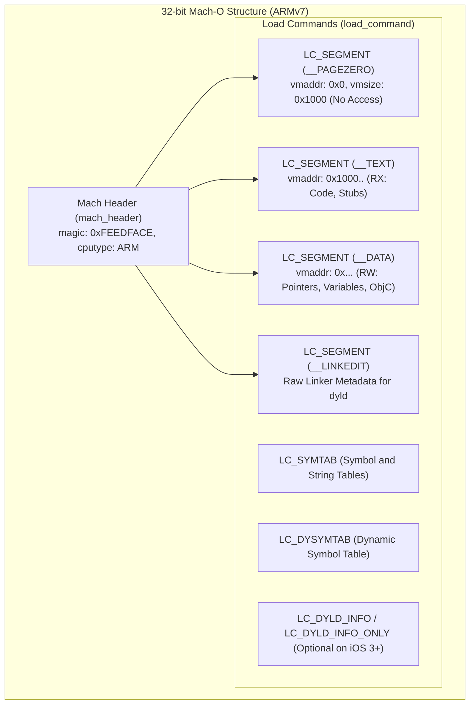
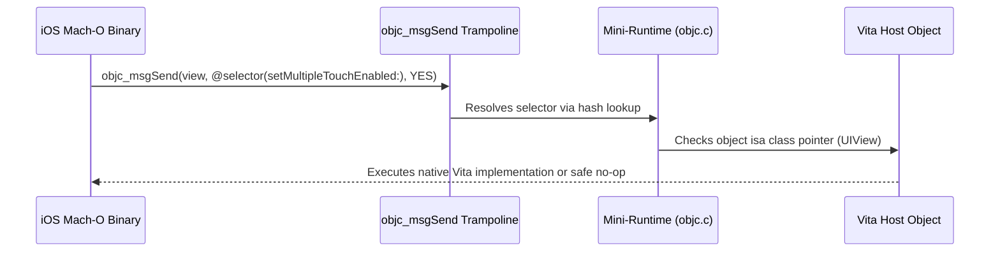

<div class="chapter-hero">
  <span class="chapter-badge">Chapter 16 • iOS Mach-O Architecture</span>
  <h1 style="margin: 0.4rem 0 0.6rem 0; font-size: 2rem;">iOS Game Porting & Mach-O Loader Architecture</h1>
  <p style="margin: 0; opacity: 0.9; font-size: 1.05rem;">
    Deep engineering methodology for running 32-bit Mach-O (ARMv6/ARMv7) iOS binaries natively on PlayStation Vita: static dyld linking, Darwin ABI mitigation (r9 and stack alignment), mini Objective-C runtime in pure C, and Apple subsystems.
  </p>
  <div class="chapter-meta">
    <span class="chapter-meta-pill">⚡ Level: Expert</span>
    <span class="chapter-meta-pill">🧠 Focus: Mach-O MH_EXECUTE, Darwin ABI, objc_msgSend, CgBI PNG</span>
    <span class="chapter-meta-pill">🎮 Verified Cases: Inotia 2, Prince of Persia WW, Rayman 2, Zenonia 5, PES 2011</span>
  </div>
</div>

---

Until recently, the PlayStation Vita homebrew community largely regarded userspace native loading as exclusive to Android (.so ELF). However, the classic iOS catalog (iPhone OS 2.0 to iOS 6.0) contains an immense treasury of timeless games that run on the **exact same 32-bit ARMv7-A CPU architecture** found in the PlayStation Vita.

Using the [`ios-loader-boilerplate`](https://github.com/MetalSyntax/ios-loader-boilerplate) framework and pioneer ports like *Inotia 2*, *Rayman 2*, *Prince of Persia: Warrior Within*, *Zenonia 5*, and *Call of Duty: World at War Zombies*, developers can load **Mach-O** executables directly into Vita RAM with **zero emulation overhead**.

---

## 🏛️ Anatomy of a 32-Bit Mach-O Binary

Unlike Android `.so` libraries (which are standard dynamic shared objects, ELF `ET_DYN`), the executable inside an iOS `.ipa` archive is almost always an **`MH_EXECUTE`** binary (a complete main executable).



### Critical Sections Inside Mach-O Segments

| Segment | Section | Role & Handling in the Loader |
|---|---|---|
| `__TEXT` | `__text` | Executable ARMv7 machine instructions. |
| `__TEXT` | `__symbol_stub4` | Small 4 or 12-byte trampolines (`ldr pc, [pc, #...]`) jumping to pointers in `__la_symbol_ptr`. |
| `__TEXT` | `__stub_helper` | Original dynamic linker helper routines (bypassed in the loader). |
| `__DATA` | `__nl_symbol_ptr` | Non-Lazy Symbol Pointers: system data and function pointers resolved on initial startup. |
| `__DATA` | `__la_symbol_ptr` | Lazy Symbol Pointers: overwritten by the loader with our native VitaSDK/vitaGL function addresses. |
| `__DATA` | `__mod_init_func` | Array of C++ static constructors (identical to `.init_array` in ELF). |
| `__DATA` | `__objc_*` | Objective-C class, selector, ivar, and method metadata. |

---

## ⚠️ The Non-PIE Dilemma (Position Independent Executable)

Binaries compiled for iOS 2.0 through 4.x were typically built without PIE. This means:
1. The `__TEXT` segment is hard-linked to reside at fixed low virtual addresses (commonly `0x1000` or `0x4000`).
2. On VitaOS, low userland virtual addresses are reserved or conflict with the console's own `eboot.bin`.
3. The binary **lacks standard dynamic local relocations** (`nlocrel = 0` in `LC_DYSYMTAB`).

### The Solution: Fixed Base Slide and Offline Rebase Hints (`macho_prep.py`)

To resolve this without invasive kernel page table hacks, the loader slides the entire binary into high Vita userland memory:

```c
#define MACHO_SLIDE 0x98000000
```

To rebase all absolute pointers pointing to `__TEXT` or `__DATA`:
1. The offline tool [`tools/macho_prep.py`](https://github.com/MetalSyntax/ios-loader-boilerplate/blob/main/tools/macho_prep.py) parses the decrypted binary on the host workstation.
2. It scans every 32-bit word in the `__DATA` segment.
3. If a word's value falls within the original address range of `__TEXT` or `__DATA`, it is categorized as an internal pointer and saved into a binary offset table: `rebase.bin`.
4. The tool intelligently filters false positives (e.g., raw numeric constants or Thumb-2 branch pairs) preventing memory corruption.
5. At runtime on the PS Vita, the loader reads `rebase.bin` and applies `MACHO_SLIDE` to each offset within milliseconds:

```c
void macho_apply_rebases(uintptr_t slide, const char *rebase_path) {
    SceUID fd = sceIoOpen(rebase_path, SCE_O_RDONLY, 0);
    if (fd < 0) return;
    
    uint32_t offset;
    while (sceIoRead(fd, &offset, sizeof(uint32_t)) == sizeof(uint32_t)) {
        uint32_t *ptr = (uint32_t *)(slide + offset);
        *ptr += slide;
    }
    sceIoClose(fd);
}
```

---

## 🔒 FairPlay DRM Decryption: Verifying `cryptid`

Binaries obtained directly from an encrypted iTunes IPA backup are protected by Apple's FairPlay encryption. **An encrypted Mach-O binary will crash instantly with a Data Abort exception on the PS Vita.**

The Mach-O header contains the `LC_ENCRYPTION_INFO` load command:
```c
struct encryption_info_command {
    uint32_t cmd;        // LC_ENCRYPTION_INFO (0x21)
    uint32_t cmdsize;    // sizeof(struct encryption_info_command)
    uint32_t cryptoff;   // Offset of the encrypted segment
    uint32_t cryptsize;  // Size of the encrypted segment
    uint32_t cryptid;    // 0 = Decrypted, 1 = Encrypted with FairPlay
};
```

> [!IMPORTANT]
> The `cryptid` field **MUST be 0**. If it is 1, the binary must first be dumped from a jailbroken 32-bit iOS device using tools such as `Clutch`, `dumpdecrypted`, `bfdecrypt`, or `frida-ios-dump`.

---

## 🥊 ABI Collision: Darwin ARM vs VitaSDK AAPCS

Discrepancies between Apple's Darwin ARM ABI (LLVM/Clang) and VitaSDK's standard ARM EABI (GCC / newlib) represent the single most common cause of crashes in iOS ports.

```
+-------------------------------------------------------------------------------+
| CRITICAL RULE 1: REGISTER r9 IS A SCRATCH REGISTER IN DARWIN                  |
|                                                                               |
| In standard ARM AAPCS (VitaSDK), r9 is callee-saved or platform-reserved.     |
| In Apple's Darwin ARMv6/v7 ABI, r9 is an available scratch register that any  |
| function can overwrite without restoring.                                     |
|                                                                               |
| REMEDY:                                                                       |
| 1. Compile the ENTIRE Vita loader codebase with:                              |
|    -ffixed-r9                                                                 |
| 2. Always transition execution into guest code through an ASM trampoline     |
|    that preserves and restores r9 on the stack.                               |
+-------------------------------------------------------------------------------+
```

### Assembly Trampoline (`asm.S`)

```armasm
.syntax unified
.arch armv7-a
.text
.align 2

.global call_guest
.type call_guest, %function
// uint32_t call_guest(void *entry, uint32_t arg0, uint32_t arg1, uint32_t arg2);
call_guest:
    push {r4-r11, lr}     // Preserves all VitaSDK ABI registers (including r9)
    mov  r12, r0          // r12 = guest entry point
    mov  r0, r1           // r0 = arg0
    mov  r1, r2           // r1 = arg1
    mov  r2, r3           // r2 = arg2
    blx  r12              // Branch to iOS machine code
    pop  {r4-r11, pc}     // Restores intact VitaSDK CPU state
```

```
+-------------------------------------------------------------------------------+
| CRITICAL RULE 2: 4-BYTE STACK ALIGNMENT VS 8-BYTE AAPCS                       |
|                                                                               |
| 32-bit iOS Darwin code only guarantees 4-byte stack alignment (sp).           |
| However, VitaSDK's newlib runtime (printf, malloc, math functions using       |
| LDRD/STRD or VFP instructions) strictly requires 8-byte aligned stacks.       |
|                                                                               |
| If guest code executes a C callback with sp aligned to 4 bytes and reaches an  |
| LDRD instruction, the Cortex-A9 CPU throws an Alignment Exception.            |
+-------------------------------------------------------------------------------+
```

The loader remedies this with the `ml_align_call` helper:

```armasm
.global ml_align_call
.type ml_align_call, %function
// uint32_t ml_align_call(void *func, uint32_t a0, uint32_t a1, uint32_t a2);
ml_align_call:
    push {r4, lr}
    mov  r4, sp
    bic  sp, sp, #7       // Force 8-byte alignment on stack pointer
    mov  r12, r0
    mov  r0, r1
    mov  r1, r2
    mov  r2, r3
    blx  r12
    mov  sp, r4           // Restore original sp
    pop  {r4, pc}
```

```
+-------------------------------------------------------------------------------+
| CRITICAL RULE 3: SOFTFP CALLING CONVENTION                                    |
|                                                                               |
| 32-bit iOS binaries pass single and double precision floats through integer   |
| registers (r0-r3).                                                            |
| Therefore, vitaGL MUST be compiled with:                                      |
|    SOFTFP_ABI=1                                                               |
+-------------------------------------------------------------------------------+
```

---

## ☕ Pure C Objective-C Runtime Bridge (`objc.c`)

On Android, the OS bridge is Java, handled via **FalsoJNI**.  
On iOS, the OS interface is **Cocoa Touch (Objective-C)**. In Objective-C, method invocations are compiled as dynamic message dispatch calls:

$$\text{objc\_msgSend}(\text{id } self, \text{SEL } op, \dots)$$

Rather than bundling a full Objective-C compiler or heavy runtime, we construct a lightweight, high-performance **mini-runtime in pure C** (`objc.c`) utilizing hash tables for selectors and registered classes:



### Universal Dispatch Engine

```c
typedef struct {
    const char *name;
    void *func;
} ObjCMethod;

typedef struct {
    const char *name;
    const char *super_name;
    ObjCMethod methods[64];
    int method_count;
} ObjCClass;

id objc_msgSend_hook(id self, SEL op, ...) {
    if (!self) return NULL;
    
    const char *sel_name = sel_getName(op);
    ObjCClass *cls = (ObjCClass *)self->isa;
    
    for (int i = 0; i < cls->method_count; i++) {
        if (strcmp(cls->methods[i].name, sel_name) == 0) {
            va_list args;
            va_start(args, op);
            id res = ((id (*)(id, SEL, va_list))cls->methods[i].func)(self, op, args);
            va_end(args);
            return res;
        }
    }
    
    l_debug("[OBJC] Ignored unimplemented selector: -[%s %s]", cls->name, sel_name);
    return NULL;
}
```

### Emulating Foundation and UIKit Classes

The boilerplate supplies native C shims for standard iOS framework classes:

1. **`NSString`**: Wraps UTF-8/UTF-16 strings, supporting `stringWithUTF8String:`, `UTF8String`, and variadic formatting in `darwin_printf.c` with the `%@` specifier.
2. **`NSBundle`**: Maps `[[NSBundle mainBundle] resourcePath]` directly to `ux0:data/<slug>/<AppName>.app`.
3. **`UIDevice`**: Returns synthetic device identifiers: `iPhone3,1` (iPhone 4) or `iPad2,1` (iPad 2), with `systemVersion` set to `5.1.1` or `6.1.3`.
4. **`UIFont`**: Instead of relying on missing proprietary Apple system fonts, renders TrueType fonts on the fly using `stb_truetype` or `libfreetype` into a dynamic OpenGL glyph atlas.
5. **`UIApplication`**: Simulates the mobile application lifecycle by calling `application:didFinishLaunchingWithOptions:`.

---

## 🎨 Apple's Proprietary CgBI PNG Format

When Xcode builds an iOS IPA package, it automatically invokes `pngcrush` with the `-iphone` flag. This alters standard PNG files into Apple's proprietary **CgBI** format.

```
+-------------------------------------------------------------------------------+
| HOW CG_BI BREAKS STANDARD PNG DECODERS:                                       |
|                                                                               |
| 1. Prepends an extra chunk before 'IHDR': 'CgBI'.                             |
| 2. Strips standard zlib headers and Adler32 checksums from IDAT chunks        |
|    (raw DEFLATE stream).                                                      |
| 3. Stores color channels in premultiplied BGR / BGRA byte order rather than   |
|    unmultiplied standard RGBA.                                                |
|                                                                               |
| CONSEQUENCE: Standard libpng or stb_image aborts with:                        |
|    "Invalid or unrecognized PNG chunk: CgBI"                                  |
+-------------------------------------------------------------------------------+
```

The loader solves this seamlessly on-the-fly via [`source/cgbi.c`](https://github.com/MetalSyntax/ios-loader-boilerplate/blob/main/source/cgbi.c):

```c
int decompress_cgbi_png(const uint8_t *src, size_t src_len, uint8_t **out_rgba, int *w, int *h) {
    if (memcmp(src + 12, "CgBI", 4) != 0) {
        // Standard PNG: pass to conventional libpng
        return decode_standard_png(src, src_len, out_rgba, w, h);
    }
    
    // 1. Parse IHDR dimensions and bit depth
    // 2. Concatenate raw IDAT payloads
    // 3. Decompress raw DEFLATE stream using zlib's inflateRaw
    // 4. Swap byte channels: BGRA -> RGBA
    // 5. Un-premultiply alpha: R = (B * 255) / A
    // Result: Standard RGBA pixel buffer ready for glTexImage2D
    return 1;
}
```

---

## 🔊 Audio Subsystem: CoreAudio & AudioQueue

While Android ports rely on OpenSL ES or JNI AudioTrack, iOS utilizes **CoreAudio** and **AudioQueue Services**.

In the boilerplate (`source/coreaudio.c`), the RemoteIO AudioUnit interface is mapped directly onto a dedicated high-priority VitaOS audio thread:

```c
static SceUID s_audio_thread = -1;

static int audio_render_thread(SceSize args, void *argp) {
    int port = sceAudioOutOpenPort(SCE_AUDIO_OUT_PORT_TYPE_MAIN, 1024, 44100, SCE_AUDIO_OUT_PARAM_FORMAT_S16_STEREO);
    int16_t buffer[1024 * 2]; // 1024 stereo samples
    
    while (s_audio_running) {
        AudioBufferList ioData;
        ioData.mNumberBuffers = 1;
        ioData.mBuffers[0].mData = buffer;
        ioData.mBuffers[0].mDataByteSize = sizeof(buffer);
        
        g_render_callback(g_render_context, NULL, NULL, 0, 1024, &ioData);
        
        // Blocking output paces the audio clock against real hardware
        sceAudioOutOutput(port, buffer);
    }
    
    sceAudioOutClosePort(port);
    return 0;
}
```

---

## 🚀 iOS Port Quickstart Flow

Using `psvita-toolkit`, scaffolding an iOS port from a decrypted IPA is automated:

```bash
# 1. Initialize port directory directly from IPA
psvita-toolkit init-port --ipa /path/to/game.ipa

# 2. Automated tasks executed:
#    - Extracts <App>.app bundle
#    - Verifies cryptid == 0 on the Mach-O binary
#    - Runs macho_prep.py to generate rebase.bin
#    - Configures CMakeLists.txt and ios-loader-boilerplate tree

# 3. Build vitaGL with SoftFP ABI support
cd vendor/vitaGL && ./build_vitagl.sh

# 4. Compile the output VPK
cmake -B build
cmake --build build
```
