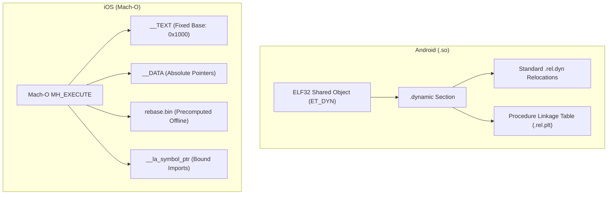
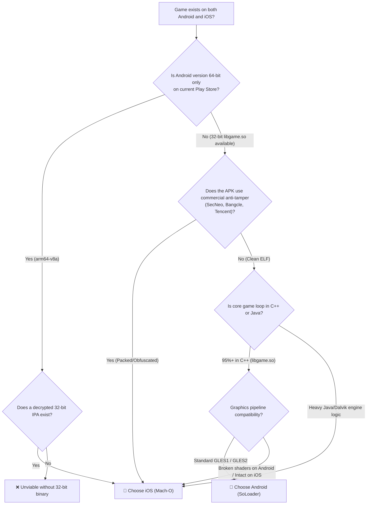

<div class="chapter-hero">
  <span class="chapter-badge">Chapter 17 • Comparative Analysis</span>
  <h1 style="margin: 0.4rem 0 0.6rem 0; font-size: 2rem;">Key Differences: Porting from Android vs iOS</h1>
  <p style="margin: 0; opacity: 0.9; font-size: 1.05rem;">
    Comprehensive architectural comparison between Android and Apple iOS mobile gaming ecosystems on PlayStation Vita: binary formats (ELF vs Mach-O), bridge layers (JNI vs ObjC), ABI intricacies, asset pipelines, and viability decision trees.
  </p>
  <div class="chapter-meta">
    <span class="chapter-meta-pill">⚡ Level: Intermediate / Advanced</span>
    <span class="chapter-meta-pill">⚖️ Comparison: ELF32 vs Mach-O, FalsoJNI vs Mini-ObjC, Bionic vs Darwin</span>
    <span class="chapter-meta-pill">🎯 Decision Tree: When to pick APK vs IPA?</span>
  </div>
</div>

---

Until the emergence of the Mach-O loader, PlayStation Vita developers focused almost exclusively on Android `.apk` files. However, for hundreds of classic titles from the golden age of smartphone gaming (2008–2014), **the iOS release is objectively superior**, featuring higher framerates, uncompressed audio, higher resolution textures, and freedom from Java garbage collection spikes.

Understanding the deep architectural differences between both platforms is essential when selecting the optimal source target for a port.

---

## 📊 Comprehensive Comparison Matrix: Android vs iOS

| Technical Dimension | Android (`.apk` / `.so`) | Apple iOS (`.ipa` / `Mach-O`) |
|---|---|---|
| **Binary Executable Format** | **ELF32** (`ET_DYN` - Shared Library / `.so`). | **Mach-O 32-bit** (`MH_EXECUTE` - Main Executable). |
| **Guest Operating System** | Linux kernel + **Bionic libc**. | Mach/BSD kernel (XNU) + **Darwin Libc**. |
| **High-Level Abstraction** | **Java VM** (Dalvik / ART) via **JNI**. | **Cocoa Touch / Objective-C** (`objc_msgSend`). |
| **Bridge Implementation** | **`FalsoJNI`** (JVM/JNIEnv simulator). | **`Mini-Runtime ObjC`** (C selector hash dispatcher). |
| **Relocation Mechanism** | Standard dynamic ELF (`R_ARM_RELATIVE`, `R_ARM_GLOB_DAT`). | Fixed slide (`MACHO_SLIDE`) + offline **`rebase.bin`**. |
| **Register `r9` Usage** | Standard AAPCS (callee-saved or platform-reserved). | **Scratch register** in Darwin ARM (freely clobbered!). |
| **Stack Alignment (`sp`)** | 8 bytes (AAPCS standard). | **4 bytes** (Requires 8-byte `ml_align_call` alignment). |
| **Floating-Point Convention** | SoftFP or HardFP (typically SoftFP in armeabi-v7a). | **Strict SoftFP** (Requires `vitaGL` with `SOFTFP_ABI=1`). |
| **Encryption / DRM** | Plain ZIP APK (or commercial packers like SecNeo). | **FairPlay DRM** encrypted (`cryptid = 0` mandatory). |
| **Asset Directory Layout** | `assets/`, `res/`, uncompressed `.obb` archives. | Root `<AppName>.app/` bundle directory inside IPA. |
| **Texture / Image Formats** | Standard RGBA PNG, ETC1 / PVRTC compressed textures. | **Apple CgBI PNG** (swapped BGRA, raw DEFLATE) & PVRTC. |
| **Audio Subsystem** | OpenSL ES, SoundPool, AudioTrack (Java). | **CoreAudio**, AudioQueue, OpenAL, FMOD. |

---

## 🔬 Low-Level Technical Divergences

### 1. Binary Structure: Shared Library vs Main Executable



- **Android:** The game is a shared library (`libgame.so`) loaded via `so_load()`. Relocations are standard dynamic ELF relocations resolved smoothly at runtime.
- **iOS:** The executable is the full program (`MH_EXECUTE`). Legacy iOS binaries were built non-PIE, meaning the code segment (`__TEXT`) assumes a low fixed base (e.g., `0x1000`). It must be slid into high memory (`MACHO_SLIDE = 0x98000000`) and patched with `rebase.bin`.

### 2. OS Bridge Layer: JNI vs Objective-C Messaging

The conceptual difference between platforms is reflected in how game code accesses device services:

```c
// ============================================================================
// ANDROID: Querying device model via JNI
// ============================================================================
jstring Java_com_game_GetPhoneModel(JNIEnv *env, jobject thiz) {
    jclass buildClass = (*env)->FindClass(env, "android/os/Build");
    jfieldID modelField = (*env)->GetStaticFieldID(env, buildClass, "MODEL", "Ljava/lang/String;");
    return (*env)->GetStaticObjectField(env, buildClass, modelField);
}

// ============================================================================
// IOS: Querying device model via Objective-C
// ============================================================================
// In iOS source code: [[UIDevice currentDevice] model];
// In ARM assembly:
// 1. r0 = objc_getClass("UIDevice");
// 2. r1 = sel_registerName("currentDevice");
// 3. r0 = objc_msgSend(r0, r1);
// 4. r1 = sel_registerName("model");
// 5. r0 = objc_msgSend(r0, r1);
```

- **The iOS Advantage:** Objective-C is an object-oriented extension to C. There is no heavy virtual machine, no garbage collection pauses, and no cumbersome JNI method signature strings (`(Ljava/lang/String;I)V`). A lightweight C hash-table dispatcher is all that is required.
- **The Android Advantage:** `FalsoJNI` is mature and battle-tested within the PS Vita ecosystem, with hundreds of common Android API stubs readily available.

### 3. Register `r9` and Stack Alignment: The Darwin ABI Trap

Attempting to run a 32-bit iOS binary inside a generic Android loader will trigger immediate `0x80010005` (Data Abort) crashes or silent memory corruption:

```
          STANDARD ARM AAPCS (VitaSDK)                  APPLE DARWIN ARM ABI
     +----------------------------------+       +----------------------------------+
r0   | Argument 0 / Return Value        |       | Argument 0 / Return Value        |
r1   | Argument 1                       |       | Argument 1                       |
r2   | Argument 2                       |       | Argument 2                       |
r3   | Argument 3                       |       | Argument 3                       |
r4-r8| Callee-Saved Registers           |       | Callee-Saved Registers           |
r9   | CALLEE-SAVED / RESERVED ON VITA  |  VS   | SCRATCH REGISTER (FREELY CLOBBERED)
r10-11 Preserved                        |       | Preserved                        |
sp   | MANDATORY 8-BYTE ALIGNMENT       |  VS   | RELAXED 4-BYTE ALIGNMENT         |
```

- In Apple's Darwin ARMv6/v7 ABI, `r9` is treated as a temporary scratch register. Guest functions clobber it without preservation. The Vita loader MUST be compiled with `-ffixed-r9` and transition calls using `call_guest`.
- Furthermore, iOS 4-byte stack alignment will trigger fatal alignment traps on Cortex-A9 when VitaSDK libc functions execute double-word memory operations (`LDRD`/`STRD`). The `ml_align_call` wrapper guarantees 8-byte alignment before newlib execution.

---

## 🌳 Viability Decision Tree: APK or IPA?

When choosing between Android and iOS releases for a target title:



### Real-World Viability Case Studies:

#### Case 1: *Prince of Persia: Warrior Within*
- **Android:** Android build suffered from severe shader incompatibilities, legacy GPU texture formats, and build regressions.
- **iOS:** Clean 32-bit Mach-O ARMv7 binary with full symbol names, high-quality audio, and uncompressed cutscenes.
- **Verdict:** **Successfully ported using the iOS loader.**

#### Case 2: *Rayman 2: The Great Escape*
- **Android:** Never released by Gameloft on Android; exclusively available on iOS.
- **iOS:** Flawless 32-bit Mach-O binary with GLES1 rendering and CD-quality audio.
- **Verdict:** **Ported exclusively using iOS.**

#### Case 3: *Zenonia 5*
- **Android:** Heavily bound to dead Google Play Game Services and obsolete online DRM.
- **iOS:** Network checks cleanly bypassable via local BSD socket loopback emulation in under 200 lines of C.
- **Verdict:** **Ported using iOS.**

#### Case 4: *Badland 2*
- **Android:** Clean Cocos2d-x `libcocos2dcpp.so` with virtually no Java logic.
- **iOS:** Complex UIKit overlay code.
- **Verdict:** **Ported using Android.**
