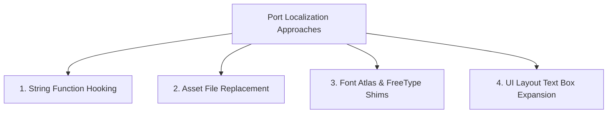
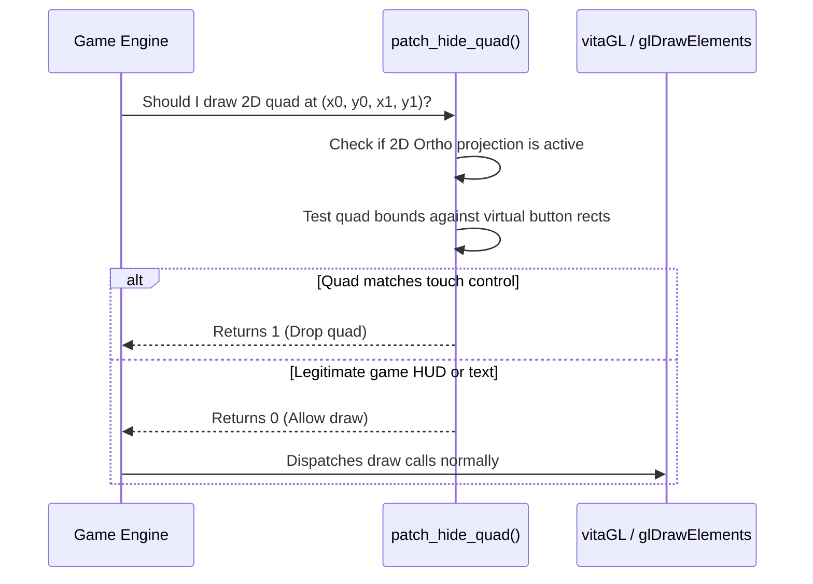

<div class="chapter-hero">
  <span class="chapter-badge">Chapter 18 • Advanced Engineering</span>
  <h1 style="margin: 0.4rem 0 0.6rem 0; font-size: 2rem;">Advanced Techniques & Game Enhancements</h1>
  <p style="margin: 0; opacity: 0.9; font-size: 1.05rem;">
    Production-grade enhancements for PlayStation Vita ports: multi-threaded FFmpeg video playback with hardware clock sync, game translation and FreeType dynamic glyph rendering, 60 FPS unlocking with physics decoupling, virtual touch HUD elimination (patch_hide_quad), in-memory loopback DRM servers, and direct GPU PVRTC VRAM streaming.
  </p>
  <div class="chapter-meta">
    <span class="chapter-meta-pill">⚡ Level: Expert</span>
    <span class="chapter-meta-pill">🎬 Video: FFmpeg SW vs SceAvPlayer HW</span>
    <span class="chapter-meta-pill">🚀 Performance: 60 FPS, NEON, Direct PVRTC VRAM</span>
    <span class="chapter-meta-pill">🌐 Modding: Dynamic I18n, FreeType, Loopback DRM</span>
  </div>
</div>

---

A truly outstanding PS Vita port goes far beyond simply achieving a bootable game. It transforms a mobile smartphone title into a polished, console-grade experience: playing cinematic cutscenes flawlessly, supporting community translations, running at a rock-solid 60 FPS, and removing cluttering on-screen touch buttons.

This chapter synthesizes cutting-edge reverse engineering patterns derived from battle-tested production ports.

---

## 🎬 1. Video Playback: Multi-Threaded FFmpeg vs Hardware

Numerous classic mobile games pack cutscenes in `.mp4` containers. However, the PlayStation Vita's hardware video decoder (`SceVideodec`, exposed via `SceAvPlayer`) **strictly decodes H.264/AVC**. It does not support **MPEG-4 Part 2 (`mp4v`)**, which is the precise codec used in dozens of 2008–2012 titles (e.g., *Prince of Persia: Warrior Within*, *Dungeon Hunter 2*, *Asphalt 5*).

```
+-------------------------------------------------------------------------------+
| THE VIDEO PLAYBACK PARADOX ON PS VITA:                                        |
|                                                                               |
| 1. SceAvPlayer (Hardware):                                                    |
|    - Zero CPU utilization (dedicated hardware ASIC decoder).                  |
|    - Strictly supports H.264 (avc1) / AAC.                                    |
|    - For MPEG-4 Part 2 assets, SceAvPlayer demuxes the file, fails to yield   |
|      frames, and terminates silently after ~1.6 seconds.                      |
|                                                                               |
| 2. FFmpeg (Software Decoupled):                                               |
|    - Decodes ANY format (MPEG-4 Part 2, Sorenson, VP6, AAC, MP3).               |
|    - Leaves original game assets unmodified (no re-encoding required).        |
|    - Requires multi-threaded architecture to sustain steady 30/60 FPS.       |
+-------------------------------------------------------------------------------+
```

### The Upstream `vitasdk` Bug and the Lightweight MP4 Demuxer

A known defect in the VitaSDK `libavformat.a` build causes `mov.o` (`ff_mov_demuxer`) to be omitted from the static archive. Consequently, `avformat_open_input()` fails with error `-1094995529 (Invalid data found)`.

In ports like *Prince of Persia: Warrior Within*, the battle-tested solution was to bypass `libavformat` entirely by implementing a **minimal ISO-BMFF (MP4) box parser** in pure C that reads container atoms (`moov`, `trak`, `mdia`, `minf`, `stbl`, `stsz`, `stco`) directly via `sceIoOpen` and `sceIoRead`, feeding raw elementary streams into `libavcodec`:

```mermaid
graph TD
    subgraph "Multi-Threaded Video Architecture"
        File["MP4 Container (ux0:data/.../cutscene.mp4)"] --> Demux["Lightweight ISO-BMFF Demuxer (sceIoRead)"]
        
        Demux -->|H.264 / MPEG-4 Packets| VidQ["Video Ring Buffer"]
        Demux -->|AAC Packets| AudQ["Audio Queue"]
        
        subgraph "Decode Thread (Cores 1-2)"
            VidQ --> AVCodec["libavcodec (avcodec_receive_frame)"]
            AVCodec --> NEON["YUV420P -> RGB565 (SIMD NEON)"]
            NEON --> TripleBuf["Triple-Buffered Ready Queue"]
        end
        
        subgraph "Audio Thread (Core 2)"
            AudQ --> AACDec["AAC Decoder (libavcodec)"]
            AACDec --> Resample["S16 Stereo Resampler (libswresample)"]
            Resample --> SceAudio["sceAudioOutOutput (Master Clock)"]
        end
        
        subgraph "Render Thread (Core 0 - GXM)"
            TripleBuf --> TexUp["glTexSubImage2D / vglUpdateTexture"]
            TexUp --> DrawQuad["Draw 960x544 Fullscreen Quad"]
            DrawQuad --> Swap["vglSwapBuffers"]
        end
    end
    
    SceAudio -.->|Physical Audio Sample Sync Clock| TripleBuf
```



### SIMD NEON-Accelerated YUV-to-RGB Conversion

Converting 848x480 YUV420P frames to RGB via standard C loops takes over 25 ms per frame, crippling playback. Using **ARM NEON** intrinsics reduces this to under **2.1 ms**:

```c
#include <arm_neon.h>

void neon_yuv420p_to_rgb565(const uint8_t *y, const uint8_t *u, const uint8_t *v, 
                            uint16_t *dst, int width, int height) {
    for (int j = 0; j < height; j++) {
        for (int i = 0; i < width; i += 8) {
            uint8x8_t y_val = vld1_u8(y + i);
            uint8x8_t u_val = vld1_u8(u + (i >> 1));
            uint8x8_t v_val = vld1_u8(v + (i >> 1));
            
            // Fast vectorized arithmetic in 128-bit Q registers
            // ... [Vectorized YUV matrix multiplication] ...
            
            uint16x8_t rgb565 = vorrq_u16(
                vorrq_u16(vshlq_n_u16(r_5, 11), vshlq_n_u16(g_6, 5)), 
                b_5
            );
            vst1q_u16(dst + i, rgb565);
        }
        y += width;
        if (j & 1) { u += width >> 1; v += width >> 1; }
        dst += width;
    }
}
```

### Flawless Audio/Video Synchronization

To prevent A/V drift where audio and lips diverge:
1. **Audio drives the clock:** `sceAudioOutOutput()` is hardware blocking.
2. We compute elapsed playback time strictly based on audio samples consumed:  
   $$\text{Audio Time} = \frac{\text{Played Samples}}{\text{Sample Rate (44100 Hz)}}$$
3. The render thread presents the frame whose Presentation Timestamp (PTS) matches the physical audio clock.

---

## 🌐 2. Game Translation & Localization (I18n)

When porting games that lacked official language support, developers can apply four proven localization methodologies:



### Method A: Memory Hooking of String Getters

If the engine retrieves strings through a centralized routine like `GetLocString(int id)` or `CS_GetText(int id)`:

```c
static char *(*original_GetLocString)(int id);

char *GetLocString_hook(int id) {
    const char *translated = translation_lookup(id);
    if (translated) {
        return (char *)translated;
    }
    return original_GetLocString(id);
}

void init_translation_system(void) {
    translation_load_dictionary("ux0:data/game/translation/strings_es.json");
    hook_addr((uintptr_t)so_symbol(&so_mod, "_Z12GetLocStringi"), (uintptr_t)&GetLocString_hook);
}
```

### Method B: Solving Missing Glyphs with FreeType Shims

Classic mobile games often pack bitmap fonts containing only ASCII characters 32–127. Injecting accented characters (`á, é, í, ó, ú, ñ, ¿, ¡`) results in question marks, blanks, or memory crashes.

```
+-------------------------------------------------------------------------------+
| SOLUTION: DYNAMIC FREETYPE FONT RENDERING                                     |
|                                                                               |
| 1. Intercept the engine's text draw calls.                                    |
| 2. Load a standard TTF font from ux0:data/font.ttf via libfreetype or         |
|    stb_truetype.                                                              |
| 3. Dynamically rasterize missing UTF-8 codepoints into a dynamic OpenGL glyph  |
|    atlas texture on demand.                                                   |
+-------------------------------------------------------------------------------+
```

In the iOS loader (`source/objc.c`), the `UIFont` and `NSStringDrawing` methods dispatch text directly to the FreeType engine:

```c
void render_utf8_string_freetype(const char *utf8_text, float x, float y, uint32_t color) {
    const uint8_t *p = (const uint8_t *)utf8_text;
    while (*p) {
        uint32_t codepoint = utf8_next_codepoint(&p);
        Glyph *g = freetype_cache_get_glyph(codepoint);
        if (g) {
            draw_textured_quad(x + g->bearing_x, y - g->bearing_y, g->width, g->height, g->texture_id);
            x += g->advance_x;
        }
    }
}
```

### Method C: UI Text Box Overflow Prevention

Romance languages (Spanish, French, Italian) typically require **20% to 30% more horizontal space** than English.  
If text clips outside mobile dialogue boxes:
1. **Dynamic Font Scaling:** Intercept text measurement and compute `scale = max_width / measured_width`. Apply `glScalef(scale, 1.0f, 1.0f)` when `scale < 1.0f`.
2. **Rectangle Expansion:** Patch dialogue bounding box coordinates in `__DATA`.

---

## ⚡ 3. Forcing 60 FPS: Framerate Uncapping & Physics Decoupling

Legacy mobile titles clamped gameplay to 30 FPS to conserve battery. On PS Vita's Cortex-A9 at 444 MHz, many of these titles run at a silky-smooth **60 FPS**.

### Step 1: Finding Frame Clamps in Disassembly

Look for timing calls in the main game loop:
- `usleep(33333)` or `sceKernelDelayThread(33333)`.
- Clamped delta-time floats: `1.0f / 30.0f` (`0x3D088889` in IEEE-754 hex).

### Step 2: Decoupling Physics from Render Framerate

Simply halving sleep delays to 16.6 ms causes physics to run at **double speed** if the engine ties physics updates directly to frame intervals.

Decouple physics using a fixed-timestep accumulator:

```c
static uint64_t s_last_time = 0;

void GameLoop_hook() {
    uint64_t now = sceKernelGetProcessTimeWide();
    float real_dt = (float)(now - s_last_time) / 1000000.0f;
    s_last_time = now;
    
    if (real_dt > 0.1f) real_dt = 0.1f;
    
    static float accumulator = 0.0f;
    accumulator += real_dt;
    
    const float FIXED_PHYSICS_STEP = 1.0f / 60.0f;
    while (accumulator >= FIXED_PHYSICS_STEP) {
        UpdatePhysics(FIXED_PHYSICS_STEP);
        accumulator -= FIXED_PHYSICS_STEP;
    }
    
    Render(); // Rendered at 60 FPS
}
```

### Preventing ARM VFP Traps on Cortex-A9

> [!CAUTION]
> If `FPSCR.LEN` or `STRIDE` bits are non-zero (VFP short vector mode), ARM Cortex-A9 generates an immediate **Undefined Instruction (`0x30002`)** exception. Always sanitize `FPSCR` during loader startup:

```c
void sanitize_fpscr(void) {
    uint32_t fpscr = 0;
    __asm__ volatile("vmrs %0, fpscr" : "=r"(fpscr));
    if (fpscr & 0x00370000) {
        fpscr &= ~0x00370000;
        __asm__ volatile("vmsr fpscr, %0" :: "r"(fpscr));
        l_info("[CPU] Sanitized FPSCR LEN/STRIDE bits");
    }
}
```

---

## 🚫 4. Eliminating On-Screen Touch HUDs (`patch_hide_quad`)

Once physical gamepad controls are mapped, lingering mobile virtual touch controls degrade immersion.

In *Rayman 2: The Great Escape*, the **`patch_hide_quad`** architecture intercepts 2D orthogonal render calls:



```c
typedef struct { int x0, x1, y0, y1; } Rect;

extern Rect *dpad_rect;
extern Rect *action_buttons[7];
extern int *g_ProjectionMatrixLevel; // 2 = 2D Ortho

int patch_hide_quad(float x0, float y0, float x1, float y1) {
    if (g_hud_visible_setting) return 0;
    if (!g_ProjectionMatrixLevel || *g_ProjectionMatrixLevel != 2) return 0;
    
    // Check collision against virtual stick
    if (x0 >= dpad_rect->x0 - 10 && x1 <= dpad_rect->x1 + 10 &&
        y0 >= dpad_rect->y0 - 10 && y1 <= dpad_rect->y1 + 10) {
        return 1;
    }
    
    // Check collision against action buttons
    for (int i = 0; i < 7; i++) {
        Rect *r = action_buttons[i];
        if (x0 >= r->x0 - 8 && x1 <= r->x1 + 8 && y0 >= r->y0 - 8 && y1 <= r->y1 + 8) {
            return 1;
        }
    }
    
    return 0; // Legitimate text or HUD element
}
```

---

## 🛰️ 5. In-Memory Loopback Servers & Offline DRM Bypass

Games like *Zenonia 5* crash on launch because their central authentication servers (e.g., `zn555.gamevil.com:10000`) were decommissioned years ago.

Instead of hunting hundreds of binary conditional jumps, the most robust technique intercepts BSD socket calls (`socket`, `connect`, `send`, `recv`) and runs an **in-memory loopback server**:

```c
static int fake_connect(int fd, const struct sockaddr *addr, socklen_t len) {
    l_info("[NET] Simulated immediate socket connection");
    return 0;
}

static int fake_send(int fd, const void *buf, size_t len, int flags) {
    const uint8_t *packet = (const uint8_t *)buf;
    uint16_t cmd = packet[2] | (packet[3] << 8);
    
    if (cmd == 0x100) { // CS_CONNECT
        uint8_t response[86] = {0};
        response[0] = 0;           // Status 0 = SUCCESS
        response[1] = 1;           // Connection accepted
        *(uint32_t *)(response + 8) = 1000001; // User ID
        strcpy((char *)response + 16, "VitaPlayer");
        
        enqueue_server_reply(0x101, response, 86); // SC_CONNECT
    }
    
    return len;
}

static int fake_recv(int fd, void *buf, size_t len, int flags) {
    return fetch_server_reply(buf, len);
}
```

This unlocks 100% of the game offline without touching gameplay logic.

---

## 🎨 6. Direct GPU PVRTC VRAM Upload

The Vita's PowerVR SGX543 GPU natively supports **hardware PVRTC (2bpp and 4bpp)** decompression.

Legacy mobile titles often fall back to slow CPU decompression (`PVRTCDecompress`) when running on unrecognized GPU drivers, inflating compressed assets into giant uncompressed RGBA32 buffers in RAM.

In *Hero of Sparta*, hooking `PVRTCDecompress` uploads compressed textures directly to VRAM:

```c
void PVRTCDecompress_hook(const void *compressed_data, int is_2bpp, int w, int h, void *out_rgba) {
    GLenum format = is_2bpp ? GL_COMPRESSED_RGB_PVRTC_2BPPV1_IMG : GL_COMPRESSED_RGBA_PVRTC_4BPPV1_IMG;
    glCompressedTexImage2D(GL_TEXTURE_2D, 0, format, w, h, 0, compressed_size, compressed_data);
}
```

**Impact:** Frees over 40 MiB of system RAM and cuts level transition load times from 12 seconds to **under 1 second**.
