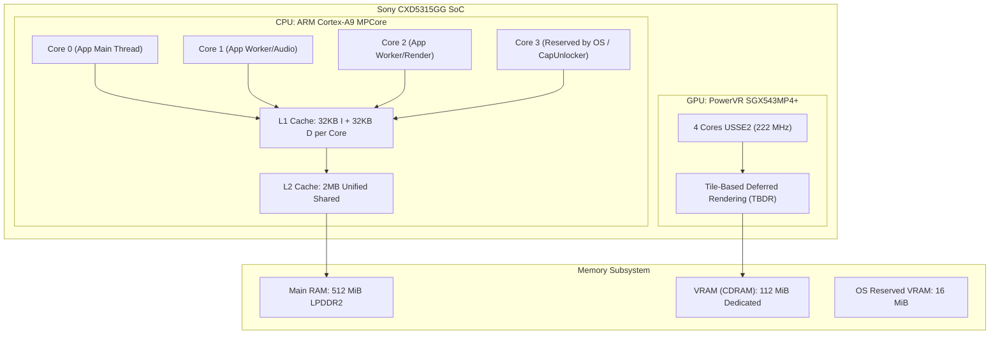
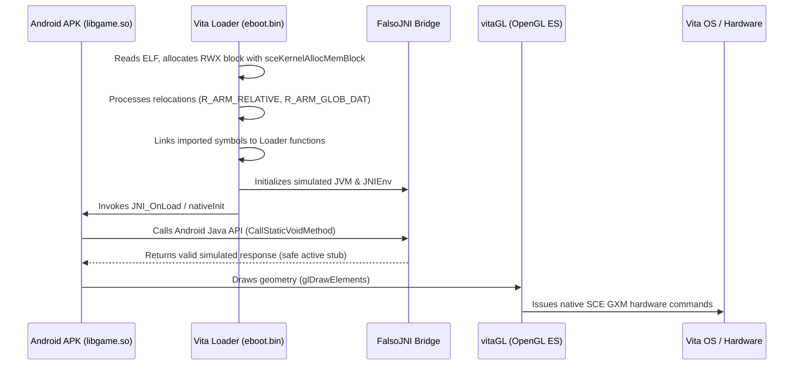

# 00. Fundamentals & Architecture

To master porting mobile games to the PlayStation Vita, one must understand both the console's physical hardware architecture and the theoretical foundation of the **SoLoader** methodology.

---

## 🔬 PS Vita Hardware Architecture

### 1. The CPU (ARM Cortex-A9 MPCore)
The PlayStation Vita features an **ARM Cortex-A9** 32-bit quad-core processor (ARMv7-A architecture).
- **Default Sony Clock:** 333 MHz (underclocked out of the factory to preserve battery).
- **Maximum Native Clock:** 444 MHz / 500 MHz (safely unlocked via code or plugins like `PSVshell`).
- **Caches:** 32 KiB L1 instruction + 32 KiB L1 data cache per core; 2 MiB unified shared L2 cache.
- **Floating Point Unit:** Hardware VFPv3-D32 and 128-bit SIMD NEON engine.
- **The 4th Core:** Reserved by default for VitaOS system background services. Using GrapheneCt's [CapUnlocker](https://github.com/GrapheneCt/CapUnlocker) kernel plugin, homebrew applications can claim this core by setting affinity mask `0x80000` via `sceKernelChangeThreadCpuAffinityMask()`.

### 2. The GPU (PowerVR SGX543MP4+)
A 4-core PowerVR Series5XT graphics chip clocked up to 222 MHz, utilizing a **Tile-Based Deferred Rendering (TBDR)** pipeline.
- The GPU breaks the screen into 16x16 pixel tiles, performing Hidden Surface Removal (HSR / Early-Z) *before* fragment shading occurs, conserving massive amounts of memory bandwidth.

### 3. Main Memory vs Video Memory (CDRAM)
Physically, the Vita has two distinct memory buses and partitions:

| Memory Partition | Physical Size | Usable by Homebrew | Role and Characteristics |
|---|---|---|---|
| **Main RAM** | 512 MiB | ~300 MiB to 420 MiB | System RAM accessible by CPU. Houses code, heap, the loaded `.so` binary, decompressed assets, and the FalsoJNI runtime. |
| **CDRAM (VRAM)** | 128 MiB | **112 MiB** | Ultra-fast VRAM directly tied to the GPU bus. Used for framebuffers, active textures, vertex and index buffers. |
| **System VRAM** | 16 MiB | 0 MiB | Reserved by VitaOS for LiveArea UI and system overlays. |

---

## 💡 What is the SoLoader Technique?

Most emulators interpret alien CPU instructions or translate them dynamically via a JIT (Just-In-Time) compiler. **The SoLoader technique is neither an emulator nor a recompiler.**

### Why does Android ARMv7 execute NATIVELY on PS Vita?
Both the PlayStation Vita and 2010–2016 era Android smartphones share the **exact same Instruction Set Architecture: ARMv7-A (32-bit)** with Thumb-2 instructions and VFP/NEON.

When a game is built for Android using the Android NDK in C++, the compiler outputs an ELF shared library: `libgame.so`. That binary contains **raw, bare-metal ARM machine instructions**.

| Platform | CPU ISA | Binary Format | Calling Convention |
|---|---|---|---|
| **Android 32-bit** | ARMv7-A (Cortex-A8/A9/A15) | ELF32 (`.so`) | AAPCS (ARM Architecture Procedure Call Standard) |
| **PlayStation Vita** | ARMv7-A (Cortex-A9 MPCore) | ELF32 / Sony SELF (`eboot.bin`) | AAPCS (with softfp / hardfp ABI matching) |

Because the PlayStation Vita CPU inherently understands the ARM opcodes in the Android `.so`, **the Vita executes the game's code directly on bare-metal silicon with ZERO CPU emulation overhead.**

### The Loader as the Guest Operating System
If instructions are natively compatible, why can't we run the `.so` directly?
Because the `.so` expects an **Android/Linux runtime environment**:
1. It expects Android's standard C library (**Bionic libc**), with Linux syscalls like `open()`, `mmap()`, `pthread_create()`.
2. It expects Android's display surface (**EGL / SurfaceView / OpenGL ES**).
3. It expects audio via **OpenSL ES**, **AudioTrack**, or **SoundPool**.
4. It expects a living Java Virtual Machine (**Dalvik / ART**) responding to **JNI** calls.

The **SoLoader** (compiled into your Vita `eboot.bin`) provides that bridge:
- It maps the ELF code and data segments into Vita memory.
- It adjusts all absolute pointers using the ARM relocation table.
- It intercepts imported functions (`malloc`, `memcpy`, `glDrawArrays`) and routes them to VitaSDK and vitaGL.
- It supplies **FalsoJNI**, a lightweight C runtime that answers all Java queries (device model, storage paths, keyboard inputs, audio state) without running an actual Java VM.
