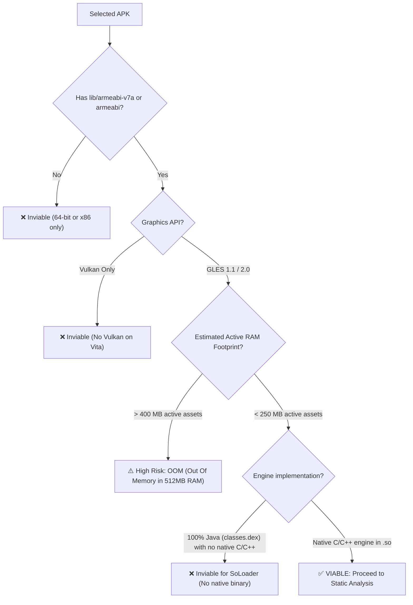

# 02. APK Triage & Viability Analysis

Before writing code or scaffolding a CMake project, performing an initial **feasibility triage on the APK** is critical. Evaluating the binary up-front saves weeks of dead-end engineering.

---

## 📦 APK Anatomy

An `.apk` file is a standard **ZIP archive**. You can unpack it or inspect its contents directly:

```
game.apk (ZIP)
├── AndroidManifest.xml        # Binary manifest (Java package, GLES version, permissions)
├── classes.dex                # Dalvik executable bytecode for Java classes
├── assets/                    # Game assets (models, textures, audio tracks, levels)
├── res/                       # Android UI layouts and application icons
├── lib/                       # COMPILED NATIVE SHARED LIBRARIES (.so)
│   ├── armeabi/               # ARMv5/v6 binaries (32-bit, soft-float)
│   ├── armeabi-v7a/           # ARMv7-A binaries (32-bit, Thumb-2, VFPv3/NEON) [IDEAL]
│   ├── arm64-v8a/             # ARMv8 binaries (64-bit) [DIRECTLY INCOMPATIBLE]
│   └── x86/                   # Intel x86 binaries [INCOMPATIBLE]
└── META-INF/                  # APK cryptographic signatures
```

---

## 🔍 Criterion 1: Architecture Compatibility (ABI)

Inspect the `lib/` directory inside the APK:

```bash
unzip -l game.apk "lib/*"
```

| ABI Folder | Verdict | Technical Reality on PS Vita |
|---|---|---|
| **`lib/armeabi-v7a/`** | **OPTIMAL (Ideal)** | 32-bit ARMv7 code with Thumb-2 and NEON SIMD vectorization. Exactly matches the Vita's Cortex-A9 CPU. |
| **`lib/armeabi/`** | **COMPATIBLE** | 32-bit ARMv5TE/v6 code with soft-float arithmetic. Runs natively on Vita because ARMv7 is a strict superset of ARMv6. |
| **`lib/arm64-v8a/`** | **INCOMPATIBLE** (32-bit) | 64-bit AArch64 instructions. The PS Vita is strictly a 32-bit machine. If the APK only contains 64-bit binaries, search for an earlier release of the game (pre-August 2019, when Google mandated 64-bit binaries). |
| **`lib/x86/` / `lib/x86_64/`** | **INCOMPATIBLE** | Intel/AMD instruction sets. |

---

## 🎨 Criterion 2: Graphics API (OpenGL ES)

The PS Vita hardware GPU supports **OpenGL ES 1.1** and **OpenGL ES 2.0** via [vitaGL](https://github.com/Rinnegatamante/vitaGL).

### Detecting the OpenGL ES Version:

1. **Inspect `AndroidManifest.xml` via `jadx`:**
   Look for `glEsVersion`:
   - `0x00010000` / `0x00010001`: OpenGL ES 1.0 / 1.1 (Fixed function pipeline).
   - `0x00020000`: OpenGL ES 2.0 (Programmable vertex and fragment shaders).
   - `0x00030000`+: OpenGL ES 3.0+. *Caution:* Hardware GLES3 features like transform feedback or 3D textures are not natively available on the Vita GPU.

2. **Inspect imported symbols in `.so`:**
   ```bash
   objdump -T lib/armeabi-v7a/libgame.so | grep -E "gl(Vertex|Color|CreateShader|Uniform)"
   ```
   - If `glVertexPointer`, `glColorPointer`, `glMatrixMode` appear: **OpenGL ES 1.1**. Handled with extreme speed by vitaGL's fixed-function pipeline.
   - If `glCreateShader`, `glCompileShader`, `glUniformMatrix4fv` appear: **OpenGL ES 2.0**. Uses vitaGL's programmable shader pipeline.
   - If `vkCreateInstance`, `vkCreateDevice` appear: **Vulkan**. The Vita has **no** Vulkan driver. Unless an OpenGL ES fallback exists, the port is not viable.

---

## 🔗 Criterion 3: NDK Dependencies

Check the external shared libraries needed by the game:

```bash
arm-vita-eabi-readelf -d lib/armeabi-v7a/libgame.so | grep NEEDED
```

Standard dependencies and their Vita status:

| Dependency | Status | Handling on PS Vita |
|---|---|---|
| `libc.so`, `libm.so`, `libdl.so` | **Supported** | Routed directly to VitaSDK Newlib functions. |
| `libGLESv1_CM.so` / `libGLESv2.so` | **Supported** | Routed to `vitaGL`. |
| `liblog.so` | **Supported** | Routed to Vita logging (`sceClibPrintf` / file log). |
| `libz.so` | **Supported** | Linked against `zlib` from VitaSDK. |
| `libOpenSLES.so` | **Supported** | Reimplemented using `sceAudio` or `OpenAL-Soft`. |
| `libunity.so` / `libmono.so` | **Complex** | Older Unity titles with Mono are possible; modern IL2CPP ARMv7 games often exceed the Vita's 512MB RAM budget. |

---

## 🚦 Viability Decision Matrix


