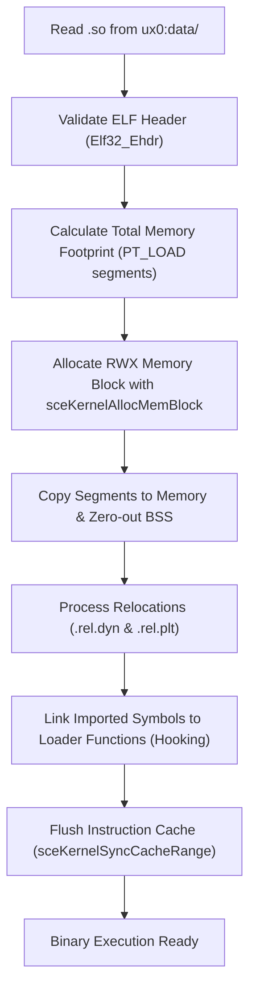

# 04. SoLoader Core & Relocations

The core of an Android-to-PS Vita port is the userspace dynamic ELF loader (`so_util.c` or `dynlib.c`). It fulfills the role of Android's system linker (`/system/bin/linker`), mapping the shared library into executable memory and wiring up symbols.

---

## 🏗️ In-Memory ELF Loading Mechanics

Android NDK `.so` files are standard 32-bit **ELF (Executable and Linkable Format)** binaries for the ARM architecture.



### 1. Validating the ELF Header (`Elf32_Ehdr`)
The loader validates the magic identification bytes and machine architecture:
- **Magic:** `0x7F 'E' 'L' 'F'`
- **Class:** `ELFCLASS32` (1)
- **Endianness:** `ELFDATA2LSB` (1)
- **Machine:** `EM_ARM` (40)

### 2. Allocating RWX Memory
The loader scans the Program Headers (`Elf32_Phdr`), locates `PT_LOAD` segments, computes the aligned memory range, and allocates a single executable block:

```c
SceUID memid = sceKernelAllocMemBlock(
    "game_code_block",
    SCE_KERNEL_MEMBLOCK_TYPE_USER_RWX, // Read, Write, and Execute permissions
    aligned_total_size,
    NULL
);

void *base_addr;
sceKernelGetMemBlockBase(memid, &base_addr);
```

> [!NOTE]
> The ability to allocate `USER_RWX` memory blocks requires the **kubridge** kernel plugin. Without it, VitaOS enforces strict W^X memory protection and denies execution.

---

## 🔄 The ARM Relocation Engine

Because shared libraries are compiled as Position-Independent Code (**PIC/PIE**), internal addresses are offsets that must be adjusted by adding the base load address (`base_addr`).

The loader reads the `.rel.dyn` and `.rel.plt` relocation tables:

```c
typedef struct {
    Elf32_Addr r_offset; // Memory address to patch
    Elf32_Word r_info;   // Relocation type and symbol index
} Elf32_Rel;

#define ELF32_R_SYM(val)  ((val) >> 8)
#define ELF32_R_TYPE(val) ((val) & 0xff)
```

### Critical ARM Relocation Types:

| Relocation Code | Symbolic Name | Loader Action |
|---|---|---|
| **23** | `R_ARM_RELATIVE` | `*(uint32_t*)(base + r_offset) += (uint32_t)base;` <br>Rebases an internal absolute pointer relative to the new base address. |
| **21** | `R_ARM_GLOB_DAT` | Resolves the external symbol name in `.dynstr`, finds its address (in VitaSDK or the loader), and writes it to `*(uint32_t*)(base + r_offset)`. |
| **22** | `R_ARM_JUMP_SLOT` | Targets the PLT (Procedure Linkage Table). Writes the function target address. |
| **2** | `R_ARM_ABS32` | Adds the symbol's runtime value to the existing data at the target offset. |

---

## 🪝 Symbol Hooking and Routing

When the game calls standard functions like `malloc`, `fopen`, or `glTexImage2D`, the loader intercepts them via a symbol table:

```c
typedef struct {
    const char *symbol;
    uintptr_t func;
} DynLibSymbol;

static const DynLibSymbol dynlib_symbols[] = {
    // Standard libc
    { "malloc", (uintptr_t)&malloc },
    { "free", (uintptr_t)&free },
    { "memcpy", (uintptr_t)&memcpy },
    { "memset", (uintptr_t)&memset },
    
    // Redirected POSIX I/O
    { "fopen", (uintptr_t)&vita_fopen },
    { "fclose", (uintptr_t)&fclose },
    
    // Hardware graphics (vitaGL)
    { "glViewport", (uintptr_t)&glViewport },
    { "glClear", (uintptr_t)&glClear },
    { "glDrawElements", (uintptr_t)&glDrawElements },
    
    // Android logging redirected to console
    { "__android_log_print", (uintptr_t)&vita_log_print },
    { NULL, 0 }
};
```

---

## 🩹 In-Memory Patching & Cache Coherency

To bypass incompatible Android services (licensing checks, analytics, anti-tamper hooks), patch the opcodes in RAM:

### Immediate Return Patch (`BX LR`):
- **Thumb Mode:** Write `movs r0, #0` (`0x2000`) and `bx lr` (`0x4770`):
  ```c
  *(uint16_t *)(so_base + offset) = 0x2000;
  *(uint16_t *)(so_base + offset + 2) = 0x4770;
  ```
- **ARM Mode:** Write `mov r0, #0` (`0xe3a00000`) and `bx lr` (`0xe12fff1e`).

### Mandatory Cache Synchronization
After writing relocations or applying patches, the CPU Data Cache (**D-Cache**) holds the changes, but the Instruction Cache (**I-Cache**) may still contain stale code.

> [!CRITICAL]
> Flush the instruction cache after applying relocations and patches:
> ```c
> sceKernelSyncCacheRange(target_address, size);
> ```
