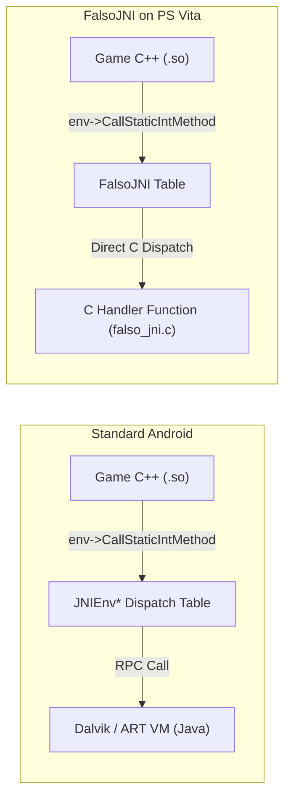

# 05. FalsoJNI & Java Bridge

On Android, games written in C/C++ interface with the Java Virtual Machine (JVM) via **JNI (Java Native Interface)** to query system locale, read device parameters, access storage paths, and play videos.

Because the PlayStation Vita lacks a full Dalvik/ART virtual machine, we use **FalsoJNI**: a lightweight C simulation that responds to game queries directly in native C.

---

## 🏛️ JNI Function Dispatch

When the game calls JNI, it invokes function pointers inside `JNIEnv*`:



### The Simulated Interface Table
`FalsoJNI` populates a static `JNINativeInterface` struct matching the JNI standard:

```c
static const struct JNINativeInterface fake_jni_native_interface = {
    .GetVersion = &fake_GetVersion,
    .FindClass = &fake_FindClass,
    .GetMethodID = &fake_GetMethodID,
    .GetStaticMethodID = &fake_GetStaticMethodID,
    .CallVoidMethod = &fake_CallVoidMethod,
    .CallStaticVoidMethod = &fake_CallStaticVoidMethod,
    .CallStaticIntMethod = &fake_CallStaticIntMethod,
    .CallStaticBooleanMethod = &fake_CallStaticBooleanMethod,
    .CallStaticObjectMethod = &fake_CallStaticObjectMethod,
    .NewStringUTF = &fake_NewStringUTF,
    .GetStringUTFChars = &fake_GetStringUTFChars,
    .ReleaseStringUTFChars = &fake_ReleaseStringUTFChars,
};

const struct JNINativeInterface *fake_env = &fake_jni_native_interface;
JNIEnv *env = (JNIEnv *)&fake_env;
```

---

## 🔡 JNI Method Signatures

When a game calls `GetMethodID(env, clazz, "methodName", "(signature)returnType")`, the signature string encodes argument and return types:

| Character | Java Type | C / C++ Type |
|---|---|---|
| `Z` | `boolean` | `jboolean` (uint8_t: 0 or 1) |
| `B` | `byte` | `jbyte` (int8_t) |
| `C` | `char` | `jchar` (uint16_t UTF-16) |
| `S` | `short` | `jshort` (int16_t) |
| `I` | `int` | `jint` (int32_t) |
| `J` | `long` | `jlong` (int64_t) |
| `F` | `float` | `jfloat` (float) |
| `D` | `double` | `jdouble` (double) |
| `V` | `void` | `void` |
| `Ljava/lang/String;` | `String` (Object) | `jstring` (object pointer) |
| `[I` | Array of ints (`int[]`) | `jintArray` |
| `[B` | Array of bytes (`byte[]`) | `jbyteArray` |

---

## 🪤 The Stubbing Trap: Dangerous No-Ops vs Active Stubs

One of the most insidious bugs in mobile porting is implementing **empty no-op stubs returning 0 or NULL**.

### The Video / Ad Black Screen Hang
Suppose the Android game executes this Java logic on startup:
```java
public static void playIntroVideo() {
    VideoPlayer.play("intro.mp4", new OnVideoCompletionListener() {
        public void onCompletion() {
            nativeOnVideoCompleted(); // Informs the C++ native engine
        }
    });
}
```

If you stub `playIntroVideo` with an empty no-op:
```c
// ❌ WRONG (Hangs the game permanently):
void fake_playIntroVideo(void) {
    return;
}
```

The native C++ state machine enters `STATE_WAITING_FOR_VIDEO`. Because the stub does nothing, `nativeOnVideoCompleted()` is never invoked.
**Result:** The game hangs permanently on a black screen.

### ✅ The Solution: Active Stubs
An active stub immediately triggers the callback the engine is waiting for:

```c
// ✔️ CORRECT (Progresses the game loop):
void fake_playIntroVideo(void) {
    sceClibPrintf("[FalsoJNI] playIntroVideo called -> Firing completion callback\n");
    if (nativeOnVideoCompleted_ptr) {
        nativeOnVideoCompleted_ptr(fake_env, NULL);
    }
}
```

---

## 🔤 String Handling and Heap Management

When the game calls `GetStringUTFChars`, manage memory lifecycle carefully to prevent heap leaks:

```c
const char *fake_GetStringUTFChars(JNIEnv *env, jstring str, jboolean *isCopy) {
    if (!str) return NULL;
    if (isCopy) *isCopy = JNI_TRUE;
    return strdup((const char *)str);
}

void fake_ReleaseStringUTFChars(JNIEnv *env, jstring str, const char *chars) {
    if (chars) {
        free((void *)chars); // Mandatory cleanup
    }
}
```
