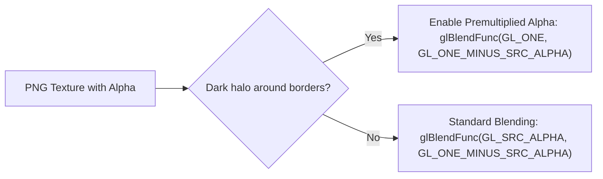

# 06. Graphics Pipeline with vitaGL

The PlayStation Vita hardware features a PowerVR SGX543MP4+ GPU, but Sony's official operating system exposes a proprietary low-level API named **SCE GXM**. Rewriting an Android game's entire rendering engine to use raw GXM command buffers would require months of effort.

Instead, the community relies on **[vitaGL](https://github.com/Rinnegatamante/vitaGL)** by Rinnegatamante: a translation library that wraps **OpenGL ES 1.1 and 2.0** calls directly into hardware-accelerated SCE GXM commands with minimal overhead.

---

## 🚀 Initialization and Game Loop

In `main.c`, initialize vitaGL before executing native engine rendering routines:

```c
#include <vitaGL.h>

void init_graphics(void) {
    // vglInitExtended(flags, width, height, ram_buffer_size, msaa_mode)
    // 6 MB vertex command buffer
    vglInitExtended(0, 960, 544, 6 * 1024 * 1024, SCE_GXM_MULTISAMPLE_NONE);
    
    // Enable VBlank synchronization for tear-free 60 FPS
    vglWaitVblankStart(GL_TRUE);
}

void game_loop_frame(void) {
    // 1. Invoke game's native render function
    nativeRender_func();
    
    // 2. Swap vitaGL display buffers
    vglSwapBuffers(GL_FALSE);
}
```

---

## 🎨 Graphics Backends Comparison

| Backend | Advantages | Trade-offs | Use Case |
|---|---|---|---|
| **vitaGL (Recommended)** | Open-source, battle-tested, complete GLES 1.1/2.0 coverage, on-the-fly GLSL compiler, optimized for CDRAM. | Slight floating-point variance on highly exotic shaders. | **Standard de facto** for 98% of mobile ports. |
| **PVR_PSP2** | Leaked official PowerVR driver from Sony SDK. Strict GLES 2.0 conformance. | Closed source, copyright/licensing issues, rigid integration. | Edge-case games with shaders that fail under vitaGL. |
| **Raw SCE GXM** | Maximum theoretical throughput, direct ring buffer control. | Extreme complexity: no GLSL support, manual primitive sync. | Ground-up native PS Vita engines only. |

---

## 🪄 Shaders: Translating GLSL to Cg / GXP

The Vita GPU requires compiled binary shaders in Sony's **GXP** format.

### Runtime vs Offline Transpilation
vitaGL translates GLSL strings to GXM intermediate representations dynamically at runtime. For heavy shaders or to avoid runtime frame drops, use offline AST transpilation:

```bash
psvita-toolkit shader-transpile --dump-dir assets/glsl --out-dir assets/cg
```
This tool uses `glslangValidator` to compile GLSL to SPIR-V, `spirv-cross` to generate NVIDIA Cg, and `psp2cgc` to emit pre-compiled `.gxp` binaries.

---

## ⚠️ Common Graphical Pitfalls & Solutions

### 1. Upside-Down FBO Rendering (Y-Flipping)
In standard OpenGL, `(0,0)` is located at the **bottom-left** corner. In GXM and some mobile FBO implementations, `(0,0)` corresponds to the **top-left**. If rendered textures appear flipped:

```c
// Invert orthographic projection matrix in shaders or adjust viewport:
glViewport(0, 0, 960, 544);
```

### 2. Dark Halos on Transparent Sprites (Premultiplied Alpha)
If text rendering or UI textures display black artifacts around transparent edges, the engine uses **Premultiplied Alpha**:
- Replace: `glBlendFunc(GL_SRC_ALPHA, GL_ONE_MINUS_SRC_ALPHA);`
- With: `glBlendFunc(GL_ONE, GL_ONE_MINUS_SRC_ALPHA);`



### 3. CDRAM Exhaustion (112 MiB VRAM Limit)
vitaGL places textures into high-speed CDRAM by default. If a game exceeds 112 MiB of textures, memory allocation fails.
- Direct non-critical textures to main RAM or downsample textures larger than 1024x1024.
