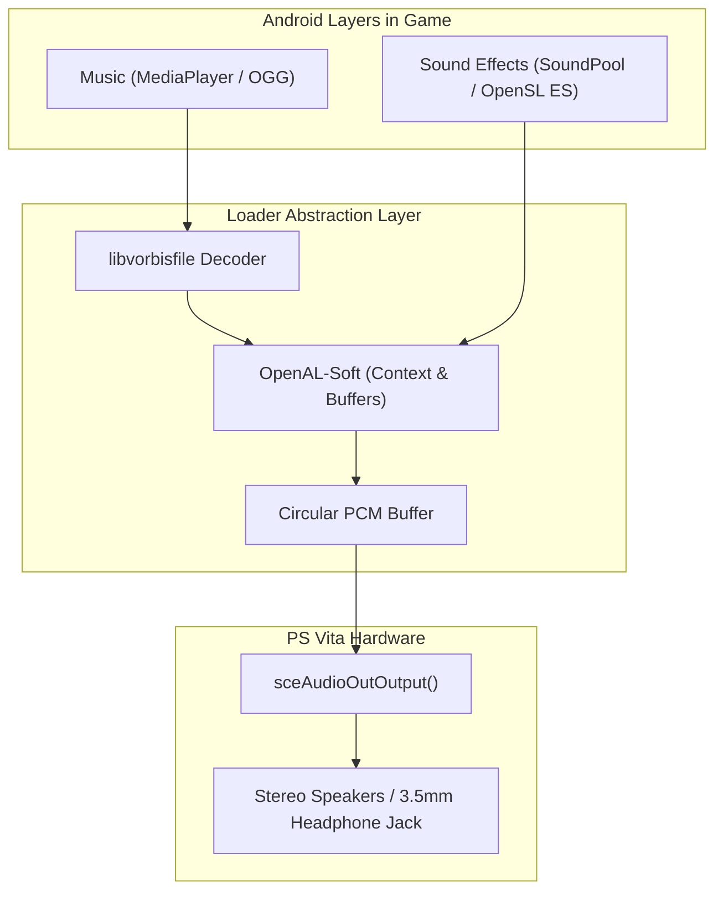

# 07. Audio Subsystem

On Android, audio playback is typically handled by three mechanisms:
1. **OpenSL ES:** Low-level native C audio API.
2. **AudioTrack / SoundPool (Java):** Android SDK classes for cached sound effects.
3. **MediaPlayer (Java):** Android SDK class for streaming background music (OGG, MP3).

On PlayStation Vita, all audio converges into the kernel's **`sceAudioOut`** API or higher-level libraries like **OpenAL-Soft**.

---

## 🔊 Audio Pipeline Architecture



### 1. Direct PCM Output via `sceAudioOut`
VitaOS manages audio ports via `sceAudioOut`:

```c
#include <psp2/audioout.h>

static int audio_port = -1;

void init_audio_hardware(void) {
    // Open stereo BGM port at 44100 Hz with 1024 sample buffer
    audio_port = sceAudioOutOpenPort(
        SCE_AUDIO_OUT_PORT_TYPE_BGM,
        1024,
        44100,
        SCE_AUDIO_OUT_MODE_STEREO
    );
    
    // Set 100% volume
    int vol[2] = { 32768, 32768 };
    sceAudioOutSetVolume(audio_port, SCE_AUDIO_VOLUME_FLAG_L_CH | SCE_AUDIO_VOLUME_FLAG_R_CH, vol);
}

void output_pcm_block(const int16_t *samples) {
    // Blocks until 1024 samples are consumed by hardware
    sceAudioOutOutput(audio_port, samples);
}
```

---

## 📻 Background Music Streaming (OGG Vorbis)

Link `libvorbisfile` for streaming compressed background music:

```c
#include <vorbis/vorbisfile.h>

typedef struct {
    OggVorbis_File vf;
    FILE *f;
    int is_playing;
    int loop;
} BGMStream;

BGMStream bgm;

void bgm_play(const char *filepath, int loop) {
    bgm.f = fopen(filepath, "rb");
    if (!bgm.f) return;
    
    if (ov_open_callbacks(bgm.f, &bgm.vf, NULL, 0, OV_CALLBACKS_DEFAULT) < 0) {
        fclose(bgm.f);
        return;
    }
    
    bgm.loop = loop;
    bgm.is_playing = 1;
}

int audio_thread(SceSize args, void *argp) {
    int16_t pcm_buffer[2048]; // 1024 stereo samples
    int bitstream;
    
    while (1) {
        if (bgm.is_playing) {
            long bytes = ov_read(&bgm.vf, (char *)pcm_buffer, sizeof(pcm_buffer), 0, 2, 1, &bitstream);
            if (bytes > 0) {
                sceAudioOutOutput(audio_port, pcm_buffer);
            } else if (bytes == 0 && bgm.loop) {
                ov_time_seek(&bgm.vf, 0); // Loop
            }
        } else {
            sceKernelDelayThread(10000);
        }
    }
    return 0;
}
```

---

## 🧩 FalsoJNI SoundPool Emulation

When games trigger sounds via `SoundPool.play(...)`:

```c
jint fake_SoundPool_play(JNIEnv *env, jobject obj, jint soundID, jfloat leftVolume, jfloat rightVolume, jint priority, jint loop, jfloat rate) {
    play_openal_sound_effect(soundID, leftVolume, loop);
    return soundID; // Return valid stream ID (> 0) to signal success
}
```

> [!TIP]
> If `SoundPool.play` returns `0`, the Android engine assumes audio hardware failure and may attempt to reload the sound file every frame, causing massive stutter.
