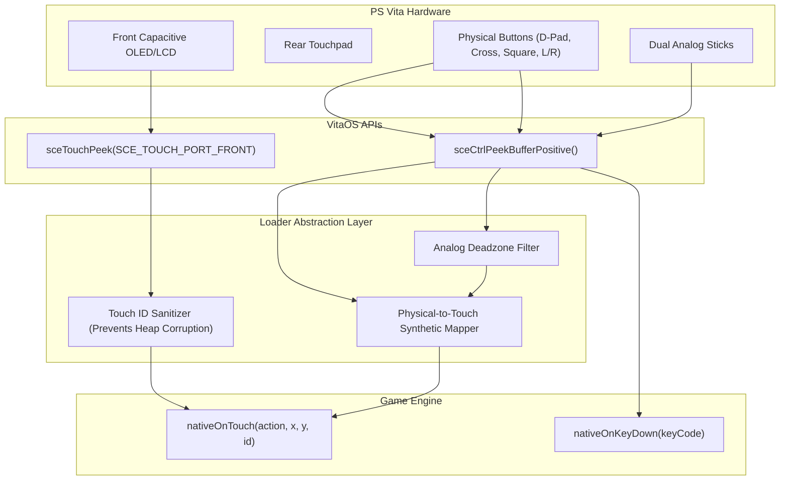

# 08. Controls & Input Mapping

Translating touch-first smartphone controls to the ergonomic inputs of the PlayStation Vita requires handling both front/rear capacitive touch surfaces and physical controls (D-Pad, action buttons, dual analog sticks).

---

## 🎮 Polling Hardware Controls in VitaOS



### 1. Mandatory Touch Sampling Initialization
By default in VitaOS, touch sampling is **disabled** to save power. Without enabling it, `sceTouchPeek` will always report zero touches:

```c
#include <psp2/touch.h>

void init_touch_system(void) {
    sceTouchSetSamplingState(SCE_TOUCH_PORT_FRONT, SCE_TOUCH_SAMPLING_STATE_START);
    sceTouchSetSamplingState(SCE_TOUCH_PORT_BACK, SCE_TOUCH_SAMPLING_STATE_START);
}
```

---

## 💣 The Touch Report ID Heap Corruption Trap

This is one of the most elusive causes of random crashes in mobile ports:

### The Problem:
Sony's `SceTouchReport` struct exposes a hardware-assigned `id`:
```c
SceTouchData touch;
sceTouchPeek(SCE_TOUCH_PORT_FRONT, &touch, 1);
uint8_t raw_id = touch.report[i].id; // Can be 15, 48, 120...
```

Android engines (like Cocos2d-x or Gameloft engines) allocate a fixed-size internal array for active fingers:
```cpp
// Internal C++ game engine code:
Touch active_touches[5];

void onTouchDown(int pointer_id, float x, float y) {
    active_touches[pointer_id].x = x; // ❌ CRASH IF pointer_id > 4
}
```

If you pass Sony's raw `report.id` (e.g. 15) to the engine:
The engine accesses `&active_touches[15]`, **writing out of bounds and silently corrupting the application heap**. The game will not crash immediately, but will abort minutes later during unrelated heap operations.

### ✅ The Solution: Virtual Pointer ID Pool

Map raw hardware touch IDs to contiguous virtual slots between `0` and `3`:

```c
#define MAX_TOUCH_SLOTS 4

static int virtual_touch_slots[MAX_TOUCH_SLOTS] = { -1, -1, -1, -1 };

int get_virtual_touch_id(int sony_raw_id) {
    for (int i = 0; i < MAX_TOUCH_SLOTS; i++) {
        if (virtual_touch_slots[i] == sony_raw_id) return i;
    }
    for (int i = 0; i < MAX_TOUCH_SLOTS; i++) {
        if (virtual_touch_slots[i] == -1) {
            virtual_touch_slots[i] = sony_raw_id;
            return i;
        }
    }
    return 0;
}

void release_virtual_touch_id(int sony_raw_id) {
    for (int i = 0; i < MAX_TOUCH_SLOTS; i++) {
        if (virtual_touch_slots[i] == sony_raw_id) {
            virtual_touch_slots[i] = -1;
            break;
        }
    }
}
```

---

## 🕹️ Mapping Physical Buttons to On-Screen Touch

For mobile games without controller support:

```c
#include <psp2/ctrl.h>

typedef struct {
    uint32_t vita_button;
    float screen_x;
    float screen_y;
    int is_pressed;
} VirtualButton;

static VirtualButton v_buttons[] = {
    { SCE_CTRL_CROSS,    860.0f, 440.0f, 0 }, // Attack
    { SCE_CTRL_SQUARE,   780.0f, 380.0f, 0 }, // Jump
    { SCE_CTRL_TRIANGLE, 840.0f, 300.0f, 0 }, // Menu
};

void process_touch_emulation(uint32_t current_buttons) {
    for (int i = 0; i < sizeof(v_buttons)/sizeof(v_buttons[0]); i++) {
        VirtualButton *vb = &v_buttons[i];
        int pressed = (current_buttons & vb->vita_button) != 0;
        
        if (pressed && !vb->is_pressed) {
            nativeOnTouch(0, vb->screen_x, vb->screen_y, 9 + i); // ACTION_DOWN
            vb->is_pressed = 1;
        } else if (!pressed && vb->is_pressed) {
            nativeOnTouch(1, vb->screen_x, vb->screen_y, 9 + i); // ACTION_UP
            vb->is_pressed = 0;
        }
    }
}
```

---

## 🎯 Analog Stick Deadzone Filtering

Vita analog sticks report unsigned bytes `0..255` centered at `128`:

```c
#define ANALOG_DEADZONE 30

void read_analog_stick(uint8_t raw_x, uint8_t raw_y, float *out_x, float *out_y) {
    int dx = (int)raw_x - 128;
    int dy = (int)raw_y - 128;
    
    if (abs(dx) < ANALOG_DEADZONE) dx = 0;
    if (abs(dy) < ANALOG_DEADZONE) dy = 0;
    
    *out_x = (float)dx / 128.0f;
    *out_y = (float)dy / 128.0f;
}
```
