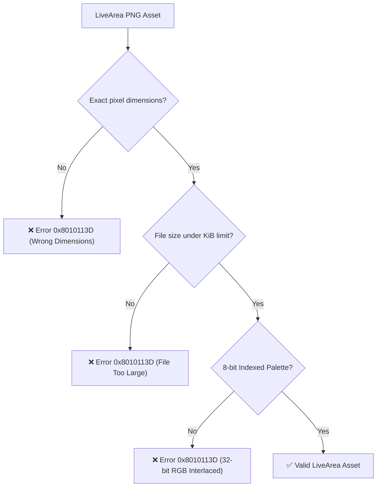

# 10. LiveArea & VPK Packaging

The final distributable package for PlayStation Vita is a **`.vpk`** archive. A VPK is a standard ZIP containing the signed executable (`eboot.bin`), metadata (`sce_sys/param.sfo`), and the visual shell resources (**LiveArea**).

---

## 🖼️ LiveArea Asset Specifications

Sony's system shell (**SceShell**) strictly enforces image resolutions, formats, and file size limits:

| Asset | Resolution (Pixels) | Maximum Allowed Size | Role on Console |
|---|---|---|---|
| **`icon0.png`** | **128 x 128** | 128 KiB | Circular home screen application bubble. |
| **`startup.png`** | **280 x 158** | 64 KiB | Interactive startup gate button. |
| **`bg0.png`** | **840 x 500** | 128 KiB | LiveArea gate background image. |
| **`pic0.png`** | **960 x 544** | 256 KiB | Optional full-screen background banner. |

---

## 🚫 The Infamous `0x8010113D` Installation Error

Error `0x8010113D` in VitaShell or the system installer occurs when LiveArea images violate Sony's internal specifications:



### Golden Rules for LiveArea Images:
1. **8-bit Indexed Palette (256 colors):** Always quantize PNGs using `pngquant` or ImageMagick.
2. **No Interlacing:** The hardware decoder does not support interlaced/progressive PNG formats.
3. **Automate with `psvita-toolkit`:**
   ```bash
   psvita-toolkit livearea --auto extras/livearea/ --validate
   ```

---

## 🍏 The macOS AppleDouble `._*` Trap

When packaging on macOS, the OS generates hidden AppleDouble metadata files (`._icon0.png`, `._param.sfo`, `._eboot.bin`) on FAT32/exFAT drives.

> [!CAUTION]
> If `._*` files are packaged inside the `.vpk`, VitaShell installation fails or displays corrupted app bubbles.

Clean junk files before packaging:
```bash
find . -name "._*" -type f -delete
# Or:
psvita-toolkit clean-junk
```

---

## 📜 Generating `param.sfo`

Configure your Title ID and display name with `vita-mksfoex`:

```bash
vita-mksfoex -s TITLE_ID="PSVHOS001" "Hero of Sparta" param.sfo
```

### Title ID Format:
- Exactly **9 uppercase alphanumeric characters**.
- Standard homebrew format: `PSV` followed by 3–4 letters and digits (e.g. `PSVHOS001`, `ZENONIA02`).

---

## 📦 Automated Packaging via CMake

In `CMakeLists.txt`:

```cmake
vita_create_self(eboot.bin ${PROJECT_NAME})

vita_create_vpk(${PROJECT_NAME}.vpk ${TITLE_ID} eboot.bin
    VERSION "01.00"
    NAME "${GAME_NAME}"
    FILE extras/livearea/icon0.png sce_sys/icon0.png
    FILE extras/livearea/startup.png sce_sys/livearea/contents/startup.png
    FILE extras/livearea/bg0.png sce_sys/livearea/contents/bg0.png
    FILE extras/livearea/template.xml sce_sys/livearea/contents/template.xml
)
```
