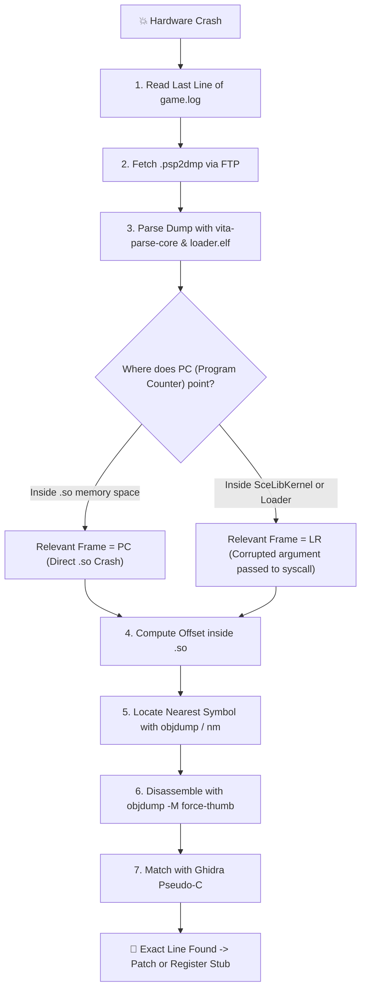

# 11. Crash Triage & Hardware Debugging

When a port crashes on physical hardware, there is no need to guess. The **Triangulation Methodology** combines three authoritative sources of truth to pinpoint the exact line of code:
1. The flushed runtime log (`fflush`).
2. The kernel core dump (**`.psp2dmp`**) parsed via `vita-parse-core`.
3. The `.so` binary disassembled with `arm-vita-eabi-objdump -M force-thumb`, cross-referenced with Ghidra pseudo-C and `jadx` Java source.

---

## 🎯 The Triangulation Workflow



---

## 📋 Step 1: Flushed Logs

Always call `fflush(log_file)` after every log write so that buffered text is committed to flash storage before a panic:

```c
void vita_log(const char *fmt, ...) {
    va_list args;
    va_start(args, fmt);
    vfprintf(log_file, fmt, args);
    fflush(log_file);
    va_end(args);
}
```

Check the final log line:
- If `GetStaticMethodID(..., "checkLicensing", ...)` is the last entry: register the missing JNI stub.
- If a missing asset path is reported: update path sanitization.

---

## 🔬 Step 2: Parsing `.psp2dmp` Core Dumps

Upon encountering a Data Abort, VitaOS generates a crash dump in `ux0:data/` or `ur0:temp/core/` named `psp2core-XXXXXXXXXX-eboot.bin.psp2dmp`.

Parse it with `vita-parse-core` against your debug `loader.elf` (the unstripped ELF with symbols):

```bash
python3 vita-parse-core/main.py crash.psp2dmp build/loader.elf
```

Output:
```
Exception Type: Data abort (read access to 0x00000004)
Registers:
  r0: 0x00000000   r1: 0x98124000   r2: 0x00000001   r3: 0x81005a20
  PC: 0x98045a1c   LR: 0x98045a05   SP: 0x810ff400
```

---

## ⚖️ Step 3: Deciding Between PC and LR

- **If `PC` lies within `.so` memory (`0x98000000`+):**
  The crash instruction was executed inside the game's native library. Investigate that offset.
- **If `PC` lies within `SceLibKernel` or the loader (`eboot.bin`):**
  **`LR` (Link Register) is the caller!** The game code invoked a system function (e.g. `memcpy` or `fopen`) with an invalid parameter (`NULL` pointer or corrupt size). Inspect the call-site in `LR`.

---

## 🔎 Step 4: Resolving the Offset & Matching Disassembly

Calculate: `offset = PC - so_base_address` (e.g. `0x98045a1c - 0x98000000 = 0x45a1c`).

Find the enclosing function:
```bash
objdump -T libgame.so | grep -v UND | awk '{print $1, $NF}' | sort > syms.txt
```
Locate the symbol with the highest address `<= 0x45a1c`. Assume it resolves to `GameRenderer_updateUI + 0x24`.

Disassemble with `-M force-thumb`:
```bash
arm-vita-eabi-objdump -d -M force-thumb --start-address=0x459f8 --stop-address=0x45a30 libgame.so
```

```assembly
   45a18:   6808        ldr     r0, [r1, #0]    ; Read pointer from r1
   45a1a:   2800        cmp     r0, #0          ; Check if NULL
   45a1c:   6840        ldr     r0, [r0, #4]    ; ❌ Crash: r0 is NULL, attempts to read offset +0x4!
```

Match with Ghidra's `out_ghidra.c`:
```c
if (player_controller != NULL) {
    player_controller->health_bar->update();
}
```
`player_controller` was valid, but its `health_bar` sub-object was `NULL` because the UI layout had not been initialized in FalsoJNI.

---

## ⚠️ ARMv7 Memory Alignment Traps

On x86 PCs, unaligned memory accesses are transparently handled by CPU microcode.
**On the ARM Cortex-A9 CPU of the PS Vita, `LDRD` (Load Register Dual, 64-bit), `STRD`, and NEON vector instructions (`VLD1`) trigger an instant hardware Data Abort if the address is not aligned to 8 or 16 bytes.**

> [!TIP]
> If a crash occurs on an `ldrd r2, r3, [r0]` instruction with non-NULL registers, check `r0`. If the address ends in `0x4` rather than `0x0` or `0x8`, a struct is misaligned in memory. Enforce 8-byte alignment via `memalign(8, size)`.
