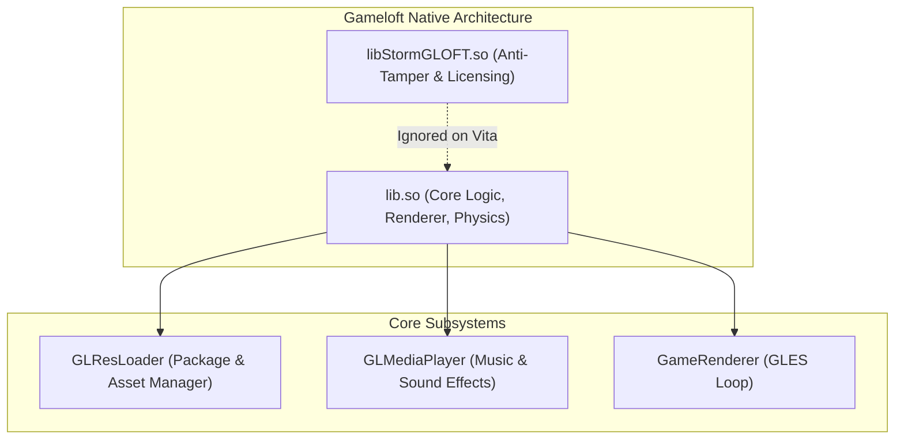
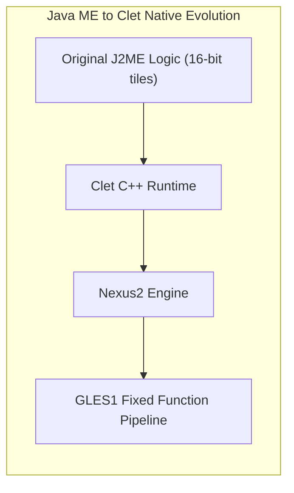

# 12. Real Engine Archaeology

Across more than 30 production PlayStation Vita ports, recurring architectural patterns emerge. This chapter catalogs real-world engine analyses, quirks, and battle-tested solutions.

---

## ⚔️ Family 1: Classic Gameloft Engines (2010–2013)

**Representative titles:** *Hero of Sparta*, *Dungeon Hunter 2*, *N.O.V.A. 2*, *Shadow Guardian*, *Eternal Legacy*, *Six-Guns*, *Gangstar Rio*, *Brothers in Arms 2*, *Asphalt 5 & 6*.

### Critical Quirks:
1. **The `libStormGLOFT.so` Companion:**
   Gameloft APKs typically bundle `libStormGLOFT.so` alongside the main game library. It serves as an anti-tamper stub without useful exports. **Only load the primary game `.so`.**
2. **`GLResLoader` Asset Resolution:**
   Gameloft uses a multi-tier asset loader:
   - Call `GLResLoader_nativeInit(int)` before rendering.
   - Assets are searched across resolution directories (`1024x768`, `960x540`, `800x480`).
3. **Universal JNI Signatures:**
   - `Java_..._GLMediaPlayer_nativeInit`
   - `Java_..._GameRenderer_nativeInit(width, height, orientation)`
   - `Java_..._GameRenderer_nativeRender()`

---

## 🛡️ Family 2: Gamevil Nexus2 / Clet Engine

**Representative titles:** *Zenonia 2*, *Zenonia 3*, *Zenonia 4*, *Destinia*, *ILLUSIA 1 & 2*, *Advena*.

### Critical Quirks:
1. **MIDP / Java ME Heritage:**
   Originally developed for Korean feature phones, Gamevil wrapped their micro-edition engines into C++ runtimes (**Clet / Nexus2**) for Android.
2. **Shared Symbol Layout:**
   Zenonia 2 and Zenonia 3 share 95% of their JNI exports: `Java_com_gamevil_nexus2_Natives_nativeInit` and `Java_com_gamevil_nexus2_Natives_nativeEvent`.
3. **Character Encoding:**
   Strings frequently use EUC-KR or UTF-8 without BOM. When rendering with `stb_truetype`, sanitize input to standard UTF-8.

---

## 🏹 Family 3: Com2uS Engines

**Representative titles:** *Inotia 2: A Wanderer of Luone*, *Inotia 3: Children of Carnia*, *Inmortal Dusk*.

### Critical Quirks:
- **Mach-O (iOS) vs ELF (Android):**
  Certain Com2uS titles had superior HD releases on iOS. In titles like *Inotia 2*, loading decrypted 32-bit ARMv7 **Mach-O binaries** directly with a custom Mach-O loader is viable, wrapping CoreAudio and UIKit calls into C and vitaGL.
- **Audio Channels:** Audio buffers are 22050 Hz mono PCM; expand to stereo before feeding `sceAudioOutOutput`.

---

## 🌳 Family 4: Cocos2d-x Engines

**Representative titles:** *Badland 2*, *Rayman Jungle Run*, *The Impossible Game*.

### Critical Quirks:
- Standardized entry point: `Java_org_cocos2dx_lib_Cocos2dxRenderer_nativeInit(width, height)`.
- Asset streaming via `CCFileUtils`: points to `ux0:data/<game>/game.apk` and streams assets from ZIP directly in RAM.
