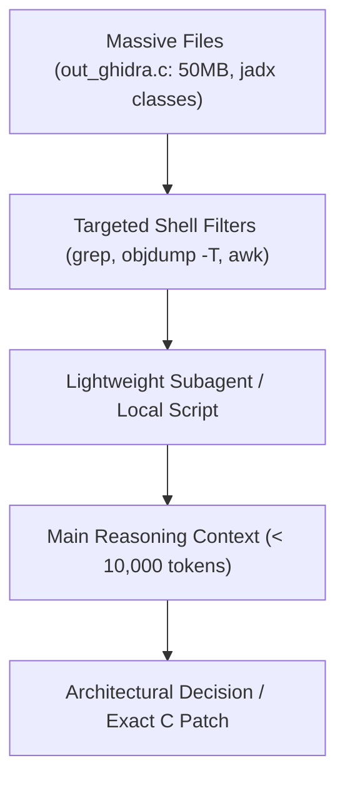

# 13. AI-Assisted Porting Guide

Developing SoLoader ports involves substantial boilerplate code (JNI tables, symbol maps, audio wrappers) paired with deep low-level debugging.

This guide outlines best practices for **human + AI pair programming** (using Antigravity, Claude, GPT), optimizing context tokens and preventing reverse-engineering hallucinations.

---

## ⚡ Context and Token Economy

Ghidra pseudo-C (`out_ghidra.c`), disassemblies (`objdump`), and decompiled Java sources can easily exceed **500,000 tokens**.



### Golden Rules:
1. **Never dump full `out_ghidra.c` files into chat:**
   Use `grep -n -C 15 "function_name"` to extract only the 30 lines under active investigation.
2. **Delegate mechanical boilerplate to fast models:**
   Use lightweight subagents (Flash / Flash-Lite) for formatting symbol tables and stub scaffolding, reserving deep reasoning models for `.psp2dmp` crash triage.

---

## 🛡️ Preventing Reverse-Engineering Hallucinations

AI models will invent plausible JNI method names or return types if context is underspecified. Prevent this with strict grounding:

### 1. Always provide verbatim signatures from Java or `objdump`
❌ **Vague Prompt:**  
*"Write a stub for the sound function in Hero of Sparta."*

✔️ **Grounded Prompt:**  
*"jadx decompilation reveals this exact Java declaration:*  
`public static native int nativePlayMusic(String path, boolean loop);`  
*Write the C FalsoJNI function with signature `(Ljava/lang/String;Z)I`, convert jstring to UTF-8, route it to our audio backend, and return streamID > 0 to indicate success."*

### 2. Verify Primitive Type Mappings
Ensure the AI strictly uses:
- `Z` = `jboolean` (1 byte).
- `J` = `jlong` (64-bit signed integer).
- Never return stack pointers for object or string queries.

---

## 📋 Batch Stubbing Prompt Template

```markdown
You are an expert PS Vita port engineer using FalsoJNI.
The game logged the following missing Android methods:

1. com.gameloft.android.GLUtils.getDeviceModel() -> Ljava/lang/String;
2. com.gameloft.android.GLMediaPlayer.isMusicActive() -> Z
3. com.gameloft.android.GLResLoader.openAsset(String path) -> [B

Requirements:
1. Write the corresponding C function with matching FalsoJNI signatures.
2. For strings, return fake_NewStringUTF with a safe value ("PlayStation Vita").
3. For booleans, return JNI_TRUE or JNI_FALSE according to expected game behavior.
4. Output the jni_methods registration table entries.
```
