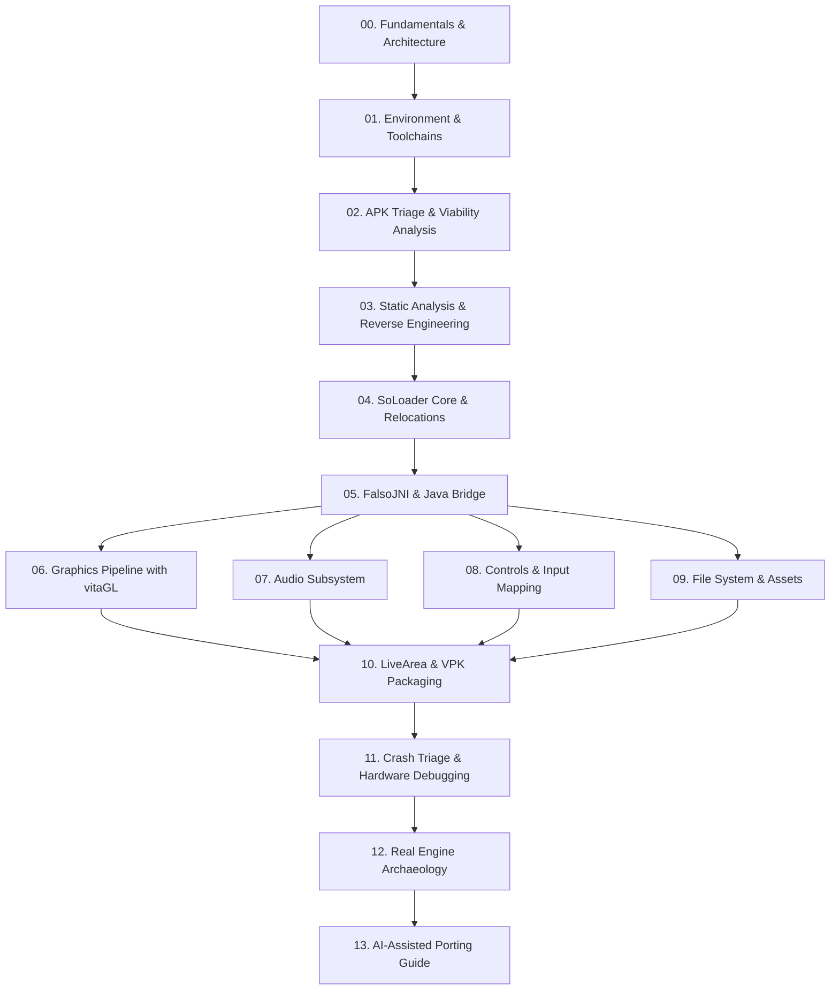

# PS Vita Porting Encyclopedia & Manual (SoLoader)

Welcome to the English section of the **PS Vita Porting Wiki**. This compendium serves as an end-to-end engineering handbook and definitive technical reference for porting compiled Android applications (`.apk` / `.so`) into native PlayStation Vita homebrew executables (`.vpk`).

---

## 🧭 Navigation Roadmap

---

## 📚 Table of Chapters

| # | Chapter | Core Focus & Technical Depth |
|---|---|---|
| **00** | [Fundamentals & Architecture](00-fundamentals-architecture.md) | ARMv7 Cortex-A9 CPU, PowerVR SGX543MP4+ GPU, CDRAM vs RAM partitions, SoLoader vs Emulation vs Static Recompilation. |
| **01** | [Environment & Toolchains](01-environment-and-tools.md) | Setting up VitaSDK, vitaGL, kubridge, fd_fix, FalsoJNI, psvita-toolkit, Docker with headless Ghidra, jadx. |
| **02** | [APK Triage & Viability Analysis](02-apk-triage-and-selection.md) | Feasibility checks: ARMv7 vs 64-bit, GLES1 vs GLES2, STL dependencies, memory footprint, viability decision matrix. |
| **03** | [Static Analysis & Reverse Engineering](03-static-analysis-and-reverse-engineering.md) | Java decompilation (`jadx`), pseudo-C extraction (`Ghidra`), symbol extraction with `objdump` and `nm`. |
| **04** | [SoLoader Core & Relocations](04-soloader-architecture-and-relocations.md) | In-memory ELF layout, ARM relocation types (`R_ARM_RELATIVE`, `R_ARM_GLOB_DAT`), binary patching and symbol hooking. |
| **05** | [FalsoJNI & Java Bridge](05-falsojni-and-java-bridge.md) | Emulating JVM/JNIEnv, Android type signatures, Java callbacks, safe stubs vs game-freezing no-ops. |
| **06** | [Graphics Pipeline with vitaGL](06-vitagl-graphics-pipeline.md) | vitaGL over SCE GXM, GLSL to Cg/GXP shader translation, FBOs, 960x544 scaling, premultiplied alpha, VRAM limits. |
| **07** | [Audio Subsystem](07-audio-subsystem.md) | `sceAudioOut`, OpenAL-Soft for Vita, Vorbis/MP3 streaming, bridging `AudioTrack`, `SoundPool`, and `MediaPlayer`. |
| **08** | [Controls & Input Mapping](08-controls-and-input.md) | Front/Rear touch panels, buttons and analog sticks, preventing touch report ID heap corruption, touch-to-pad emulation. |
| **09** | [File System & Assets](09-file-system-and-assets.md) | Redirecting paths to `ux0:data/`, FAT/exFAT case insensitivity quirks, reading assets from ZIP/OBB in memory. |
| **10** | [LiveArea & VPK Packaging](10-livearea-and-vpk-packaging.md) | Strict 8-bit indexed PNG rules (eliminating `0x8010113D`), `param.sfo`, `template.xml`, cleaning macOS `._` junk files. |
| **11** | [Crash Triage & Hardware Debugging](11-crash-triage-and-debugging.md) | Triangulation methodology: `.psp2dmp` analysis, `vita-parse-core`, `PC` vs `LR`, ARMv7 memory alignment traps (`ldrd`). |
| **12** | [Real Engine Archaeology](12-engine-archaeology.md) | Production case studies from 30+ ports: Gameloft, Gamevil Nexus2/Clet, Com2uS, custom Cocos2d-x pipelines. |
| **13** | [AI-Assisted Porting Guide](13-ai-assisted-porting.md) | Human + AI pair programming protocols, context and token economy, deterministic prompts for JNI stubs. |
| **14** | [Base Guide (gl33ntwine)](14-base-guide-gl33ntwine.md) | Vitaliy Atamanenko's original foundational guide with modern technical annotations and context. |
| **15** | [Quick Reference & Cheat Sheets](15-quick-reference-and-cheatsheets.md) | JNI signature tables, common VitaOS kernel error codes, Bionic libc to VitaSDK Newlib translation tables. |

---

> [!TIP]
> **For New Developers**: Start with Chapters 00, 01, and 02 before acquiring an APK.
> **For Experienced Engineers / AI Agents**: Chapters 04 (ELF Relocations), 05 (FalsoJNI), 06 (vitaGL), and 11 (Crash Triage) contain the core low-level logic required to resolve production hardware crashes.
