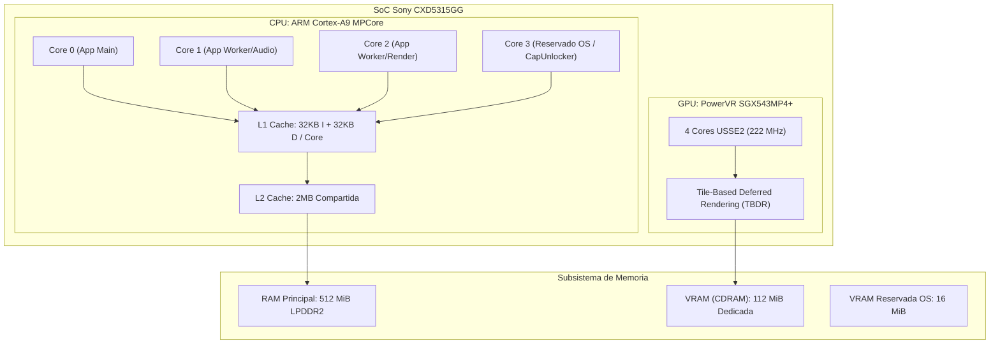
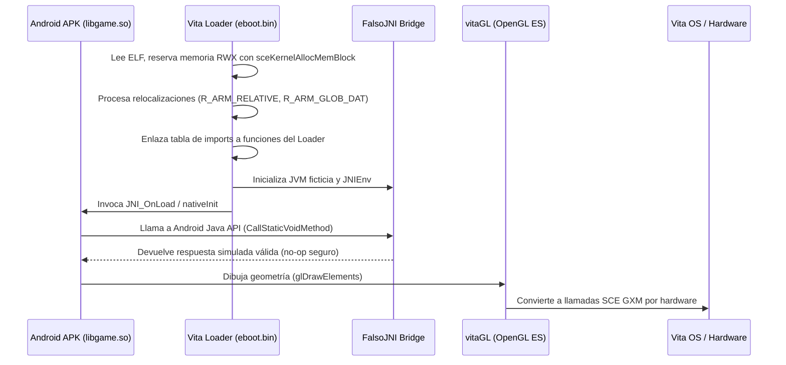

  Capítulo 00 • Fundamentos del Hardware
  <h1 style="margin: 0.4rem 0 0.6rem 0; font-size: 2rem;">Fundamentos y Arquitectura de Hardware</h1>
  

    Análisis exhaustivo del hardware de PlayStation Vita (Cortex-A9, SGX543MP4+, particiones CDRAM y RAM) y los fundamentos de la ejecución nativa ARMv7.
  

  

    ⚡ Nivel: Fundamental
    🧠 Enfoque: ARMv7-A, SGX543 TBDR, CDRAM vs RAM
    🎮 Casos Reales: Hero of Sparta, Zenonia 3, Badland 2
  

---

Para dominar el porting de juegos móviles hacia la PlayStation Vita, es imperativo comprender la arquitectura de hardware de la consola y la base teórica del método **SoLoader**.

---

## 🔬 Arquitectura de Hardware de PS Vita

### 1. La CPU (ARM Cortex-A9 MPCore)
La PlayStation Vita monta un procesador **ARM Cortex-A9** de cuatro núcleos de 32 bits (arquitectura ARMv7-A).
- **Frecuencia nominal de Sony:** 333 MHz (reducida originalmente por preservación de batería).
- **Frecuencia máxima nativa:** 444 MHz / 500 MHz (desbloqueable sin riesgo mediante llamadas en código o plugins como `PSVshell`).
- **Cachés:** 32 KiB L1 de instrucciones + 32 KiB L1 de datos por núcleo; 2 MiB de caché L2 unificada compartida.
- **Unidad de punto flotante:** VFPv3-D32 y SIMD NEON de 128 bits integrados por hardware.
- **El 4º Núcleo:** Reservado por defecto para servicios del sistema operativo. Mediante el plugin de kernel [CapUnlocker](https://github.com/GrapheneCt/CapUnlocker) de GrapheneCt, un homebrew puede reclamar el 4º núcleo asignando la máscara de afinidad `0x80000` con `sceKernelChangeThreadCpuAffinityMask()`.

### 2. La GPU (PowerVR SGX543MP4+)
Un chip gráfico de cuatro núcleos de la serie SGX543 (PowerVR Series5XT) con arquitectura **TBDR** (Tile-Based Deferred Rendering).
- **Frecuencia:** Hasta 222 MHz (por defecto 111 MHz o 166 MHz).
- **Pipeline:** Totalmente programable mediante shaders (OpenGL ES 2.0 / DirectX 9 nivel de capacidades).
- **TBDR:** La GPU divide la pantalla en tiles de 16x16 píxeles, descarta fragmentos ocultos antes de ejecutar los pixel shaders (*Early-Z / HSR - Hidden Surface Removal*), ahorrando un ancho de banda masivo de memoria.

### 3. Memoria Principal vs Memoria de Vídeo (CDRAM)
Físicamente, la Vita posee dos buses y particiones de memoria claramente diferenciados:

| Partición | Tamaño Físico | Disponible para Homebrew | Propósito y Características |
|---|---|---|---|
| **RAM Principal** | 512 MiB | ~300 MiB a 420 MiB | Memoria de sistema accesible por CPU. Aloja el ejecutable, el heap de C, el archivo `.so` cargado, los assets descomprimidos y la máquina FalsoJNI. |
| **CDRAM (VRAM)** | 128 MiB | **112 MiB** | Memoria gráfica ultrarrápida ligada directamente al bus de la GPU. Reservada para framebuffers, texturas activas, vertex buffers e índices de renderizado. |
| **VRAM Sistema** | 16 MiB | 0 MiB | Reservada por Sony para la UI del LiveArea y el framebuffer de overlay del OS. |

> [!WARNING]
> Intentar colocar texturas gigantescas (ej. 4096x4096 o múltiples 2048x2048 sin comprimir) agotará rápidamente los 112 MiB de CDRAM, causando un crash `0x80010018` (`SCE_KERNEL_ERROR_NO_MEMORY`). En la Vita, la compresión de texturas y el empaquetado eficiente en atlas es mandatorio.

---

## 💡 ¿Qué es exactamente el método SoLoader?

La mayoría de los emuladores interpretan instrucciones de una CPU foránea o usan un recompilador dinámico (JIT) para traducir instrucciones en tiempo real. **El método SoLoader NO es un emulador ni un recompilador.**

### ¿Por qué Android ARMv7 ejecuta NATIVO en PS Vita?
Tanto la PlayStation Vita como los smartphones Android de la era 2010–2016 comparten la **misma arquitectura de conjunto de instrucciones: ARMv7-A (32 bits)** con instrucciones Thumb-2 y punto flotante VFP/NEON.

Cuando compilas un juego para Android en C++ usando el Android NDK, el compilador genera un archivo de librería compartida ELF: `libgame.so`.
Ese binario contiene **instrucciones de máquina ARM puras**.

| Plataforma | CPU ISA | Formato de Binario | ABI de Llamada |
|---|---|---|---|
| **Android 32-bit** | ARMv7-A (Cortex-A8/A9/A15) | ELF32 (`.so`) | AAPCS (ARM Architecture Procedure Call Standard) |
| **PlayStation Vita** | ARMv7-A (Cortex-A9 MPCore) | ELF32 / Sony SELF (`eboot.bin`) | AAPCS (con softfp / hardfp según toolchain) |

Debido a que el procesador de la PlayStation Vita comprende directamente los opcodes ARM generados para Android, **la CPU de la Vita ejecuta las instrucciones del `.so` directamente en silicio a velocidad de hardware nativa (cero overhead de emulación)**.

### El Rol del Loader: El "Sistema Operativo Huésped"
Si las instrucciones son compatibles, ¿por qué no podemos simplemente ejecutar el `.so` directamente?
Porque el `.so` fue diseñado esperando un entorno **Linux / Android**:
1. Espera la biblioteca estándar de C de Android (**Bionic libc**), con llamadas al sistema Linux como `open()`, `mmap()`, `pthread_create()`.
2. Espera que los gráficos se comuniquen con la superficie de Android (**EGL / SurfaceView / OpenGL ES**).
3. Espera que el audio se envíe a través de **OpenSL ES**, **AudioTrack** o **SoundPool**.
4. Espera que la máquina virtual Java (**Dalvik / ART**) esté viva para atender llamadas **JNI** (`JNIEnv*`, `JavaVM*`).

El **SoLoader** (empaquetado en tu `eboot.bin` de Vita) cumple exactamente ese papel:
- **Carga el ELF:** Mapea los segmentos de código y datos del `.so` en la memoria de la Vita.
- **Relocaliza los punteros:** Ajusta todas las direcciones de memoria absoluta del binario.
- **Intercepta las importaciones:** Redirige llamadas a `malloc`, `memcpy`, `glDrawArrays`, `pthread_mutex_lock` hacia la implementación nativa de VitaSDK y vitaGL.
- **Suministra un entorno JNI simulado (FalsoJNI):** Responde a las consultas del juego sobre el modelo de dispositivo, rutas de almacenamiento, entrada de teclado y estado del audio sin necesitar una máquina virtual Java real.

---

## ⚖️ Comparativa: SoLoader vs Otras Técnicas

| Característica | SoLoader (Este método) | Recompilación Estática | Emulación (ej. Vita3K / PPSSPP) |
|---|---|---|---|
| **Rendimiento** | **100% Nativo** (Sin pérdida de FPS por CPU). | **100% Nativo**. | Pérdida de 30% a 70% por traducción dinámica de instrucciones. |
| **Consumo de Memoria** | **Mínimo** (~5 MB de overhead para el loader). | Mínimo. | Alto (requiere buffers de emulador, JIT cache). |
| **Código Fuente Original** | **NO requerido** (Parte del binario compilado `.so`). | **NO requerido** (parte del binario desensamblado). | **NO requerido**. |
| **Tiempo de Desarrollo** | De días a semanas (según complejidad de JNI y motor). | Meses de ingeniería inversa y recreación. | N/A (el emulador ya existe). |
| **Precisión de Gráficos** | Acelerado por GPU real vía vitaGL (GXM). | Acelerado por GPU. | Emulado por software o hardware wrapper. |
