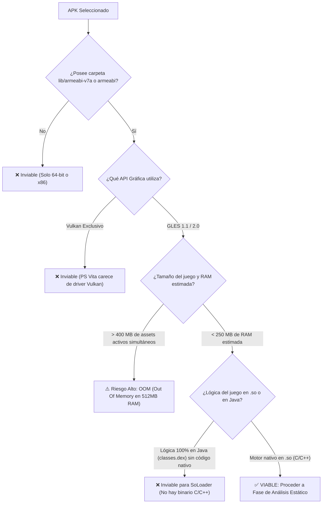

<div class="lang-switch-bar">
  <span>🌐 Language / Idioma:</span>
  <a href="../../02-apk-triage-and-selection/" class="lang-switch-link">🇬🇧 English</a>
  <a href="./" class="lang-switch-link active">🇪🇸 Español</a>
  <a href="../../pt/02-triagem-e-selecao-apk/" class="lang-switch-link">🇧🇷 Português</a>
</div>

<div class="chapter-hero">
  <span class="chapter-badge">Capítulo 02 • Viabilidad & Triaje</span>
  <h1 style="margin: 0.4rem 0 0.6rem 0; font-size: 2rem;">Triaje y Análisis de Viabilidad de APK</h1>
  <p style="margin: 0; opacity: 0.9; font-size: 1.05rem;">
    Diagnóstico sistemático de compatibilidad de arquitectura ABI (ARMv7 vs 64-bit), pipeline gráfico (GLES 1.1 vs 2.0 vs Vulkan), límites de memoria y ratio de código nativo.
  </p>
  <div class="chapter-meta">
    <span class="chapter-meta-pill">⚡ Nivel: Intermedio</span>
    <span class="chapter-meta-pill">🔍 Enfoque: Triaje ABI, Detección GLES, Presupuesto RAM</span>
    <span class="chapter-meta-pill">🎮 Casos: Hero of Sparta, Zenonia 3, Badland 2</span>
  </div>
</div>

---

Antes de escribir una sola línea de código o crear un proyecto CMake, es fundamental realizar un **análisis de viabilidad del APK**. No todos los juegos de Android pueden ser portados mediante la técnica SoLoader; evaluar las características del binario en los primeros diez minutos previene semanas de trabajo estéril.

---

## 📦 Anatomía de un APK de Android

Un archivo `.apk` es internamente un archivo comprimido estándar en formato **ZIP**. Puedes descomprimirlo con cualquier herramienta o renombrarlo a `.zip`:

```
juego.apk (ZIP)
├── AndroidManifest.xml        # Manifiesto binario (paquete Java, versión GLES, permisos)
├── classes.dex                # Bytecode Dalvik ejecutable de las clases Java
├── assets/                    # Assets directos del juego (modelos, texturas, música, niveles)
├── res/                       # Recursos de interfaz de Android (iconos, layouts XML)
├── lib/                       # LIBRERÍAS NATIVAS COMPILADAS (.so)
│   ├── armeabi/               # Binarios ARMv5/v6 (32 bits, soft-float)
│   ├── armeabi-v7a/           # Binarios ARMv7-A (32 bits, Thumb-2, VFPv3/NEON) [IDEAL]
│   ├── arm64-v8a/             # Binarios ARMv8 (64 bits) [INCOMPATIBLE DIRECTAMENTE]
│   └── x86/                   # Binarios Intel x86 [INCOMPATIBLE]
└── META-INF/                  # Firmas de seguridad y certificados
```

---

## 🔍 Criterio 1: Compatibilidad de Arquitectura (ABI)

Extrae la carpeta `lib/` y examina las carpetas presentes:

```bash
unzip -l juego.apk "lib/*"
```

| Directorio de ABI | Veredicto | Notas Técnicas para PS Vita |
|---|---|---|
| **`lib/armeabi-v7a/`** | **EXCELENTE (Óptimo)** | Código nativo ARMv7 de 32 bits con soporte para instrucciones Thumb-2 y aceleración vectorial NEON. Coincide exactamente con la CPU ARM Cortex-A9 de la Vita. |
| **`lib/armeabi/`** | **COMPATIBLE** | Código ARMv5TE / ARMv6 de 32 bits con aritmética de punto flotante por software (*soft-float*). La Vita lo ejecuta perfectamente porque ARMv7 es un superset estricto de ARMv6. |
| **`lib/arm64-v8a/`** | **NO COMPATIBLE** (en 32-bit) | Instrucciones AArch64 de 64 bits. La CPU de la PS Vita es estrictamente de 32 bits. Si el APK **solo** tiene `arm64-v8a`, busca una versión anterior del juego (versiones previas a agosto de 2019, fecha en la que Google impuso la obligatoriedad de 64 bits). |
| **`lib/x86/` / `lib/x86_64/`** | **INCOMPATIBLE** | Binarios para procesadores Intel/AMD. |

---

## 🎨 Criterio 2: Versión de API Gráfica (OpenGL ES)

La GPU de la PS Vita soporta hardware equivalente a **OpenGL ES 1.1** y **OpenGL ES 2.0** a través de la biblioteca [vitaGL](https://github.com/Rinnegatamante/vitaGL).

### ¿Cómo saber qué versión usa el juego?

1. **Revisar `AndroidManifest.xml` con `jadx`:**
   Busca la etiqueta `glEsVersion`:
   - `0x00010000` o `0x00010001`: OpenGL ES 1.0 / 1.1 (Pipeline de función fija).
   - `0x00020000`: OpenGL ES 2.0 (Shaders programables de vértices y fragmentos).
   - `0x00030000` o superior: OpenGL ES 3.0+. *Precaución:* La Vita no tiene hardware GLES3 completo, aunque muchas funciones básicas son mapeables a vitaGL.

2. **Inspeccionar los símbolos importados en el `.so` con `objdump`:**
   ```bash
   objdump -T lib/armeabi-v7a/libgame.so | grep -E "gl(Vertex|Color|CreateShader|Uniform)"
   ```
   - Si aparecen `glVertexPointer`, `glColorPointer`, `glTexCoordPointer`, `glMatrixMode`: **Es OpenGL ES 1.1**. vitaGL lo ejecuta con su pipeline de función fija de manera ultraeficiente.
   - Si aparecen `glCreateShader`, `glCompileShader`, `glAttachShader`, `glUniformMatrix4fv`: **Es OpenGL ES 2.0**. Requerirá el traductor de shaders de vitaGL o recompilación manual a Cg/GXP.
   - Si aparecen `vkCreateInstance`, `vkCreateDevice`: **Es Vulkan**. La PS Vita **NO** tiene soporte para Vulkan. Salvo que el motor tenga un fallback de OpenGL ES, el port no es viable.

---

## 🔗 Criterio 3: Dependencias NDK y Middleware

Ejecuta el siguiente comando para listar las librerías dinámicas compartidas de las que depende el juego:

```bash
arm-vita-eabi-readelf -d lib/armeabi-v7a/libgame.so | grep NEEDED
```

Salida típica de un juego apto:
```
 0x00000001 (NEEDED)             Shared library: [liblog.so]
 0x00000001 (NEEDED)             Shared library: [libGLESv2.so]
 0x00000001 (NEEDED)             Shared library: [libz.so]
 0x00000001 (NEEDED)             Shared library: [libm.so]
 0x00000001 (NEEDED)             Shared library: [libc.so]
 0x00000001 (NEEDED)             Shared library: [libstdc++.so]
```

### Tabla de resolución de dependencias comunes:

| Librería Requerida | Estado en Vita | Cómo se Resuelve en el Loader |
|---|---|---|
| `libc.so`, `libm.so`, `libdl.so` | **Resuelto** | Mapeado directamente a las funciones de Newlib / VitaSDK. |
| `libGLESv1_CM.so` / `libGLESv2.so` | **Resuelto** | Mapeado a [vitaGL](https://github.com/Rinnegatamante/vitaGL). |
| `liblog.so` | **Resuelto** | Mapeado a funciones de logging (`sceClibPrintf` / escritura en archivo). |
| `libz.so` | **Resuelto** | Enlazado contra `zlib` de VitaSDK. |
| `libOpenSLES.so` | **Resuelto** | Reimplementado mediante un wrapper hacia `sceAudio` o `OpenAL`. |
| `libfmod.so` / `libfmodstudio.so` | **Resuelto** | Existe FMOD nativo para PS Vita o se puede enlazar con wrappers de audio. |
| `libunity.so` / `libmono.so` | **Complejo** | Los juegos de Unity antiguos con Mono pueden requerir configuraciones avanzadas; Unity moderno con IL2CPP en ARMv7 suele exceder los límites de RAM si el juego es pesado. |

---

## 🚦 Matriz de Decisión de Viabilidad


