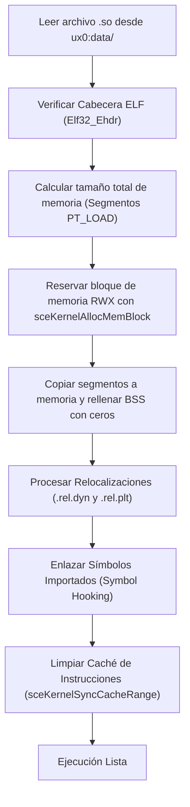

# 04. Arquitectura SoLoader y Relocalizaciones

El núcleo de todo port de Android para PlayStation Vita reside en el cargador dinámico de binarios ELF (`so_util.c` o `dynlib.c`). Este componente emula en espacio de usuario la labor que realiza el cargador dinámico de Linux (`/system/bin/linker` en Android).

---

## 🏗️ Cómo se Carga un ELF32 en Memoria

Un archivo `.so` compilado con el Android NDK es un binario en formato estándar **ELF (Executable and Linkable Format)** de 32 bits para arquitectura ARM.



### 1. Verificación de la Cabecera ELF (`Elf32_Ehdr`)
El cargador lee los primeros bytes del archivo y valida su integridad:
- **Magic:** `0x7F 'E' 'L' 'F'`
- **Clase:** `ELFCLASS32` (1) — 32 bits.
- **Endián:** `ELFDATA2LSB` (1) — Little Endian.
- **Máquina:** `EM_ARM` (40) — Arquitectura ARM.

### 2. Reserva de Memoria en VitaOS
El cargador recorre las cabeceras de programa (`Elf32_Phdr`), localiza los segmentos de tipo `PT_LOAD`, calcula el tamaño total de la imagen en memoria y alinea a páginas de 4 KiB:

```c
// Ejemplo real en dynlib.c:
SceUID memid = sceKernelAllocMemBlock(
    "game_code_block",
    SCE_KERNEL_MEMBLOCK_TYPE_USER_RWX, // Permisos Lectura, Escritura y Ejecución
    aligned_total_size,
    NULL
);

void *base_addr;
sceKernelGetMemBlockBase(memid, &base_addr);
```

> [!NOTE]
> La capacidad de asignar bloques `USER_RWX` es posible gracias al plugin de kernel **kubridge**. Sin este plugin, VitaOS bloquea la creación de páginas simultáneamente escribibles y ejecutables por motivos de seguridad (*W^X protection*).

---

## 🔄 El Motor de Relocalizaciones ARM

Dado que las librerías dinámicas se compilan con código independiente de posición (**PIC/PIE**), las referencias a variables globales y direcciones de funciones internas no son fijas, sino que deben ser ajustadas sumándoles la dirección base real donde el bloque fue alojado en memoria (`base_addr`).

El cargador examina las secciones dinámicas `.rel.dyn` y `.rel.plt`. Cada entrada de relocalización (`Elf32_Rel`) contiene un offset y un campo de información:

```c
typedef struct {
    Elf32_Addr r_offset; // Dirección en memoria donde aplicar la corrección
    Elf32_Word r_info;   // Tipo de relocalización y símbolo asociado
} Elf32_Rel;

#define ELF32_R_SYM(val)  ((val) >> 8)
#define ELF32_R_TYPE(val) ((val) & 0xff)
```

### Tipos de Relocalización Vitales en ARM:

| Tipo Numérico | Nombre Simbólico | Acción Realizada por el Cargador |
|---|---|---|
| **23** | `R_ARM_RELATIVE` | `*(uint32_t*)(base + r_offset) += (uint32_t)base;` <br>Ajusta un puntero interno absoluto sumándole la dirección base donde fue cargado el módulo. |
| **21** | `R_ARM_GLOB_DAT` | Localiza el nombre del símbolo en la tabla de strings (`.dynstr`), resuelve su dirección (función local o exportada por el loader) y la escribe en `*(uint32_t*)(base + r_offset)`. |
| **22** | `R_ARM_JUMP_SLOT` | Aplica a las entradas de la tabla PLT (*Procedure Linkage Table*). Escribe la dirección real de la función a invocar. |
| **2** | `R_ARM_ABS32` | Suma el valor del símbolo a la dirección absoluta existente en el offset. |

---

## 🪝 Tabla de Hooking e Intercepción de Símbolos

Cuando el juego en Android llama a `malloc`, `fopen` o `glTexImage2D`, el cargador de Vita intercepta esa llamada y la conecta con la función equivalente nativa de VitaSDK o vitaGL.

Esto se realiza mediante una tabla de resolución (`dynlib_symbols`):

```c
typedef struct {
    const char *symbol;
    uintptr_t func;
} DynLibSymbol;

static const DynLibSymbol dynlib_symbols[] = {
    // Memoria y strings estándar (libc)
    { "malloc", (uintptr_t)&malloc },
    { "free", (uintptr_t)&free },
    { "memcpy", (uintptr_t)&memcpy },
    { "memset", (uintptr_t)&memset },
    
    // I/O de archivos redirigido
    { "fopen", (uintptr_t)&vita_fopen },
    { "fclose", (uintptr_t)&fclose },
    { "fread", (uintptr_t)&fread },
    
    // Gráficos (mapeados a vitaGL)
    { "glViewport", (uintptr_t)&glViewport },
    { "glClear", (uintptr_t)&glClear },
    { "glDrawElements", (uintptr_t)&glDrawElements },
    { "glBindTexture", (uintptr_t)&glBindTexture },
    
    // Logging de Android redirigido a la consola de Vita
    { "__android_log_print", (uintptr_t)&vita_log_print },
    { NULL, 0 }
};
```

---

## 🩹 Parches Binarios en Memoria (Patching)

Con frecuencia, ciertas funciones nativas del `.so` intentan llamar a servicios incompatibles de Android (por ejemplo, validaciones antipiratería de Google Play Licensing, telemetría de Crashlytics, o inicializaciones de hardware inexistente).

Para neutralizarlas sin recompilar el `.so`:

### 1. Parche con instrucción de retorno inmediato (`BX LR`)
Para hacer que una función retorne inmediatamente sin hacer nada:

- **Modo Thumb:** El opcode para `bx lr` (retorno) y `movs r0, #0` (retornar 0 / éxito):
  ```c
  // Escribir 0x2000 (movs r0, #0) seguido de 0x4770 (bx lr)
  *(uint16_t *)(so_base + offset) = 0x2000;
  *(uint16_t *)(so_base + offset + 2) = 0x4770;
  ```
- **Modo ARM (32 bits):**
  ```c
  // 0xe3a00000 = mov r0, #0
  // 0xe12fff1e = bx lr
  *(uint32_t *)(so_base + offset) = 0xe3a00000;
  *(uint32_t *)(so_base + offset + 4) = 0xe12fff1e;
  ```

### 2. Sincronización de Caché Obligatoria
Cuando se escribe código o se modifican opcodes en memoria, los datos quedan alojados en la caché de datos (**D-Cache**) de la CPU. Si la CPU intenta ejecutar esa dirección inmediatamente, la caché de instrucciones (**I-Cache**) leerá el código antiguo sin modificar, causando crashes catastróficos.

> [!CRITICAL]
> Tras aplicar cualquier parche binario o relocalización, es mandatorio vaciar y sincronizar la caché:
> ```c
> sceKernelSyncCacheRange(target_address, size);
> ```
