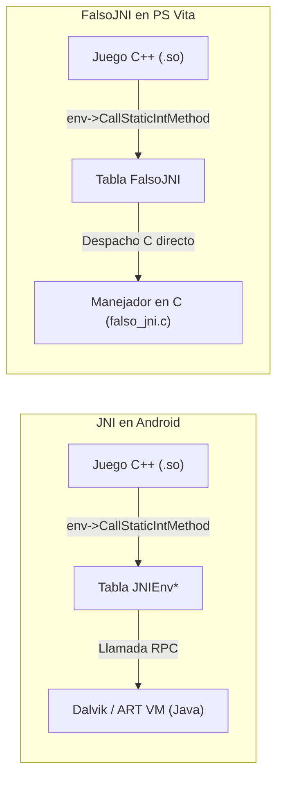

<div class="lang-switch-bar">
  <span>🌐 Language / Idioma:</span>
  <a href="../../05-falsojni-and-java-bridge/" class="lang-switch-link">🇬🇧 English</a>
  <a href="./" class="lang-switch-link active">🇪🇸 Español</a>
  <a href="../../pt/05-falsojni-e-ponte-java/" class="lang-switch-link">🇧🇷 Português</a>
</div>

<div class="chapter-hero">
  <span class="chapter-badge">Capítulo 05 • Puente Java</span>
  <h1 style="margin: 0.4rem 0 0.6rem 0; font-size: 2rem;">FalsoJNI y Puente de Emulación Java</h1>
  <p style="margin: 0; opacity: 0.9; font-size: 1.05rem;">
    Implementación del entorno de ejecución FalsoJNI en C para simular Dalvik VM, resolver firmas JNI complejas y responder a llamadas del sistema Android sin Java VM.
  </p>
  <div class="chapter-meta">
    <span class="chapter-meta-pill">⚡ Nivel: Avanzado</span>
    <span class="chapter-meta-pill">☕ Emulación: JNIEnv, JavaVM, Clases Android</span>
    <span class="chapter-meta-pill">🎮 Verificado: Hero of Sparta, Zenonia 3, Badland 2</span>
  </div>
</div>

---

En Android, los juegos escritos en C/C++ dependen continuamente de la máquina virtual Java (JVM) a través de la interfaz **JNI (Java Native Interface)** para consultar el idioma del sistema, acceder a la tarjeta SD, reproducir vídeos o reproducir pistas de audio.

Dado que en PlayStation Vita no disponemos de una máquina virtual Dalvik o ART completa, utilizamos **FalsoJNI**: una reimplementación minimalista y ultraligera que simula el entorno JNI respondiendo a las consultas del juego en C puro.

---

## 🏛️ Anatomía de las Estructuras JNI

Cuando el juego en C++ llama a JNI, lo hace a través de un puntero a una tabla de funciones (`JNIEnv*`):



### La Tabla de Funciones Simulada
`FalsoJNI` expone una estructura con los punteros a funciones estándar de JNI:

```c
// Extracto de la inicialización de FalsoJNI:
static const struct JNINativeInterface fake_jni_native_interface = {
    .GetVersion = &fake_GetVersion,
    .FindClass = &fake_FindClass,
    .GetMethodID = &fake_GetMethodID,
    .GetStaticMethodID = &fake_GetStaticMethodID,
    .CallVoidMethod = &fake_CallVoidMethod,
    .CallStaticVoidMethod = &fake_CallStaticVoidMethod,
    .CallStaticIntMethod = &fake_CallStaticIntMethod,
    .CallStaticBooleanMethod = &fake_CallStaticBooleanMethod,
    .CallStaticObjectMethod = &fake_CallStaticObjectMethod,
    .NewStringUTF = &fake_NewStringUTF,
    .GetStringUTFChars = &fake_GetStringUTFChars,
    .ReleaseStringUTFChars = &fake_ReleaseStringUTFChars,
    // ... más de 100 funciones de la especificación JNI
};

const struct JNINativeInterface *fake_env = &fake_jni_native_interface;
JNIEnv *env = (JNIEnv *)&fake_env;
```

---

## 🔡 Firmas de Métodos JNI (Type Signatures)

Cuando el juego busca un método Java llamando a `GetMethodID(env, clazz, "nombreMetodo", "(firma)retorno")`, la firma describe exactamente los tipos de argumentos y el tipo de retorno:

| Carácter | Tipo en Java | Tipo en C / C++ |
|---|---|---|
| `Z` | `boolean` | `jboolean` (uint8_t: 0 o 1) |
| `B` | `byte` | `jbyte` (int8_t) |
| `C` | `char` | `jchar` (uint16_t UTF-16) |
| `S` | `short` | `jshort` (int16_t) |
| `I` | `int` | `jint` (int32_t) |
| `J` | `long` | `jlong` (int64_t) |
| `F` | `float` | `jfloat` (float) |
| `D` | `double` | `jdouble` (double) |
| `V` | `void` | `void` |
| `Ljava/lang/String;` | `String` (Objeto) | `jstring` (puntero a objeto) |
| `[I` | Array de enteros (`int[]`) | `jintArray` |
| `[B` | Array de bytes (`byte[]`) | `jbyteArray` |

### Ejemplo Práctico:
Una firma `(ILjava/lang/String;)Z` indica un método que recibe un entero (`I`) y una cadena de texto (`String`), devolviendo un booleano (`Z`).

---

## 🪤 La Trampa Mortal de los Stubs: No-Ops vs Stubs Activos

Uno de los errores más comunes y destructivos en el desarrollo de ports es **crear stubs vacíos (no-ops) que devuelven 0 o NULL**.

### El Problema de la Pantalla Negra por Vídeos o Anuncios
Imagina que el motor del juego ejecuta este flujo al iniciar:
```java
// Código Java original en el APK:
public static void playIntroVideo() {
    VideoPlayer.play("intro.mp4", new OnVideoCompletionListener() {
        public void onCompletion() {
            nativeOnVideoCompleted(); // Informa al motor nativo en C++
        }
    });
}
```

Si en tu `falso_jni.c` implementas `playIntroVideo` como un stub vacío:
```c
// ❌ IMPLEMENTACIÓN INCORRECTA (Cuelga el juego permanentemente):
void fake_playIntroVideo(void) {
    // No hace nada
    return;
}
```

El motor C++ entra en un estado interno de espera (`WAITING_FOR_COMPLETION`). Como el stub no hace nada, la señal `nativeOnVideoCompleted()` jamás se dispara.
**Resultado:** El juego se queda congelado en una pantalla negra infinita sin consumir CPU.

### ✅ La Solución: El Patrón de Stub Activo
El stub debe disparar inmediatamente el callback nativo que el juego está esperando:

```c
// ✔️ IMPLEMENTACIÓN CORRECTA (Avanza el ciclo del motor):
void fake_playIntroVideo(void) {
    sceClibPrintf("[FalsoJNI] playIntroVideo solicitado -> Disparando fin de vídeo inmediato\n");
    
    // Invocamos inmediatamente la función nativa que notifica que el vídeo terminó
    if (nativeOnVideoCompleted_ptr) {
        nativeOnVideoCompleted_ptr(fake_env, NULL);
    }
}
```

---

## 🔤 Conversión de Cadenas UTF-8 y Manejo de Memoria

Los motores de Android solicitan constantemente strings mediante `GetStringUTFChars`. Si no gestionas los punteros adecuadamente, provocarás una fuga masiva de memoria en el heap:

```c
const char *fake_GetStringUTFChars(JNIEnv *env, jstring str, jboolean *isCopy) {
    if (!str) return NULL;
    if (isCopy) *isCopy = JNI_TRUE;
    
    // str en FalsoJNI suele encapsular un puntero char* directamente
    return strdup((const char *)str);
}

void fake_ReleaseStringUTFChars(JNIEnv *env, jstring str, const char *chars) {
    if (chars) {
        free((void *)chars); // Liberación obligatoria para evitar Memory Leaks
    }
}
```
