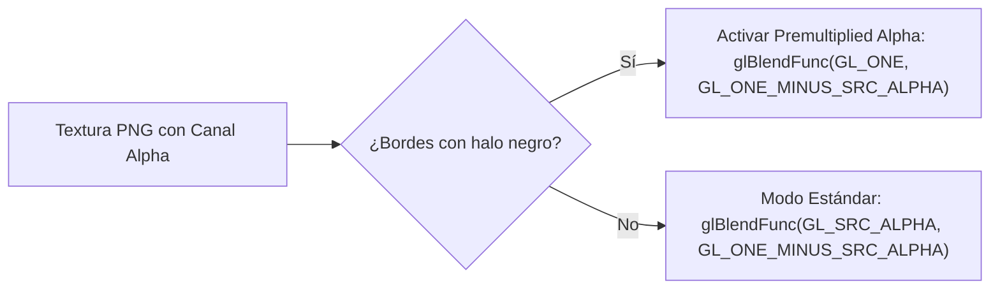

<div class="lang-switch-bar">
  <span>🌐 Language / Idioma:</span>
  <a href="../../06-vitagl-graphics-pipeline/" class="lang-switch-link">🇬🇧 English</a>
  <a href="./" class="lang-switch-link active">🇪🇸 Español</a>
  <a href="../../pt/06-pipeline-grafico-vitagl/" class="lang-switch-link">🇧🇷 Português</a>
</div>

<div class="chapter-hero">
  <span class="chapter-badge">Capítulo 06 • Gráficos vitaGL</span>
  <h1 style="margin: 0.4rem 0 0.6rem 0; font-size: 2rem;">Pipeline Gráfico con vitaGL</h1>
  <p style="margin: 0; opacity: 0.9; font-size: 1.05rem;">
    Traducción de llamadas OpenGL ES 1.1 / 2.0 a comandos nativos SCE GXM en GPU PowerVR SGX543, compilación de shaders GLSL a Cg/GXP y gestión de CDRAM.
  </p>
  <div class="chapter-meta">
    <span class="chapter-meta-pill">⚡ Nivel: Avanzado</span>
    <span class="chapter-meta-pill">🎨 Pipeline: OpenGL ES, SCE GXM, Shaders Cg/GXP</span>
    <span class="chapter-meta-pill">🎮 Verificado: Hero of Sparta, Zenonia 3, Badland 2</span>
  </div>
</div>

---

La PlayStation Vita cuenta con una GPU PowerVR SGX543MP4+, pero su sistema operativo oficial expone una API propietaria de muy bajo nivel llamada **SCE GXM**. Adaptar un juego de Android para que hable GXM directamente exigiría reescribir todo el motor gráfico desde cero.

Para resolver esto, la comunidad utiliza **[vitaGL](https://github.com/Rinnegatamante/vitaGL)**, una biblioteca de alto rendimiento desarrollada por Rinnegatamante que traduce llamadas de **OpenGL ES 1.1 y 2.0** a comandos de hardware GXM nativos en tiempo real con overhead mínimo.

---

## 🚀 Inicialización y Ciclo de Renderizado

En `main.c`, antes de invocar cualquier método del motor nativo, se inicializa vitaGL configurando la resolución nativa de la pantalla de la consola (**960x544**) y los buffers de memoria:

```c
#include <vitaGL.h>

void init_graphics(void) {
    // vglInitExtended(flags, width, height, ram_buffer_size, msaa_mode)
    // 6 MB de buffer temporal para comandos de vértices
    vglInitExtended(0, 960, 544, 6 * 1024 * 1024, SCE_GXM_MULTISAMPLE_NONE);
    
    // Configurar sincronización vertical (VBlank) para 60 FPS sin tearing
    vglWaitVblankStart(GL_TRUE);
}

void game_loop_frame(void) {
    // 1. Invocar el render nativo del juego
    nativeRender_func();
    
    // 2. Intercambiar los buffers de pantalla de vitaGL
    vglSwapBuffers(GL_FALSE);
}
```

---

## 🎨 Comparativa de Backends Gráficos en PS Vita

| Backend | Ventajas | Desventajas | Cuándo Usarlo |
|---|---|---|---|
| **vitaGL (Recomendado)** | Código abierto, maduro, soporte GLES 1.1/2.0 completo, compilación de shaders GLSL integrada, optimizado para CDRAM. | Pequeñas variaciones de precisión de punto flotante en shaders muy complejos. | **Estándar de facto** en el 98% de los ports de Android. |
| **PVR_PSP2** | Driver oficial PowerVR SGX extraído del SDK de Sony. Cumplimiento exacto de GLES 2.0. | No es código abierto, problemas de redistribución legal, integración rígida. | Casos excepcionales donde un shader GLSL no compila bajo vitaGL. |
| **SCE GXM Nativo** | Máximo rendimiento posible en la GPU, control absoluto de ring buffers. | Complejidad titánica: no hay soporte de GLSL, requiere gestión manual de sincronización de primitivas. | Solo para engines desarrollados desde cero para Vita. |

---

## 🪄 Shaders: De GLSL a Cg / GXP

La GPU de la Vita no procesa código fuente GLSL en texto en tiempo de ejecución de manera nativa; requiere binarios compilados de shaders en formato **GXP** (generados por el compilador `psp2cgc` a partir de dialecto Cg).

### ¿Cómo maneja vitaGL los shaders?
vitaGL incorpora un parser e intérprete interno que traduce código GLSL estándar a código intermedio de GXM en tiempo de ejecución.

### Transpilación de Shaders Offline (`psvita-toolkit`):
Para shaders pesados o juegos que sufren tartamudeo (*stuttering*) al compilar shaders durante el juego, se utiliza la transpilación offline basada en AST:

```bash
psvita-toolkit shader-transpile --dump-dir assets/glsl --out-dir assets/cg
```
Este comando utiliza `glslangValidator` para compilar GLSL a SPIR-V, luego `spirv-cross` para generar Cg limpio, y finalmente `psp2cgc` de VitaSDK para generar binarios `.gxp` precompilados de carga instantánea.

---

## ⚠️ Trampas Gráficas Frecuentes y Soluciones

### 1. El Efecto "Pantalla Invertida" (FBO Y-Flipping)
En OpenGL clásico, el origen de coordenadas `(0,0)` se sitúa en la esquina **inferior izquierda**. En muchas arquitecturas móviles y en GXM, el origen del framebuffer nativo se sitúa en la esquina **superior izquierda**.
Si el juego se dibuja de cabeza al renderizar hacia un FBO (*Framebuffer Object*):

```c
// Solución en vitaGL:
// Invertir verticalmente la proyección ortográfica en el shader o activar flag:
glViewport(0, 0, 960, 544);
```

### 2. Halo Negro en Texturas Transparentes (Alfa Premultiplicado)
Si los textos renderizados o sprites transparentes muestran un borde oscuro o halo sucio alrededor de los bordes, el motor está usando **Premultiplied Alpha**:
- En lugar del modo de mezcla estándar: `glBlendFunc(GL_SRC_ALPHA, GL_ONE_MINUS_SRC_ALPHA);`
- Configura: `glBlendFunc(GL_ONE, GL_ONE_MINUS_SRC_ALPHA);`



### 3. Saturación de CDRAM (112 MiB VRAM)
Por defecto, vitaGL aloja las texturas en la memoria ultrarrápida CDRAM. Si un juego carga cientos de texturas sin comprimir, la CDRAM se desbordará.
- **Solución:** vitaGL permite redirigir texturas estáticas o secundarias a la RAM principal mediante la función de control de asignación o reduciendo la resolución de texturas que superen 1024x1024 píxeles.
