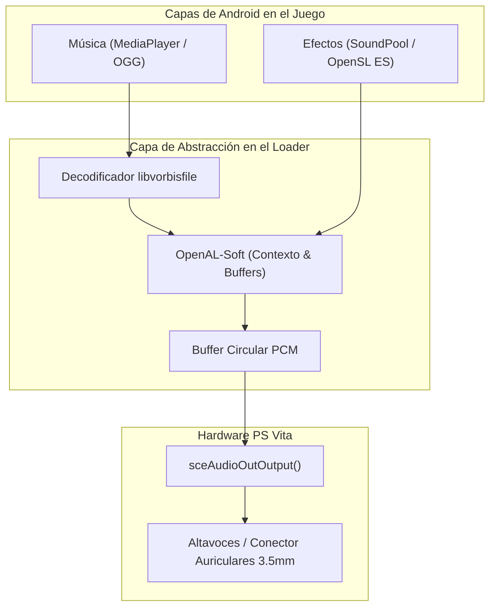

<div class="lang-switch-bar">
  <span>🌐 Language / Idioma:</span>
  <a href="../../07-audio-subsystem/" class="lang-switch-link">🇬🇧 English</a>
  <a href="./" class="lang-switch-link active">🇪🇸 Español</a>
  <a href="../../pt/07-subsistema-de-audio/" class="lang-switch-link">🇧🇷 Português</a>
</div>

<div class="chapter-hero">
  <span class="chapter-badge">Capítulo 07 • Subsistema de Audio</span>
  <h1 style="margin: 0.4rem 0 0.6rem 0; font-size: 2rem;">Subsistema de Audio y Streaming</h1>
  <p style="margin: 0; opacity: 0.9; font-size: 1.05rem;">
    Puente entre APIs de audio de Android (OpenSL ES, SoundPool, MediaPlayer) y el hardware de PS Vita usando sceAudioOut, OpenAL-Soft y decodificación OGG Vorbis.
  </p>
  <div class="chapter-meta">
    <span class="chapter-meta-pill">⚡ Nivel: Intermedio</span>
    <span class="chapter-meta-pill">🔊 Backends: sceAudioOut, OpenAL-Soft, libvorbisfile</span>
    <span class="chapter-meta-pill">🎮 Verificado: Hero of Sparta, Zenonia 3, Badland 2</span>
  </div>
</div>

---

En los juegos de Android, el audio se gestiona comúnmente a través de tres vías principales:
1. **OpenSL ES:** API nativa en C para audio de baja latencia.
2. **AudioTrack / SoundPool (Java):** Clases del SDK de Android para efectos de sonido cortos en memoria.
3. **MediaPlayer (Java):** Clase para streaming de música de fondo en formatos comprimidos (OGG, MP3).

En la PlayStation Vita, todo el audio físico converge en la API del kernel **`sceAudioOut`**, o en wrappers de alto nivel como **OpenAL-Soft**.

---

## 🔊 Arquitectura de Audio en PS Vita



### 1. Salida PCM Directa con `sceAudioOut`
VitaOS expone puertos de audio PCM estéreo de 16 bits mediante `sceAudioOut`:

```c
#include <psp2/audioout.h>

static int audio_port = -1;

void init_audio_hardware(void) {
    // Abrir puerto estéreo a 44100 Hz con tamaño de buffer de 1024 muestras
    audio_port = sceAudioOutOpenPort(
        SCE_AUDIO_OUT_PORT_TYPE_BGM,
        1024,
        44100,
        SCE_AUDIO_OUT_MODE_STEREO
    );
    
    // Configurar volumen máximo (32768 = 100%)
    int vol[2] = { 32768, 32768 };
    sceAudioOutSetVolume(audio_port, SCE_AUDIO_VOLUME_FLAG_L_CH | SCE_AUDIO_VOLUME_FLAG_R_CH, vol);
}

void output_pcm_block(const int16_t *samples) {
    // Bloquea hasta que el hardware procese las 1024 muestras
    sceAudioOutOutput(audio_port, samples);
}
```

---

## 📻 Streaming de Música de Fondo (OGG Vorbis)

Para juegos que reproducen música mediante OGG Vorbis (`.ogg`), enlazamos la biblioteca oficial `libvorbisfile`:

```c
#include <vorbis/vorbisfile.h>

typedef struct {
    OggVorbis_File vf;
    FILE *f;
    int is_playing;
    int loop;
} BGMStream;

BGMStream bgm;

void bgm_play(const char *filepath, int loop) {
    bgm.f = fopen(filepath, "rb");
    if (!bgm.f) return;
    
    if (ov_open_callbacks(bgm.f, &bgm.vf, NULL, 0, OV_CALLBACKS_DEFAULT) < 0) {
        fclose(bgm.f);
        return;
    }
    
    bgm.loop = loop;
    bgm.is_playing = 1;
}

// Bucle en hilo secundario de audio:
int audio_thread(SceSize args, void *argp) {
    int16_t pcm_buffer[2048]; // 1024 muestras estéreo
    int bitstream;
    
    while (1) {
        if (bgm.is_playing) {
            long bytes = ov_read(&bgm.vf, (char *)pcm_buffer, sizeof(pcm_buffer), 0, 2, 1, &bitstream);
            if (bytes > 0) {
                sceAudioOutOutput(audio_port, pcm_buffer);
            } else if (bytes == 0 && bgm.loop) {
                ov_time_seek(&bgm.vf, 0); // Rebobinar al inicio
            }
        } else {
            sceKernelDelayThread(10000); // 10 ms si está en pausa
        }
    }
    return 0;
}
```

---

## 🧩 Implementación de FalsoJNI para Audio

Muchos motores de Android disparan sonidos a través de JNI llamando a `SoundPool.play(soundID, leftVol, rightVol, priority, loop, rate)`:

```c
// En falso_jni.c:
jint fake_SoundPool_play(JNIEnv *env, jobject obj, jint soundID, jfloat leftVolume, jfloat rightVolume, jint priority, jint loop, jfloat rate) {
    // Localizar el sonido pre-cargado por su ID y enviarlo al mezclador OpenAL
    play_openal_sound_effect(soundID, leftVolume, loop);
    return soundID; // Devuelve stream ID válido (> 0) para que el juego sepa que inició con éxito
}
```

> [!TIP]
> Si el método `SoundPool.play` devuelve `0`, el motor de Android asume que todos los canales de hardware están saturados o fallaron, lo que puede provocar que el juego intente recargar el asset en cada frame, causando congelamientos masivos.
