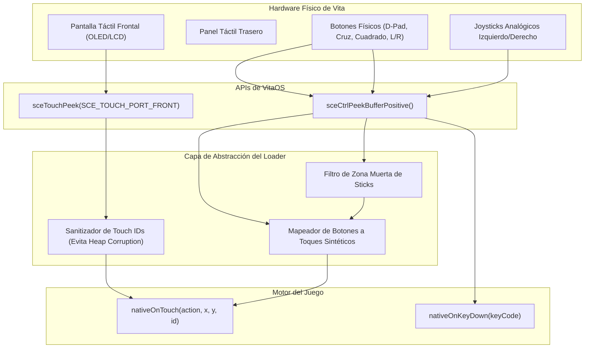

<div class="lang-switch-bar">
  <span>🌐 Language / Idioma:</span>
  <a href="../../08-controls-and-input/" class="lang-switch-link">🇬🇧 English</a>
  <a href="./" class="lang-switch-link active">🇪🇸 Español</a>
  <a href="../../pt/08-controles-e-entrada/" class="lang-switch-link">🇧🇷 Português</a>
</div>

<div class="chapter-hero">
  <span class="chapter-badge">Capítulo 08 • Entrada y Controles</span>
  <h1 style="margin: 0.4rem 0 0.6rem 0; font-size: 2rem;">Controles, Entrada Táctil y Mapeo Físico</h1>
  <p style="margin: 0; opacity: 0.9; font-size: 1.05rem;">
    Mapeo de botones analógicos y digitales de PS Vita (SceCtrlData) hacia eventos de MotionEvent de Android, emulación de multitouch frontal/trasero y prevención de desbordamiento.
  </p>
  <div class="chapter-meta">
    <span class="chapter-meta-pill">⚡ Nivel: Intermedio</span>
    <span class="chapter-meta-pill">🎮 Control: SceCtrlData, SceTouchData, Inyección Táctil</span>
    <span class="chapter-meta-pill">🎮 Verificado: Hero of Sparta, Zenonia 3, Badland 2</span>
  </div>
</div>

---

Adaptar el sistema de entrada de un juego táctil de smartphone a la ergonomía de una consola física como la PlayStation Vita requiere gestionar tanto la pantalla multitáctil como los botones físicos y joysticks analógicos.

---

## 🎮 Sondeo de Hardware en VitaOS



### 1. Inicialización Obligatoria del Táctil
Por defecto en VitaOS, el sondeo del panel táctil está **apagado** para conservar energía. Si no se activa explícitamente, `sceTouchPeek` devolverá siempre cero contactos:

```c
#include <psp2/touch.h>

void init_touch_system(void) {
    // Activar sondeo para la pantalla táctil frontal
    sceTouchSetSamplingState(SCE_TOUCH_PORT_FRONT, SCE_TOUCH_SAMPLING_STATE_START);
    
    // Activar sondeo para el panel táctil trasero (si se utiliza)
    sceTouchSetSamplingState(SCE_TOUCH_PORT_BACK, SCE_TOUCH_SAMPLING_STATE_START);
}
```

---

## 💣 La Trampa Mortal del Report ID (Heap Corruption)

Esta es una de las causas más esquivas de crashes aleatorios en ports de Android:

### El Error:
La estructura `SceTouchReport` de Sony contiene un campo `id`:
```c
SceTouchData touch;
sceTouchPeek(SCE_TOUCH_PORT_FRONT, &touch, 1);
uint8_t raw_id = touch.report[i].id; // Puede ser 15, 48, 120...
```

Los motores de Android (como Cocos2d-x o Gameloft) gestionan los dedos activos mediante un array estático de tamaño fijo (habitualmente 4 o 5 elementos):
```cpp
// Código interno del motor C++ de Android:
Touch active_touches[5];

void onTouchDown(int pointer_id, float x, float y) {
    active_touches[pointer_id].x = x; // ❌ CRASH SI pointer_id > 4
}
```

Si le pasas al motor el `report.id` crudo de Sony (ej. 15):
El motor calcula `&active_touches[15]`, **escribiendo fuera de los límites del array y corrompiendo el heap de la aplicación**. El juego no crasheará inmediatamente, sino minutos después cuando otra función intente leer esa memoria destruida.

### ✅ La Solución: Tabla de Mapeo de IDs Virtuales

El loader debe mantener un mapeo estricto de IDs crudos de Sony a slots contiguos entre `0` y `3`:

```c
#define MAX_TOUCH_SLOTS 4

static int virtual_touch_slots[MAX_TOUCH_SLOTS] = { -1, -1, -1, -1 };

int get_virtual_touch_id(int sony_raw_id) {
    // 1. Si ya tiene un slot asignado, devolverlo
    for (int i = 0; i < MAX_TOUCH_SLOTS; i++) {
        if (virtual_touch_slots[i] == sony_raw_id) return i;
    }
    // 2. Asignar un nuevo slot vacío
    for (int i = 0; i < MAX_TOUCH_SLOTS; i++) {
        if (virtual_touch_slots[i] == -1) {
            virtual_touch_slots[i] = sony_raw_id;
            return i;
        }
    }
    return 0; // Fallback seguro
}

void release_virtual_touch_id(int sony_raw_id) {
    for (int i = 0; i < MAX_TOUCH_SLOTS; i++) {
        if (virtual_touch_slots[i] == sony_raw_id) {
            virtual_touch_slots[i] = -1;
            break;
        }
    }
}
```

---

## 🕹️ Mapeo de Botones Físicos a Toques Sintéticos (Touch-to-Pad)

Muchos juegos móviles clásicos carecen de soporte nativo para mandos y solo responden a toques en pantalla sobre crucetas o botones virtuales dibujados en la UI.

Podemos emular toques físicos inyectando eventos táctiles sintéticos cuando el usuario presiona botones físicos de la consola:

```c
#include <psp2/ctrl.h>

typedef struct {
    uint32_t vita_button;
    float screen_x;
    float screen_y;
    int is_pressed;
} VirtualButton;

// Coordenadas normalizadas a la pantalla de 960x544
static VirtualButton v_buttons[] = {
    { SCE_CTRL_CROSS,    860.0f, 440.0f, 0 }, // Botón de Ataque / Acción
    { SCE_CTRL_SQUARE,   780.0f, 380.0f, 0 }, // Botón de Magia / Salto
    { SCE_CTRL_TRIANGLE, 840.0f, 300.0f, 0 }, // Botón de Menú
};

void process_touch_emulation(uint32_t current_buttons) {
    for (int i = 0; i < sizeof(v_buttons)/sizeof(v_buttons[0]); i++) {
        VirtualButton *vb = &v_buttons[i];
        int pressed = (current_buttons & vb->vita_button) != 0;
        
        if (pressed && !vb->is_pressed) {
            // Evento ACTION_DOWN (0)
            nativeOnTouch(0, vb->screen_x, vb->screen_y, 9 + i);
            vb->is_pressed = 1;
        } else if (!pressed && vb->is_pressed) {
            // Evento ACTION_UP (1)
            nativeOnTouch(1, vb->screen_x, vb->screen_y, 9 + i);
            vb->is_pressed = 0;
        }
    }
}
```

---

## 🎯 Filtrado de Zona Muerta en Joysticks Analógicos

Los joysticks analógicos de la PS Vita entregan valores enteros de `0` a `255`, con el centro neutral situado idealmente en `128`:

```c
#define ANALOG_DEADZONE 30

void read_analog_stick(uint8_t raw_x, uint8_t raw_y, float *out_x, float *out_y) {
    int dx = (int)raw_x - 128;
    int dy = (int)raw_y - 128;
    
    // Si está dentro de la zona muerta, cancelar deriva (drift)
    if (abs(dx) < ANALOG_DEADZONE) dx = 0;
    if (abs(dy) < ANALOG_DEADZONE) dy = 0;
    
    // Normalizar a rango -1.0f .. +1.0f
    *out_x = (float)dx / 128.0f;
    *out_y = (float)dy / 128.0f;
}
```
