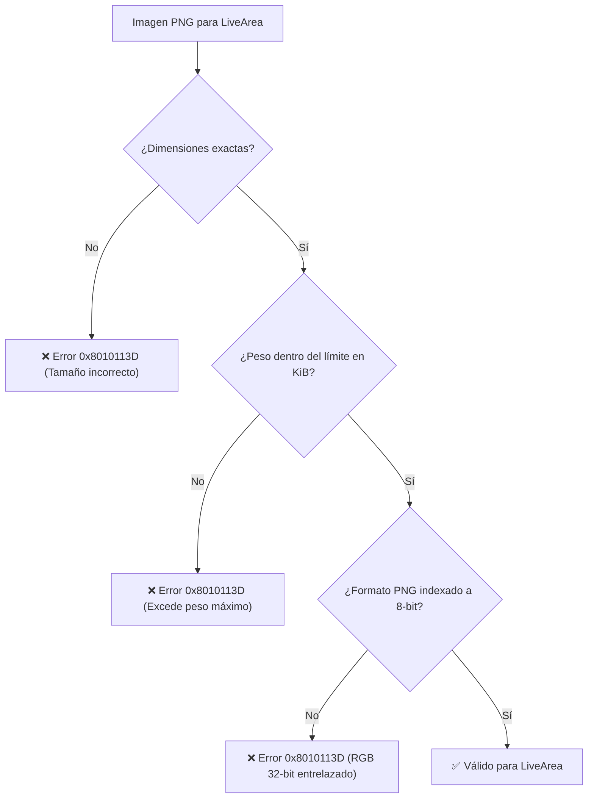

<div class="chapter-hero">
  <span class="chapter-badge">Capítulo 10 • Empaquetado & LiveArea</span>
  <h1 style="margin: 0.4rem 0 0.6rem 0; font-size: 2rem;">LiveArea y Empaquetado de VPK</h1>
  <p style="margin: 0; opacity: 0.9; font-size: 1.05rem;">
    Construcción de paquetes de distribución VPK, configuración de LiveArea (template.xml, icon0.png, bg0.png), resolución del error 0x8010113D y purga de archivos AppleDouble de macOS.
  </p>
  <div class="chapter-meta">
    <span class="chapter-meta-pill">⚡ Nivel: Intermedio</span>
    <span class="chapter-meta-pill">📦 Formato: Sony SELF, param.sfo, VPK (ZIP)</span>
    <span class="chapter-meta-pill">🎨 Assets: PNG Indexado de 8-bit, Límites SceShell</span>
  </div>
</div>

---

El paquete final distribuible en PlayStation Vita es un archivo con extensión **`.vpk`**. Un VPK es internamente un archivo ZIP estándar que contiene el ejecutable firmado (`eboot.bin`), el archivo de metadatos del sistema (`sce_sys/param.sfo`) y los recursos visuales del menú del sistema (**LiveArea**).

---

## 🖼️ Especificaciones de Imágenes del LiveArea

La interfaz de usuario de PlayStation Vita (**SceShell**) impone dimensiones exactas y restricciones estrictas de peso y profundidad de color:

| Archivo | Dimensiones (Píxeles) | Peso Máximo Permitido | Función en la Consola |
|---|---|---|---|
| **`icon0.png`** | **128 x 128** | 128 KiB | Icono circular en la pantalla de inicio (burbuja). |
| **`startup.png`** | **280 x 158** | 64 KiB | Botón central interactivo para iniciar el juego en la puerta LiveArea. |
| **`bg0.png`** | **840 x 500** | 128 KiB | Fondo de pantalla de la pantalla de bienvenida (LiveArea gate). |
| **`pic0.png`** | **960 x 544** | 256 KiB | Imagen de fondo estática a pantalla completa (opcional). |

---

## 🚫 El Terrorífico Error `0x8010113D` al Instalar

El error `0x8010113D` en VitaShell o en el instalador del sistema ocurre cuando una o más imágenes de LiveArea no cumplen con la especificación de Sony.



### Reglas de Oro para Imágenes:
1. **Paleta Indexada a 8 bits (256 colores):** Convierte siempre las imágenes con herramientas como `pngquant` o ImageMagick.
2. **Cero Entrelazado (No interlaced):** El decodificador de hardware de Sony no soporta PNGs progresivos o entrelazados.
3. **Conversión Automática con `psvita-toolkit`:**
   ```bash
   psvita-toolkit livearea --auto extras/livearea/ --validate
   ```

---

## 🍏 Trampa de macOS: Los Archivos Fantasma `._*`

Si compilas o empaquetas tu VPK en un ordenador Apple Mac, el sistema operativo macOS crea automáticamente archivos ocultos de metadatos llamados **AppleDouble** (`._icon0.png`, `._param.sfo`, `._eboot.bin`) al interactuar con discos externos o carpetas FAT32/exFAT.

> [!CAUTION]
> Si estos archivos `._*` se cuelan dentro del `.vpk`, VitaShell fallará al descomprimir o la burbuja del juego aparecerá corrupta en la pantalla de inicio de la consola.

### Limpieza antes de empaquetar:
```bash
# Eliminar todos los archivos AppleDouble del árbol:
find . -name "._*" -type f -delete

# O mediante el toolkit:
psvita-toolkit clean-junk
```

---

## 📜 Configuración de `param.sfo`

El archivo `param.sfo` almacena el Title ID, el nombre en pantalla y la categoría de la aplicación. Se genera automáticamente con `vita-mksfoex`:

```bash
vita-mksfoex -s TITLE_ID="PSVHOS001" "Hero of Sparta" param.sfo
```

### Reglas del `TITLE_ID`:
- Consta exactamente de **9 caracteres alfanuméricos en mayúsculas**.
- Prefijos habituales en homebrew: `PSV` seguido de 3 o 4 letras identificativas del juego y números (ejemplo: `PSVHOS001`, `ZENONIA02`, `INOTIA003`).

---

## 📦 Empaquetado Automático con CMake

En el archivo `CMakeLists.txt` del proyecto, configuramos `vita_create_vpk` para que construya el VPK firmado en cada compilación:

```cmake
vita_create_self(eboot.bin ${PROJECT_NAME})

vita_create_vpk(${PROJECT_NAME}.vpk ${TITLE_ID} eboot.bin
    VERSION "01.00"
    NAME "${GAME_NAME}"
    FILE extras/livearea/icon0.png sce_sys/icon0.png
    FILE extras/livearea/startup.png sce_sys/livearea/contents/startup.png
    FILE extras/livearea/bg0.png sce_sys/livearea/contents/bg0.png
    FILE extras/livearea/template.xml sce_sys/livearea/contents/template.xml
)
```
