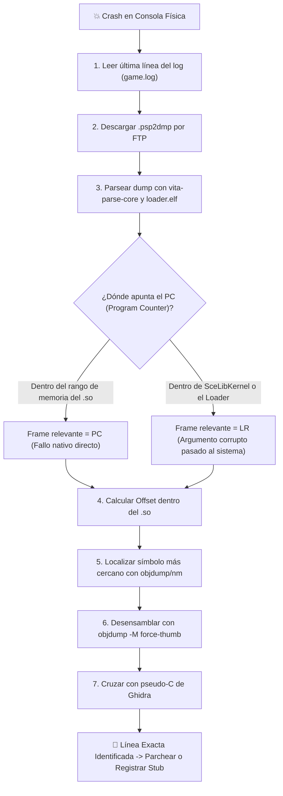

<div class="chapter-hero">
  <span class="chapter-badge">Capítulo 11 • Depuración de Hardware</span>
  <h1 style="margin: 0.4rem 0 0.6rem 0; font-size: 2rem;">Triage de Crashes y Depuración en Hardware</h1>
  <p style="margin: 0; opacity: 0.9; font-size: 1.05rem;">
    Metodología científica de triangulación de crashes usando .psp2dmp, registros ARMv7 (PC vs LR, R0-R3), desensamblado con objdump y trampas de alineación de memoria.
  </p>
  <div class="chapter-meta">
    <span class="chapter-meta-pill">⚡ Nivel: Avanzado</span>
    <span class="chapter-meta-pill">🔍 Depuración: .psp2dmp, vita-parse-core, addr2line</span>
    <span class="chapter-meta-pill">🎮 Verificado: Hero of Sparta, Zenonia 3, Badland 2</span>
  </div>
</div>

---

Cuando un port crashea en la consola física, no es necesario adivinar ni recurrir a pruebas a ciegas. La **Metodología de Triangulación** cruza tres fuentes exactas de verdad para llegar a la línea de código nativo causante del fallo:
1. El archivo de log con vaciado forzado (`fflush`).
2. El volcado de memoria del kernel (**`.psp2dmp`**) analizado con `vita-parse-core`.
3. El binario `.so` (desensamblado con `arm-vita-eabi-objdump`) cruzado con el pseudo-C de Ghidra y el Java de `jadx`.

---

## 🎯 El Flujo de Triangulación de Crashes



---

## 📋 Paso 1: Leer el Log Primero

El archivo de log de tu juego debe incluir un `fflush(log_file)` tras cada línea para garantizar que los últimos datos no queden atrapados en el buffer de escritura cuando ocurra un aborto:

```c
void vita_log(const char *fmt, ...) {
    va_list args;
    va_start(args, fmt);
    vfprintf(log_file, fmt, args);
    fflush(log_file); // OBLIGATORIO: descarga inmediata al disco
    va_end(args);
}
```

Examina la última línea:
- Si muestra `GetStaticMethodID(..., "checkLicensing", ...)` justo antes del corte: falta un stub JNI.
- Si muestra una lectura de archivo inexistente: falta redirigir una ruta de assets.

---

## 🔬 Paso 2: Parsear el `.psp2dmp` con `vita-parse-core`

Cuando una aplicación homebrew genera un Data Abort o Prefetch Abort en VitaOS, el sistema guarda un archivo de volcado en `ux0:data/` o `ur0:temp/core/` con el nombre `psp2core-XXXXXXXXXX-eboot.bin.psp2dmp`.

Descarga ese archivo por FTP y analízalo contra el archivo `loader.elf` con símbolos (generado en la carpeta de build antes de pasar por `vita-elf-create`):

```bash
python3 vita-parse-core/main.py crash.psp2dmp build/loader.elf
```

Salida típica del analizador:
```
Exception Type: Data abort (read access to 0x00000004)
Registers:
  r0: 0x00000000   r1: 0x98124000   r2: 0x00000001   r3: 0x81005a20
  PC: 0x98045a1c   LR: 0x98045a05   SP: 0x810ff400
```

---

## ⚖️ Paso 3: Decidir entre PC y LR

- **Si `PC` cae dentro del rango de direcciones del `.so` (comúnmente `0x98000000` en adelante):**
  El fallo ocurrió directamente dentro del código del juego. Ese es el offset a investigar.
- **Si `PC` cae dentro de `SceLibKernel` o dentro del propio loader (`eboot.bin`):**
  ¡**`LR` (Link Register) es la clave**! Significa que el código del juego llamó a una función del sistema (por ejemplo `memcpy` o `fopen`) pasándole un puntero `NULL` o un tamaño inválido. Debes examinar el punto de llamada en `LR`.

---

## 🔎 Paso 4: Resolver el Offset contra los Símbolos

Calcula el offset relativo restando la dirección base del `.so` en memoria:
`offset = PC - so_base_address` (ejemplo: `0x98045a1c - 0x98000000 = 0x45a1c`).

Busca qué función contiene ese offset:
```bash
objdump -T lib/armeabi-v7a/libgame.so | grep -v UND | awk '{print $1, $NF}' | sort > syms.txt
```
Localiza la función cuyo valor hexadecimal sea el más cercano inmediatamente inferior a `0x45a1c`. Supongamos que resuelve a `GameRenderer_updateUI + 0x24`.

---

## 📐 Paso 5: Desensamblar con `-M force-thumb` y Cruzar con Ghidra

Desensambla la función exacta:
```bash
arm-vita-eabi-objdump -d -M force-thumb --start-address=0x459f8 --stop-address=0x45a30 libgame.so
```

Instrucción causante del crash en `0x45a1c`:
```assembly
   45a18:   6808        ldr     r0, [r1, #0]    ; Lee puntero desde r1
   45a1a:   2800        cmp     r0, #0          ; Comprueba si es NULL
   45a1c:   6840        ldr     r0, [r0, #4]    ; ❌ DATA ABORT: r0 es NULL (0x0), intenta leer offset 0x4!
```

Abre `decompiled_so/out_ghidra.c`, busca `GameRenderer_updateUI` y verás el código equivalente en C:
```c
if (player_controller != NULL) {
    player_controller->health_bar->update(); // player_controller era válido, pero health_bar era NULL
}
```
¡Diagnóstico instantáneo y certero! El objeto `health_bar` no había sido inicializado porque faltaba cargar el layout XML correspondiente en FalsoJNI.

---

## ⚠️ La Trampa de Alineación de Memoria de ARMv7 (Alignment Traps)

En procesadores x86 de PC, la CPU tolera accesos a memoria desalineados (por ejemplo, leer un entero de 32 bits en una dirección impar).
**En la CPU ARM Cortex-A9 de la PlayStation Vita, las instrucciones `LDRD` (Load Register Dual de 64 bits), `STRD` y las cargas vectoriales NEON (`VLD1`) disparan un Data Abort inmediato por hardware si la dirección no está alineada a múltiplos de 8 o 16 bytes.**

> [!TIP]
> Si el juego crashea en una instrucción `ldrd r2, r3, [r0]` con un Data Abort y los registros no son `NULL`, verifica la alineación: si `r0` termina en `0x4` en lugar de `0x0` o `0x8`, el struct fue empaquetado incorrectamente en memoria. Corrige el empaquetado forzando asignaciones alineadas con `memalign(8, size)`.
