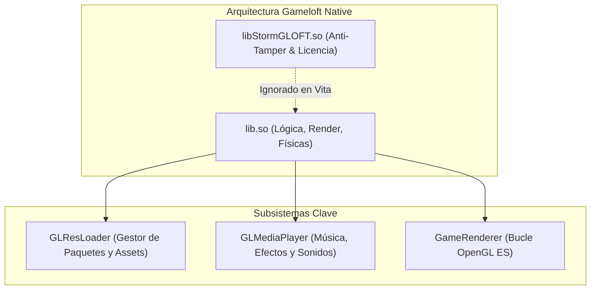
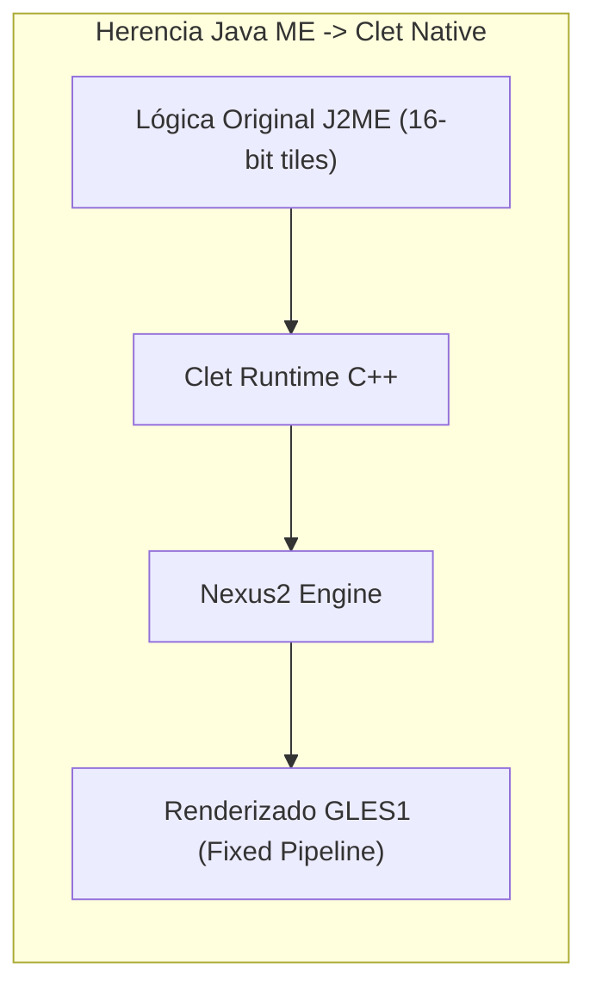

# 12. Arqueología de Motores Reales

A lo largo del desarrollo de más de 30 ports de PlayStation Vita en producción, se han desentrañado las arquitecturas internas de los motores móviles más influyentes. Esta sección documenta los patrones, estructuras y soluciones probadas para cada familia de motor.

---

## ⚔️ Familia 1: El Motor Gameloft Clásico (2010–2013)

**Juegos representativos:** *Hero of Sparta*, *Dungeon Hunter 2*, *N.O.V.A. 2*, *Shadow Guardian*, *Eternal Legacy*, *Six-Guns*, *Gangstar Rio*, *Brothers in Arms 2*, *Asphalt 5 & 6*.

### Particularidades Críticas:
1. **La Librería `libStormGLOFT.so`:**
   Casi todos los APKs de Gameloft de esta época incluyen dos archivos `.so`: `libStormGLOFT.so` y `lib<juego>.so`. El primero es un sistema anti-manipulación y de validación de compra que no contiene exports útiles. **En la PS Vita, solo cargamos la librería principal del juego.**
2. **El Subsistema `GLResLoader`:**
   Gameloft utiliza un cargador de recursos propio con soporte multi-raíz:
   - `GLResLoader_nativeInit(int)` debe invocarse antes de cualquier renderizado.
   - Busca archivos secuencialmente en carpetas de resolución (`1024x768`, `960x540`, `800x480`).
3. **Firmas de Métodos JNI Universales:**
   - `Java_..._GLMediaPlayer_nativeInit`
   - `Java_..._GLMediaPlayer_nativeGetTotalMusics`
   - `Java_..._GameRenderer_nativeInit(width, height, orientation)`
   - `Java_..._GameRenderer_nativeRender()`

---

## 🛡️ Familia 2: Motor Gamevil Nexus2 / Clet

**Juegos representativos:** *Zenonia 2*, *Zenonia 3*, *Zenonia 4*, *Destinia*, *ILLUSIA 1 y 2*, *Advena*.

### Particularidades Críticas:
1. **Herencia de Java ME (J2ME):**
   Estos juegos provienen de la época dorada de los feature phones coreanos. Para llevarlos a Android, Gamevil encapsuló su código original de microedición en un framework nativo en C++ llamado **Clet / Nexus2**.
2. **Mapeo de Símbolos Compartido:**
   Zenonia 2 y Zenonia 3 comparten casi el 95% de sus firmas JNI:
   `Java_com_gamevil_nexus2_Natives_nativeInit` y `Java_com_gamevil_nexus2_Natives_nativeEvent`.
   Si tienes un cargador funcional para Zenonia 2, portar Zenonia 3 consiste principalmente en actualizar los offsets del `.so` y adaptar el mapeo de teclas.
3. **Manejo de Texto y Codificación:**
   Muchos diálogos internos están codificados en cadenas de caracteres EUC-KR o UTF-8 sin BOM. Si ves caracteres extraños en pantalla, intercepta las funciones de dibujo de texto (`drawText`) y asegura la conversión a UTF-8 estándar para renderizar con `stb_truetype`.

---

## 🏹 Familia 3: Motores Com2uS

**Juegos representativos:** *Inotia 2: A Wanderer of Luone*, *Inotia 3: Children of Carnia*, *Inmortal Dusk*.

### Particularidades Críticas:
- **Gestión de Formatos Mach-O (iOS) vs ELF (Android):**
  Algunos títulos de Com2uS solo existieron en calidad HD para dispositivos Apple iOS de la época del iPhone 3GS/4. En títulos como *Inotia 2*, es posible cargar directamente el ejecutable **Mach-O de 32 bits** de ARMv7 descifrado de un archivo `.ipa`, reimplementando el framework CoreAudio y UIKit en C con vitaGL.
- **Buffers de Sonido Mono:** El motor de audio interno utiliza buffers PCM mono a 22050 Hz. Es necesario expandirlos a estéreo antes de enviarlos a `sceAudioOutOutput`.

---

## 🌳 Familia 4: Motores Modernos Basados en Cocos2d-x

**Juegos representativos:** *Badland 2*, *Rayman Jungle Run*, *The Impossible Game*.

### Particularidades Críticas:
- **Punto de Entrada Estandarizado:**
  Todos los juegos basados en Cocos2d-x exponen:
  `Java_org_cocos2dx_lib_Cocos2dxRenderer_nativeInit(width, height)`.
- **Carga de Assets desde ZIP:**
  Cocos2d-x busca internamente los assets mediante `CCFileUtils`. Al configurar la ruta base a `ux0:data/<juego>/game.apk`, la librería lee automáticamente imágenes, fuentes TTF y música directamente del ZIP sin necesidad de descomprimir miles de archivos sueltos.
