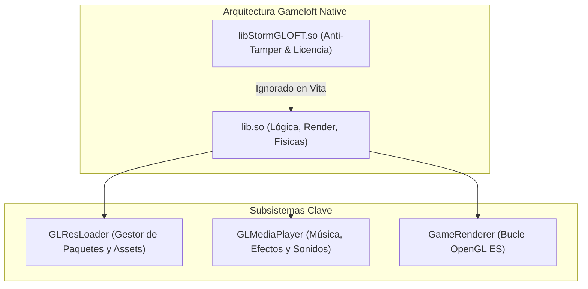
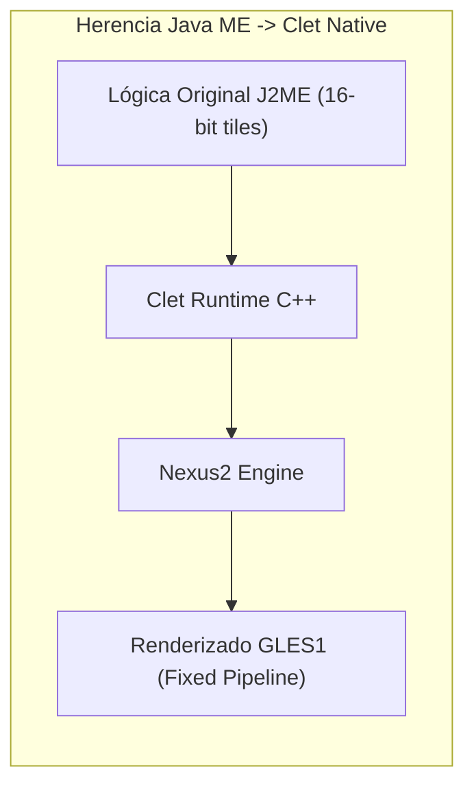
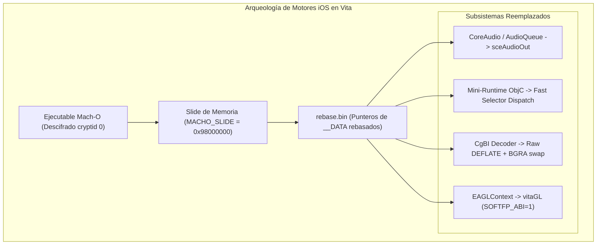

  Capítulo 12 • Arqueología de Motores
  <h1 style="margin: 0.4rem 0 0.6rem 0; font-size: 2rem;">Arqueología de Motores Reales y Casos de Estudio</h1>
  

    Patrones de ingeniería inversa, tablas de símbolos y soluciones probadas en combate a lo largo de más de 30 motores móviles (Gameloft, Gamevil, Com2uS, Cocos2d-x).
  

  

    ⚡ Nivel: Avanzado
    🏛️ Motores: Gameloft, Gamevil Nexus2, Com2uS, Cocos2d-x
    🎮 Casos Reales: 30+ Ports Probados
  

---

A lo largo del desarrollo de más de 30 ports de PlayStation Vita en producción, se han desentrañado las arquitecturas internas de los motores móviles más influyentes. Esta sección documenta los patrones, estructuras y soluciones probadas para cada familia de motor.

---

## ⚔️ Familia 1: El Motor Gameloft Clásico (2010–2013)

**Juegos representativos:** *Hero of Sparta*, *Dungeon Hunter 2*, *N.O.V.A. 2*, *Shadow Guardian*, *Eternal Legacy*, *Six-Guns*, *Gangstar Rio*, *Brothers in Arms 2*, *Asphalt 5 & 6*.

### Particularidades Críticas:
1. **La Librería `libStormGLOFT.so`:**
   Casi todos los APKs de Gameloft de esta época incluyen dos archivos `.so`: `libStormGLOFT.so` y `lib<juego>.so`. El primero es un sistema anti-manipulación y de validación de compra que no contiene exports útiles. **En la PS Vita, solo cargamos la librería principal del juego.**
2. **El Subsistema `GLResLoader`:**
   Gameloft utiliza un cargador de recursos propio con soporte multi-raíz:
   - `GLResLoader_nativeInit(int)` debe invocarse antes de cualquier renderizado.
   - Busca archivos secuencialmente en carpetas de resolución (`1024x768`, `960x540`, `800x480`).
3. **Firmas de Métodos JNI Universales:**
   - `Java_..._GLMediaPlayer_nativeInit`
   - `Java_..._GLMediaPlayer_nativeGetTotalMusics`
   - `Java_..._GameRenderer_nativeInit(width, height, orientation)`
   - `Java_..._GameRenderer_nativeRender()`

---

## 🛡️ Familia 2: Motor Gamevil Nexus2 / Clet

**Juegos representativos:** *Zenonia 2*, *Zenonia 3*, *Zenonia 4*, *Destinia*, *ILLUSIA 1 y 2*, *Advena*.

### Particularidades Críticas:
1. **Herencia de Java ME (J2ME):**
   Estos juegos provienen de la época dorada de los feature phones coreanos. Para llevarlos a Android, Gamevil encapsuló su código original de microedición en un framework nativo en C++ llamado **Clet / Nexus2**.
2. **Mapeo de Símbolos Compartido:**
   Zenonia 2 y Zenonia 3 comparten casi el 95% de sus firmas JNI:
   `Java_com_gamevil_nexus2_Natives_nativeInit` y `Java_com_gamevil_nexus2_Natives_nativeEvent`.
   Si tienes un cargador funcional para Zenonia 2, portar Zenonia 3 consiste principalmente en actualizar los offsets del `.so` y adaptar el mapeo de teclas.
3. **Manejo de Texto y Codificación:**
   Muchos diálogos internos están codificados en cadenas de caracteres EUC-KR o UTF-8 sin BOM. Si ves caracteres extraños en pantalla, intercepta las funciones de dibujo de texto (`drawText`) y asegura la conversión a UTF-8 estándar para renderizar con `stb_truetype`.

---

## 🏹 Familia 3: Motores Com2uS

**Juegos representativos:** *Inotia 2: A Wanderer of Luone*, *Inotia 3: Children of Carnia*, *Inmortal Dusk*.

### Particularidades Críticas:
- **Gestión de Formatos Mach-O (iOS) vs ELF (Android):**
  Algunos títulos de Com2uS solo existieron en calidad HD para dispositivos Apple iOS de la época del iPhone 3GS/4. En títulos como *Inotia 2*, es posible cargar directamente el ejecutable **Mach-O de 32 bits** de ARMv7 descifrado de un archivo `.ipa`, reimplementando el framework CoreAudio y UIKit en C con vitaGL.
- **Buffers de Sonido Mono:** El motor de audio interno utiliza buffers PCM mono a 22050 Hz. Es necesario expandirlos a estéreo antes de enviarlos a `sceAudioOutOutput`.

---

## 🌳 Familia 4: Motores Modernos Basados en Cocos2d-x

**Juegos representativos:** *Badland 2*, *Rayman Jungle Run*, *The Impossible Game*.

### Particularidades Críticas:
- **Punto de Entrada Estandarizado:**
  Todos los juegos basados en Cocos2d-x exponen:
  `Java_org_cocos2dx_lib_Cocos2dxRenderer_nativeInit(width, height)`.
- **Carga de Assets desde ZIP:**
  Cocos2d-x busca internamente los assets mediante `CCFileUtils`. Al configurar la ruta base a `ux0:data/<juego>/game.apk`, la librería lee automáticamente imágenes, fuentes TTF y música directamente del ZIP sin necesidad de descomprimir miles de archivos sueltos.

---

## 🍎 Familia 5: Motores Nativos Clásicos de iOS (Mach-O)

**Juegos representativos:** *Prince of Persia: Warrior Within*, *Rayman 2: The Great Escape*, *Zenonia 5 iOS*, *PES 2011/2012 iOS*, *The Sims 3 iOS*.

A diferencia de los ports de Android, estos juegos se compilaron como binarios `MH_EXECUTE` puros para ARMv7, prescindiendo totalmente de máquinas virtuales Java o capas JNI.

### Casos de Estudio Reales de Producción:

#### 1. *Prince of Persia: Warrior Within* (Ubisoft / Gameloft)
- **Pipeline de Vídeo Dual:** Sus cinemáticas eran archivos `.mp4` codificados en MPEG-4 Part 2 (`mp4v`). `SceAvPlayer` por hardware no podía reproducirlos (se apagaba a los 1.6 segundos). Se implementó un demuxer ISO-BMFF (MP4) ligero en C para parsear cajas `moov/trak/mdia/stbl` directamente con `sceIoOpen`/`sceIoRead`, enviando los flujos a `libavcodec` en hilos dedicados con conversión YUV420P->RGB565 acelerada por NEON, mientras los vídeos en H.264 usan decodificación hardware con `SceAvcdec`.
- **Audio y Sincronía:** El audio AAC decodificado con `libswresample` alimenta `sceAudioOutOutput()`, dictando el reloj físico de sincronización A/V sin derivas temporales.

#### 2. *Rayman 2: The Great Escape* (Gameloft)
- **Arqueología de Controles en Memoria:** El motor inicializa sus botones táctiles en `_TouchpadInit` (0x687c) rellenando estructuras de 84 bytes en `__DATA` (`_DpadButton`, `_tp_button[7]`). En lugar de adivinar las coordenadas en pantalla, el loader lee directamente las estructuras de la memoria del juego y traduce los botones físicos de la consola a pulsaciones en el centro exacto de cada botón.
- **Ocultación Dinámica de HUD (`patch_hide_quad`):** Interceptando las llamadas de dibujo ortográfico 2D (`g_ProjectionMatrixLevel == 2`), el loader suprime el renderizado de los botones táctiles virtuales, manteniendo la pantalla completamente limpia.

#### 3. *Zenonia 5 iOS* (Gamevil)
- **Emulación de Servidor en Memoria:** El juego exigía autenticarse con `zn555.gamevil.com:10000` (servidores dados de baja). Interceptando sockets BSD (`socket`, `connect`, `send`, `recv`), el loader aloja un servidor loopback interno que responde a paquetes `CS_CONNECT` (0x100) generando respuestas `SC_CONNECT` (0x101) con ID de usuario y sesión válidos, desbloqueando el juego sin conexión a internet.

---

## 🧟 Familia 6: Motor Marmalade SDK / s3e

**Juegos representativos:** *Call of Duty: World at War Zombies*, *Plants vs. Zombies iOS*.

### Particularidades Críticas:
- **Estructura s3e:** El ejecutable de Marmalade (`kiwi`) monta una capa de abstracción interna denominada **s3e** que encapsula gráficos, sonido y sistema de archivos.
- **Configuración `.icf`:** Marmalade lee archivos de texto de configuración de inicialización (ej. `app.icf`). Mediante parches en memoria, es posible forzar banderas críticas como `[S3E] GLESVersion=2` o acelerar los tiempos de arranque con `FastShutdown=1`.
- **Secciones de Código:** Emplea segmentos propietarios `s3e_code` y `__S3E_DATA`, requiriendo un alineamiento estricto de punteros durante la carga.
