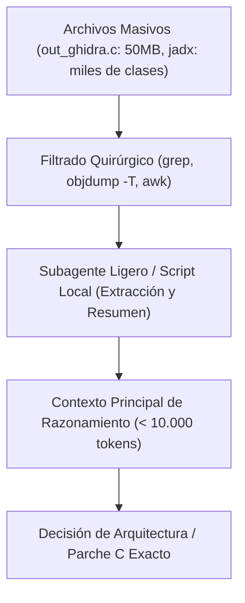

<div class="chapter-hero">
  <span class="chapter-badge">Capítulo 13 • Pair Programming con IA</span>
  <h1 style="margin: 0.4rem 0 0.6rem 0; font-size: 2rem;">Guía de Porting Asistido con IA</h1>
  <p style="margin: 0; opacity: 0.9; font-size: 1.05rem;">
    Mejores prácticas para desarrollo en pareja humano + IA, optimización del 90% en tokens de contexto, mitigación de alucinaciones en firmas JNI y plantillas de prompts deterministas.
  </p>
  <div class="chapter-meta">
    <span class="chapter-meta-pill">⚡ Nivel: Metodología</span>
    <span class="chapter-meta-pill">🤖 Herramientas: Claude, GPT, Antigravity, Subagentes</span>
    <span class="chapter-meta-pill">🎯 Enfoque: Cero Alucinación, Economía de Tokens</span>
  </div>
</div>

---

El desarrollo de ports para PlayStation Vita mediante SoLoader requiere una cantidad significativa de código repetitivo (stubs JNI, tablas de resolución de símbolos, wrappers de audio) y razonamiento profundo de bajo nivel para depurar fallos en hardware real.

Esta guía documenta las mejores prácticas para programar en pareja (**Pair Programming**) con agentes de Inteligencia Artificial (Antigravity, Claude, GPT), optimizando el consumo de contexto y evitando alucinaciones.

---

## ⚡ La Economía de Tokens en Triage de Ports

Los archivos de desensamblado (`objdump`), el pseudo-C de Ghidra (`out_ghidra.c`) y las clases Java decompiladas pueden superar fácilmente los **500.000 tokens**.



### Reglas de Oro para la Gestión de Contexto:
1. **Nunca vuelques un archivo `out_ghidra.c` completo en el chat:**
   Utiliza siempre comandos de filtrado como `grep -n -C 15 "nombre_funcion"` para extraer únicamente las 30 líneas relevantes.
2. **Delega tareas mecánicas a modelos más ligeros:**
   La generación de 40 stubs vacíos o el formateo de tablas de símbolos dinámicos debe delegarse a subagentes rápidos (Flash / Flash-Lite), reservando el modelo de mayor razonamiento para el análisis de los volcados `.psp2dmp`.

---

## 🛡️ Prevención de Alucinaciones en Ingeniería Inversa

Las IAs tienden a adivinar nombres de métodos JNI o tipos de retorno si la información no está explícita. Sigue estas directrices para obtener código 100% determinista:

### 1. Proporciona siempre la firma real extraída de Java o `objdump`
❌ **Prompt Inadecuado:**  
*"Escribe el stub para el método que reproduce música en Hero of Sparta."*

✔️ **Prompt Blindado:**  
*"En el APK decompilado por jadx encontramos esta declaración exacta:*  
`public static native int nativePlayMusic(String path, boolean loop);`  
*Escribe la función C correspondiente para FalsoJNI asegurándote de que la firma sea `(Ljava/lang/String;Z)I`, convierta el jstring a UTF-8, lo envíe a nuestro backend de audio y devuelva un streamID > 0 para que el motor no lo considere un fallo."*

### 2. Obliga a la IA a verificar tipos primitivos JNI
Recuérdale a la IA la correspondencia estricta de tipos:
- `Z` = `jboolean` (1 byte, no 4 bytes int).
- `J` = `jlong` (64 bits enteros con signo).
- Los métodos que devuelven punteros u objetos nunca deben devolver un puntero colgante en stack.

---

## 📋 Plantilla de Prompt para Generación de Stubs en Lote

Utiliza esta plantilla cuando el log de la consola reporte varios métodos no encontrados:

```markdown
Actúa como un desarrollador experto de ports para PS Vita usando FalsoJNI.
A continuación tienes los métodos de Android que el juego intentó invocar y no encontró:

1. com.gameloft.android.GLUtils.getDeviceModel() -> Ljava/lang/String;
2. com.gameloft.android.GLMediaPlayer.isMusicActive() -> Z
3. com.gameloft.android.GLResLoader.openAsset(String path) -> [B

Para cada uno:
1. Escribe la función C con la firma FalsoJNI correspondiente.
2. Si devuelve un string, utiliza fake_NewStringUTF con un valor seguro ("PlayStation Vita").
3. Si devuelve un booleano, devuelve JNI_TRUE o JNI_FALSE según lo que el juego espere para continuar.
4. Genera la entrada correspondiente para la tabla de registro jni_methods.
```
