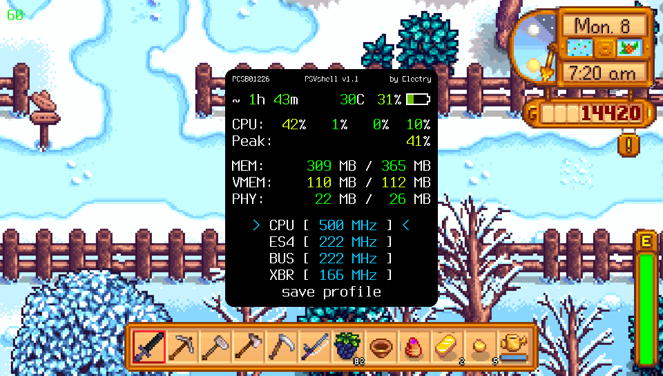
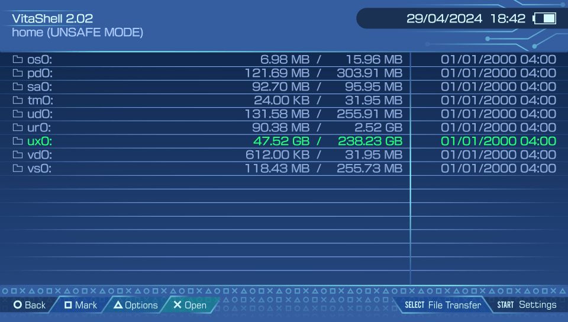

<div class="chapter-hero">
  <span class="chapter-badge">Capítulo 14 • Guía Histórica</span>
  <h1 style="margin: 0.4rem 0 0.6rem 0; font-size: 2rem;">Guía Base de gl33ntwine (Vitaliy Atamanenko)</h1>
  <p style="margin: 0; opacity: 0.9; font-size: 1.05rem;">
    La guía fundamental de gl33ntwine preservada bajo licencia CC BY 4.0, cubriendo la arquitectura de la consola, configuración de VitaSDK, CMake y el ecosistema homebrew.
  </p>
  <div class="chapter-meta">
    <span class="chapter-meta-pill">✍️ Autor: gl33ntwine</span>
    <span class="chapter-meta-pill">📜 Licencia: CC BY 4.0</span>
    <span class="chapter-meta-pill">🏛️ Preservada de Wayback Machine</span>
  </div>
</div>

---

> **Autor:** [gl33ntwine (Vitaliy Atamanenko)](https://twitter.com/gl33ntwine)  
> **Fecha de publicación original:** 2 de Mayo de 2022  
> **Tiempo de lectura:** ~38 min (6,918 palabras)  
> **URL original (sitio inactivo):** `https://gl33ntwine.com/posts/develop-for-vita/`  
> **Captura archivada en Wayback Machine:** [Web Archive (2024-12-06)](https://web.archive.org/web/20241206184722/https://gl33ntwine.com/posts/develop-for-vita/)  
> **Licencia:** [Creative Commons Attribution 4.0 International (CC BY 4.0)](https://creativecommons.org/licenses/by/4.0/)
> **Traducción al español:** Traducción comunitaria del artículo original en inglés. El original permanece intacto en `develop-for-vita.md`.

---

¡Hola! Si has llegado hasta aquí, probablemente no necesito contarte lo increíble que es la PlayStation Vita ni lo triste que fue que Sony fallara en su marketing y la abandonara tan rápido. Aun así, me siento obligado a decir que la Vita también es muy curiosa desde la perspectiva de un desarrollador.

Debes entender que una consola portátil lanzada en 2012 no puede tener las capacidades de una PlayStation 4 y, en la mayoría de los casos, ni siquiera las de una PlayStation 3. Pero los límites de este pequeño hardware veterano siguen siendo más un reto que una molestia en 2022. Creo sinceramente que si te tomas el tiempo de dominar tus técnicas de desarrollo de juegos con PSV, crear software fluido y optimizado para cualquier plataforma de escritorio, móvil o consola te resultará mucho menos problemático.

Y lo más importante: la escena homebrew de Vita sigue siendo cuidada por mantenedores y desarrolladores, llena de nuevas librerías, lenguajes, motores y demás. Por supuesto, eso también implica una no tan pequeña comunidad de jugadores fieles que disfrutarán y valorarán tus trabajos.

¿Convencido? :) Vamos al grano.

## Introducción

Esta guía está planeada para constar de varias partes, empezando con información general y el SDK de Vita en la primera parte, y llegando a otros lenguajes de programación, motores, plugins y ports de Android en las siguientes partes.

Ten en cuenta que Vita SDK es una cadena de herramientas (toolchain) de C/C++. Así que, para desarrollar cosas usando Vita SDK directamente, necesitas tener algún conocimiento de alguno de estos lenguajes y una buena comprensión de informática en general. ¡Pero no te vayas todavía si no sabes ni C ni C++! Este artículo también contendrá mucha información que puede resultarte útil, sin importar el lenguaje o motor que termines usando. Siéntete libre de usar la navegación de la derecha para saltar a las secciones que más te interesen.

> [!TIP]
> Ejecutar cualquier aplicación homebrew en la Vita requiere custom firmware. Si no sabes lo que es o estás a punto de cerrar el artículo, no te preocupes. Es un proceso sencillo y seguro e incluso completamente reversible. Siempre puedes «des-hackear» tu dispositivo y dejarlo como si nunca hubiera pasado nada. Más info: [https://vita.hacks.guide/](https://vita.hacks.guide/)

## Resumen del hardware de Vita

### Entradas y salidas


Como puedes ver en el diagrama de arriba, en cuanto a controles, la Vita es prácticamente un mando DualShock 4 con una pantalla táctil de 5 pulgadas en el frontal y su panel táctil movido a la parte trasera. Algunas diferencias importantes a tener en cuenta son que los sticks analógicos no se pueden pulsar, y que no tienes el segundo par de gatillos (L2/R2 en el DS4), solo L/R.

La buena noticia es que todo lo que ves en el diagrama es accesible desde Vita SDK. Excepto quizá el puerto de accesorios. No estoy seguro de por qué existe siquiera :)

### CPU

PlayStation Vita lleva un [ARM Cortex-A9](https://en.wikipedia.org/wiki/ARM_Cortex-A9). Por suerte, Sony eligió para la Vita la cómoda, optimizada y bien conocida **arquitectura ARM** en lugar de la bastante exótica MIPS que había usado para la PSP. Por cierto, esta misma CPU fue la que usó Apple para el iPhone 4S y otros dispositivos con el SoC Apple A5.

La variante de Cortex-A9 de Vita tiene cuatro núcleos a 500 MHz, cada uno con una caché de instrucciones L1 de 32 KiB y una caché de datos de 32 KiB. Además, los cuatro comparten una caché L2 común de 2 MiB.

Antes de que mires tu procesador i9-99999k a 1337 GHz y decidas que es una causa perdida, déjame recordarte que la CPU de PlayStation 2 funcionaba a 294 MHz y aun así hizo un montón de cosas impresionantes. Además, ¡mira este [gameplay de Killzone Mercenary](https://youtu.be/KlLQlTFIQ6U?t=698)! Básicamente, la ~~fama~~ velocidad de reloj no lo es todo. ¡La optimización es la clave!

Si quieres profundizar en los detalles de la CPU de Vita, te recomiendo leer:

- [«Main Processor» en la Wiki de HENkaku](https://wiki.henkaku.xyz/vita/Main_Processor).
- [«CPU» en la PlayStation Developer Wiki](https://playstationdev.wiki/psvitadevwiki/index.php/CPU).

Aquí, centrémonos solo en dos de sus peculiaridades importantes para ti como desarrollador.

#### Overclocking

Para ser precisos, el reloj de la CPU no es de 500 MHz; es de **111 MHz a 500 MHz**. Esta velocidad de reloj se puede cambiar en el lado del usuario usando un plugin como [PSVShell](https://github.com/Electry/PSVshell):



La velocidad de reloj estándar de la CPU es de 330 MHz, pero el desarrollador puede forzar un valor más alto en el código [así](https://github.com/v-atamanenko/osu-octave/blob/6ee14f52f91ca4d49e9b7ffab72e963dd0685f8f/source/main.cpp#L17-L20).

Tal «overclocking» es seguro y no causará sobrecalentamiento ni comportamientos inesperados: en realidad no estamos haciendo overclock, sino revirtiendo el *underclock* que introdujo Sony para alargar la batería.

#### Cuarto núcleo

Por defecto, el cuarto núcleo está reservado para procesos del sistema y no puede ser usado por «aplicaciones de juego» (es decir, cualquier aplicación homebrew en nuestro contexto).

En la mayoría de los casos, el rendimiento de tu juego o aplicación depende de la velocidad de reloj de un solo núcleo. Pero si resulta que tienes una tarea intensiva en multihilo y echas en falta ese cuarto núcleo, existe [un plugin llamado CapUnlocker](https://github.com/GrapheneCt/CapUnlocker) de GrapheneCt.

Para usar el cuarto núcleo teniendo CapUnlocker configurado, especifica 0x80000 como máscara de afinidad de CPU al crear un nuevo hilo. También puedes usar ese valor con `sceKernelChangeThreadCpuAffinityMask()` para cambiar la máscara de afinidad de un hilo ya existente.

No te preocupes si aún no entiendes lo que te dice el último párrafo. Solo ten en cuenta que esa opción existe.

### GPU

Mientras que la CPU puede considerarse bastante normalita, la GPU de Vita es bastante impresionante. Es un chip [PowerVR Series5XT](https://en.wikipedia.org/wiki/PowerVR#Series5XT_(SGX)), SGX543MP4+, para ser específicos. En términos de GFLOPS, ¡es 11 veces más potente que la PSP, 6 veces más potente que la Nintendo 3DS, y solo 5,5 veces menos potente que la Nintendo Switch!

La GPU tiene 4 núcleos, cada uno a un máximo de 222 MHz. El overclocking se hace igual que con la CPU, ya sea en el lado del usuario o del desarrollador.

Si quieres saber más en profundidad sobre la GPU, te recomiendo leer:

- [«SGX543» en la Wiki de HENkaku](https://wiki.henkaku.xyz/vita/SGX543).
- [«Graphics» en la PlayStation Developer Wiki](https://playstationdev.wiki/psvitadevwiki/index.php/Graphics).

### Memoria

Espero que hayas sobrevivido a las dos secciones anteriores con facilidad porque esta puede ser dura, pero sigue siendo muy importante.

Físicamente, hay dos tipos de RAM: memoria principal (512 MiB) y memoria de vídeo (128 MiB). Empecemos con la memoria de vídeo, que se usa —como su nombre indica— principalmente por la GPU.

#### Memoria de vídeo / VRAM (128 MiB)

Ambos tipos de memoria están particionados en la Vita. Con la VRAM, es bastante simple:

1) **CDRAM**: partición de 112 MiB.
  `CDRAM` es la memoria de vídeo que puedes usar en tus aplicaciones. A menos que vayas a muy bajo nivel, prácticamente cualquier librería gráfica se encargará de la VRAM por ti, p. ej., almacenando texturas activas y geometría y gestionándola. En la mayoría de los casos, solo tienes que ser consciente de su volumen (de nuevo, 112 MB) para no meter texturas de 8192x8192 en tu juego. Aparte de eso, confía en tu librería/API gráfica.
2) **Reservada**: partición de 16 MiB.
  Sí, Sony nos robó el 12,5 % de nuestra memoria de vídeo para necesidades del sistema. Suspiro. No hay nada que podamos hacer al respecto.

#### Memoria principal / RAM (512 MiB)

La memoria principal está mucho más particionada:

1) **USER_RW** (también llamada **MAIN**): partición de 365 MiB.
  Esta es tu mejor amiga. Prácticamente todo (excepto gráficos y algunas cosas del sistema) usará la memoria `USER_RW` para almacenamiento. Una nota importante aquí es que, por defecto, `USER_RW` es de 256 MiB para dejar espacio para la **multitarea**. Con aplicaciones que no usan el máximo total de 365 MiB, puedes ejecutar apps del sistema como el navegador web o el reproductor de música en paralelo. Más adelante en este artículo, hablaré de cómo ajustar el presupuesto de USER_RW en [la sección de param.sfo](#paramsfo).
2) **PHYCONT**: partición de 26 MiB.
  `PHYCONT` es una *memoria físicamente contigua*<sup>[¿qué es esto?](https://www.techopedia.com/definition/3769/contiguous-memory-allocation)</sup>. En la Vita, normalmente se usa para cosas como códecs de vídeo del sistema que requieren este tipo de memoria. Pero en caso de que te quedes sin `USER_RW` y necesites desesperadamente exprimir algunos MiB más, puedes usar `PHYCONT`, pero ten en cuenta que debe estar alineada a 1 MiB. Un ejemplo de este uso es [VitaGL](https://github.com/Rinnegatamante/vitaGL/blob/4163e5e8e8dcd383615c7dc267eec2d1bbf404fb/source/utils/mem_utils.c#L259-L271), una capa de compatibilidad entre la API gráfica nativa de PSVita (GXM) ↔ OpenGL.
3) **CDLG**: partición de 9 MiB.
  `CDLG` es una partición que el sistema usa normalmente para *diálogos comunes*, como los diálogos de entrada del teclado en pantalla. Si aún necesitas exprimir más RAM incluso después de usar `PHYCONT` y estás seguro de que no usarás diálogos comunes, 8,77 MiB de `CDLG` están ahí para ayudar (8,77 debido a la alineación a 1024). Un ejemplo de uso de `CDLG` también se puede encontrar en VitaGL.
4) **Reservada**: partición de 112 MiB.
  Los últimos 112 MiB de RAM están reservados por el sistema operativo para diferentes propósitos, como almacenar módulos compartidos, kernel, shell, etc. No hay suerte intentando usar esto.

#### Caché de memoria y rendimiento

TL;DR:

- Existen versiones **UNCACHED** y **CACHED** de `USER_RW` y `PHYCONT`. «CACHED» significa usar la caché L1/L2 de la CPU. `CDRAM` es, por supuesto, siempre UNCACHED. Para el mejor rendimiento en CPU, `USER_RW | CACHED` es el camino a seguir, y para GPU, empieza con `CDRAM` hasta llenarla y luego usa variantes `UNCACHED` de otros tipos de RAM. Otro recordatorio aquí: esta info es útil cuando vas a muy bajo nivel o exprimes hasta el último bit de rendimiento/RAM. Generalmente, todo esto se gestiona por ti.

No TL;DR:

- [Elaborada prueba de velocidad de memcpy con diferentes implementaciones y tipos de memoria.](https://forum.devchroma.nl/index.php/topic,315.0.html)
- [Más sobre el presupuesto de memoria en la wiki de HENkaku](https://wiki.henkaku.xyz/vita/Memory_budget)

### Almacenamiento y sistema de archivos

Superficialmente, podría parecer que no hay casi nada que decir sobre el almacenamiento de Vita. Es comprensible: para un usuario avanzado, un vistazo rápido al gestor de archivos bastaría para entender que todo funciona de forma muy similar a Windows; tienes unas pocas «discos»/particiones para diferentes propósitos del sistema y un árbol típico de archivos/directorios dentro de ellas:




Pero como siempre, hay algunas cosas que necesitas entender al respecto.

#### Rendimiento del almacenamiento

El almacenamiento de Vita es posiblemente su parte menos eficiente. Los desarrolladores a menudo tuvieron que inventar formas de lidiar con tiempos de carga abismales al portear o crear algo, sin experimentar ningún problema de rendimiento de CPU o GPU.

El [port de Baba Is You](https://github.com/v-atamanenko/baba-is-you-vita) es un excelente ejemplo. Mientras que los usuarios promedio de Android no notaron nada extraño, la versión inicial del port tardó **40 minutos** en cargar hasta el menú principal. Otros 20 fueron necesarios para cargar el mapa, y otros 20 para finalmente cargar el nivel. Puedes saber que digo la verdad por el tic en el ojo que me dio ese día.

La razón exacta de eso fue que, al cargar recursos, el motor intentaba abrir decenas de miles de archivos inexistentes, y aunque parece que es gratis en Android, en Vita no lo era en absoluto. Solo con añadir una lista estática de archivos realmente existentes y buscar en ella antes de intentar acceder al sistema de archivos, redujimos estos tiempos de carga a **meros segundos**.

Desafortunadamente, ni siquiera importa qué tipo de medio de almacenamiento uses: ya sea la memoria interna, la tarjeta de memoria, SD2Vita (¡por cierto, consigue una si aún no tienes!), disco duro/SSD/pendrive externo, o incluso Wi-Fi o Ethernet. Va a ser lento. Tenlo en cuenta e intenta optimizar tu acceso de E/S tanto como sea posible. Especialmente si trabajas con directorios con muchos archivos; en ese caso, empaquétalos en un archivo comprimido o al menos divide los archivos en varios directorios.

La velocidad de acceso de E/S se puede mejorar usando una capa de caché Fios2 y algunas llamadas de E/S más eficientes, pero ese es un tema para otro artículo.

#### Ubicaciones

La partición con la que trabajarás el 99 % del tiempo es **ux0**. Aquí es donde el SO almacena los datos de los juegos instalados, y aquí es donde ponemos nuestras aplicaciones homebrew también. La mayoría de las veces estaría mapeada a SD2Vita (una MicroSD normal insertada en la ranura de tarjetas de juego mediante un adaptador), pero a veces puede ser la tarjeta de memoria o el almacenamiento interno, así que ten cuidado de no desperdiciar demasiado espacio en disco para los usuarios.

En las secciones posteriores de este artículo, tocaremos `ux0:/app` y `ux0:/data`, los dos directorios más importantes para ti como desarrollador.

Si quieres aprender más sobre cómo funciona el sistema de archivos y lo que puedes encontrar allí, consulta estos enlaces:

- [«File Management» en la Wiki de HENkaku](https://wiki.henkaku.xyz/vita/File_Management).
- [«Partitions» en la PlayStation Developer Wiki](https://www.psdevwiki.com/vita/Partitions).
- [«Files on the PS Vita» en la PlayStation Developer Wiki](https://www.psdevwiki.com/vita/Files_on_the_PS_Vita).

## Qué es VitaSDK

[Vita SDK](https://vitasdk.org/) es una cadena de herramientas de código abierto para el desarrollo de PlayStation Vita. No te sorprendas todavía: por supuesto, Sony no liberó nada como código abierto. La comunidad ha construido progresivamente este SDK analizando y haciendo ingeniería inversa del firmware de Vita.

El término «Toolchain» en el párrafo anterior se refiere a un conjunto de herramientas de desarrollo, como compilador, enlazador, librerías, etc., que te permiten compilar tu código para que puedas ejecutarlo en la Vita y usar sus funciones específicas de la plataforma, como la pantalla táctil o el giroscopio.

Vita SDK está construido sobre software de código abierto bien conocido como [GCC](https://gcc.gnu.org/), así que si ya has hecho algo para plataformas tipo Linux antes, rápidamente le cogerás el truco.

En los últimos años, el cumplimiento POSIX de Vita SDK <sup>[¿qué es esto?](https://superuser.com/questions/322601/what-does-it-mean-to-have-a-posix-compliant-operating-system)</sup> ha llegado al punto de que, a menos que uses funciones de hardware específicas de Vita como sensores de proximidad, tu código puede ser totalmente multiplataforma. Por ejemplo, en [mi cliente de osu!](https://web.archive.org/web/20241206184722/https://gl33ntwine.com/p/osu-octave/), las únicas comprobaciones de plataforma objetivo en el código son para la entrada del panel táctil trasero y el overclocking, como [aquí](https://github.com/v-atamanenko/osu-octave/blob/6ee14f52f91ca4d49e9b7ffab72e963dd0685f8f/source/main.cpp#L16). Por tanto, puede compilarse para plataformas de escritorio tal cual.

Otra forma de darte una idea general de lo similar que es nuestra cadena de herramientas actual a una cadena normal de Linux es decir que no es raro que el proceso de portear juegos C/C++ con SDL<sup>[¿qué es esto?](https://www.libsdl.org/)</sup> a Vita consista solo en ediciones menores al Makefile/CMakeLists<sup>[¿qué es esto?](https://stackoverflow.com/questions/25789644/what-is-the-difference-between-using-a-makefile-and-cmake-to-compile-the-code)</sup> y ajustar el código de entradas y la resolución de pantalla.

### VitaSDK y Sony SDK — ¿alguna diferencia?

No confundas Vita SDK (o «VitaSDK», «vitasdk») con el SDK oficial de Sony para PSVita, a menudo referido como «sce sdk», «official sdk» o «sony sdk».

El SDK oficial es software licenciado y con copyright proporcionado por Sony a sus desarrolladores registrados. Probablemente sea ilegal descargarlo o usarlo si Sony no te ha dado permiso directamente. Teóricamente, incluso podrían demandarte por eso, aunque la comunidad nunca ha oído de tales casos.

A menos que quieras hacer cosas oscuras que nadie en la escena hizo antes, es muy improbable que alguna vez necesites reemplazar Vita SDK por SCE SDK. Personalmente, no recuerdo ningún homebrew que *requiriera* desarrollarse con él, así de memoria. Bueno, excepto proyectos de Unity (el motor de juegos), pero llegaremos a eso en futuras partes de la guía.

### Vale, ¿qué hay de dolcesdk y vdsuite?

Espero que no te haya explotado la cabeza todavía con la cantidad de SDK que tenemos :) Estos son los dos últimos que deberías conocer.

**dolcesdk** fue un fork de VitaSDK con añadidos del código filtrado del SDK oficial. Ahora está obsoleto, así que si encuentras algo que lo use, lo más probable es que puedas portearlo fácilmente a Vita SDK o a vdsuite.

**vdsuite** es aquello en favor de lo cual **dolcesdk** quedó obsoleto. vdsuite aporta añadidos y mejoras al SDK oficial; la comunidad lo actualiza y mantiene regularmente. Como habrás adivinado, está en una zona legal bastante gris, así que úsalo bajo tu propio riesgo.

Probablemente necesitarías vdsuite si quisieras trabajar en algo que use ScePaf, que es una librería de Sony que permite —entre otras cosas— usar los widgets nativos de la interfaz de Vita (ver [NetStream](https://github.com/GrapheneCt/NetStream), [BetterHomebrewBrowser](https://github.com/Ibrahim778/BetterHomebrewBrowser), [PSVshellPlus](https://github.com/GrapheneCt/PSVshellPlus)).

En un caso normal, Vita SDK es el camino a seguir a menos que sepas que necesitas algunas funciones específicas de vdsuite.

## Configurar Vita SDK

Vita SDK se puede configurar fácilmente en escritorios Linux, macOS y Windows. Las compilaciones para Raspberry Pi ARM64 y Apple M1 llegarán pronto™; si estás usando una de estas plataformas ahora y no sabes cómo funciona la compilación de toolchains, mejor usa otro dispositivo o espera un tiempo. Por cierto, ¡algunos locos incluso pudieron ejecutarlo en un Nokia N900 con postmarketOS :)

El proceso de instalación es bastante fácil. Sigue las instrucciones en [la página principal de Vita SDK](https://vitasdk.org/) y vuelve aquí si has terminado o tienes algún problema con las variables de entorno (resolver lo cual resulta ser la siguiente sección).

### Variables de entorno

En la página enlazada arriba, puedes ver que uno de los pasos requeridos es establecer la variable de entorno `$VITASDK` y añadir `$VITASDK/bin` al `$PATH` así:

```bash
export VITASDK=/usr/local/vitasdk
export PATH=$VITASDK/bin:$PATH # add vitasdk tool to $PATH
```

Lo que a veces causa confusión es que *el lugar donde ponerlas* no es universal. Para saber dónde poner tus variables de entorno, haz lo siguiente en tu terminal:

```bash
cd ~ # this will take you to your home directory
ls -d .* # this will show all hidden ("dot") files
```

Por ejemplo, en mi macOS Monterey, no tengo ni `.bash_profile` ni `.bashrc` mencionados por Vita SDK. Esta es la salida de los comandos anteriores:

```bash
v@mbp ~ % ls -d .*
.CFUserTextEncoding  .DS_Store     .Trash
.bitnami             .bundle       .gitconfig
.gem                 .ghidra       .ssh
.viminfo             .zsh_history  .zshrc
```

¡Pero sí tengo `.zshrc`! [Zsh](https://www.zsh.org/) es otra shell, un reemplazo de [Bash](https://www.gnu.org/software/bash/) que se convirtió en la predeterminada en macOS hace unas versiones. Por tanto, `.zshrc` es el lugar donde debería poner estas líneas.

Si no tienes nada similar a `.bash_profile`, `.bashrc` o `.zshrc`, prueba a crear un nuevo archivo llamado `.bashrc` y úsalo en su lugar.

Después de hacer esto, reinicia tu Terminal y comprueba si funcionó con el siguiente comando:

```bash
echo $VITASDK # should print whatever you set as the vitasdk path in the variable
```

Si la salida de este comando está vacía hagas lo que hagas, e incluso googlear no ayudó, todavía hay un último recurso, pero tendrás que hacerlo cada vez que inicies la terminal:

```bash
source ~/.bashrc # or whatever the file you put variables into is named
```

Esto cargará forzosamente las variables de entorno, y estarás listo para continuar la instalación.

### Hola mundo

Sí, por fin, estamos listos para hacer algo palpable :) Vamos a coger `vitasdk/samples` de GitHub y compilar una aplicación hola-mundo:

```bash
cd /your/preferred/working/directory/
git clone https://github.com/vitasdk/samples
cd samples/hello_world
cmake .
make
```

Si no fastidiaste la instalación, esto debería producir un archivo `hello_world.vpk` listo para ejecutarse en tu Vita. Para ejecutarlo, haz lo siguiente:

- Envía el `hello_world.vpk` generado a tu Vita:
  - Inicia un servidor FTP en tu Vita (por ejemplo, con [VitaShell](https://github.com/TheOfficialFloW/VitaShell#vitashell) - pulsando el botón SELECT).
  - Sube el `.vpk` a la Vita usando tu cliente FTP (por ejemplo, FileZilla o simplemente curl a secas)
- Instala el `.vpk` en tu Vita usando un instalador de VPK (por ejemplo, con VitaShell - pulsando el botón X sobre el .vpk)

Finalmente, en tu pantalla principal, aparecerá una nueva burbuja «Hello World» que puedes ejecutar y contemplar algo como esto:


## Configurar el entorno de desarrollo y depuración

Ahora, cuando ya aprendiste lo básico del hardware de Vita y los SDK, configuraste tu propia copia de Vita SDK, e incluso compilaste tu primera aplicación con él, estás prácticamente listo para empezar a desarrollar o portear lo que quieras por tu cuenta.

Pero, para hacer este proceso un poco más consciente que simplemente «editar el hola mundo en el Bloc de notas hasta que se convierta en un juego», repasemos varios aspectos clave del mismo.

### Desarrollo

Como Vita SDK es una cadena de herramientas C/C++ normal, puedes escribir código usando lo que quieras. Visual Studio Code, Sublime Text y Notepad++ son algunas de las opciones más populares.

Personalmente, prefiero JetBrains CLion por sus potentes capacidades de IDE como ayudantes de refactorización, depurador totalmente integrado, clangd, IntelliSense, etc., pero es de pago.

Vita SDK ofrece una gran variedad de librerías de código abierto ya porteadas, así como un bastante buen nivel de cumplimiento POSIX, permitiendo así que la mayoría del código multiplataforma funcione tal cual. Repasaremos algunas de esas librerías y APIs gráficas en una de las secciones posteriores de este artículo.

Para futura referencia, en Vita SDK, la librería estándar de C (libc) está implementada a través de un [port de newlib](https://github.com/vitasdk/newlib/), y la librería estándar de C++ (libstdc++) la proporciona GCC.

### Compilación

De nuevo, como Vita SDK es una cadena de herramientas C/C++ normal, probablemente puedas usar cualquier generador / sistema de compilación que quieras que pueda trabajar con compiladores `gcc`/`g++` (incluso algo como Ninja o Meson).

Hay dos opciones más comunes que te permitirán encontrar más respuestas en internet cuando lo necesites, así como ahorrar tiempo a tus colaboradores:

- [GNU Make](https://www.gnu.org/software/make/)
El estándar durante muchas décadas, perfecto para proyectos simples (en el sentido de «pequeños» y «fáciles en dependencias»). [Ejemplo de Makefile para un proyecto de Vita.](https://github.com/vitasdk/samples/blob/master/hello_world/Makefile)
- [CMake](https://cmake.org/)
Alternativa más moderna a Make, perfecta para proyectos más complejos o multiplataforma. [Ejemplo de CMakeLists.txt para un proyecto de Vita.](https://github.com/vitasdk/samples/blob/master/hello_world/CMakeLists.txt)

Para este y posteriores artículos, usaré solo **CMake**. Para mí tiene una sintaxis más intuitiva y un montón de macros útiles que facilitan la gestión de dependencias y la configuración de proyectos para Vita específicamente.

El CMakeLists.txt de ejemplo enlazado arriba es un buen lugar para empezar a entender cómo configurar sistemas de compilación para proyectos de Vita. Otra buena idea es mirar el código fuente de algunos ports y compararlos con los sistemas de compilación originales:

- Un [CMakeLists.txt](https://github.com/v-atamanenko/blues-vita/blob/ed08706d776018fd8ea8aa43333873081b2ddc1d/CMakeLists.txt) hecho manualmente a partir del [Makefile](https://github.com/cyxx/blues/blob/140d278724ae2d26f8328cb822f36cff4ef73c8e/Makefile) para un port de un juego SDL2 (Blues Brothers).
- Una [diferencia (diff) Escritorio vs Vita](https://github.com/arx/ArxLibertatis/compare/master...v-atamanenko:ArxLibertatis:master#diff-1e7de1ae2d059d21e1dd75d5812d5a34b0222cef273b7c3a2af62eb747f9d20a) de un CMakeLists.txt bastante complejo para un port de un juego 3D antiguo (Arx Libertatis).

#### Formato ejecutable

Algo que vale la pena señalar es que, a diferencia de, digamos, los binarios de Linux, los ejecutables de PSVita no son simples ELF<sup>[¿qué es esto?](https://en.wikipedia.org/wiki/Executable_and_Linkable_Format)</sup>.

Cuando compilas un programa con VitaSDK, pasa por varias etapas:

1. El compilador y el enlazador crean un ELF estándar. Por defecto, este aparecería como un archivo sin extensión en tu directorio de compilación.
2. El ELF se convierte en un VELF usando `vita-elf-create` de la toolchain. Es la versión propia de Sony del formato ELF que tiene información extra sobre los módulos (básicamente, librerías) usados en la aplicación. Este sería el archivo con extensión `.velf` en tu directorio de compilación.
3. El VELF se convierte en un (F)SELF usando `vita-make-fself` de la toolchain. SELF es la etapa final de un ejecutable tal como se almacenaría en el sistema de archivos de Vita; básicamente, es una versión cifrada del VELF. FSELF significa «Fake SELF». FSELF se diferencia de un SELF oficial normal en que no tiene firma propietaria que no podamos reproducir con VitaSDK. De ahí que las aplicaciones homebrew solo funcionen en consolas hackeadas: evitan la comprobación de firma.

Verás en las siguientes secciones por qué es útil saber esta información.

#### Despliegue rápido

Reinstalar el VPK usando VitaShell cada vez que haces una nueva compilación es inconveniente, por decir lo menos. Hay dos cosas que puedes hacer para que este proceso sea mucho más rápido y simple, y solo necesitarás instalar tu VPK una vez.

Primero, en lugar de reinstalar el VPK, puedes simplemente reemplazar el SELF instalado por uno nuevo. Está ubicado en `ux0:app/{TITLEID}/eboot.bin`, donde `TITLEID` es el identificador único de tu app que especificas en el Makefile/CMakeLists ([ejemplo](https://github.com/vitasdk/samples/blob/97381cf9240e944ab1529587963a5f99b9e03f26/hello_world/CMakeLists.txt#L26-L28)), y `eboot.bin` es el nombre estándar del ejecutable principal de la aplicación en la PSVita.

Como habrás notado, el Makefile/CMakeLists de ejemplo en VitaSDK tiene `${PROJECT_NAME}.self` [especificado como nombre de archivo del SELF](https://github.com/vitasdk/samples/blob/97381cf9240e944ab1529587963a5f99b9e03f26/hello_world/CMakeLists.txt#L65-L68). Recomiendo cambiar eso a `eboot.bin` por comodidad.

Segundo, hay un gran plugin llamado [vitacompanion](https://github.com/devnoname120/vitacompanion). Mantiene un servidor FTP en segundo plano funcionando en tu Vita en todo momento y también escucha algunos comandos que podemos aprovechar. (Por favor tómate el tiempo de leer el readme completo del proyecto.)

> [!TIP]
> Si nunca instalaste plugins antes, consulta [la guía de Samilop](https://cimmerian.gitbook.io/vita-troubleshooting-guide/plugins-related-problem/error-when-using-autoplugin) o la página principal de [taiHEN (el framework que potencia el sistema de plugins)](https://tai.henkaku.xyz/) para más información.

Con vitacompanion instalado, puedes compilar y ejecutar tu homebrew usando un solo comando. Defino el siguiente target personalizado en los CMakeLists de todos mis homebrews:

```cmake
set(PSVITAIP "192.168.0.198" CACHE STRING "PSVita IP (for FTP access)")

add_custom_target(send
                  COMMAND echo destroy | nc ${PSVITAIP} 1338
                  COMMAND curl -T eboot.bin ftp://${PSVITAIP}:1337/ux0:/app/${VITA_TITLEID}/
                  COMMAND echo launch ${VITA_TITLEID} | nc ${PSVITAIP} 1338
                  DEPENDS ${VITA_VPKNAME}.vpk-vpk
                  )
```

Este target personalizado espera a que se complete la compilación, envía un comando `destroy` a vitacompanion para cerrar las apps en ejecución, sube el SELF recién compilado y lanza la aplicación. Todo en un comando desde tu terminal:

```bash
cmake --build build --target send # en lugar del normal cmake --build build
```

### Depuración

Ahora la parte más interesante… Mientras que los desarrolladores con licencia de Sony podían disfrutar de una selección bastante versátil de herramientas de depuración, con VitaSDK estamos limitados a usar unas pocas cosas básicas.

#### Registro de eventos (logging)

La primera sería el **logging**, lo grande y terrible. Por mucho que sea un meme, tener un logging extenso para tu juego o aplicación de Vita es imprescindible.

Siempre puedes optar por registrar en un archivo, pero es mucho más productivo ver tus logs (stdout) en tiempo real en tu PC. Hay dos plugins útiles para lograrlo:

1. [Cat-A-Log](https://github.com/isage/catlog)
  Básicamente una continuación de [PrincessLog](https://forum.devchroma.nl/index.php?topic=80.0) que tiene integración nativa con la app de Ajustes y un molesto bug de configuración corregido. Te permite ver la salida de logging usando `netcat`. Las instrucciones de configuración están disponibles en el enlace de arriba.
2. [PSMLogUSB](https://forum.devchroma.nl/index.php?topic=136.0)
  Casualmente, también una continuación de PrincessLog, pero en este caso adaptada para redirigir stdout a un dispositivo serie USB. Si, por alguna razón, te gustan los cables o no puedes poner tu Vita en la misma red local que tu PC, usa este.

Técnicamente, hay una tercera vía: hacer un [mod de hardware UART](https://forum.devchroma.nl/index.php/topic,79.msg135.html), pero en la mayoría de los casos, eso es un poco excesivo en mi opinión.

#### Analizar volcados de memoria (crash dumps)

Cuando algo malo sucede en lugares donde no puedes añadir logging, tu única esperanza son los crashdumps.

Cada vez que un error irrecuperable obliga a la aplicación a cerrarse, el SO de PS Vita crea un volcado del estado de los registros de la CPU, la pila y más información útil. Esos volcados se guardan en `ux0:/data/` en archivos llamados como `psp2core-[algunos-dígitos]-[nombre_del_ejecutable].psp2dmp`.

Al pasar uno de esos volcados y un ELF a [vita-parse-core](https://github.com/xyzz/vita-parse-core), puedes ver toda esa información volcada y, en la mayoría de los casos, un desensamblado alrededor del lugar donde la aplicación falló. El repositorio enlazado también tiene una salida de ejemplo que puede darte una idea general de con qué estarás lidiando.

> [!WARNING]
> Fíjate en que específicamente mencioné **ELF** en el párrafo anterior. No intentes pasar un VELF o un SELF a vita-parse-core; esto no funcionará. No te olvides de [los formatos ejecutables](#formato-ejecutable) que discutimos arriba.

Descargar manualmente los crash dumps y ejecutar el script cada vez se vuelve molesto bastante rápido, así que recomendaría configurar otro atajo aquí, igual que hicimos con la subida de un SELF recién compilado.

Para hacer eso, primero, crea un script Bash con los siguientes contenidos en algún lugar de tu directorio de proyecto. Este script obtiene el archivo más nuevo con extensión `.psp2dmp` de tu Vita y lo guarda como `coredump`.

```bash
#!/bin/bash

curl "ftp://$1:1337/ux0:/data/"$(curl "ftp://$1:1337/ux0:/data/" 2>/dev/null | grep psp2core | tail -1 | awk '{print $(NF)}') --output coredump
```

Y en tu CMakeLists, define otro target personalizado como sigue (no olvides ajustar las rutas):

```cmake
set(PSVITAIP "192.168.0.198" CACHE STRING "PSVita IP (for FTP access)")
set(PARSECOREPATH "/your/path/to/vita-parse-core/main.py" CACHE STRING "vita-parse-core main.py")

add_custom_target(dump
                  COMMAND ${CMAKE_SOURCE_DIR}/bash-script-you-just-created.sh ${PSVITAIP}
                  COMMAND python3 ${PARSECOREPATH} coredump ${CMAKE_PROJECT_NAME}
                  )
```

Ahora, con eso configurado, cada vez que tu aplicación falle, puedes simplemente hacer `cmake --build build --target dump` para obtener inmediatamente un crash dump analizado en tu terminal.

#### gdb (kvdb)

Gracias a Davee, también tenemos un depurador compatible con gdb - [kvdb](https://github.com/DaveeFTW/kvdb). En teoría, debería proporcionarte todas esas funciones geniales que tienen los buenos depuradores, como backtrace, breakpoints, monitoreo de variables, etc.

Pero desafortunadamente, kvdb nunca pasó de la etapa alfa, así que es bastante defectuoso, poco fiable y difícil de configurar. Quizá en el futuro haga un artículo separado sobre cómo configurarlo y usarlo, pero por ahora te aconsejaría evitarlo a menos que estés absolutamente sin opciones.

#### Herramientas del SDK de Sony

Aunque limitadas, todavía hay algún uso que se podría hacer de las herramientas oficiales del SDK incluso con aplicaciones compiladas con VitaSDK. Un ejemplo sería la captura de GPU, que puede ser irreemplazable al depurar bugs gráficos. Ten en cuenta, sin embargo, que la legalidad de usar estas herramientas es muy cuestionable.

Aun así, este es su propio tema y en un nivel más avanzado. Con suerte, en el futuro también escribiré un artículo separado sobre eso.

## Motores, librerías, APIs gráficas

¿Cansado ya? :) No te preocupes, estamos cerca del final, pero todavía hay cosas importantes que cubrir. Específicamente, en esta sección, repasemos la amplia variedad de cosas prefabricadas como librerías y motores que puedes usar para potenciar tu homebrew.

### Controladores GPU (drivers)

Empezando en el nivel más bajo y más importante, cuando se trata de gráficos en Vita, tienes dos opciones de controlador gráfico, **GXM** (también conocido como SceGxm) y **PVR_PSP2**. Nota: probablemente puedas saltarte esta sección si planeas usar una librería o motor de alto nivel.

#### GXM (+ VitaGL)

GXM es una API gráfica nativa de PlayStation Vita. Piensa en ella como una mezcla de OpenGL y DirectX específicamente adaptada a esta consola.

Puedes usar GXM puro para implementar tu renderizado, pero para eso necesitarás aprender la API y sus peculiaridades, lo cualHonestamente es una habilidad bastante inútil a futuro. Incluso si puedes obtener algunas ganancias menores de rendimiento usando GXM directamente, recomendaría usar [VitaGL](https://github.com/Rinnegatamante/vitaGL) en su lugar.

[VitaGL](https://github.com/Rinnegatamante/vitaGL) es una librería que actúa como puente entre la API nativa GXM de la consola y OpenGL. Esto permite a los desarrolladores portear o desarrollar más fácilmente juegos y aplicaciones que originalmente usan OpenGL. Básicamente, escribes tu código OpenGL normal, y VitaGL implementa estos métodos OpenGL usando sus equivalentes cercanos en GXM nativo.

Antes de 2023, una desventaja considerable de usar GXM/VitaGL era el hecho de que GXM usa shaders Cg, a diferencia de muchas otras plataformas que usan GLSL. Pero ahora VitaGL incluye también un traductor automático de shaders, y en casi todos los casos funcionan con ajustes menores o nulos.

Considerándolo todo, GXM/VitaGL es la forma predeterminada a seguir.

#### PVR_PSP2

[PVR_PSP2](https://github.com/GrapheneCt/PVR_PSP2) es un proyecto muy interesante. No entraré en detalle sobre sus orígenes, pero debes saber que es más bien una zona gris, y aunque Sony ha demostrado que no le importa la Vita en absoluto, esto tiene que ver con otra compañía.

Es básicamente un controlador first-party que, hasta donde sé, nunca se usó comercialmente, pero fue encontrado y arreglado para que realmente funcione. El principal punto de interés sobre este controlador es su soporte nativo para OpenGL ES 1.4 / 2.2 y shaders GLSL. A diferencia de VitaGL y algunas otras librerías que surgieron en el pasado, es un controlador de bajo nivel, que no usa SceGxm en absoluto. Por tanto, es bastante lógico ponerlo en el mismo estante que SceGxm mismo. Aunque en la práctica, la elección suele ser «PVR_PSP2 vs VitaGL», no explícitamente «PVR_PSP2 vs GXM».

En cuanto a rendimiento, PVR_PSP2 es comparable a VitaGL. Nadie ha hecho aún un benchmark completo, pero por experiencia, en algunos lugares VitaGL rinde mejor, en otros —PVR_PSP2. En cuanto a cumplimiento, hasta mayo de 2024 hemos visto algunos casos donde PVR_PSP2 estropeó el renderizado mientras VitaGL funcionaba bien. Un caso conocido de lo contrario es el port de HoMM3:HD, pero eventualmente el bug responsable en VitaGL fue corregido.

### Librerías

#### GXM

Si elegiste GXM como tu controlador principal, aquí hay una lista de las cosas más grandes (de nivel bastante bajo) que puedes usar con él:

- **[Vía VitaGL]: OpenGL 1/2 de escritorio** (con muchas extensiones y algunas partes de GL3). Shaders Cg, GLSL (vía traductor automatizado).
- **[Vía VitaGL]: OpenGL ES 1/2** (con muchas extensiones y algunas partes de GLES3). Shaders Cg, GLSL (vía traductor automatizado).
- **SDL1**: no deberías usarlo para proyectos nuevos (ya que está bastante desactualizado y superado por SDL2) pero está listo para portear.
- **SDL2**: el soporte de Vita está en upstream, úsalo libremente. `SDL_GL` está disponible ya sea vía PVR_PSP2 o [el fork de Northfear](https://github.com/Northfear/SDL).
- **libvita2d**: librería 2D simple acelerada por GPU.

> [!TIP]
> VitaGL, SDL1, SDL2 y libvita2d vienen con tu instalación de Vita SDK por defecto. Pero para soporte SDL2 SDL_GL, necesitarías recompilar la librería tú mismo.
> - [Instrucciones para el contexto OGL de PVR_PSP2](https://wiki.libsdl.org/SDL2/README/vita).
> - [Instrucciones para el contexto OGL de VitaGL](https://github.com/Northfear/SDL#readme).

#### PVR_PSP2

- **OpenGL ES 1/2 nativo**, shaders GLSL.
- **OpenGL de escritorio** vía [GL4ES](https://github.com/SonicMastr/gl4es4vita).
- **SDL2**: ver arriba.

#### Otras

Hablando de librerías en general, tenemos muchas de las más populares ya porteadas, y muchas de ellas se instalan con Vita SDK automáticamente. Ejemplos notables son boost, OpenAL, box2d, freetype, libpng, zlib, OpenSSL y muchas otras. Puedes ver [la lista completa en vitasdk/packages](https://github.com/vitasdk/packages) e instalarlas escribiendo `vdpm [nombre_del_paquete]` en tu terminal.

### Motores

- **Unity (hasta 2018.2.21f1)**. Legalmente tienes que ser un desarrollador licenciado para usarlo. [Aquí hay una guía de todos modos](https://www.patreon.com/posts/guide-how-to-to-24906451).
- [Godot (hasta 3.5.rc5)](https://github.com/SonicMastr/godot-vita/releases)
- [Ren'Py](https://github.com/SonicMastr/renpy-vita)
- [ScummVM](https://docs.scummvm.org/en/v2.7.0/other_platforms/playstation_vita.html)
- [RPG Maker 2000 / 2003 / EasyRPG](https://github.com/EasyRPG/Player)
- [OpenBOR](https://github.com/rsn8887/openbor)
- [Game Maker](https://gamemaker.io/en). Nota: necesitarías exportar el juego para la plataforma Android y usar [YoYo Loader](https://github.com/Rinnegatamante/yoyoloader_vita) para llevar tu juego a Vita.
- **Varios motores idTech**: [motor de Wolfenstein 3D](https://github.com/Rinnegatamante/vitaWolfen), [id Tech 1](https://github.com/aagallag/Vita_Doom), [id Tech 2](https://github.com/Rinnegatamante/vitaQuakeII), [id Tech 3](https://github.com/Rinnegatamante/vitaQuakeIII), incluso [una PoC de id Tech 4](https://github.com/Rinnegatamante/d3es-vita).
- **Derivados de motores idTech**: como [Quakespasm-Spiked](https://vitadb.rinnegatamante.it/#/info/716), [Chocolate Doom](https://vitadb.rinnegatamante.it/#/info/377), y otros.
- **GoldSrc** (vía [Xash3D](https://vitadb.rinnegatamante.it/#/info/1157)).
- Y muchos más.

## Entendiendo el VPK

Como ya sabes, las aplicaciones homebrew para PS Vita se distribuyen en un paquete VPK. Podrías hacerlo manualmente si quisieras, pero normalmente se gestiona vía la utilidad `vita-pack-vpk` de la toolchain (en CMake, se usa vía `vita_create_vpk` como habrás visto en los ejemplos).

En esencia, VPK es muy similar al APK de Android o al IPA de iOS. Básicamente, es solo un archivo .zip normal que tiene requisitos específicos para su contenido. Cuando «instalas» un VPK, lo que sucede en realidad es solo que el archivo se desempaqueta en los directorios correctos y se llaman algunas funciones del sistema para actualizar las bases de datos de aplicaciones y hacer que la burbuja aparezca en tu pantalla principal.

Repasemos la estructura de un VPK:

| Nombre de archivo | Requerido |
| --- | --- |
| /eboot.bin | Sí |
| /sce_sys/param.sfo | Sí |
| /sce_sys/icon0.png | No |
| /sce_sys/pic0.png | No |
| /sce_sys/livearea/contents/template.xml | No |
| [cualquier otro archivo] | No |

Ya sabes acerca de `eboot.bin` - ese sería el ejecutable principal de tu aplicación. Hablemos del resto de estos archivos en orden.

### param.sfo

En resumen, `param.sfo` es un archivo que contiene metadatos importantes sobre tu aplicación, como su nombre, TITLEID (el identificador único), versión y algunas banderas del sistema que indican al sistema operativo cómo manejar la app. Continuando con la analogía de Android, esto sería el Manifiesto de la Aplicación.

`param.sfo` puede crearse usando la utilidad `vita-mksfoex` de la toolchain si quieres hacerlo manualmente. En CMake, se hace por ti entre bastidores, pero puedes establecer parámetros para `vita-mksfoex` usando la variable `VITA_MKSFOEX_FLAGS`, así:

```cmake
set(VITA_MKSFOEX_FLAGS "-d ATTRIBUTE2=12")
```

Esto llevará a que CMake ejecute algo como esto para ti como paso de compilación automáticamente:

```bash
vita-mksfoex -s APP_VER=1.00 -s TITLE_ID=APPL00001 -d ATTRIBUTE2=12 "My Cool Application" param.sfo
```

> [!TIP]
> Si alguna vez quieres modificar un juego retail o homebrew existente, usar `vita-mksfoex` directamente puede serte útil. Más notablemente, si quieres poder tener dos copias del mismo juego base instaladas al mismo tiempo, puedes generar un nuevo `param.sfo` para él con un TITLEID diferente.

Así que, si usas una configuración normal de CMake, `TITLE_ID`, `APP_VER` y el nombre de la aplicación se rellenan por ti en la invocación de `vita-mksfoex` usando las respectivas variables que defines en tu CMakeLists. Pero además de estas estándar, hay algunas banderas muy útiles que quizá quieras usar.

Aquí hay una pequeña chuleta con formato y descripción de algunas de las banderas más importantes:

- `-s APP_VER=XX.YY`
Versión de la aplicación. El formato es `XX.YY` donde `XX` y `YY` son números, y el punto `.` está incluido en la cadena, p. ej.: `01.00` para la primera versión estable publicada.
- `-d ATTRIBUTE2=X`
Bandera que establece el modo de memoria extendida. Los valores conocidos son: `4` para +29 MiB, `8` para +77 MiB, y `12` para +109 MiB. `12` es el más comúnmente usado que puedes encontrar en muchas aplicaciones homebrew. Sin `ATTRIBUTE2` establecido, estás limitado al presupuesto estándar de 256 MiB de RAM.
- `-s TITLE_ID=XXXXYYYYY`
Identificador único de la aplicación. El formato es `XXXXYYYYY` donde `XXXX` son letras y `YYYYY` son dígitos. El sistema operativo en sí no te impide ignorar el requisito de letra/dígito así que podrías hacer algo como `SUPERGAME`, pero no seguir el formato puede hacer que algunos módulos del sistema raramente usados se nieguen a funcionar.

Lecturas adicionales:

- [«System File Object (SFO) (PSF)» en la PlayStation Developer Wiki](https://www.psdevwiki.com/vita/index.php/System_File_Object_(SFO)_(PSF))

### icon0, pic0

`icon0.png` es una imagen de 128x128 que servirá, como su nombre sugiere, como icono para la burbuja de tu aplicación. Si no proporcionas una, la burbuja aparecería blanca.

`pic0.png` es una imagen de 960x544 que se muestra después de lanzar la aplicación y antes de que empiece el renderizado propio. Básicamente, una pantalla de bienvenida (splash screen). Si no proporcionas una, la pantalla simplemente aparecería negra durante ese tiempo.

> [!WARNING]
> `icon0.png`, `pic0.png`, así como cualquier otro recurso de LiveArea<sup>[¿qué es esto?](https://manuals.playstation.net/document/gb/psvita/basic/screens.html)</sup> no pueden ser PNG aleatorios cualesquiera. Deben tener una profundidad de color de 256, de lo contrario la instalación del VPK fallará. La forma más simple (y más suave con la calidad) de convertir un PNG arbitrario al formato correcto es usando [pngquant](https://pngquant.org/).

### template.xml

`template.xml` define el diseño de la pantalla LiveArea de tu aplicación. Hay un montón de opciones de personalización que puedes usar. Recomiendo echar un vistazo a la guía [How to create a custom LiveArea screen for your Homebrew](https://forum.hackinformer.com/viewtopic.php?t=765) de Freakler para tener una idea general de lo que es posible, y consultarla cada vez que crees algo nuevo.

### Otros archivos

Además de lo mencionado, un VPK puede incluir cualquier archivo que quieras: texturas, sonidos, partes de LiveArea personalizada, otros ejecutables (sí, puedes tener más de un ejecutable en una sola aplicación), y demás.

Aun así, no recomendaría poner todos tus recursos ahí si son más grandes que una docena o dos de MiB. Es más probable que actualices tu ejecutable más a menudo que los recursos, y tenerlos separados ahorrará a los usuarios el tiempo de volver a descargar y reinstalar un paquete grande cada vez.

Para datos externos (es decir, no proporcionados dentro del VPK), deberías usar el directorio `ux0:/data/[nombre_arbitrario]`. Es un estándar de facto dentro de la comunidad. Por ejemplo, [VitaDB Downloader](https://vitadb.rinnegatamante.it/#/info/877) desempaquetaría automáticamente tus archivos de datos en `ux0:/data/`.

Para añadir archivos o directorios extra a tu VPK, puedes ajustar el comando `vita_create_vpk` en tu CMakeLists así:

```cmake
vita_create_vpk(MyApplication.vpk ${VITA_TITLEID} eboot.bin
                VERSION ${VITA_VERSION}
                NAME ${VITA_APP_NAME}
                FILE ${CMAKE_SOURCE_DIR}/livearea/icon0.png sce_sys/icon0.png
                ${CMAKE_SOURCE_DIR}/livearea/pic0.png sce_sys/pic0.png
                ${CMAKE_SOURCE_DIR}/livearea/startup.png sce_sys/livearea/contents/startup.png
                ${CMAKE_SOURCE_DIR}/livearea/bg0.png sce_sys/livearea/contents/bg0.png
                ${CMAKE_SOURCE_DIR}/livearea/template.xml sce_sys/livearea/contents/template.xml
                ${CMAKE_SOURCE_DIR}/assets assets
                )
```

Fíjate en que, para directorios, **no** pones una barra final en la ruta.

## Notas finales y enlaces útiles

He estado escribiendo este post intermitentemente durante dos años (exactamente desde el 2 de mayo de 2022). Todavía siento que podría hacer más aquí, pero honestamente, realmente es hora de publicarlo y que empiece a hacer algún bien ya. ¡Si tienes alguna sugerencia o corrección, déjala aquí en los comentarios!

¡Si este artículo te fue útil de alguna manera, házmelo saber en los comentarios también!

¡Buena suerte en tu camino de desarrollo homebrew! Siéntete libre de usar este artículo como chuleta cuando olvides algo (ciertamente yo mismo lo hago :> ). Pide ayuda en uno de los servidores Discord de la comunidad si te atascas, y revisa las páginas de GitHub de otros homebrews —casi todos están bajo licencias de código abierto permisivas, así que para muchas cosas, puedes simplemente tomar código de alguien más.

Aquí tienes una lista de enlaces útiles; la mayoría ya se mencionan arriba, pero también hay bastantes nuevos:

### Toolchains C/C++

- [Vita SDK](https://vitasdk.org/)
  La solución de referencia para todo lo relacionado con homebrew de Vita. La mayoría de apps, juegos y ports de la comunidad están hechos con esta toolchain. Fácil de configurar y usar, pero requiere conocimientos de C/C++.
- [Vita Development Suite](https://github.com/Vita-Development-Suite/doc)
  Versión extendida y mejorada del SDK oficial de Sony Playstation Vita. Usarlo está en una zona legal gris pero puede ser irreemplazable para algunas situaciones donde el SDK de código abierto carece de funciones.

### Librerías

- [VitaGL](https://github.com/Rinnegatamante/vitaGL)
  Capa de traducción de OpenGL a la API gráfica nativa de PS Vita (sceGxm). Potencia la mayoría de los juegos y ports homebrew que requieren OpenGL.
- [PVR_PSP2](https://github.com/GrapheneCt/PVR_PSP2/releases)
  Capa de controlador con soporte OpenGL para PS Vita. Zona legal gris su uso. Una alternativa a VitaGL que puede tener mejor compatibilidad con el estándar en algunos casos.
- [libvita2d](https://github.com/xerpi/libvita2d)
  Librería 2D simple acelerada por GPU para PS Vita (viene con tu instalación de Vita SDK por defecto)
- [SDL1 / SDL2](https://github.com/libsdl-org/SDL/blob/main/docs/README-vita.md)
  (viene con tu instalación de Vita SDK por defecto)
- [SDL2 (fork de Northfear)](https://github.com/Northfear/SDL)
  (úsalo si quieres gestionar el contexto GL de VitaGL desde SDL)
- ...Y muchas otras en [vitasdk/packages](https://github.com/vitasdk/packages).

### Motores de juego

- [Unity](https://www.patreon.com/posts/guide-how-to-to-24906451)
- [Godot](https://github.com/SonicMastr/godot-vita/releases)
- [Ren'Py](https://github.com/SonicMastr/renpy-vita)
- [ScummVM](https://docs.scummvm.org/en/v2.7.0/other_platforms/playstation_vita.html)
- [RPG Maker 2000 / 2003 / EasyRPG](https://github.com/EasyRPG/Player)
- [OpenBOR](https://github.com/rsn8887/openbor)
- [Game Maker](https://gamemaker.io/en)
  Nota: necesitarías exportar el juego para la plataforma Android y usar [YoYo Loader](https://github.com/Rinnegatamante/yoyoloader_vita) para llevar tu juego a Vita.

### Otros lenguajes de programación

- [Lua](https://github.com/Rinnegatamante/lpp-vita/releases)
  Y no te pierdas [una gran guía para hacer un juego para Vita en Lua](https://github.com/island-games/Color-Avoider/wiki).
- [Python](https://github.com/SonicMastr/Python-Player-Vita/releases)
- [C#/Mono](https://github.com/GrapheneCt/VitaMonoLoader)
- [PHP](https://github.com/isage/pppp-vita/releases)
- [Ruby](https://silica.codes/SilicaAndPina/ruby-vita)

### Herramientas de depuración

- [Vitacompanion](https://github.com/devnoname120/vitacompanion)
  Servidor FTP en segundo plano + ejecución de comandos remotos en tu Vita.
- [vita-parse-core](https://github.com/xyzz/vita-parse-core)
  Lector de volcados de núcleo (core dumps) para depurar fallos.
- [Cat-A-Log](https://github.com/isage/catlog) / [PrincessLog](https://forum.devchroma.nl/index.php?topic=80.0)
  Ver stdout (salida de logging) desde la Vita en tu PC.
- [KVDB](https://github.com/DaveeFTW/kvdb).
  Depurador compatible con GDB para PS Vita. Con bugs.

### Otras cosas que pueden ayudar

- [VPS (Vita Project Suggestions)](https://web.archive.org/web/20241206184722/https://vps.gl33ntwine.com/)
  Un catálogo de ideas para tu próximo proyecto.
- [Guía de LiveArea por Freakler](https://forum.hackinformer.com/viewtopic.php?t=765)
  Una guía extensa para personalizar los recursos LiveArea de tu proyecto.

### Servidores Discord útiles

- [HENkaku](https://discord.gg/m7MwpKA) (principalmente VitaSDK)
- [Vita Nuova](https://discord.gg/PyCaBx9) (VitaSDK, ports de Android, YoYo Loader)
- [CBPS](http://discord.cbps.xyz/) (principalmente VDSuite)
- [Vita Forever](https://discord.gg/qrUs4a85Aa) (principalmente Unity)

---

### Metadatos del post original
- **Categoría / Tags:** `PS Vita`, `Homebrew`, `VitaSDK`
- **Licencia:** Publicado bajo la licencia [Creative Commons Attribution 4.0 International (CC BY 4.0)](https://creativecommons.org/licenses/by/4.0/).
- **Imágenes:** Preservadas localmente en `./../assets/develop-for-vita-assets/` y respaldadas en la Wayback Machine.
- **Versión en español:** Este archivo (`develop-for-vita.es.md`) es traducción al español. El original en inglés permanece intacto en `./develop-for-vita.md`.
