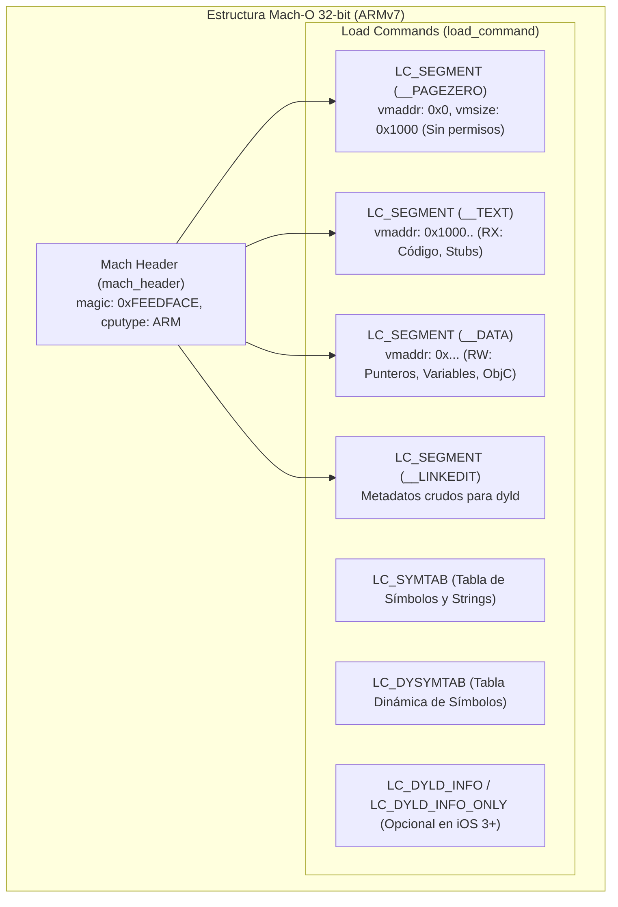
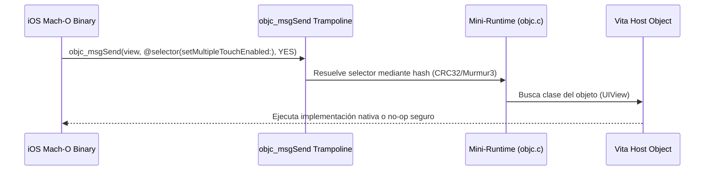

<div class="chapter-hero">
  <span class="chapter-badge">Capítulo 16 • Arquitectura iOS Mach-O</span>
  <h1 style="margin: 0.4rem 0 0.6rem 0; font-size: 2rem;">Porting de Juegos iOS y Cargador Mach-O</h1>
  <p style="margin: 0; opacity: 0.9; font-size: 1.05rem;">
    Ingeniería profunda para ejecutar binarios ejecutables Mach-O de 32 bits (ARMv6/ARMv7) de iOS en PlayStation Vita: enlace estático dyld, mitigación de ABI Darwin (r9 y alineación de pila), mini-runtime Objective-C en C puro y subsistemas Apple.
  </p>
  <div class="chapter-meta">
    <span class="chapter-meta-pill">⚡ Nivel: Experto</span>
    <span class="chapter-meta-pill">🧠 Enfoque: Mach-O MH_EXECUTE, Darwin ABI, objc_msgSend, CgBI PNG</span>
    <span class="chapter-meta-pill">🎮 Casos Reales: Inotia 2, Prince of Persia WW, Rayman 2, Zenonia 5, PES 2011</span>
  </div>
</div>

---

Hasta hace poco, la comunidad de PS Vita consideraba que el método de carga nativa en espacio de usuario era exclusivo de Android (.so ELF). Sin embargo, el ecosistema clásico de iOS (iPhone OS 2.0 a iOS 6.0) alberga una enorme cantidad de obras maestras que corren sobre la **misma CPU ARMv7-A de 32 bits** presente en la PlayStation Vita.

A través del framework [`ios-loader-boilerplate`](https://github.com/MetalSyntax/ios-loader-boilerplate) y ports pioneros como *Inotia 2*, *Rayman 2*, *Prince of Persia: Warrior Within*, *Zenonia 5* y *Call of Duty: World at War Zombies*, es posible cargar ejecutables **Mach-O** directamente en la RAM de la Vita con **cero sobrecarga de emulación**.

---

## 🏛️ Anatomía de un Ejecutable Mach-O de 32 Bits

A diferencia de los archivos `.so` de Android (que son bibliotecas dinámicas ELF `ET_DYN`), el ejecutable dentro de un archivo `.ipa` de iOS es habitualmente un binario de tipo **`MH_EXECUTE`** (un ejecutable principal completo).



### Secciones Críticas dentro de los Segmentos

| Segmento | Sección | Propósito y Tratamiento en el Loader |
|---|---|---|
| `__TEXT` | `__text` | Código de máquina ARMv7 ejecutable. |
| `__TEXT` | `__symbol_stub4` | Pequeños trampolines de 4 o 12 bytes (`ldr pc, [pc, #...]`) que saltan a los punteros de `__la_symbol_ptr`. |
| `__TEXT` | `__stub_helper` | Código original de dyld para resolución perezosa (se ignora en el loader). |
| `__DATA` | `__nl_symbol_ptr` | Punteros no perezosos (*Non-Lazy Symbol Pointers*). Direcciones de datos y funciones del sistema que el cargador debe enlazar al iniciar. |
| `__DATA` | `__la_symbol_ptr` | Punteros perezosos (*Lazy Symbol Pointers*). El loader los sobreescribe con las direcciones reales de nuestras implementaciones nativas. |
| `__DATA` | `__mod_init_func` | Array de constructores estáticos C++. Equivalente a `.init_array` en ELF. |
| `__DATA` | `__objc_*` | Metadatos de clases, selectores, variables de instancia y métodos de Objective-C. |

---

## ⚠️ El Problema de la Falta de PIE (Position Independent Executable)

Los binarios de iOS 2.0 a 4.x no fueron compilados como PIE. Esto significa que:
1. El segmento `__TEXT` está enlazado para residir en direcciones fijas muy bajas (habitualmente `0x1000` o `0x4000`).
2. En VitaOS, el rango de memoria de usuario baja está reservado o genera colisiones con el propio `eboot.bin` de la consola.
3. El binario **no incluye una tabla de relocalizaciones dinámicas estándar** (`nlocrel = 0` en `LC_DYSYMTAB`).

### La Solución: Slide Fijo y Rebase Offline (`macho_prep.py`)

Para resolver esto sin necesidad de un plugin de kernel invasivo, el cargador adopta una dirección base arbitraria en la memoria alta de la Vita:

```c
#define MACHO_SLIDE 0x98000000
```

Para reubicar todos los punteros absolutos que apuntan a `__TEXT` o `__DATA`:
1. La herramienta offline [`tools/macho_prep.py`](https://github.com/MetalSyntax/ios-loader-boilerplate/blob/main/tools/macho_prep.py) analiza el binario descifrado en el host.
2. Escanea cada palabra de 32 bits en el segmento `__DATA`.
3. Si el valor de la palabra cae dentro del rango original de direcciones de `__TEXT` o `__DATA`, se identifica como un puntero y se añade a un archivo binario de offsets: `rebase.bin`.
4. La herramienta filtra inteligentemente falsos positivos (como constantes numéricas o pares de instrucciones Thumb-2) asegurando que no se corrompa la memoria.
5. Al arrancar en la Vita, el cargador lee `rebase.bin` y suma `MACHO_SLIDE` a cada offset en milisegundos:

```c
void macho_apply_rebases(uintptr_t slide, const char *rebase_path) {
    SceUID fd = sceIoOpen(rebase_path, SCE_O_RDONLY, 0);
    if (fd < 0) return;
    
    uint32_t offset;
    while (sceIoRead(fd, &offset, sizeof(uint32_t)) == sizeof(uint32_t)) {
        uint32_t *ptr = (uint32_t *)(slide + offset);
        *ptr += slide;
    }
    sceIoClose(fd);
}
```

---

## 🔒 Descifrado FairPlay: Verificación de `cryptid`

Los ejecutables extraídos directamente de una copia de seguridad oficial de iTunes están cifrados con el sistema FairPlay de Apple. **Un binario cifrado causará un cuelgue inmediato (Data Abort) en la Vita.**

En la cabecera del Mach-O existe el comando `LC_ENCRYPTION_INFO`:
```c
struct encryption_info_command {
    uint32_t cmd;        // LC_ENCRYPTION_INFO (0x21)
    uint32_t cmdsize;    // sizeof(struct encryption_info_command)
    uint32_t cryptoff;   // Offset del segmento cifrado
    uint32_t cryptsize;  // Tamaño del área cifrada
    uint32_t cryptid;    // 0 = Descifrado, 1 = Cifrado con FairPlay
};
```

> [!IMPORTANT]
> El campo `cryptid` **DEBE ser 0**. Si es 1, el juego debe descifrarse previamente en un dispositivo iOS físico con jailbreak usando herramientas como `Clutch`, `dumpdecrypted`, `bfdecrypt` o `frida-ios-dump`.

---

## 🥊 Choque de ABIs: Darwin ARM vs AAPCS de VitaSDK

La diferencia de Calling Convention entre el compilador de Apple (LLVM/Clang adaptado a Darwin) y el toolchain de Vita (GCC ARM EABI / newlib) es la causa número uno de crashes en ports de iOS.

```
+-------------------------------------------------------------------------------+
| REGLA 1: EL REGISTRO r9 ES UN REGISTRO SCRATCH EN DARWIN                      |
|                                                                               |
| En el estándar ARM AAPCS (VitaSDK), r9 está reservado o es callee-saved.      |
| En la ABI de Apple iOS ARMv6/v7, r9 es un registro temporal que cualquier     |
| función puede sobreescribir sin restaurarlo.                                  |
|                                                                               |
| SOLUCIÓN:                                                                     |
| 1. Compilar TODO el loader de Vita con la bandera:                            |
|    -ffixed-r9                                                                 |
| 2. Cruzar siempre hacia código del juego a través de un trampolín ASM que     |
|    preserve y restaure r9 en la pila.                                         |
+-------------------------------------------------------------------------------+
```

### Trampolín en Ensamblador (`asm.S`)

```armasm
.syntax unified
.arch armv7-a
.text
.align 2

.global call_guest
.type call_guest, %function
// uint32_t call_guest(void *entry, uint32_t arg0, uint32_t arg1, uint32_t arg2);
call_guest:
    push {r4-r11, lr}     // Preserva todos los registros de la ABI de Vita (incluyendo r9)
    mov  r12, r0          // r12 = dirección de entrada al juego
    mov  r0, r1           // r0 = arg0
    mov  r1, r2           // r1 = arg1
    mov  r2, r3           // r2 = arg2
    blx  r12              // Salta al código de iOS
    pop  {r4-r11, pc}     // Restaura el estado intacto de VitaSDK
```

```
+-------------------------------------------------------------------------------+
| REGLA 2: ALINEACIÓN DE PILA DE 4 BYTES VS 8 BYTES                             |
|                                                                               |
| En iOS de 32 bits, el puntero de pila (sp) solo requiere estar alineado a     |
| 4 bytes.                                                                      |
| Sin embargo, las funciones de newlib de VitaSDK (como printf, malloc y        |
| operaciones matemáticas que usan instrucciones LDRD/STRD o VFP) exigen       |
| alineación estricta de 8 bytes según AAPCS.                                   |
|                                                                               |
| Si el juego invoca un callback de C con sp alineado a 4 bytes y se ejecuta    |
| un LDRD, la CPU Cortex-A9 generará un fallo de alineación instantáneo.        |
+-------------------------------------------------------------------------------+
```

Para remediarlo, el loader implementa el envoltorio `ml_align_call`:

```armasm
.global ml_align_call
.type ml_align_call, %function
// uint32_t ml_align_call(void *func, uint32_t a0, uint32_t a1, uint32_t a2);
ml_align_call:
    push {r4, lr}
    mov  r4, sp
    bic  sp, sp, #7       // Fuerza alineación de 8 bytes en la pila
    mov  r12, r0
    mov  r0, r1
    mov  r1, r2
    mov  r2, r3
    blx  r12
    mov  sp, r4           // Restaura el sp original
    pop  {r4, pc}
```

```
+-------------------------------------------------------------------------------+
| REGLA 3: CONVENCIÓN DE PUNTO FLOTANTE SOFTFP                                  |
|                                                                               |
| Los binarios de iOS de 32 bits transmiten floats y doubles a través de los   |
| registros enteros generales (r0-r3).                                          |
| Por ello, la biblioteca vitaGL DEBE compilarse obligatoriamente con:          |
|    SOFTFP_ABI=1                                                               |
+-------------------------------------------------------------------------------+
```

---

## ☕ El Puente de Objective-C en C Puro (`objc.c`)

En Android, la capa del sistema es Java y se intercepta con **FalsoJNI**.  
En iOS, la capa del sistema es **Cocoa Touch (Objective-C)**. En Objective-C, las llamadas a métodos se traducen en llamadas a la función de despacho en tiempo de ejecución:

$$\text{objc\_msgSend}(\text{id } self, \text{SEL } op, \dots)$$

No necesitamos un compilador de Objective-C en VitaSDK ni el runtime completo de Apple. Construimos un **mini-runtime en C estándar** (`objc.c`) con tablas hash ultra-rápidas para selectores y clases:



### Implementación del Despachador Universal

```c
typedef struct {
    const char *name;
    void *func;
} ObjCMethod;

typedef struct {
    const char *name;
    const char *super_name;
    ObjCMethod methods[64];
    int method_count;
} ObjCClass;

id objc_msgSend_hook(id self, SEL op, ...) {
    if (!self) return NULL;
    
    const char *sel_name = sel_getName(op);
    ObjCClass *cls = (ObjCClass *)self->isa;
    
    // Búsqueda del método en la tabla de la clase
    for (int i = 0; i < cls->method_count; i++) {
        if (strcmp(cls->methods[i].name, sel_name) == 0) {
            // Invoca la implementación de Vita
            va_list args;
            va_start(args, op);
            id res = ((id (*)(id, SEL, va_list))cls->methods[i].func)(self, op, args);
            va_end(args);
            return res;
        }
    }
    
    l_debug("[OBJC] Ignorado selector sin implementar: -[%s %s]", cls->name, sel_name);
    return NULL;
}
```

### Emulación de Clases de UIKit y Foundation

El boilerplate implementa las estructuras fundamentales que todo juego requiere:

1. **`NSString`**: Envoltura que almacena texto UTF-8 o UTF-16, con soporte para `stringWithUTF8String:`, `UTF8String` y formateo en variádicas (`darwin_printf.c` con soporte de `%@`).
2. **`NSBundle`**: Mapea `[[NSBundle mainBundle] resourcePath]` directamente a `ux0:data/<slug>/<AppName>.app`.
3. **`UIDevice`**: Devuelve strings simuladas: `iPhone3,1` (iPhone 4) o `iPad2,1` (iPad 2), e informa `systemVersion` como `5.1.1` o `6.1.3`.
4. **`UIFont`**: En lugar de depender de fuentes propietarias de iOS, carga fuentes TrueType universales renderizadas dinámicamente con `stb_truetype` o `libfreetype` en un atlas de texturas.
5. **`UIApplication`**: Simula el bucle principal de eventos invocando `application:didFinishLaunchingWithOptions:`.

---

## 🎨 El Formato de Imagen Propietario de Apple: CgBI PNG

Cuando Xcode compila un archivo IPA para iOS, ejecuta internamente una herramienta llamada `pngcrush` con el parámetro `-iphone`. Este proceso transforma los archivos PNG estándar en un formato propietario denominado **CgBI**.

```
+-------------------------------------------------------------------------------+
| CÓMO CG_BI ROMPE LOS DECODIFICADORES PNG ESTÁNDAR:                            |
|                                                                               |
| 1. Añade un chunk extra al inicio: 'CgBI' antes de 'IHDR'.                    |
| 2. Elimina la cabecera zlib estándar y los checksums Adler32 de los chunks    |
|    IDAT (compresión DEFLATE pura en bruto).                                   |
| 3. Los datos de color están almacenados en orden BGR / BGRA premultiplicado   |
|    por el canal Alfa, en vez del orden estándar RGBA sin premultiplicar.      |
|                                                                               |
| CONSECUENCIA: libpng estándar o stb_image fallan con:                         |
|    "Invalid or unrecognized PNG chunk: CgBI"                                  |
+-------------------------------------------------------------------------------+
```

Para solventar esto de forma elegante en tiempo real sin obligar al usuario a descifrar o convertir sus imágenes en un ordenador, el loader incluye [`source/cgbi.c`](https://github.com/MetalSyntax/ios-loader-boilerplate/blob/main/source/cgbi.c):

```c
int decompress_cgbi_png(const uint8_t *src, size_t src_len, uint8_t **out_rgba, int *w, int *h) {
    if (memcmp(src + 12, "CgBI", 4) != 0) {
        // Es un PNG estándar normal: decodificar con libpng convencional
        return decode_standard_png(src, src_len, out_rgba, w, h);
    }
    
    // 1. Extrae parámetros de IHDR (ancho, alto, bit depth)
    // 2. Extrae todos los fragmentos IDAT continuos
    // 3. Descomprime el flujo DEFLATE crudo usando inflateRaw de zlib
    // 4. Invierte los bytes de cada píxel: BGRA -> RGBA
    // 5. Deshace el alpha premultiplicado: R = (B * 255) / A
    // Resultado: Buffer RGBA estándar listo para glTexImage2D
    return 1;
}
```

---

## 🔊 Subsistema de Audio: CoreAudio y AudioQueue

A diferencia de Android (que utiliza OpenSL ES o JNI AudioTrack), iOS cuenta con **CoreAudio** y **AudioQueue Services**.

En el boilerplate (`source/coreaudio.c`), implementamos la interfaz RemoteIO de AudioUnit mapeándola sobre un hilo de audio de alta prioridad de VitaOS:

```c
static SceUID s_audio_thread = -1;

static int audio_render_thread(SceSize args, void *argp) {
    // Asigna el puerto de salida PCM estéreo a 44100 Hz
    int port = sceAudioOutOpenPort(SCE_AUDIO_OUT_PORT_TYPE_MAIN, 1024, 44100, SCE_AUDIO_OUT_PARAM_FORMAT_S16_STEREO);
    int16_t buffer[1024 * 2]; // 1024 muestras estéreo
    
    while (s_audio_running) {
        // Ejecuta el callback del juego de iOS (AudioQueue o RemoteIO RenderCallback)
        AudioBufferList ioData;
        ioData.mNumberBuffers = 1;
        ioData.mBuffers[0].mData = buffer;
        ioData.mBuffers[0].mDataByteSize = sizeof(buffer);
        
        g_render_callback(g_render_context, NULL, NULL, 0, 1024, &ioData);
        
        // Salida bloqueante de audio: el hardware sincroniza el ritmo temporal
        sceAudioOutOutput(port, buffer);
    }
    
    sceAudioOutClosePort(port);
    return 0;
}
```

---

## 🚀 Flujo de Trabajo para Iniciar un Port de iOS

Gracias a la integración en `psvita-toolkit`, inicializar un nuevo proyecto basado en un archivo `.ipa` es totalmente determinista:

```bash
# 1. Inicializar el proyecto con el template de iOS
psvita-toolkit init-port --ipa /ruta/a/juego.ipa

# 2. El comando ejecuta automáticamente:
#    - Extracción del bundle <App>.app
#    - Verificación de cryptid == 0 en el ejecutable Mach-O
#    - Ejecución de macho_prep.py para generar rebase.bin
#    - Configuración del árbol CMake con ios-loader-boilerplate

# 3. Compilar vitaGL con la convención SoftFP requerida por iOS
cd vendor/vitaGL && ./build_vitagl.sh

# 4. Compilar el VPK final
cmake -B build
cmake --build build
```
