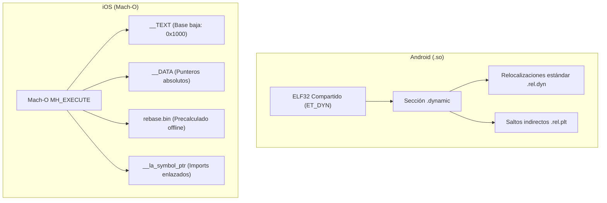
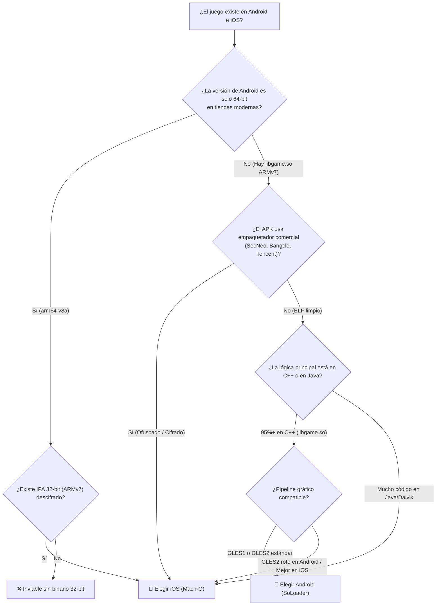

<div class="chapter-hero">
  <span class="chapter-badge">Capítulo 17 • Análisis Comparativo</span>
  <h1 style="margin: 0.4rem 0 0.6rem 0; font-size: 2rem;">Diferencias Clave: Portar desde Android vs iOS</h1>
  <p style="margin: 0; opacity: 0.9; font-size: 1.05rem;">
    Matriz técnica comparativa entre los ecosistemas móviles de Android y Apple iOS en PlayStation Vita: formatos binarios (ELF vs Mach-O), puentes de llamadas (JNI vs ObjC), particularidades de ABI, empaquetado de assets y árbol de decisión de viabilidad.
  </p>
  <div class="chapter-meta">
    <span class="chapter-meta-pill">⚡ Nivel: Intermedio / Avanzado</span>
    <span class="chapter-meta-pill">⚖️ Comparativa: ELF32 vs Mach-O, FalsoJNI vs Mini-ObjC, Bionic vs Darwin</span>
    <span class="chapter-meta-pill">🎯 Árbol de Decisión: ¿Cuándo elegir APK y cuándo IPA?</span>
  </div>
</div>

---

Hasta la llegada del cargador Mach-O, los desarrolladores de PS Vita se centraban exclusivamente en los archivos `.apk` de Android. Sin embargo, para cientos de juegos clásicos de la era dorada de los smartphones (2008–2014), **la versión de iOS es objetivamente superior**, ya sea por mejor tasa de cuadros, texturas con mayor resolución, mejor fidelidad de audio o por carecer de la sobrecarga de máquinas virtuales Java.

Comprender las diferencias arquitectónicas entre ambas plataformas es indispensable para elegir la mejor fuente de porting y evitar semanas de frustración técnica.

---

## 📊 Matriz Comparativa Integral: Android vs iOS

| Dimensión Técnica | Android (`.apk` / `.so`) | Apple iOS (`.ipa` / `Mach-O`) |
|---|---|---|
| **Formato del Ejecutable** | **ELF32** (`ET_DYN` - Shared Object / `.so`). | **Mach-O 32-bit** (`MH_EXECUTE` - Ejecutable Principal). |
| **Sistema Operativo Huésped** | Linux kernel + **Bionic libc**. | Mach/BSD kernel (XNU) + **Darwin Libc**. |
| **Capa de Abstracción Superior** | **Java VM** (Dalvik / ART) comunicada vía **JNI**. | **Cocoa Touch / Objective-C** (`objc_msgSend`). |
| **Herramienta de Simulación** | **`FalsoJNI`** (Emulador de JVM/JNIEnv). | **`Mini-Runtime ObjC`** (Despachador C con hash de selectores). |
| **Mecanismo de Relocalización** | Estándar dinámico (`R_ARM_RELATIVE`, `R_ARM_GLOB_DAT`). | Slide fijo (`MACHO_SLIDE`) + tabla offline **`rebase.bin`**. |
| **Uso del Registro `r9`** | Cumple AAPCS estándar (callee-saved o plataforma). | **Scratch register** en Darwin ARM (¡Cualquiera puede sobreescribirlo!). |
| **Alineación de Pila (`sp`)** | 8 bytes (AAPCS estándar). | **4 bytes** (Requiere re-alineación `ml_align_call` a 8 bytes). |
| **Convención de Floats** | SoftFP o HardFP (habitualmente SoftFP en armeabi-v7a). | **SoftFP estricto** (requiere `vitaGL` con `SOFTFP_ABI=1`). |
| **Cifrado / DRM** | APK ZIP sin cifrar (o packers comerciales tipo SecNeo). | **FairPlay DRM** cifrado (`cryptid = 0` obligatorio). |
| **Estructura de Assets** | `assets/`, `res/`, archivos `.obb` (ZIP sin compresión). | Directorio bundle `<Nombre>.app/` en la raíz del IPA. |
| **Formato de Texturas / PNG** | PNG estándar RGBA, texturas ETC1 / PVRTC. | **Apple CgBI PNG** (BGRA invertido, DEFLATE crudo) y PVRTC. |
| **Subsistema de Audio Típico** | OpenSL ES, SoundPool, AudioTrack (Java). | **CoreAudio**, AudioQueue, OpenAL, FMOD. |

---

## 🔬 Diferencias Técnicas Explicadas a Bajo Nivel

### 1. Formato de Binario: Biblioteca Compartida vs Ejecutable Principal



- **En Android:** El juego suele ser una biblioteca `.so` que se carga dinámicamente con `so_load()`. Sus relocalizaciones son procesadas dinámicamente en tiempo de ejecución porque el formato ELF incluye metadatos limpios en `.rel.dyn`.
- **En iOS:** El ejecutable es el programa completo (`MH_EXECUTE`). En versiones antiguas no se compiló como ejecutable independiente de posición (Non-PIE), lo que obliga a mapearlo en una dirección base fija (`MACHO_SLIDE = 0x98000000`) y parchear todas las referencias con `rebase.bin`.

### 2. El Puente con el Sistema Operativo: JNI vs Mensajería Objective-C

Esta es la diferencia más radical a nivel de código fuente:

```c
// ============================================================================
// EN ANDROID: El juego pide el modelo de teléfono vía JNI
// ============================================================================
jstring Java_com_game_GetPhoneModel(JNIEnv *env, jobject thiz) {
    // El juego interactúa mediante punteros de función JNIEnv:
    jclass buildClass = (*env)->FindClass(env, "android/os/Build");
    jfieldID modelField = (*env)->GetStaticFieldID(env, buildClass, "MODEL", "Ljava/lang/String;");
    return (*env)->GetStaticObjectField(env, buildClass, modelField);
}

// ============================================================================
// EN IOS: El juego pide el modelo de teléfono vía Objective-C
// ============================================================================
// En código fuente de iOS esto era: [[UIDevice currentDevice] model];
// En ensamblador ARM se traduce exactamente a:
// 1. r0 = objc_getClass("UIDevice");
// 2. r1 = sel_registerName("currentDevice");
// 3. r0 = objc_msgSend(r0, r1);
// 4. r1 = sel_registerName("model");
// 5. r0 = objc_msgSend(r0, r1);
```

- **Ventaja de iOS:** Objective-C es un lenguaje orientado a objetos basado en C puro. No hay máquinas virtuales, ni recolectores de basura concurrentes que detengan los hilos (*garbage collection pauses*), ni necesidad de emular firmas de tipo complejas de Java como `(Ljava/lang/String;I)V`. Un despachador de selectores en C puro es suficiente.
- **Ventaja de Android:** `FalsoJNI` está sumamente maduro en la comunidad de Vita, con cientos de funciones auxiliares ya escritas y listas para reutilizar.

### 3. El Registro `r9` y la Pila: La Trampa Mortal de la ABI de Darwin

Si tomas un ejecutable de iOS y lo ejecutas en un loader estándar de Android sin precauciones, la consola colapsará a los pocos segundos con un `0x80010005` (Data Abort) o una corrupción silenciosa de punteros.

```
       CONVENCIÓN ARM ESTÁNDAR (AAPCS)             CONVENCIÓN APPLE DARWIN ARM
     +----------------------------------+       +----------------------------------+
r0   | Argumento 0 / Retorno            |       | Argumento 0 / Retorno            |
r1   | Argumento 1                      |       | Argumento 1                      |
r2   | Argumento 2                      |       | Argumento 2                      |
r3   | Argumento 3                      |       | Argumento 3                      |
r4-r8| Registros Callee-Saved (Proteg.) |       | Registros Callee-Saved (Proteg.) |
r9   | CALLEE-SAVED / RESERVADO VITA    |  VS   | SCRATCH REGISTER (SOBREESCRIBIBLE)
r10-11 Preservados                      |       | Preservados                      |
sp   | ALINEACIÓN OBLIGATORIA A 8 BYTES |  VS   | ALINEACIÓN RELAJADA A 4 BYTES    |
```

- En iOS, el compilador de Apple consideraba que `r9` estaba libre para ser usado en cálculos rápidos temporales sin guardar su valor original. Si el código de Vita llama al juego esperando que `r9` no cambie, los punteros del sistema operativo se corrompen.
- La solución es compilar con `-ffixed-r9` y canalizar llamadas a través de `call_guest` en ensamblador.

---

## 🌳 Árbol de Decisión de Viabilidad: ¿APK o IPA?

Cuando te dispongas a portar un videojuego clásico y existan versiones tanto para Android como para iOS, utiliza este árbol de decisión:



### Casos de Estudio Reales de Selección:

#### Caso 1: *Prince of Persia: Warrior Within*
- **Android:** El port original para Android sufría de problemas severos de compatibilidad con versiones modernas del NDK, texturas comprimidas en formatos propietarios de GPUs antiguas y shaders problemáticos.
- **iOS:** Binario Mach-O ARMv7 limpio, con símbolos de depuración intactos, audio de alta calidad y cinemáticas completas.  
- **Veredicto:** **Portado exitosamente desde iOS.**

#### Caso 2: *Rayman 2: The Great Escape*
- **Android:** Gameloft nunca publicó una versión oficial de Rayman 2 para Android; solo existió en iOS.
- **iOS:** Binario Mach-O de 32 bits excelente con renderizado OpenGL ES y audio impecable.
- **Veredicto:** **Portado exclusivamente desde iOS.**

#### Caso 3: *Zenonia 5*
- **Android:** Requiere una cantidad abrumadora de llamadas Java a servicios obsoletos de Google Play y servidores de autenticación.
- **iOS:** La versión de iOS permite emular los sockets BSD de autenticación en local en menos de 200 líneas de C, saltándose la protección de red.
- **Veredicto:** **Portado con éxito desde iOS.**

#### Caso 4: *Badland 2*
- **Android:** Basado en Cocos2d-x con un archivo `libcocos2dcpp.so` 100% nativo que se enlaza sin tocar Java.
- **iOS:** Binario con mayor complejidad en UIKit.
- **Veredicto:** **Portado con éxito desde Android.**

---

## 📋 Resumen Rápido de Elección

- **Ve por iOS si:** El juego en Android solo existe en 64 bits, el APK está protegido con DRM comercial anti-tamper, la versión de Android está saturada de código Java que requiere cientos de stubs en FalsoJNI, o la versión de iOS tiene mejores assets gráficos y controles táctiles más limpios.
- **Ve por Android si:** El archivo `.so` en `lib/armeabi-v7a/` es limpio, el motor es Cocos2d-x / Unity / Unreal Engine estándar, o no dispones de un dispositivo iOS con jailbreak para descifrar el binario FairPlay del archivo IPA.
