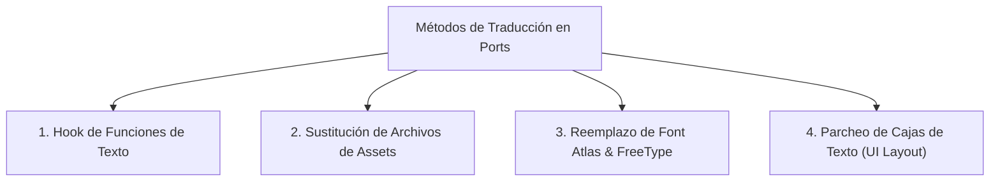
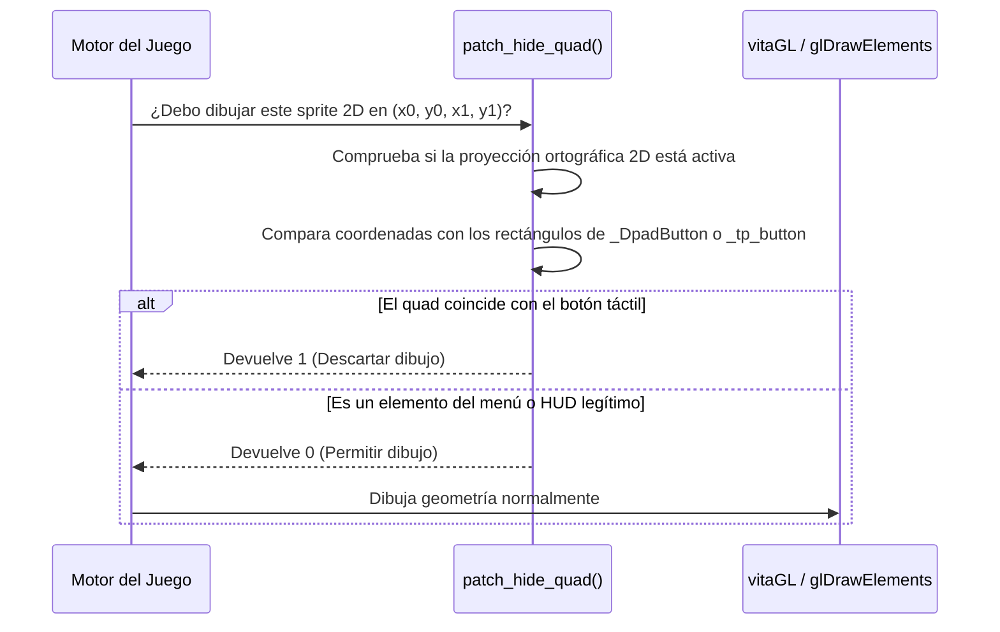

<div class="chapter-hero">
  <span class="chapter-badge">Capítulo 18 • Técnicas Avanzadas</span>
  <h1 style="margin: 0.4rem 0 0.6rem 0; font-size: 2rem;">Técnicas Avanzadas y Mejoras de Juegos</h1>
  <p style="margin: 0; opacity: 0.9; font-size: 1.05rem;">
    Implementación práctica de mejoras de grado profesional para ports de PS Vita: reproducción de vídeo con FFmpeg multihilo y aceleración hardware, traducción y reemplazo de fuentes con FreeType, desbloqueo de 60 FPS y desacoplamiento de físicas, supresión de botones táctiles (patch_hide_quad), servidores loopback en memoria y subida directa de texturas PVRTC.
  </p>
  <div class="chapter-meta">
    <span class="chapter-meta-pill">⚡ Nivel: Experto</span>
    <span class="chapter-meta-pill">🎬 Vídeo: FFmpeg SW vs SceAvPlayer HW</span>
    <span class="chapter-meta-pill">🚀 Rendimiento: 60 FPS, NEON, PVRTC VRAM Directa</span>
    <span class="chapter-meta-pill">🌐 Modding: I18n Dinámica, FreeType, Loopback DRM</span>
  </div>
</div>

---

Un port comercialmente viable y disfrutable en PlayStation Vita no se limita a hacer que el juego "arranque". Requiere transformarlo de una experiencia táctil de teléfono móvil a un videojuego de consola pura: reproducir sus cinemáticas a la perfección, permitir traducciones a otros idiomas, elevar la fluidez a 60 FPS estables y eliminar los molestos botones táctiles que estorban en la pantalla.

Este capítulo compila las técnicas de ingeniería inversa más avanzadas desarrolladas en ports de producción reales.

---

## 🎬 1. Reproducción de Vídeo: FFmpeg Multihilo vs Hardware

Muchos juegos clásicos de Android e iOS incluyen cinemáticas en formato `.mp4`. Sin embargo, el decodificador por hardware de la PS Vita (`SceVideodec`, utilizado por `SceAvPlayer`) **únicamente decodifica H.264/AVC**. No soporta **MPEG-4 Part 2 (`mp4v`)**, que es exactamente el códec en el que vienen comprimidos los vídeos de decenas de juegos clásicos (ej. *Prince of Persia: Warrior Within*, *Dungeon Hunter 2*, *Asphalt 5*).

```
+-------------------------------------------------------------------------------+
| EL DILEMA DEL VÍDEO EN PS VITA:                                               |
|                                                                               |
| 1. SceAvPlayer (Hardware):                                                    |
|    - Cero consumo de CPU (usa chip decodificador dedicado).                   |
|    - Soporta ÚNICAMENTE H.264 (avc1) / AAC.                                   |
|    - Si el vídeo es MPEG-4 Simple/Advanced Profile, SceAvPlayer abre el       |
|      archivo pero nunca emite un solo cuadro y se apaga a los ~1.6 segundos.  |
|                                                                               |
| 2. FFmpeg (Software Decoupled):                                               |
|    - Decodifica CUALQUIER formato (MPEG-4 Part 2, Sorenson, VP6, AAC, MP3).   |
|    - Mantiene intactos los archivos originales del juego (sin re-codificar).  |
|    - Requiere arquitectura multihilo para sostener 30/60 FPS sin tirones.    |
+-------------------------------------------------------------------------------+
```

### El Bug Upstream de `vitasdk` y el Demuxer MP4 en Miniatura

Al enlazar `libavformat.a` de VitaSDK, se descubrió un fallo histórico: aunque la receta de configuración incluye demuxers para MP4, el archivo objeto `mov.o` (`ff_mov_demuxer`) no se compila en el archivo estático. Como consecuencia, `avformat_open_input()` falla con `-1094995529 (Invalid data found)`.

En ports como *Prince of Persia: Warrior Within*, la solución definitiva fue implementar un **demuxer ISO-BMFF (MP4) ultraligero en C puro** que parsea los átomos del contenedor (`moov`, `trak`, `mdia`, `minf`, `stbl`, `stsz`, `stco`) mediante `sceIoOpen` y `sceIoRead`, enviando los paquetes directamente a `libavcodec`:

```mermaid
graph TD
    subgraph "Pipeline de Reproducción de Vídeo Multihilo"
        File["Archivo MP4 (ux0:data/.../cinematica.mp4)"] --> Demux["Demuxer ISO-BMFF Nativo (sceIoRead)"]
        
        Demux -->|Paquetes H.264 / MPEG-4| VidQ["Cola de Vídeo (Ring Buffer)"]
        Demux -->|Paquetes AAC| AudQ["Cola de Audio"]
        
        subgraph "Hilo Decodificador (Cores 1 y 2)"
            VidQ --> AVCodec["libavcodec (avcodec_receive_frame)"]
            AVCodec --> NEON["Conversión YUV420P -> RGB565 (SIMD NEON)"]
            NEON --> TripleBuf["Triple Buffer de Cuadros Listos"]
        end
        
        subgraph "Hilo de Audio (Core 2)"
            AudQ --> AACDec["Decodificador AAC (libavcodec)"]
            AACDec --> Resample["Resampleo S16 Estéreo (libswresample)"]
            Resample --> SceAudio["sceAudioOutOutput (Reloj Maestro)"]
        end
        
        subgraph "Hilo Principal / Render (Core 0)"
            TripleBuf --> TexUp["glTexSubImage2D / vglUpdateTexture"]
            TexUp --> DrawQuad["Renderizado de Quad a 960x544"]
            DrawQuad --> Swap["vglSwapBuffers"]
        end
    end
    
    SceAudio -.->|Sincronización A/V por Muestras Físicas| TripleBuf
```



### Conversión Acelerada por Hardware NEON (YUV a RGB)

Convertir imágenes de 848x480 de espacio de color YUV420P a RGB en la CPU mediante bucles tradicionales en C consume más de 25 ms por cuadro, destruyendo la tasa de refresco. Mediante instrucciones **ARM NEON**, la conversión toma menos de **2.1 ms**:

```c
#include <arm_neon.h>

void neon_yuv420p_to_rgb565(const uint8_t *y, const uint8_t *u, const uint8_t *v, 
                            uint16_t *dst, int width, int height) {
    // Procesa 8 píxeles simultáneamente por iteración usando registros Q de 128 bits
    for (int j = 0; j < height; j++) {
        for (int i = 0; i < width; i += 8) {
            uint8x8_t y_val = vld1_u8(y + i);
            uint8x8_t u_val = vld1_u8(u + (i >> 1));
            uint8x8_t v_val = vld1_u8(v + (i >> 1));
            
            // Fórmulas matemáticas de conversión YUV->RGB vectorizadas con VMULL / VMLAL
            int16x8_t r = vmovl_u8(y_val);
            // ... [Multiplicaciones matriciales aceleradas] ...
            
            // Empaqueta a RGB565 (5 bits R, 6 bits G, 5 bits B) y almacena en VRAM
            uint16x8_t rgb565 = vorrq_u16(
                vorrq_u16(vshlq_n_u16(r_5, 11), vshlq_n_u16(g_6, 5)), 
                b_5
            );
            vst1q_u16(dst + i, rgb565);
        }
        y += width;
        if (j & 1) { u += width >> 1; v += width >> 1; }
        dst += width;
    }
}
```

### Sincronización Audio-Vídeo Impecable

Para evitar desincronización (*drift*) donde el audio se adelanta a las voces:
1. **El audio manda:** La función `sceAudioOutOutput()` es bloqueante.
2. Contamos el número exacto de muestras consumidas por el chip de audio:  
   $$\text{Tiempo de Audio} = \frac{\text{Muestras Reproducidas}}{\text{Frecuencia (44100 Hz)}}$$
3. El hilo de renderizado solo presenta el cuadro de vídeo cuyo *Presentation Timestamp* (PTS) coincide con el tiempo real de audio transcurrido.

---

## 🌐 2. Traducción y Localización de Videojuegos (I18n)

Muchos juegos móviles clásicos nunca fueron lanzados en español o solo incluyeron inglés y japonés. En un port sin código fuente, existen 4 métodos para traducir el juego:



### Método A: Hooking de la Función de Textos

Si el juego utiliza un gestor centralizado de textos como `GetLocString(int string_id)` o `CS_GetText(int id)`:

```c
static char *(*original_GetLocString)(int id);
static char s_translation_buffer[512];

char *GetLocString_hook(int id) {
    // 1. Busca si tenemos una traducción en un archivo JSON o diccionario en memoria
    const char *translated = translation_lookup(id);
    if (translated) {
        return (char *)translated;
    }
    // 2. Si no está traducido, recurre al texto original en inglés
    return original_GetLocString(id);
}

void init_translation_system(void) {
    // Carga diccionario desde ux0:data/<slug>/translation/es.json
    translation_load_dictionary("ux0:data/game/translation/es.json");
    
    // Intercepta la función en el .so o Mach-O
    hook_addr((uintptr_t)so_symbol(&so_mod, "_Z12GetLocStringi"), (uintptr_t)&GetLocString_hook);
}
```

### Método B: El Problema de los Caracteres Especiales y Fuentes FreeType

Los juegos en inglés habitualmente almacenan fuentes bitmap que solo contienen caracteres ASCII del 32 al 127. Si insertas caracteres en español como **`á, é, í, ó, ú, ñ, ¿, ¡`**, el juego mostrará espacios en blanco, signos de interrogación o colapsará por acceso a glifos fuera de rango.

```
+-------------------------------------------------------------------------------+
| SOLUCIÓN: INYECCIÓN DINÁMICA DE FUENTES CON FREETYPE                          |
|                                                                               |
| 1. En lugar de modificar texturas bitmap estáticas, interceptamos la función  |
|    de dibujo de texto del juego.                                             |
| 2. Cargamos una fuente TrueType moderna (.ttf) desde ux0:data/font.ttf       |
|    usando libfreetype o stb_truetype.                                         |
| 3. Generamos un atlas de texturas dinámico en memoria con soporte UTF-8      |
|    completo, garantizando tildes y signos de apertura perfectos.              |
+-------------------------------------------------------------------------------+
```

En el cargador de iOS (`source/objc.c`), la clase `UIFont` y `NSStringDrawing` redirigen las cadenas directamente a un renderizador FreeType:

```c
void render_utf8_string_freetype(const char *utf8_text, float x, float y, uint32_t color) {
    // Decodifica puntos de código UTF-8 multibyte
    const uint8_t *p = (const uint8_t *)utf8_text;
    while (*p) {
        uint32_t codepoint = utf8_next_codepoint(&p);
        Glyph *g = freetype_cache_get_glyph(codepoint);
        if (g) {
            draw_textured_quad(x + g->bearing_x, y - g->bearing_y, g->width, g->height, g->texture_id);
            x += g->advance_x;
        }
    }
}
```

### Método C: Manejo del Desbordamiento de Cajas de Texto (Text Overflow)

El idioma español requiere en promedio entre un **20% y un 30% más de caracteres** que el inglés para expresar la misma idea ("Play" -> "Jugar", "Settings" -> "Configuración").  
Si el texto desborda las cajas de diálogo de la interfaz móvil:
1. **Auto-Escalado:** Interceptar la llamada de dibujo y calcular `width = measure_text(str)`. Si `width > max_box_width`, aplicar una matriz de escalado en X: `glScalef(max_box_width / width, 1.0f, 1.0f)`.
2. **Parcheo de Coordenadas de Rectángulos:** Localizar las estructuras del menú en el segmento `__DATA` y ampliar las dimensiones `w` y `h` del recuadro.

---

## ⚡ 3. Forzar FPS: Desbloqueo de 30 a 60 FPS y Desacoplamiento de Físicas

Los smartphones antiguos limitaban los juegos a 30 FPS para mitigar el consumo de batería y el calentamiento. En la PS Vita, con su procesador Cortex-A9 a 444 MHz y GPU a 222 MHz, muchos de estos títulos pueden correr a **60 FPS fluidos**.

### Paso 1: Localizar el Limitador de Cuadros en Ghidra

Busca llamadas en el bucle principal:
- `usleep(33333)` o `sceKernelDelayThread(33333)` (33.3 ms = 30 FPS).
- Constantes de tiempo delta: `1.0 / 30.0` (`0.033333335f`, representado en hexadecimal IEEE-754 como `0x3D088889`).

```c
// ============================================================================
// CÓDIGO ORIGINAL DESENSAMBLADO (LIMITADO A 30 FPS):
// ============================================================================
void GameLoop() {
    float dt = 1.0f / 30.0f; // 0x3D088889
    UpdatePhysics(dt);
    Render();
    usleep(33333); // Espera artificial
}
```

### Paso 2: El Bug de la Velocidad Doble (Físicas Acopladas)

Si simplemente cambias el limitador a 16.6 ms (60 FPS) sin tocar las físicas, **el juego correrá al doble de velocidad** (personajes supersónicos, gravedad acelerada).

Para desacoplar el renderizado de la física:

```c
// ============================================================================
// PARCHE DE DESACOPLAMIENTO DE DELTA-TIME:
// ============================================================================
static uint64_t s_last_time = 0;

void GameLoop_hook() {
    uint64_t now = sceKernelGetProcessTimeWide();
    float real_dt = (float)(now - s_last_time) / 1000000.0f;
    s_last_time = now;
    
    // Evita saltos temporales gigantes tras pausas o cargas
    if (real_dt > 0.1f) real_dt = 0.1f;
    
    // Acumulador de física fija a 30 o 60 Hz mientras los gráficos se dibujan libres
    static float accumulator = 0.0f;
    accumulator += real_dt;
    
    const float FIXED_PHYSICS_STEP = 1.0f / 60.0f;
    while (accumulator >= FIXED_PHYSICS_STEP) {
        UpdatePhysics(FIXED_PHYSICS_STEP);
        accumulator -= FIXED_PHYSICS_STEP;
    }
    
    Render(); // Se dibuja a 60 FPS reales
}
```

### Protección contra Excepciones VFP en Cortex-A9

> [!CAUTION]
> En la arquitectura ARM Cortex-A9 de la PlayStation Vita, si los bits `LEN` o `STRIDE` del registro de control de punto flotante `FPSCR` son distintos de cero (modo de vectores cortos de VFPv2), la CPU lanzará una excepción fatal de **Instrucción Indefinida (`0x30002`)**. Asegúrate de limpiar siempre estos bits al inicializar el juego:

```c
void sanitize_fpscr(void) {
    uint32_t fpscr = 0;
    __asm__ volatile("vmrs %0, fpscr" : "=r"(fpscr));
    if (fpscr & 0x00370000) { // Comprueba bits LEN y STRIDE
        fpscr &= ~0x00370000; // Limpia a cero estricto
        __asm__ volatile("vmsr fpscr, %0" :: "r"(fpscr));
        l_info("[CPU] Corregidos bits LEN/STRIDE en FPSCR");
    }
}
```

---

## 🚫 4. Supresión de Botones Táctiles en Pantalla (`patch_hide_quad`)

Cuando mapeas los controles físicos de la Vita (sticks, botones frontales y gatillos), los controles táctiles virtuales dibujados en la pantalla se vuelven redundantes y arruinan la inmersión visual.

En *Rayman 2: The Great Escape*, se diseñó la técnica **`patch_hide_quad`**:



### Implementación en C

```c
typedef struct { int x0, x1, y0, y1; } Rect;

extern Rect *dpad_rect;
extern Rect *action_buttons[7];
extern int *g_ProjectionMatrixLevel; // 2 = Proyección Ortográfica 2D

int patch_hide_quad(float x0, float y0, float x1, float y1) {
    // Si el usuario activó "Mostrar HUD" en opciones, no ocultar
    if (g_hud_visible_setting) return 0;
    
    // Solo oculta elementos dibujados en espacio 2D ortográfico (nunca modelos 3D)
    if (!g_ProjectionMatrixLevel || *g_ProjectionMatrixLevel != 2) return 0;
    
    // Comprueba colisión con el stick virtual
    if (x0 >= dpad_rect->x0 - 10 && x1 <= dpad_rect->x1 + 10 &&
        y0 >= dpad_rect->y0 - 10 && y1 <= dpad_rect->y1 + 10) {
        return 1; // Suprime el quad
    }
    
    // Comprueba colisión con botones de acción
    for (int i = 0; i < 7; i++) {
        Rect *r = action_buttons[i];
        if (x0 >= r->x0 - 8 && x1 <= r->x1 + 8 && y0 >= r->y0 - 8 && y1 <= r->y1 + 8) {
            return 1; // Suprime el quad
        }
    }
    
    return 0; // Es texto, barra de vida u otro elemento legítimo: dibújalo
}
```

---

## 🛰️ 5. Emulación de Servidores y Sockets en Memoria (Bypass DRM)

Muchos juegos legendarios como *Zenonia 5* son incapaces de arrancar hoy en día porque intentan autenticarse contra servidores centrales de juego cerrados hace una década (ej. `zn555.gamevil.com:10000`).

En lugar de parchear cientos de ramas de código binario, la técnica más limpia consiste en **interceptar las llamadas a sockets BSD** (`socket`, `connect`, `send`, `recv`, `select`) y montar un servidor simulado en memoria (*in-memory loopback server*):

```c
static int fake_connect(int fd, const struct sockaddr *addr, socklen_t len) {
    l_info("[NET] Conexión simulada con éxito al servidor de autenticación");
    return 0; // Informa éxito instantáneo
}

static int fake_send(int fd, const void *buf, size_t len, int flags) {
    const uint8_t *packet = (const uint8_t *)buf;
    uint16_t cmd = packet[2] | (packet[3] << 8);
    
    l_info("[NET] Cliente envió comando: 0x%03x", cmd);
    
    // Si el juego envía CS_CONNECT (0x100), preparamos la respuesta SC_CONNECT (0x101)
    if (cmd == 0x100) {
        uint8_t response[86] = {0};
        response[0] = 0;           // Estado 0 = ÉXITO
        response[1] = 1;           // Conexión aceptada
        *(uint32_t *)(response + 8) = 1000001; // ID de usuario asignado
        strcpy((char *)response + 16, "JugadorVita"); // Nickname
        
        enqueue_server_reply(0x101, response, 86);
    }
    
    return len; // Simula que se enviaron todos los bytes
}

static int fake_recv(int fd, void *buf, size_t len, int flags) {
    // Entrega la respuesta prefabricada por nuestro servidor simulado
    return fetch_server_reply(buf, len);
}
```

Con este sencillo puente de red, el juego cree que los servidores oficiales siguen operando, desbloqueando el 100% de la campaña para disfrute offline.

---

## 🎨 6. Subida Directa de Texturas PVRTC a la GPU

La GPU PowerVR SGX543 de la Vita soporta **compresión nativa PVRTC (2bpp y 4bpp)** directamente por hardware.

Muchos juegos antiguos de Android e iOS detectaban la GPU por software y, si no reconocían el driver, ejecutaban una función lenta de descompresión PVRTC en la CPU (`PVRTCDecompress`) que inflaba las texturas a RGBA32 sin comprimir en la RAM.

En *Hero of Sparta*, interceptamos `PVRTCDecompress`:

```c
void PVRTCDecompress_hook(const void *compressed_data, int is_2bpp, int w, int h, void *out_rgba) {
    // EN LUGAR DE DESCOMPRIMIR EN CPU:
    // Subimos la textura comprimida directamente a la GPU con vitaGL:
    GLenum format = is_2bpp ? GL_COMPRESSED_RGB_PVRTC_2BPPV1_IMG : GL_COMPRESSED_RGBA_PVRTC_4BPPV1_IMG;
    glCompressedTexImage2D(GL_TEXTURE_2D, 0, format, w, h, 0, compressed_size, compressed_data);
}
```

**Resultado:** Se liberan más de 40 MiB de RAM del sistema y el tiempo de carga entre niveles pasa de 12 segundos a **menos de 1 segundo**.
