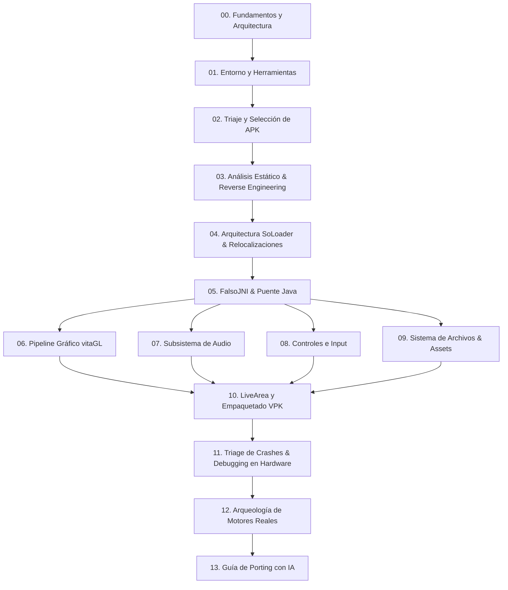

  Edición en Español
  <h1 style="margin: 0.4rem 0 0.6rem 0; font-size: 2rem;">Enciclopedia y Guía de Porting para PS Vita (SoLoader)</h1>
  

    Manual completo de ingeniería paso a paso y base de referencia técnica para transformar un binario compilado de Android (<code>.apk</code> / <code>.so</code>) en una aplicación nativa ejecutable (<code>.vpk</code>) en PlayStation Vita.
  

## 🧭 Mapa de Navegación del Manual

---

## 📚 Índice de Capítulos

| # | Capítulo | Enfoque y Contenido Técnico |
|---|---|---|
| **00** | [Fundamentos y Arquitectura](00-fundamentos-arquitectura.md) | CPU ARMv7 Cortex-A9, GPU PowerVR SGX543MP4+, particiones CDRAM y RAM, filosofía del SoLoader vs Emulación/Recompilación. |
| **01** | [Entorno y Herramientas](01-entorno-y-herramientas.md) | Configuración de VitaSDK, vitaGL, kubridge, fd_fix, FalsoJNI, psvita-toolkit, Docker con Ghidra headless, jadx. |
| **02** | [Triaje y Selección de APK](02-triaje-y-seleccion-apk.md) | Análisis preliminar de compatibilidad: ARMv7 vs 64-bit, GLES1 vs GLES2, dependencias de STL, matriz de viabilidad. |
| **03** | [Análisis Estático & Reverse Engineering](03-analisis-estatico-e-ingenieria-inversa.md) | Decompilación de Java (`jadx`), generación de pseudo-C (`Ghidra`), extracción de tablas de símbolos con `objdump` y `nm`. |
| **04** | [Arquitectura SoLoader & Relocalizaciones](04-arquitectura-soloader-y-relocalizaciones.md) | Formato ELF en memoria, tablas de relocalización ARM (`R_ARM_RELATIVE`, `R_ARM_GLOB_DAT`), parches binarios y hooking. |
| **05** | [FalsoJNI & Puente Java](05-falsojni-y-puente-java.md) | Emulación de JVM/JNIEnv, firmas de tipo de Android, callbacks hacia Java, diseño de stubs activos y seguros. |
| **06** | [Pipeline Gráfico vitaGL](06-pipeline-grafico-vitagl.md) | vitaGL sobre SCE GXM, traslación de shaders GLSL a Cg/GXP, FBOs, escalado a 960x544, alpha premultiplicado y VRAM. |
| **07** | [Subsistema de Audio](07-subsistema-de-audio.md) | `sceAudioOut`, OpenAL-Soft para Vita, decodificación Vorbis/MP3, emulación de `AudioTrack`, `SoundPool` y `MediaPlayer`. |
| **08** | [Controles e Input](08-controles-e-input.md) | Pantalla táctil frontal/trasera, botones y sticks, prevención de corrupción de heap por report IDs, inyección táctil. |
| **09** | [Sistema de Archivos & Assets](09-sistema-de-archivos-y-assets.md) | Redirección de rutas a `ux0:data/`, insensibilidad a mayúsculas/minúsculas en FAT, extracción de ZIP/OBB y APK en RAM. |
| **10** | [LiveArea y Empaquetado VPK](10-livearea-y-empaquetado-vpk.md) | Reglas estrictas de imágenes PNG 8-bit indexadas (evitar `0x8010113D`), `param.sfo`, `template.xml`, limpieza de metadatos `._`. |
| **11** | [Triage de Crashes & Debugging](11-triage-de-crashes-y-debugging.md) | Metodología de triangulación: análisis de `.psp2dmp`, `vita-parse-core`, `PC` vs `LR`, trampas de alineación ARMv7 (`ldrd`). |
| **12** | [Arqueología de Motores Reales](12-arqueologia-de-motores.md) | Disección técnica de motores reales: Gameloft, Gamevil Nexus2/Clet, Com2uS, Cocos2d-x y motores propios. |
| **13** | [Guía de Porting con IA](13-guia-porting-con-ia.md) | Protocolos de interacción Humano+IA, economía de contexto y tokens, prompts deterministas para stubs y desensamblado. |
| **14** | [Guía Base de gl33ntwine](14-guia-base-gl33ntwine.md) | La guía histórica de Vitaliy Atamanenko traducida al español con comentarios y notas de desarrollo actualizadas. |
| **15** | [Referencia Rápida & Cheat Sheets](15-referencia-rapida-y-cheatsheets.md) | Tipos JNI, códigos de error de kernel VitaOS, funciones libc Bionic vs Newlib y tabla de compatibilidad rápida. |

---

> [!TIP]
> **Para desarrolladores principiantes**: Comienza leyendo los capítulos 00, 01 y 02 antes de descargar cualquier APK.
> **Para desarrolladores avanzados / IAs**: Los capítulos 04 (Relocalizaciones ELF), 05 (FalsoJNI), 06 (vitaGL) y 11 (Triage de Crashes) contienen la lógica nuclear de bajo nivel requerida para solucionar los fallos más complejos en hardware real.
