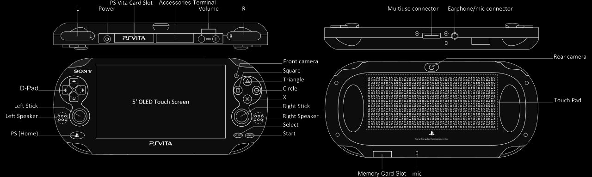

---
hide:
  - navigation
  - toc
---

  
PS Vita Porting Wiki & Knowledge Base

  

    Enciclopedia técnica definitiva sobre ports de videojuegos móviles (Android APK mediante <code>.so loader</code>, <code>FalsoJNI</code> y <code>vitaGL</code>) para la consola PlayStation Vita.
  

  

    ⚡ 100% Velocidad Nativa ARMv7
    🎮 Aceleración Hardware SCE GXM
    🧩 FalsoJNI Runtime Emulation
    🔬 Triangulación de Crashes con Hardware Real
    🤖 Optimizado para Humanos & IAs
  

  

    
  

  

    
30+

    
Ports Reales Analizados

  

  

    
16

    
Capítulos Técnicos

  

  

    
3

    
Idiomas (ES / EN / PT)

  

  

    
0%

    
Overhead de Emulación

  

---

<h2 style="text-align: center; margin-top: 2rem;">🌐 Selecciona tu Idioma / Select Language / Selecione o Idioma</h2>

  <!-- Español Card -->
  

    

      

        🇪🇸
        <h3 class="lang-name">Español</h3>
      

      

        Manual completo de ingeniería paso a paso: arquitectura ARM Cortex-A9, relocalizaciones ELF, simulación de JVM con FalsoJNI, shaders en vitaGL, triage de volcados <code>.psp2dmp</code> y casos de estudio reales.
      

    

    <a href="es/" class="lang-btn">
      Comenzar en Español &rarr;
    </a>
  

  <!-- English Card -->
  

    

      

        🇬🇧
        <h3 class="lang-name">English</h3>
      

      

        Comprehensive low-level porting manual: ARMv7 bare-metal execution, ELF relocation parsing, FalsoJNI runtime dispatch, vitaGL hardware shaders, physical <code>.psp2dmp</code> crash triage, and 30+ engine deep-dives.
      

    

    <a href="en/" class="lang-btn">
      Start in English &rarr;
    </a>
  

  <!-- Português Card -->
  

    

      

        🇧🇷 🇵🇹
        <h3 class="lang-name">Português</h3>
      

      

        Manual completo de engenharia passo a passo: arquitetura da CPU Cortex-A9, carregamento de ELF, emulação JNI, pipeline gráfico no vitaGL, triagem de travamentos com <code>vita-parse-core</code> e dissecção de motores.
      

    

    <a href="pt/" class="lang-btn">
      Iniciar em Português &rarr;
    </a>
  

---

## ⚡ Ecosistema y Repositorios Oficiales

| Herramienta / Proyecto | Repositorio Oficial | Rol en el Porting / Função no Porting |
| :--- | :--- | :--- |
| **VitaSDK** | [github.com/vitasdk](https://github.com/vitasdk) | Toolchain oficial de compilación cruzada GCC (`arm-vita-eabi-gcc`). |
| **vitaGL** | [github.com/Rinnegatamante/vitaGL](https://github.com/Rinnegatamante/vitaGL) | Wrapper acelerado por hardware OpenGL ES 1.1 / 2.0 sobre SCE GXM. |
| **kubridge** | [github.com/TheOfficialFloW/kubridge](https://github.com/TheOfficialFloW/kubridge) | Plugin de kernel para asignar memoria ejecutable (`USER_RWX`) en espacio de usuario. |
| **fd_fix** | [github.com/TheOfficialFloW/fd_fix](https://github.com/TheOfficialFloW/fd_fix) | Corrige el cierre indebido de descriptores de archivos I/O en VitaOS. |
| **FalsoJNI** | [github.com/Rinnegatamante/FalsoJNI](https://github.com/Rinnegatamante/FalsoJNI) | Entorno simulado ligero para satisfacer el JNI de Android sin una JVM pesada. |
| **soloader-boilerplate** | [github.com/Rinnegatamante/soloader-boilerplate](https://github.com/Rinnegatamante/soloader-boilerplate) | Plantilla base de arquitectura para carga de librerías `.so` dinámicas. |
| **psvita-toolkit** | [github.com/metalsyntax/psvita-toolkit](https://github.com/metalsyntax/psvita-toolkit) | CLI automatizado para compilación, despliegue FTP, triage de crashes y shaders. |
