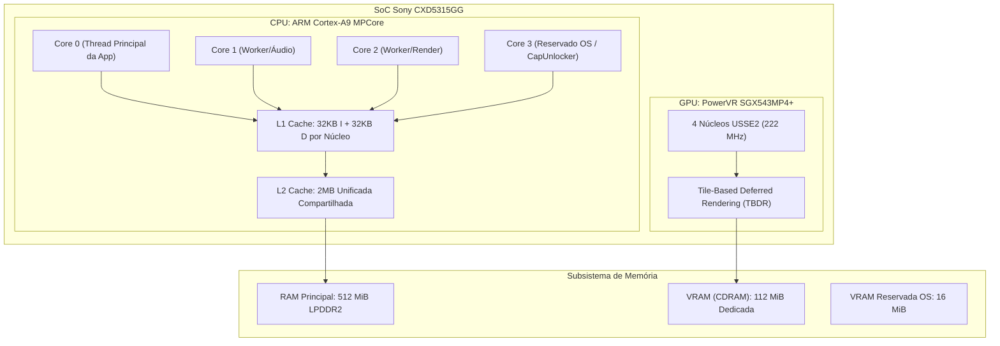
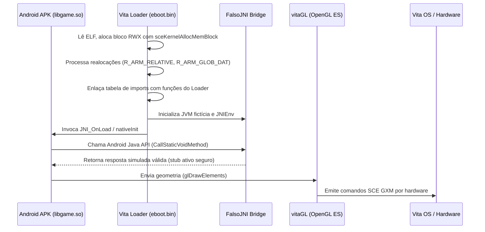

# 00. Fundamentos e Arquitetura

Para dominar o desenvolvimento de ports de jogos móveis para o PlayStation Vita, é indispensável compreender a arquitetura de hardware do console e os princípios teóricos do método **SoLoader**.

---

## 🔬 Arquitetura de Hardware do PS Vita

### 1. A CPU (ARM Cortex-A9 MPCore)
O PlayStation Vita conta com um processador **ARM Cortex-A9** quad-core de 32 bits (arquitetura ARMv7-A).
- **Frequência padrão da Sony:** 333 MHz (reduzida de fábrica para economizar bateria).
- **Frequência máxima nativa:** 444 MHz / 500 MHz (desbloqueável com segurança por código ou plugins como o `PSVshell`).
- **Caches:** 32 KiB L1 de instruções + 32 KiB L1 de dados por núcleo; 2 MiB de cache L2 unificada compartilhada.
- **Ponto Flutuante:** VFPv3-D32 por hardware e motor vetorial SIMD NEON de 128 bits.
- **O 4º Núcleo:** Reservado pelo VitaOS para processos de fundo do sistema. Usando o plugin de kernel [CapUnlocker](https://github.com/GrapheneCt/CapUnlocker) de GrapheneCt, o homebrew pode reivindicar este núcleo aplicando a máscara de afinidade `0x80000` com `sceKernelChangeThreadCpuAffinityMask()`.

### 2. A GPU (PowerVR SGX543MP4+)
Um chip gráfico quad-core da série SGX543 operando até 222 MHz, utilizando uma arquitetura **TBDR** (Tile-Based Deferred Rendering).
- O processador gráfico divide o quadro em blocos de 16x16 pixels e executa descarte de superfícies ocultas (*Hidden Surface Removal / Early-Z*) antes dos fragment shaders, economizando largura de banda massiva de memória.

### 3. Memória Principal vs Memória de Vídeo (CDRAM)

| Partição | Tamanho Físico | Disponível para Homebrew | Propósito e Características |
|---|---|---|---|
| **RAM Principal** | 512 MiB | ~300 MiB a 420 MiB | Memória acessível pela CPU. Abriga o código, heap em C, o arquivo `.so` carregado, assets descompactados e a máquina FalsoJNI. |
| **CDRAM (VRAM)** | 128 MiB | **112 MiB** | Memória ultrarrápida ligada diretamente ao barramento da GPU. Utilizada para framebuffers, texturas ativas, vertex e index buffers. |
| **VRAM Sistema** | 16 MiB | 0 MiB | Reservada pela Sony para a interface do LiveArea e overlays do sistema operacional. |

---

## 💡 O Que é Exatamente o Método SoLoader?

A maioria dos emuladores interpreta instruções de uma CPU estrangeira ou as traduz em tempo real usando JIT. **O método SoLoader NÃO é um emulador nem um recompilador.**

### Por que o Android ARMv7 Executa NATIVAMENTE no PS Vita?
Tanto o PlayStation Vita quanto os smartphones Android da era 2010–2016 utilizam a **mesma arquitetura de conjunto de instruções: ARMv7-A (32 bits)** com instruções Thumb-2 e ponto flutuante VFP/NEON.

Quando um jogo é compilado no Android NDK em C++, o compilador gera uma biblioteca compartilhada no formato ELF: `libgame.so`. Esse arquivo contém **código de máquina ARM puro**.

| Plataforma | CPU ISA | Formato de Binário | Convenção de Chamada |
|---|---|---|---|
| **Android 32-bit** | ARMv7-A (Cortex-A8/A9/A15) | ELF32 (`.so`) | AAPCS (ARM Architecture Procedure Call Standard) |
| **PlayStation Vita** | ARMv7-A (Cortex-A9 MPCore) | ELF32 / Sony SELF (`eboot.bin`) | AAPCS (com softfp / hardfp compatível) |

Como a CPU do PlayStation Vita compreende diretamente essas instruções ARM, **a Vita executa o código do jogo diretamente no silício com velocidade nativa (zero perda por emulação de CPU).**

### O Carregador como "Sistema Operacional Convidado"
Se as instruções são nativamente compatíveis, por que não podemos rodar o `.so` diretamente?
Porque o `.so` foi construído esperando um ambiente **Linux / Android**:
1. Espera a biblioteca C padrão do Android (**Bionic libc**), com syscalls como `open()`, `mmap()`, `pthread_create()`.
2. Espera a superfície gráfica do Android (**EGL / SurfaceView / OpenGL ES**).
3. Espera o subsistema de áudio (**OpenSL ES**, **AudioTrack** ou **SoundPool**).
4. Espera uma máquina virtual Java (**Dalvik / ART**) atendendo chamadas **JNI** (`JNIEnv*`, `JavaVM*`).

O **SoLoader** (embutido no seu `eboot.bin` de Vita) preenche exatamente essa lacuna:
- Mapeia os segmentos de código e dados do ELF na memória da Vita.
- Corrige os ponteiros absolutos usando a tabela de realocações ARM.
- Intercepta importações de funções e as roteia para as implementações do VitaSDK e vitaGL.
- Fornece o ambiente simulado **FalsoJNI**, respondendo a todas as solicitações Java em C puro sem precisar de uma JVM real.
