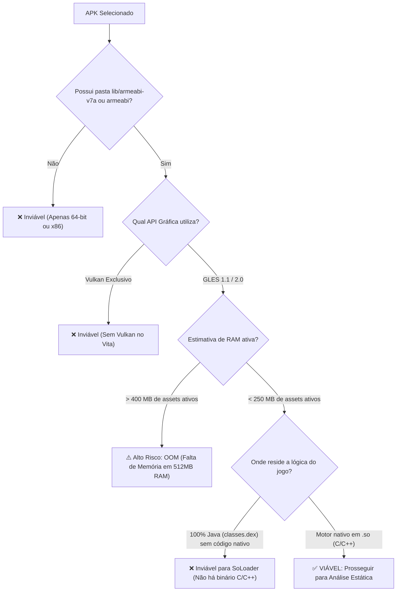

# 02. Triagem e Seleção de APK

Antes de escrever qualquer código ou configurar um projeto CMake, é essencial realizar uma **análise de viabilidade do APK**. Nem todos os jogos Android podem ser portados via SoLoader; avaliar o binário nos primeiros minutos evita semanas de trabalho infrutífero.

---

## 📦 Anatomia de um APK Android

Um arquivo `.apk` é internamente um arquivo compactado padrão **ZIP**. Você pode extraí-lo com qualquer ferramenta:

```
jogo.apk (ZIP)
├── AndroidManifest.xml        # Manifesto binário (pacote Java, versão GLES, permissões)
├── classes.dex                # Bytecode Dalvik executável das classes Java
├── assets/                    # Dados do jogo (modelos 3D, texturas, áudio, fases)
├── res/                       # Recursos de interface do Android e ícones
├── lib/                       # BIBLIOTECAS NATIVAS COMPILADAS (.so)
│   ├── armeabi/               # Binários ARMv5/v6 (32-bit, soft-float)
│   ├── armeabi-v7a/           # Binários ARMv7-A (32-bit, Thumb-2, VFPv3/NEON) [IDEAL]
│   ├── arm64-v8a/             # Binários ARMv8 (64-bit) [INCOMPATÍVEL DIRETAMENTE]
│   └── x86/                   # Binários Intel x86 [INCOMPATÍVEL]
└── META-INF/                  # Certificados e assinaturas do APK
```

---

## 🔍 Critério 1: Compatibilidade de Arquitetura (ABI)

Inspecione a pasta `lib/` do APK:

```bash
unzip -l jogo.apk "lib/*"
```

| Pasta de ABI | Veredito | Realidade Técnica no PS Vita |
|---|---|---|
| **`lib/armeabi-v7a/`** | **EXCELENTE (Ideal)** | Código ARMv7 de 32 bits com instruções Thumb-2 e aceleração vetorial NEON. Compatibilidade perfeita com o Cortex-A9 do Vita. |
| **`lib/armeabi/`** | **COMPATÍVEL** | Código ARMv5TE/v6 de 32 bits com ponto flutuante por software (*soft-float*). Funciona perfeitamente porque ARMv7 é um superset estrito de ARMv6. |
| **`lib/arm64-v8a/`** | **INCOMPATÍVEL** (em 32-bit) | Instruções AArch64 de 64 bits. O processador do PS Vita é estritamente de 32 bits. Se o APK só possui 64 bits, procure versões anteriores do jogo (lançadas antes de agosto de 2019). |
| **`lib/x86/` / `lib/x86_64/`** | **INCOMPATÍVEL** | Arquiteturas Intel/AMD. |

---

## 🎨 Critério 2: Versão da API Gráfica (OpenGL ES)

A GPU do PS Vita oferece aceleração nativa equivalente a **OpenGL ES 1.1** e **OpenGL ES 2.0** via [vitaGL](https://github.com/Rinnegatamante/vitaGL).

### Como detectar a versão do jogo:

1. **Inspecione o `AndroidManifest.xml` via `jadx`:**
   Procure por `glEsVersion`:
   - `0x00010000` / `0x00010001`: OpenGL ES 1.0 / 1.1 (Pipeline de função fixa).
   - `0x00020000`: OpenGL ES 2.0 (Shaders programáveis de vértices e fragmentos).
   - `0x00030000`+: OpenGL ES 3.0+. *Atenção:* Recursos avançados de GLES3 não são suportados nativamente pelo hardware do Vita.

2. **Inspecione os símbolos importados no `.so` com `objdump`:**
   ```bash
   objdump -T lib/armeabi-v7a/libgame.so | grep -E "gl(Vertex|Color|CreateShader|Uniform)"
   ```
   - Se encontrar `glVertexPointer`, `glColorPointer`, `glMatrixMode`: **OpenGL ES 1.1**. Roda com eficiência extrema no pipeline de função fixa do vitaGL.
   - Se encontrar `glCreateShader`, `glCompileShader`, `glUniformMatrix4fv`: **OpenGL ES 2.0**. Requer o pipeline programável do vitaGL.
   - Se encontrar `vkCreateInstance`, `vkCreateDevice`: **Vulkan**. O PS Vita **NÃO** possui suporte a Vulkan. Sem fallback para OpenGL ES, o port é inviável.

---

## 🔗 Critério 3: Dependências do NDK

Verifique as dependências externas da biblioteca nativa:

```bash
arm-vita-eabi-readelf -d lib/armeabi-v7a/libgame.so | grep NEEDED
```

Tabela de status para dependências comuns:

| Biblioteca | Status | Solução no PS Vita |
|---|---|---|
| `libc.so`, `libm.so`, `libdl.so` | **Suportado** | Mapeado diretamente para as funções da Newlib do VitaSDK. |
| `libGLESv1_CM.so` / `libGLESv2.so` | **Suportado** | Mapeado para o `vitaGL`. |
| `liblog.so` | **Suportado** | Mapeado para o logger da Vita (`sceClibPrintf` / arquivo de log). |
| `libz.so` | **Suportado** | Vinculado à `zlib` do VitaSDK. |
| `libOpenSLES.so` | **Suportado** | Reimplementado via `sceAudio` ou `OpenAL-Soft`. |
| `libunity.so` / `libmono.so` | **Complexo** | Jogos antigos de Unity com Mono são viáveis; jogos modernos com IL2CPP frequentemente excedem os 512 MB de RAM do console. |

---

## 🚦 Matriz de Decisão de Viabilidade


