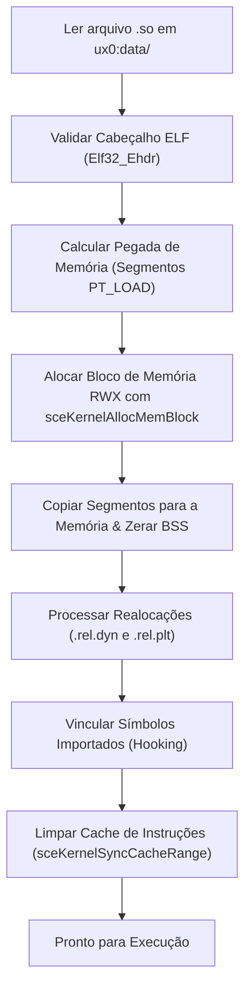

<div class="lang-switch-bar">
  <span>🌐 Language / Idioma:</span>
  <a href="../../04-soloader-architecture-and-relocations/" class="lang-switch-link">🇬🇧 English</a>
  <a href="../../es/04-arquitectura-soloader-y-relocalizaciones/" class="lang-switch-link">🇪🇸 Español</a>
  <a href="./" class="lang-switch-link active">🇧🇷 Português</a>
</div>

<div class="chapter-hero">
  <span class="chapter-badge">Capítulo 04 • Runtime Central</span>
  <h1 style="margin: 0.4rem 0 0.6rem 0; font-size: 2rem;">Arquitetura SoLoader e Realocações</h1>
  <p style="margin: 0; opacity: 0.9; font-size: 1.05rem;">
    Mecânica de baixo nível para carregar binários ELF32 na memória executável do PS Vita, análise de cabeçalhos de programa, resolução de realocações ARM e hooking dinâmico.
  </p>
  <div class="chapter-meta">
    <span class="chapter-meta-pill">⚡ Nível: Avançado</span>
    <span class="chapter-meta-pill">🧠 Foco: ELF32, Realocações ARMv7, Páginas RWX</span>
    <span class="chapter-meta-pill">🎮 Verificado: Hero of Sparta, Zenonia 3, Badland 2</span>
  </div>
</div>

---

O coração de qualquer port de Android para o PlayStation Vita reside no carregador dinâmico de binários ELF (`so_util.c` ou `dynlib.c`). Este módulo substitui em espaço de usuário o carregador dinâmico do Linux (`/system/bin/linker`).

---

## 🏗️ Como o ELF é Carregado na Memória

Arquivos `.so` do Android NDK são binários no formato **ELF32** padrão para a arquitetura ARM.



### 1. Validação do Cabeçalho ELF (`Elf32_Ehdr`)
O carregador verifica os bytes mágicos e a arquitetura alvo:
- **Magic:** `0x7F 'E' 'L' 'F'`
- **Classe:** `ELFCLASS32` (1)
- **Endianness:** `ELFDATA2LSB` (1)
- **Máquina:** `EM_ARM` (40)

### 2. Alocação de Memória Executável no VitaOS
O carregador lê os Program Headers (`Elf32_Phdr`), encontra os segmentos `PT_LOAD`, calcula o tamanho alinhado e aloca um bloco contíguo:

```c
SceUID memid = sceKernelAllocMemBlock(
    "game_code_block",
    SCE_KERNEL_MEMBLOCK_TYPE_USER_RWX, // Permissões de Leitura, Escrita e Execução
    aligned_total_size,
    NULL
);

void *base_addr;
sceKernelGetMemBlockBase(memid, &base_addr);
```

> [!NOTE]
> A alocação de blocos `USER_RWX` requer o plugin de kernel **kubridge**. Sem ele, o VitaOS rejeita a criação de páginas de memória simultaneamente graváveis e executáveis.

---

## 🔄 O Motor de Realocações ARM

Bibliotecas compartilhadas são compiladas com código independente de posição (**PIC/PIE**), de modo que ponteiros internos precisam ser recalculados somando o endereço base onde a biblioteca foi carregada (`base_addr`).

O carregador itera sobre as seções `.rel.dyn` e `.rel.plt`:

```c
typedef struct {
    Elf32_Addr r_offset; // Endereço de memória a ser ajustado
    Elf32_Word r_info;   // Tipo de realocação e índice do símbolo
} Elf32_Rel;

#define ELF32_R_SYM(val)  ((val) >> 8)
#define ELF32_R_TYPE(val) ((val) & 0xff)
```

### Tipos Fundamentais de Realocação ARM:

| Código | Nome Simbólico | Ação Executada pelo Carregador |
|---|---|---|
| **23** | `R_ARM_RELATIVE` | `*(uint32_t*)(base + r_offset) += (uint32_t)base;` <br>Ajusta ponteiros absolutos internos somando o novo endereço base. |
| **21** | `R_ARM_GLOB_DAT` | Localiza o símbolo na tabela de strings (`.dynstr`), resolve seu endereço real e escreve em `*(uint32_t*)(base + r_offset)`. |
| **22** | `R_ARM_JUMP_SLOT` | Usado na tabela PLT (*Procedure Linkage Table*). Escreve o ponteiro de salto da função. |
| **2** | `R_ARM_ABS32` | Soma o valor do símbolo ao endereço presente no offset. |

---

## 🪝 Interceptação de Símbolos (Symbol Hooking)

Quando o jogo chama funções padrão da libc ou OpenGL ES, o carregador as redireciona para as implementações do VitaSDK ou vitaGL:

```c
typedef struct {
    const char *symbol;
    uintptr_t func;
} DynLibSymbol;

static const DynLibSymbol dynlib_symbols[] = {
    // Funções da libc
    { "malloc", (uintptr_t)&malloc },
    { "free", (uintptr_t)&free },
    { "memcpy", (uintptr_t)&memcpy },
    { "memset", (uintptr_t)&memset },
    
    // I/O de arquivos redirecionado
    { "fopen", (uintptr_t)&vita_fopen },
    { "fclose", (uintptr_t)&fclose },
    
    // Gráficos (vitaGL)
    { "glViewport", (uintptr_t)&glViewport },
    { "glClear", (uintptr_t)&glClear },
    { "glDrawElements", (uintptr_t)&glDrawElements },
    
    // Log do Android redirecionado
    { "__android_log_print", (uintptr_t)&vita_log_print },
    { NULL, 0 }
};
```

---

## 🩹 Patches em Memória e Sincronização de Cache

Para neutralizar verificações de pirataria da Google Play ou serviços de telemetria:

### Patch de Retorno Imediato (`BX LR`):
- **Modo Thumb:** Escreva `movs r0, #0` (`0x2000`) e `bx lr` (`0x4770`):
  ```c
  *(uint16_t *)(so_base + offset) = 0x2000;
  *(uint16_t *)(so_base + offset + 2) = 0x4770;
  ```
- **Modo ARM (32 bits):** Escreva `mov r0, #0` (`0xe3a00000`) e `bx lr` (`0xe12fff1e`).

### Sincronização Obrigatória de Cache
Após aplicar patches ou processar realocações, a memória é atualizada na cache de dados (**D-Cache**), mas a cache de instruções (**I-Cache**) pode manter o código desatualizado.

> [!CRITICAL]
> Sempre limpe e sincronize a cache após alterar instruções na memória:
> ```c
> sceKernelSyncCacheRange(target_address, size);
> ```
