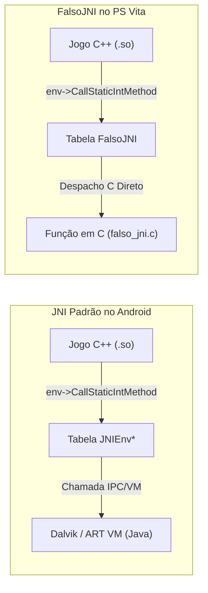

# 05. FalsoJNI & Ponte Java

No Android, jogos em C/C++ dependem constantemente da máquina virtual Java através do **JNI (Java Native Interface)** para consultar configurações de sistema, tocar vídeos, reproduzir sons e gerenciar arquivos.

Como o PlayStation Vita não possui uma máquina virtual Dalvik ou ART completa, utilizamos o **FalsoJNI**: uma implementação minimalista e ultrarrápida que simula o ambiente JNI em C puro.

---

## 🏛️ Despacho de Funções JNI

Quando o código do jogo em C++ executa chamadas JNI, ele utiliza ponteiros dentro da tabela `JNIEnv*`:



### A Tabela Simulada
O `FalsoJNI` expõe a estrutura canônica de interfaces nativas do JNI:

```c
static const struct JNINativeInterface fake_jni_native_interface = {
    .GetVersion = &fake_GetVersion,
    .FindClass = &fake_FindClass,
    .GetMethodID = &fake_GetMethodID,
    .GetStaticMethodID = &fake_GetStaticMethodID,
    .CallVoidMethod = &fake_CallVoidMethod,
    .CallStaticVoidMethod = &fake_CallStaticVoidMethod,
    .CallStaticIntMethod = &fake_CallStaticIntMethod,
    .CallStaticBooleanMethod = &fake_CallStaticBooleanMethod,
    .CallStaticObjectMethod = &fake_CallStaticObjectMethod,
    .NewStringUTF = &fake_NewStringUTF,
    .GetStringUTFChars = &fake_GetStringUTFChars,
    .ReleaseStringUTFChars = &fake_ReleaseStringUTFChars,
};

const struct JNINativeInterface *fake_env = &fake_jni_native_interface;
JNIEnv *env = (JNIEnv *)&fake_env;
```

---

## 🔡 Assinaturas de Tipos JNI (Type Signatures)

Ao registrar ou consultar métodos via `GetMethodID(env, clazz, "nomeMetodo", "(assinatura)retorno")`:

| Caractere | Tipo Java | Tipo C / C++ |
|---|---|---|
| `Z` | `boolean` | `jboolean` (uint8_t: 0 ou 1) |
| `B` | `byte` | `jbyte` (int8_t) |
| `C` | `char` | `jchar` (uint16_t UTF-16) |
| `S` | `short` | `jshort` (int16_t) |
| `I` | `int` | `jint` (int32_t) |
| `J` | `long` | `jlong` (int64_t) |
| `F` | `float` | `jfloat` (float) |
| `D` | `double` | `jdouble` (double) |
| `V` | `void` | `void` |
| `Ljava/lang/String;` | `String` (Objeto) | `jstring` (ponteiro) |
| `[I` | Array de inteiros (`int[]`) | `jintArray` |
| `[B` | Array de bytes (`byte[]`) | `jbyteArray` |

---

## 🪤 A Armadilha dos Stubs: No-Ops vs Stubs Ativos

Um erro frequente é criar stubs vazios (*no-ops*) que retornam 0 ou NULL cegamente.

### O Travamento da Tela Preta por Vídeos
Se o motor do jogo executa a seguinte lógica ao iniciar:
```java
public static void playIntroVideo() {
    VideoPlayer.play("intro.mp4", new OnVideoCompletionListener() {
        public void onCompletion() {
            nativeOnVideoCompleted(); // Notifica o motor em C++
        }
    });
}
```

Se você implementar `playIntroVideo` como um stub vazio:
```c
// ❌ INCORRETO (Trava o jogo em tela preta para sempre):
void fake_playIntroVideo(void) {
    return;
}
```

O motor em C++ entra em um estado de espera (`WAITING_FOR_COMPLETION`). Como o stub nada faz, o callback `nativeOnVideoCompleted()` nunca é disparado.
**Resultado:** O jogo congela em tela preta sem consumir CPU.

### ✅ A Solução: Stubs Ativos
O stub ativo dispara imediatamente o callback que o jogo aguarda:

```c
// ✔️ CORRETO (Avança o ciclo do jogo):
void fake_playIntroVideo(void) {
    sceClibPrintf("[FalsoJNI] playIntroVideo -> Disparando callback de conclusão imediato\n");
    if (nativeOnVideoCompleted_ptr) {
        nativeOnVideoCompleted_ptr(fake_env, NULL);
    }
}
```

---

## 🔤 Manipulação de Strings e Gerenciamento de Memória

Ao fornecer strings para o motor via `GetStringUTFChars`, libere a memória corretamente:

```c
const char *fake_GetStringUTFChars(JNIEnv *env, jstring str, jboolean *isCopy) {
    if (!str) return NULL;
    if (isCopy) *isCopy = JNI_TRUE;
    return strdup((const char *)str);
}

void fake_ReleaseStringUTFChars(JNIEnv *env, jstring str, const char *chars) {
    if (chars) {
        free((void *)chars); // Liberação obrigatória contra vazamentos de heap
    }
}
```
