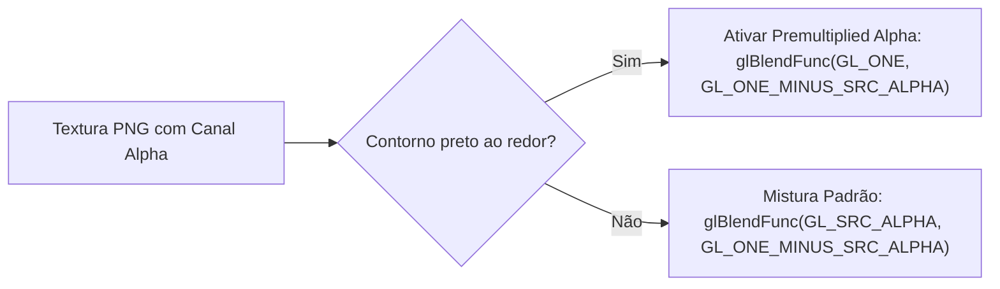

<div class="lang-switch-bar">
  <span>🌐 Language / Idioma:</span>
  <a href="../../06-vitagl-graphics-pipeline/" class="lang-switch-link">🇬🇧 English</a>
  <a href="../../es/06-pipeline-grafico-vitagl/" class="lang-switch-link">🇪🇸 Español</a>
  <a href="./" class="lang-switch-link active">🇧🇷 Português</a>
</div>

<div class="chapter-hero">
  <span class="chapter-badge">Capítulo 06 • Gráficos vitaGL</span>
  <h1 style="margin: 0.4rem 0 0.6rem 0; font-size: 2rem;">Pipeline Gráfico com vitaGL</h1>
  <p style="margin: 0; opacity: 0.9; font-size: 1.05rem;">
    Tradução de chamadas OpenGL ES 1.1 / 2.0 para comandos nativos SCE GXM na GPU PowerVR SGX543, compilação de shaders GLSL para Cg/GXP e gestão de CDRAM.
  </p>
  <div class="chapter-meta">
    <span class="chapter-meta-pill">⚡ Nível: Avançado</span>
    <span class="chapter-meta-pill">🎨 Pipeline: OpenGL ES, SCE GXM, Shaders Cg/GXP</span>
    <span class="chapter-meta-pill">🎮 Verificado: Hero of Sparta, Zenonia 3, Badland 2</span>
  </div>
</div>

---

O PlayStation Vita possui uma GPU PowerVR SGX543MP4+, mas a API proprietária exposta pelo sistema operacional é a **SCE GXM**. Reescrever o renderizador de um jogo Android em GXM puro exigiria meses de trabalho de baixo nível.

Para contornar isso, a comunidade utiliza o **[vitaGL](https://github.com/Rinnegatamante/vitaGL)**, desenvolvido por Rinnegatamante: uma biblioteca de alto desempenho que traduz comandos de **OpenGL ES 1.1 e 2.0** diretamente em chamadas de hardware GXM com overhead mínimo.

---

## 🚀 Inicialização e Ciclo de Renderização

Em `main.c`, inicialize o vitaGL antes de chamar as funções gráficas nativas:

```c
#include <vitaGL.h>

void init_graphics(void) {
    // vglInitExtended(flags, width, height, ram_buffer_size, msaa_mode)
    // 6 MB de buffer para comandos de vértices
    vglInitExtended(0, 960, 544, 6 * 1024 * 1024, SCE_GXM_MULTISAMPLE_NONE);
    
    // Ativa VBlank para 60 FPS estáveis sem tearing
    vglWaitVblankStart(GL_TRUE);
}

void game_loop_frame(void) {
    // 1. Invoca a rotina nativa de renderização
    nativeRender_func();
    
    // 2. Troca os buffers de tela
    vglSwapBuffers(GL_FALSE);
}
```

---

## 🎨 Comparativo de Backends Gráficos no Vita

| Backend | Vantagens | Desvantagens | Quando Utilizar |
|---|---|---|---|
| **vitaGL (Recomendado)** | Código aberto, suporte GLES 1.1/2.0 maduro, compilador GLSL em tempo de execução, otimizado para CDRAM. | Variações mínimas de precisão em shaders extremamente incomuns. | **Padrão absoluto** em 98% dos ports. |
| **PVR_PSP2** | Driver oficial PowerVR vazado do SDK da Sony. Conformidade estrita a GLES 2.0. | Código fechado, questões de redistribuição, integração rígida. | Casos raros em que um shader falha sob o vitaGL. |
| **SCE GXM Puro** | Máximo controle do hardware, ring buffers manuais. | Complexidade extrema: sem GLSL, sincronização manual de primitivas. | Motores construídos especificamente para o Vita. |

---

## 🪄 Shaders: De GLSL para Cg / GXP

A GPU do Vita exige binários compilados no formato **GXP** da Sony.

### Tradução em Tempo de Execução vs Offline
O vitaGL traduz código GLSL em tempo de execução automaticamente. Para shaders complexos ou para eliminar micro-travamentos (*stutters*), utiliza-se a transpilação offline com o `psvita-toolkit`:

```bash
psvita-toolkit shader-transpile --dump-dir assets/glsl --out-dir assets/cg
```
Esse processo converte GLSL para SPIR-V com `glslangValidator`, em seguida para Cg com `spirv-cross`, e gera binários `.gxp` com o `psp2cgc`.

---

## ⚠️ Armadilhas Gráficas Comuns e Soluções

### 1. Renderização Invertida em FBOs (Y-Flipping)
No OpenGL padrão, a origem `(0,0)` fica no canto **inferior esquerdo**. No GXM e em muitos FBOs móveis, fica no canto **superior esquerdo**. Se texturas renderizadas aparecerem de cabeça para baixo:

```c
glViewport(0, 0, 960, 544);
```

### 2. Halo Escuro em Bordas Transparentes (Alpha Pré-multiplicado)
Se textos ou sprites exibirem contornos pretos em fundos transparentes:
- Substitua: `glBlendFunc(GL_SRC_ALPHA, GL_ONE_MINUS_SRC_ALPHA);`
- Por: `glBlendFunc(GL_ONE, GL_ONE_MINUS_SRC_ALPHA);`



### 3. Exaustão da CDRAM (112 MiB de VRAM)
O vitaGL aloca texturas na memória CDRAM por padrão. Se o jogo carregar texturas em excesso, o limite de 112 MiB será ultrapassado.
- Redirecione texturas secundárias para a RAM principal ou redimensione imagens acima de 1024x1024.
