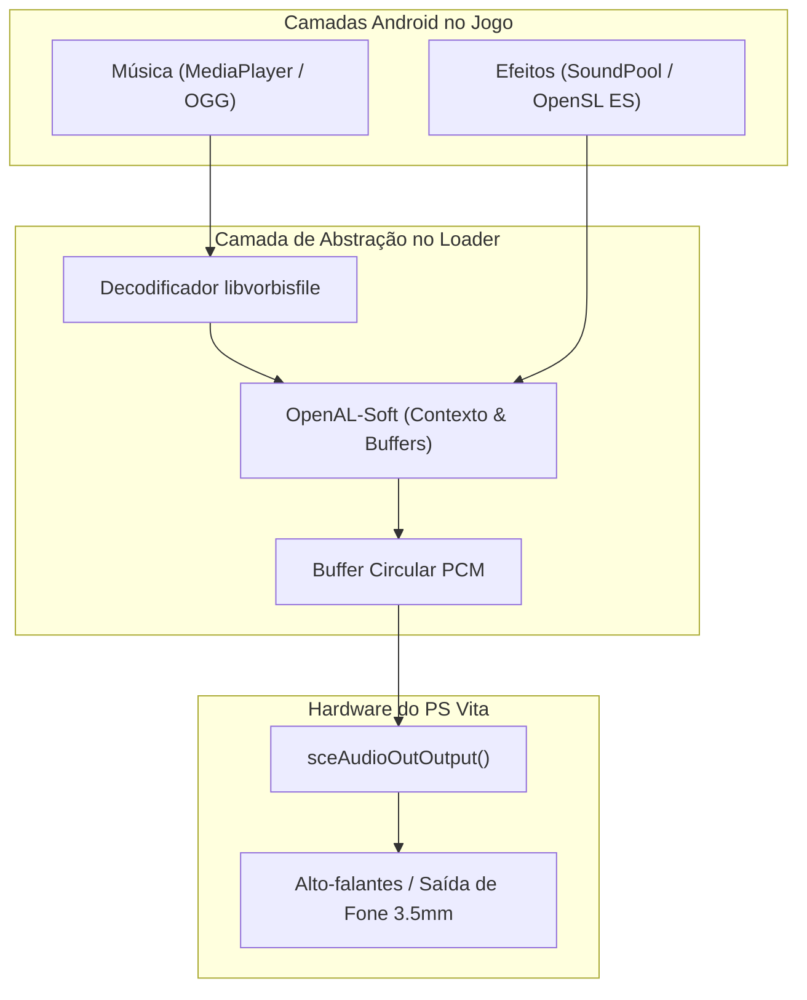

<div class="lang-switch-bar">
  <span>🌐 Language / Idioma:</span>
  <a href="../../07-audio-subsystem/" class="lang-switch-link">🇬🇧 English</a>
  <a href="../../es/07-subsistema-de-audio/" class="lang-switch-link">🇪🇸 Español</a>
  <a href="./" class="lang-switch-link active">🇧🇷 Português</a>
</div>

<div class="chapter-hero">
  <span class="chapter-badge">Capítulo 07 • Subsistema de Áudio</span>
  <h1 style="margin: 0.4rem 0 0.6rem 0; font-size: 2rem;">Subsistema de Áudio e Streaming</h1>
  <p style="margin: 0; opacity: 0.9; font-size: 1.05rem;">
    Ponte entre APIs de áudio do Android (OpenSL ES, SoundPool, MediaPlayer) e o hardware do PS Vita usando sceAudioOut, OpenAL-Soft e decodificação OGG Vorbis.
  </p>
  <div class="chapter-meta">
    <span class="chapter-meta-pill">⚡ Nível: Intermediário</span>
    <span class="chapter-meta-pill">🔊 Backends: sceAudioOut, OpenAL-Soft, libvorbisfile</span>
    <span class="chapter-meta-pill">🎮 Verificado: Hero of Sparta, Zenonia 3, Badland 2</span>
  </div>
</div>

---

Em jogos Android, o áudio geralmente é reproduzido por três vias:
1. **OpenSL ES:** API nativa em C para áudio de baixa latência.
2. **AudioTrack / SoundPool (Java):** Classes do Android SDK para efeitos sonoros curtos em memória.
3. **MediaPlayer (Java):** Classe para streaming de músicas comprimidas (OGG, MP3).

No PlayStation Vita, todo o áudio é direcionado para o kernel através da API **`sceAudioOut`** ou via bibliotecas de alto nível como o **OpenAL-Soft**.

---

## 🔊 Arquitetura do Subsistema de Áudio



### 1. Saída PCM Direta com `sceAudioOut`
O VitaOS gerencia portas de áudio PCM de 16 bits estéreo:

```c
#include <psp2/audioout.h>

static int audio_port = -1;

void init_audio_hardware(void) {
    audio_port = sceAudioOutOpenPort(
        SCE_AUDIO_OUT_PORT_TYPE_BGM,
        1024,
        44100,
        SCE_AUDIO_OUT_MODE_STEREO
    );
    
    int vol[2] = { 32768, 32768 }; // 100% de volume
    sceAudioOutSetVolume(audio_port, SCE_AUDIO_VOLUME_FLAG_L_CH | SCE_AUDIO_VOLUME_FLAG_R_CH, vol);
}

void output_pcm_block(const int16_t *samples) {
    sceAudioOutOutput(audio_port, samples);
}
```

---

## 📻 Streaming de Música em OGG Vorbis

Vincule a `libvorbisfile` para decodificar faixas de áudio comprimidas:

```c
#include <vorbis/vorbisfile.h>

typedef struct {
    OggVorbis_File vf;
    FILE *f;
    int is_playing;
    int loop;
} BGMStream;

BGMStream bgm;

void bgm_play(const char *filepath, int loop) {
    bgm.f = fopen(filepath, "rb");
    if (!bgm.f) return;
    
    if (ov_open_callbacks(bgm.f, &bgm.vf, NULL, 0, OV_CALLBACKS_DEFAULT) < 0) {
        fclose(bgm.f);
        return;
    }
    
    bgm.loop = loop;
    bgm.is_playing = 1;
}

int audio_thread(SceSize args, void *argp) {
    int16_t pcm_buffer[2048];
    int bitstream;
    
    while (1) {
        if (bgm.is_playing) {
            long bytes = ov_read(&bgm.vf, (char *)pcm_buffer, sizeof(pcm_buffer), 0, 2, 1, &bitstream);
            if (bytes > 0) {
                sceAudioOutOutput(audio_port, pcm_buffer);
            } else if (bytes == 0 && bgm.loop) {
                ov_time_seek(&bgm.vf, 0); // Repetir
            }
        } else {
            sceKernelDelayThread(10000);
        }
    }
    return 0;
}
```

---

## 🧩 Emulação de SoundPool no FalsoJNI

Quando o jogo dispara efeitos sonoros via `SoundPool.play(...)`:

```c
jint fake_SoundPool_play(JNIEnv *env, jobject obj, jint soundID, jfloat leftVolume, jfloat rightVolume, jint priority, jint loop, jfloat rate) {
    play_openal_sound_effect(soundID, leftVolume, loop);
    return soundID; // Retorne um stream ID válido (> 0) indicando sucesso
}
```

> [!TIP]
> Se o método `SoundPool.play` retornar `0`, o jogo pode interpretar como falha de canais do hardware e tentar recarregar o som a cada frame, causando congelamentos severos.
